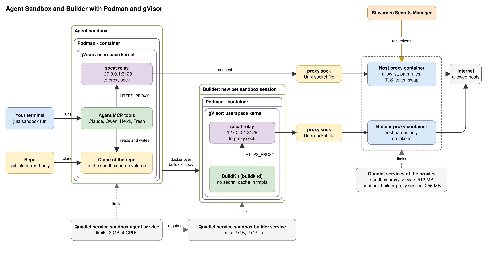

# Agent Sandbox

A sandbox for AI agents. It runs Claude Code, Qwen Code and the Fresh editor in a hardened Docker container with gVisor. A second container, the builder, builds images for the agent. The devcontainer CLI starts both, with their proxies, from `compose.yaml`.

## The problem

You let a coding agent work on your repository. The agent has three abilities. They are dangerous together:

- **Untrusted content.** The agent reads text that you did not write: web pages, issues, packages and code.
- **Private data.** The agent reaches your repository, your files and your tokens.
- **Outside communication.** The agent can send data to an outside host with a `git push`, an API call or a web request.

A prompt injection hides an instruction in the text that the agent reads. A fooled agent then runs commands with your rights. Simon Willison calls this combination the [lethal trifecta](https://simonwillison.net/2025/Jun/16/the-lethal-trifecta/). A filter that stops most attacks is not enough, because one missed attack is enough.

These attacks already happened:

| Date | Case | What limits it here | Source |
|---|---|---|---|
| 2025-05 | GitHub MCP. A poisoned issue in a public repo made an agent leak private repo data into a public pull request. | The scope of the token. The proxy cannot see the repository of an MCP call. | [Invariant Labs](https://invariantlabs.ai/blog/mcp-github-vulnerability), [GitHub issue](https://github.com/github/github-mcp-server/issues/844) |
| 2025-07 | Amazon Q Developer 1.84.0 carried malicious code (CVE-2025-8217). Reports say it told the agent to delete local files and AWS resources. A syntax error stopped it. | A private clone. No real AWS credentials. | [Advisory](https://github.com/aws/aws-toolkit-vscode/security/advisories/GHSA-7g7f-ff96-5gcw) |
| 2025-08 | Nx `s1ngularity`. A malicious npm package prompted the AI tools on the machine to search for secrets. It sent them to a new repo in the account of the victim. | Placeholders instead of tokens. The proxy gives a `403` to a request that creates a repo. The builder has no token. | [Advisory](https://github.com/nrwl/nx/security/advisories/GHSA-cxm3-wv7p-598c) |
| 2026-04 | Mini Shai-Hulud. A malicious npm package stole tokens and `~/.claude.json`. It planted a Claude Code hook that runs again when someone opens the repo. | The builder has no token. The agent holds placeholders only. You read the agent config files in each diff. | [StepSecurity](https://www.stepsecurity.io/blog/a-mini-shai-hulud-has-appeared), [CISA](https://www.cisa.gov/news-events/alerts/2026/05/28/supply-chain-compromises-impact-nx-console-and-github-repositories) |

Checks inside the agent fail too. The Claude Code [security advisories](https://github.com/anthropics/claude-code/security/advisories) list three allowlist bugs that could leak data: CVE-2025-55284, CVE-2026-24052 and CVE-2026-54316. So this sandbox puts the gate in a separate container. The note [agent-sandbox-incidents](../docs/research/agent-sandbox-incidents.md) has the details and the sources.

## The solution

The sandbox keeps the agent useful and limits what a fooled agent can do. It has one step for each ability, and one for builds:

| Ability | What the sandbox does |
|---|---|
| Private data | The agent works in a private clone. It holds placeholders, not real tokens. The real tokens stay in the agent proxy. |
| Untrusted content | The sandbox cannot stop it, because the agent must read. The other two steps limit the damage. |
| Outside communication | The agent is on an internal Docker network with no route out. The only address that it can reach is the agent proxy. The proxy allows listed hosts, methods and paths only. |
| Builds | A second container, the builder, runs the build steps. It has no token, and it is on its own internal network. It uses its own proxy, the builder proxy. |

The [sandbox of Claude Code](https://www.anthropic.com/engineering/claude-code-sandboxing) uses the same idea: a proxy outside the sandbox is the only way out, and it enforces approved domains.

### How to design an agent sandbox

An agent sandbox has six concepts. Use the diagram as a checklist when you build a sandbox.


This sandbox applies each concept as follows:

| Concept | This sandbox |
|---|---|
| 1 The wall | A Docker container on gVisor, a user-space kernel. The root file system is read-only. The container has no capabilities. |
| 2 Workspace | A private clone of the repo. The `.git` folder of your checkout is a read-only mount. |
| 3 Network gate | An internal Docker network leads only to the agent proxy. The proxy allows listed hosts, methods and paths. |
| 4 Key holder | Bitwarden Secrets Manager, outside the host, holds the real tokens. `init.sh` fetches them into `$XDG_RUNTIME_DIR/sandbox-secrets`, a tmpfs, and the agent proxy swaps a placeholder for the real token. |
| 5 Saved state | The volume `sandbox-home` keeps the clone, the logins and the histories. Herdr restores the panes. |
| 6 You | You approve tool calls in Claude Code and follow the panes in Herdr and the audit log. `docker compose -p sandbox stop` stops the sandbox. Each task has its own worktree and branch. |

## What is out of scope

The sandbox limits what a fooled agent can do. Other layers handle the rest. These risks are out of scope:

| Risk | Who handles it |
|---|---|
| A prompt injection changes what the agent tries to do | The model and the client. The sandbox limits only the damage. |
| A tool of the MCP server writes outside this repository | The central MCP gateway. The proxy does not read MCP calls. |
| A write goes to `main` | Branch protection on GitHub. A rule in the proxy cannot see the branch. |
| A token has more scope than the agent needs | The scope of the token. Use a fine-grained token for one repository. |
| A pushed branch holds bad code | You. Read the diff before you merge or check it out. Read the agent config files too: `.claude/` and `.vscode/tasks.json`. |
| Data leaves through a listed host | The allowlists. Keep them short. |

The sandbox has two limits of its own:

- The proxy reads every request of the agent. A bug in the proxy can expose the real tokens.
- gVisor is not a microVM. A bug in gVisor can give an attacker your host user.

## How it works

[](docs/diagrams/architecture.svg)

The numbers follow one session:

1. `init.sh` fetches the API tokens from Bitwarden.
2. `init.sh` writes a new CA and the tokens into `$XDG_RUNTIME_DIR/sandbox-secrets`.
3. The proxy reads the CA and the tokens at `/run/secrets`. The agent reads only `ca.crt`.
4. `lifecycle/on-create.sh` clones the repo into the volume `sandbox-home`.
5. You open Herdr in the agent with `devcontainer exec`.
6. A tool sends each request to the proxy through `HTTPS_PROXY`.
7. The proxy checks the request, swaps the placeholder for the token, and sends the request out on the network `default`.
8. `docker build` sends the build to BuildKit through `buildkitd.sock`.
9. BuildKit fetches images and packages through the builder proxy.

gVisor, a userspace kernel, runs the agent sandbox and the builder. The proxies run on runc. The allowed hosts are in `policy/agent.yaml` and `policy/builder.yaml`.

More detail:

- [Networking](docs/networking.md): the three networks, the addresses and the blocked routes.
- [Flows](docs/flows.md): the start, the image update, each request and each build.
- [Security controls](docs/security-controls.md): the controls of each container.

### Files

A file in `agent/` goes into the agent image. Every other file stays in your checkout: it runs on your host, or a container mounts it read-only.

```text
.devcontainer/
├── devcontainer.json    # run config: compose.yaml, the agent service, init.sh first, the lifecycle hooks
├── init.sh              # host: a new CA and the API tokens in a tmpfs, for a new proxy
├── compose.yaml         # the four containers, the networks, the limits and the mounts
├── policy/
│   ├── agent.yaml       # agent proxy: allowlist, path rules, token swap
│   └── builder.yaml     # builder proxy: host names only
├── lifecycle/           # on-create.sh and post-start.sh, a read-only mount in the agent
├── configs/             # tool and agent settings, a read-only mount in the agent
└── agent/               # the agent image. Its git tree sha is the image tag.
    ├── devcontainer.json    # build config: Dockerfile and layer cache
    ├── Dockerfile
    └── tools/*.toml         # the tools that mise installs
```

A change outside `agent/` needs a restart of the sandbox. A change in `agent/` needs a new image, a push and a new pin in `compose.yaml`. See [Update the agent image](#update-the-agent-image).

There are two `devcontainer.json` files, because the devcontainer CLI refuses `--push` for a Compose config. The run config holds the lifecycle hooks. They run the scripts from the read-only mount of `lifecycle/`, so a change of a script needs no new image.

## Prerequisites

This is a personal setup.

What the setup assumes:

- The image registry is `ghcr.io`. The secret manager is Bitwarden Secrets Manager.
- The Bitwarden project holds `GH_TOKEN`, `CLAUDE_CODE_OAUTH_TOKEN`, `QWEN_API_KEY` and `GITHUB_TOKEN`. `GITHUB_TOKEN` has the scope `write:packages`.
- You have the access token of a machine account that can only read that project.
- The host is Arch Linux with a systemd user manager.
- The host has 6 GB of free memory: 3 GB for the agent sandbox, 2 GB for the builder and less than 1 GB for the two proxies.

For another registry or secret manager, change `policy/agent.yaml`, `init.sh` and the commands in [Update the agent image](#update-the-agent-image).

Do these steps once, in your main checkout.

1. **Docker Engine** with Compose and buildx: [install](https://docs.docker.com/engine/install/), then [the post-install steps for Linux](https://docs.docker.com/engine/install/linux-postinstall/).
2. **mise**: [getting started](https://mise.jdx.dev/getting-started.html). Then run `mise install` in the repo.
3. **acl and openssl**: the Arch packages `acl` and `openssl`.
4. **gVisor runtimes**:

   ```shell
   g=$(mise where http:gvisor)
   sudo install -m 0755 "$g/runsc" /usr/local/bin/runsc
   sudo install -D -m 0755 -t /usr/local/bin/gvisor-bin "$g"/gvisor-bin/*
   # gVisor blocks host Unix sockets by default. Each runtime allows one thing.
   # The agent: it can connect to a socket on the host, the BuildKit socket.
   sudo runsc install --runtime=runsc-uds -- --host-uds=open
   # The builder: it can create a socket on the host, buildkitd.sock in the volume buildkit-sock.
   sudo runsc install --runtime=runsc-builder -- --host-uds=create
   sudo systemctl restart docker
   ```

5. **Bitwarden token**, encrypted with systemd-creds:

   ```shell
   f=~/.config/credstore.encrypted/bws-token && mkdir -p "${f%/*}"
   read -rsp 'Bitwarden access token> ' t && echo && printf %s "$t" | systemd-creds --user encrypt --name=bws-token - "$f" && unset t
   chmod 0400 "$f"
   ```

6. **ghcr.io login**, with a GitHub token that has `read:packages` and `write:packages`:

   ```shell
   docker login ghcr.io -u <github-user>
   ```

## Quick start

Run these commands in your main checkout. `init.sh` runs first: it gives a new proxy a new CA and its tokens.

```shell
devcontainer up --workspace-folder .                # pull the agent image if needed, then start the four services
devcontainer exec --workspace-folder . herdr        # open Herdr, a terminal workspace manager
```

`docker compose -p sandbox ps` then shows four services: `builder-proxy`, `builder`, `proxy` and `agent`.

## Update the agent image

1. Go to the root of your main checkout, and set the tag and the image name:

   ```shell
   cd "$(git rev-parse --show-toplevel)"
   # The tag is the git tree sha of agent/. Commit your change of agent/ first.
   tag=$(git rev-parse HEAD:.devcontainer/agent)
   img=ghcr.io/raghav19/engineersdaybook/sandbox-dev
   ```

2. Build the image, then push it and its layer cache:

   ```shell
   devcontainer build \
     --workspace-folder . \
     --config .devcontainer/agent/devcontainer.json \
     --image-name "$img:$tag" \
     --push \
     --cache-to "type=registry,ref=$img:cache,mode=max"
   ```

   To test the image before the push, leave out `--push` and `--cache-to`.

3. Pin the digest in `compose.yaml`, then review and commit the change:

   ```shell
   docker buildx imagetools inspect "$img:$tag" --format '{{.Name}}@{{.Manifest.Digest}}' \
     | yq -i '.services.agent.image = (load_str("/dev/stdin") | trim)' .devcontainer/compose.yaml \
     && git diff .devcontainer/compose.yaml
   ```

4. Apply it:

   ```shell
   docker compose -p sandbox down
   devcontainer up --workspace-folder .
   ```

## Plugins

Herdr loads two plugins. `agent/Dockerfile` pins each one to a commit. Neither plugin makes a network call.

| Plugin | What it does | How to use it |
|---|---|---|
| Token usage (`pseudovar.token-usage`) | Shows the tokens and the cost of each agent pane in the Herdr sidebar. It reads the logs of Claude Code. The cost is an estimate from list prices. | Press `prefix+u` for the dashboard. Run `tu report --month` for a table in the terminal. |
| Review (`persiyanov.reviewr`) | Shows the diff of the agent in a pane beside it. You comment on lines, and the agent gets your comments. | Press `prefix+d` to open or close the pane. A new worktree opens it too. Select lines with `v`, write a comment with `c`, and send all comments with `s`. Press `?` for all keys. |

The review pane keeps your comments only while it is open. Its PR tab needs `gh`, and the image has no `gh`.

## Troubleshooting

| Symptom | Fix |
|---|---|
| `devcontainer up` stops at the start | Run `docker compose -p sandbox ps -a` and `docker compose -p sandbox logs proxy builder-proxy builder`. If the agent image is missing, see [Update the agent image](#update-the-agent-image). |
| `unknown or invalid runtime name: runsc-uds` | Docker has no gVisor runtime of that name. Do [step 4](#prerequisites) again. |
| `bind source path does not exist: .../sandbox-secrets` | `init.sh` did not run. Start the sandbox with `devcontainer up`, not with `docker compose up`. |
| `Failed to read encrypted credential data: No such file or directory` | The file `~/.config/credstore.encrypted/bws-token` is missing or unreadable. Do [step 5](#prerequisites) again. |
| `Failed to read encrypted credential data: Invalid argument` | `bws-token` holds the plain token. Remove it, then do [step 5](#prerequisites) again. |
| `init.sh` says `bws cannot read the secrets` | The access token is wrong or expired. Remove `~/.config/credstore.encrypted/bws-token`, then do [step 5](#prerequisites) again. |
| `init.sh` says `Bitwarden has no secret <name>` | The Bitwarden project has no secret of that name. Add it, or change the names in `init.sh` and `policy/agent.yaml`. |
| `docker compose -p sandbox ps` shows `unhealthy` | Run `docker logs sandbox-agent-1` or `docker logs sandbox-builder-1`. The agent is healthy only after `lifecycle/post-start.sh` writes `/tmp/sandbox-ready`. |
| `docker build` says `failed to connect to the docker API` | Check that `docker compose -p sandbox ps builder` shows `healthy`. `BUILDX_BUILDER` comes from `compose.yaml`, and `lifecycle/on-create.sh` defines that builder. |
| A `FROM` or a `RUN` step gets `403` | The host is not in `policy/builder.yaml`. Add it, then run `docker compose -p sandbox down && devcontainer up --workspace-folder .`. The proxy reads its policy at start. |
| `crane push` gets `403` | The namespace is not `raghav19`. Push to `ghcr.io/raghav19/<NAME>:<TAG>`. |
| A GitHub call gets `403` | The agent proxy allows a push to `raghav19/engineersdaybook` and a REST write on its issues and pull requests. It denies a merge, a file write, a removal and GraphQL. To change this, edit `policy/agent.yaml`, then run `docker compose -p sandbox down && devcontainer up --workspace-folder .`. |
| `docker compose -p sandbox ps -a` shows the agent as `exited` | Read `docker logs sandbox-agent-1`. A limit can stop the container. Run `devcontainer up --workspace-folder .` again. The clone stays in the volume `sandbox-home`. |
| The builder shows `exited (1)` after `docker compose -p sandbox stop` | This is normal. `buildkitd` exits with code 1 when it stops. |
| A tool fails with `network unreachable` | The tool ignores `HTTPS_PROXY`. Set the proxy of the tool to `http://10.200.0.2:18080`. |
| HTTPS calls in the agent fail with a certificate error | The agent proxy has a new CA, and the running agent still trusts the old one. Run `docker compose -p sandbox down && devcontainer up --workspace-folder .`. |

## Commands

| Command | What it does |
|---|---|
| `devcontainer up --workspace-folder .` | Starts the sandbox. On stopped containers, it starts them as they were. |
| `devcontainer exec --workspace-folder . <command>` | Runs your command in the agent sandbox. |
| `docker compose -p sandbox stop` | Stops the four containers. `devcontainer up` starts them again, and `init.sh` gives the proxy a new CA and its tokens. |
| `docker compose -p sandbox down` | Removes the four containers and the networks. The volume `sandbox-home` stays. Never add `-v`: it removes the clone and the logins. |
| `docker compose -p sandbox down && devcontainer up --workspace-folder .` | Applies an edit of `compose.yaml`, `devcontainer.json` or a policy. `devcontainer up` alone keeps the old containers. |
| `docker compose -p sandbox ps` | Shows `(starting)`, `(healthy)` or `(unhealthy)`. |
| `docker logs -f sandbox-proxy-1` | Follows the audit log of the proxy: one JSON line for each request. |
| `docker logs -f sandbox-builder-proxy-1` | Follows the log of the builder proxy. |

## References

- Anthropic: [Beyond permission prompts: making Claude Code more secure and autonomous](https://www.anthropic.com/engineering/claude-code-sandboxing) (2025-10-20)
- Claude Code docs: [Sandboxing](https://code.claude.com/docs/en/sandboxing) and [Security](https://code.claude.com/docs/en/security)
- Simon Willison: [The lethal trifecta for AI agents](https://simonwillison.net/2025/Jun/16/the-lethal-trifecta/) (2025-06-16)
- Simon Willison: [Agents Rule of Two and The Attacker Moves Second](https://simonwillison.net/2025/Nov/2/new-prompt-injection-papers/) (2025-11-02)
- Nasr, Carlini, Tramèr and others: [The Attacker Moves Second](https://arxiv.org/abs/2510.09023) (2025-10-10)
- OWASP: [Top 10 for Agentic Applications](https://genai.owasp.org/2025/12/09/owasp-top-10-for-agentic-applications-the-benchmark-for-agentic-security-in-the-age-of-autonomous-ai/) (2025-12-09)
- NIST: [AI Agent Standards Initiative](https://www.nist.gov/news-events/news/2026/02/announcing-ai-agent-standards-initiative-interoperable-and-secure) (2026-02-17)
- Vendor sandboxes: [Codex](https://developers.openai.com/codex/agent-approvals-security), [GitHub Copilot firewall](https://docs.github.com/en/copilot/how-tos/use-copilot-agents/coding-agent/customize-the-agent-firewall), [Gemini CLI](https://github.com/google-gemini/gemini-cli/blob/main/docs/cli/sandbox.md) and [Docker Sandboxes](https://docs.docker.com/ai/sandboxes/security/)
- Claude Code [security advisories](https://github.com/anthropics/claude-code/security/advisories)
- Research note: [agent-sandbox-incidents](../docs/research/agent-sandbox-incidents.md)
