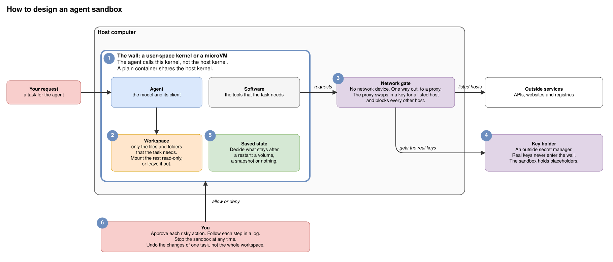
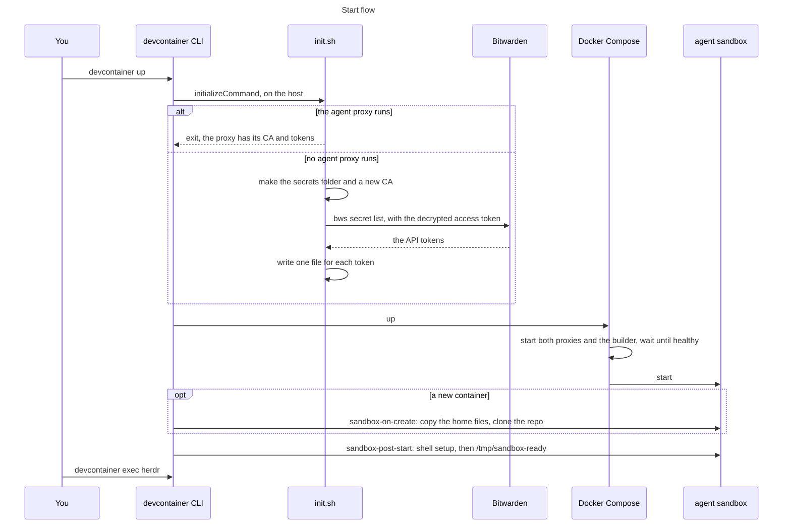
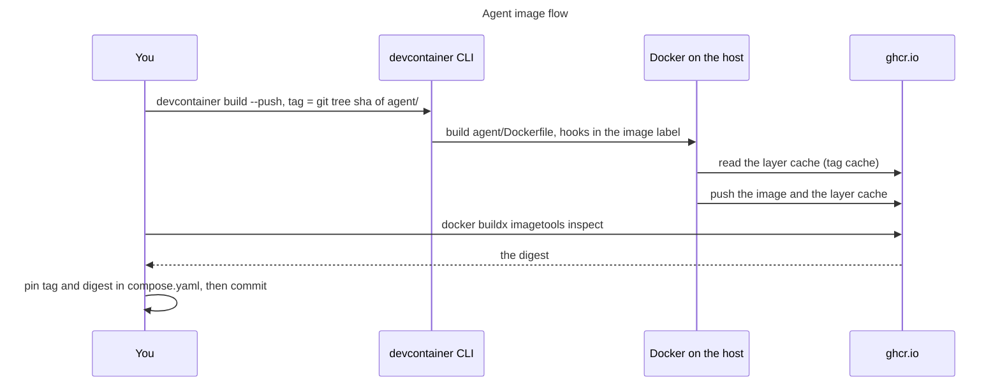
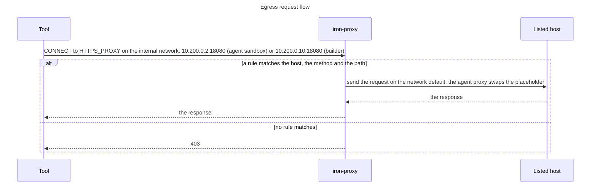
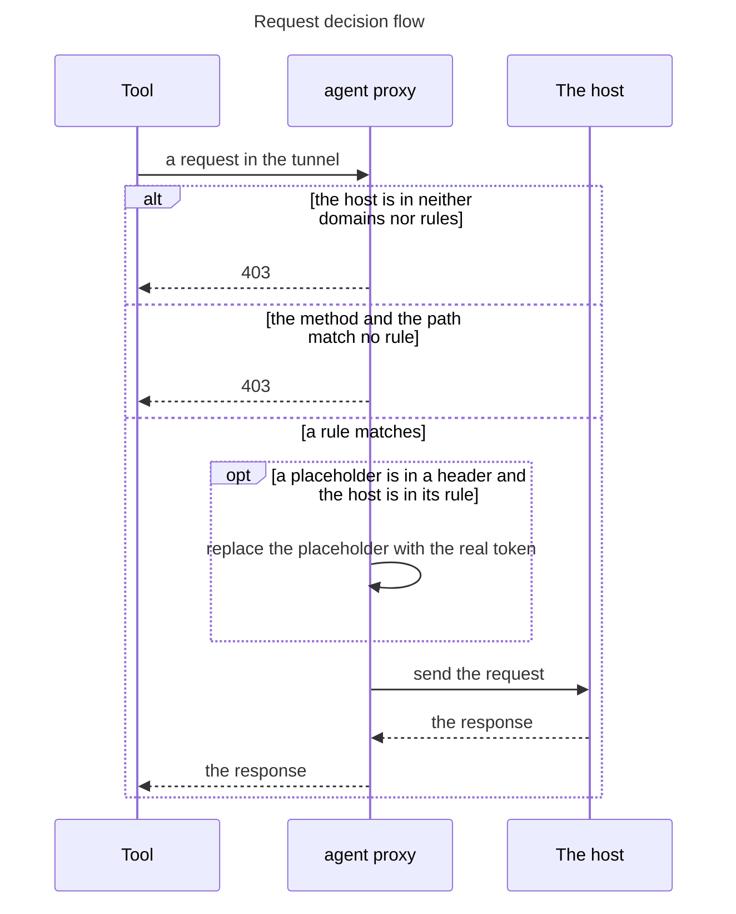
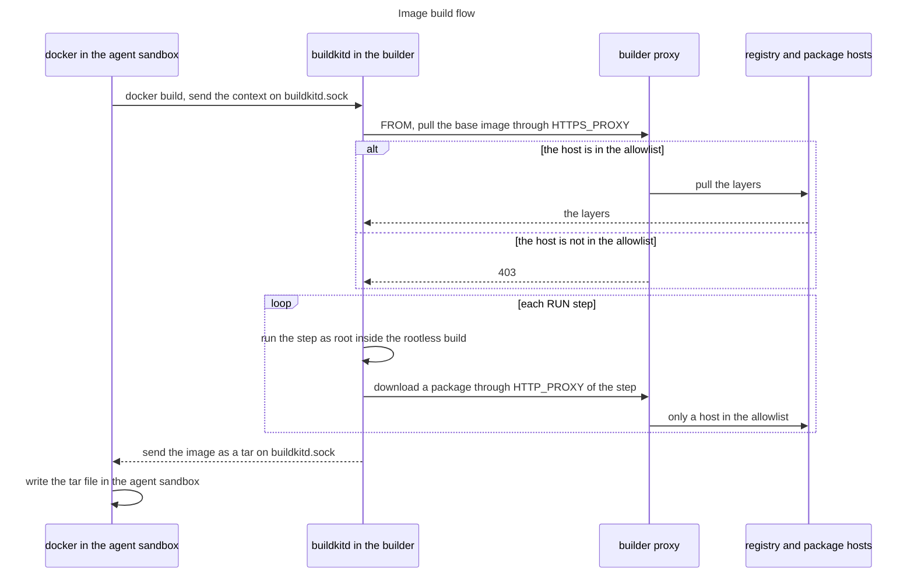
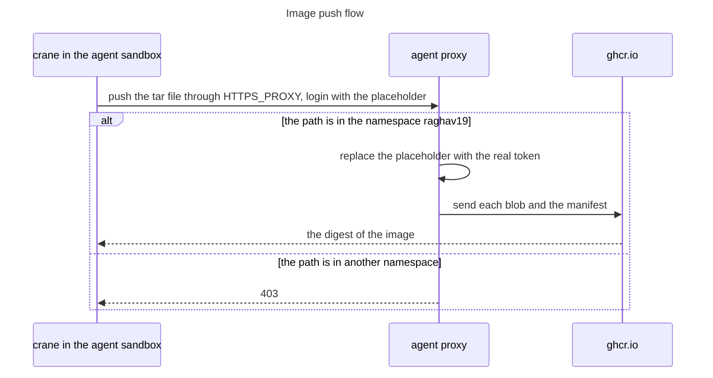

# Agent Sandbox

A sandbox for AI agents. It runs Claude Code, Qwen Code and the Fresh editor in a hardened Docker container with gVisor. A second container, the builder, builds images for the agent. The devcontainer CLI starts both, with their proxies, from `compose.yaml`.

## The problem

You let a coding agent work on your repository. The agent has three abilities. They are dangerous together:

- **Untrusted content.** The agent reads text that you did not write: web pages, issues, packages and code.
- **Private data.** The agent reaches your repository, your files and your tokens.
- **Outside communication.** The agent can send data to an outside host with a `git push`, an API call or a web request.

A prompt injection hides an instruction in the text that the agent reads. A fooled agent then runs commands with your rights. Simon Willison calls this combination the [lethal trifecta](https://simonwillison.net/2025/Jun/16/the-lethal-trifecta/). A filter that stops most attacks is not enough, because one missed attack is enough.

These attacks already happened:

| Date | Case | What limits it here | Source |
|---|---|---|---|
| 2025-05 | GitHub MCP. A poisoned issue in a public repo made an agent leak private repo data into a public pull request. | The scope of the token. The proxy cannot see the repository of an MCP call. | [Invariant Labs](https://invariantlabs.ai/blog/mcp-github-vulnerability), [GitHub issue](https://github.com/github/github-mcp-server/issues/844) |
| 2025-07 | Amazon Q Developer 1.84.0 carried malicious code (CVE-2025-8217). Reports say it told the agent to delete local files and AWS resources. A syntax error stopped it. | A private clone. No real AWS credentials. | [Advisory](https://github.com/aws/aws-toolkit-vscode/security/advisories/GHSA-7g7f-ff96-5gcw) |
| 2025-08 | Nx `s1ngularity`. A malicious npm package prompted the AI tools on the machine to search for secrets. It sent them to a new repo in the account of the victim. | Placeholders instead of tokens. The proxy gives a `403` to a request that creates a repo. The builder has no token. | [Advisory](https://github.com/nrwl/nx/security/advisories/GHSA-cxm3-wv7p-598c) |
| 2026-04 | Mini Shai-Hulud. A malicious npm package stole tokens and `~/.claude.json`. It planted a Claude Code hook that runs again when someone opens the repo. | The builder has no token. The agent holds placeholders only. You read the agent config files in each diff. | [StepSecurity](https://www.stepsecurity.io/blog/a-mini-shai-hulud-has-appeared), [CISA](https://www.cisa.gov/news-events/alerts/2026/05/28/supply-chain-compromises-impact-nx-console-and-github-repositories) |

Checks inside the agent fail too. The Claude Code [security advisories](https://github.com/anthropics/claude-code/security/advisories) list three allowlist bugs that could leak data: CVE-2025-55284, CVE-2026-24052 and CVE-2026-54316. So this sandbox puts the gate in a separate container. The note [agent-sandbox-incidents](../docs/research/agent-sandbox-incidents.md) has the details and the sources.

## The solution

The sandbox keeps the agent useful and limits what a fooled agent can do. It has one step for each ability, and one for builds:

| Ability | What the sandbox does |
|---|---|
| Private data | The agent works in a private clone. It holds placeholders, not real tokens. The real tokens stay in the agent proxy. |
| Untrusted content | The sandbox cannot stop it, because the agent must read. The other two steps limit the damage. |
| Outside communication | The agent is on an internal Docker network with no route out. The only address that it can reach is the agent proxy. The proxy allows listed hosts, methods and paths only. |
| Builds | A second container, the builder, runs the build steps. It has no token, and it is on its own internal network. It uses its own proxy, the builder proxy. |

The [sandbox of Claude Code](https://www.anthropic.com/engineering/claude-code-sandboxing) uses the same idea: a proxy outside the sandbox is the only way out, and it enforces approved domains.

### How to design an agent sandbox

An agent sandbox has six concepts. Use the diagram as a checklist when you build a sandbox.



This sandbox applies each concept as follows:

| Concept | This sandbox |
|---|---|
| 1 The wall | A Docker container on gVisor, a user-space kernel. The root file system is read-only. The container has no capabilities. |
| 2 Workspace | A private clone of the repo. The `.git` folder of your checkout is a read-only mount. |
| 3 Network gate | An internal Docker network leads only to the agent proxy. The proxy allows listed hosts, methods and paths. |
| 4 Key holder | The agent proxy swaps a placeholder for the real token. `init.sh` fetches the real tokens from Bitwarden into files in `$XDG_RUNTIME_DIR/sandbox-secrets`, a tmpfs. |
| 5 Saved state | The volume `sandbox-home` keeps the clone, the logins and the histories. Herdr restores the panes. |
| 6 You | You approve tool calls in Claude Code and follow the panes in Herdr and the audit log. `docker compose -p sandbox stop` stops the sandbox. Each task has its own worktree and branch. |

## What is out of scope

The sandbox limits what a fooled agent can do. Other layers handle the rest. These risks are out of scope:

| Risk | Who handles it |
|---|---|
| A prompt injection changes what the agent tries to do | The model and the client. The sandbox limits only the damage. |
| A tool of the MCP server writes outside this repository | The central MCP gateway. The proxy does not read MCP calls. |
| A write goes to `main` | Branch protection on GitHub. A rule in the proxy cannot see the branch. |
| A token has more scope than the agent needs | The scope of the token. Use a fine-grained token for one repository. |
| A pushed branch holds bad code | You. Read the diff before you merge or check it out. Read the agent config files too: `.claude/` and `.vscode/tasks.json`. |
| Data leaves through a listed host | The allowlists. Keep them short. |

The sandbox has two limits of its own:

- The proxy reads every request of the agent. A bug in the proxy can expose the real tokens.
- gVisor is not a microVM. A bug in gVisor can give an attacker your host user.

## How it works

[](docs/diagrams/architecture.svg)

`compose.yaml` starts four containers on two internal Docker networks:

- **Network `sandbox`** (10.200.0.0/29) holds the agent sandbox (10.200.0.3) and the agent proxy (10.200.0.2).
- **Network `build`** (10.200.0.8/29) holds the builder (10.200.0.11) and the builder proxy (10.200.0.10).
- **Network `default`** of Compose holds only the two proxies. It is their way to the Internet.

Each internal network is a /29, a block of 8 addresses. In each block, the gateway takes the first host address, the proxy the next one, and the container the one after it. So the builder at .11 has the same place in its block as the agent at .3. The two blocks do not overlap.

gVisor runs the agent sandbox and the builder. The proxies run on runc. The agent and the builder share no network. The agent reaches the builder only through `buildkitd.sock` in the volume `buildkit-sock`.

The allowed hosts are in `policy/agent.yaml` and `policy/builder.yaml`.

### Files

A file outside `agent/` runs on your host or goes into a proxy as a mount. A file in `agent/` goes into the agent image.

```text
.devcontainer/
├── devcontainer.json    # run config: compose.yaml, the agent service, init.sh first
├── init.sh              # host: a new CA and the API tokens in a tmpfs, for a new proxy
├── compose.yaml         # the four containers, the networks, the limits and the mounts
├── policy/
│   ├── agent.yaml       # agent proxy: allowlist, path rules, token swap
│   └── builder.yaml     # builder proxy: host names only
└── agent/               # the agent image. Its git tree sha is the image tag.
    ├── devcontainer.json    # build config: Dockerfile, layer cache, lifecycle hooks
    ├── Dockerfile
    ├── tools/*.toml         # the tools that mise installs
    ├── configs/             # files that the image copies
    └── lifecycle/           # on-create.sh and post-start.sh, run in the container
```

A change outside `agent/` needs a restart of the sandbox. A change in `agent/` needs a new image, a push and a new pin in `compose.yaml`. See [Update the agent image](#update-the-agent-image).

There are two `devcontainer.json` files, because the devcontainer CLI refuses `--push` for a Compose config. The run config has no lifecycle hooks. The CLI reads the hooks from the image label, and a hook in both files runs twice.

## Security controls


The diagram shows each control in the container that has it.

Notes on the controls:

- **Internal networks.** Both networks have `internal: true`, so they have no route to the Internet. `inhibit_ipv4` gives the bridge no IPv4 address on the host, so a container cannot reach the host. A tool that ignores `HTTPS_PROXY` gets `network unreachable`.
- **Fixed IPs.** gVisor cannot use the DNS of Docker to find a proxy by name. So each proxy has a fixed IP, and `HTTPS_PROXY` names that IP.
- **The builder.** `rootlesskit` needs the three capabilities. The builder has no `no-new-privileges`, and its root file system is writable.
- **Root in the builder.** BuildKit has no authorization. Any holder of `buildkitd.sock` can run any build step as root in the build. The container is the wall.
- **Path rules.** The path is the part of a URL after the host name. For `https://github.com/raghav19/engineersdaybook`, the path is `/raghav19/engineersdaybook`. A merge, a file removal, a gist, a fork and GraphQL get `403`.
- **TLS.** `init.sh` makes a new CA for each new agent proxy. The agent proxy reads each request with this CA, and the agent trusts only this CA. The builder proxy has no CA.
- **Tokens.** `init.sh` writes each API token into a file in `$XDG_RUNTIME_DIR/sandbox-secrets`. `$XDG_RUNTIME_DIR` is `/run/user/<uid>`, a tmpfs, so the files stay in RAM. The folder has mode 0700. An ACL lets the proxy uid 10001 read the files. Your host user can read them while the session runs. A logout or a reboot empties the folder.
- **Audit log.** Read it with `docker logs -f sandbox-proxy-1`.
- **Limits.** `compose.yaml` sets the memory, CPU and PID limits of each container. Rootful Docker enforces them under gVisor. `memswap_limit` is equal to `mem_limit`, so no container uses swap.
- **Session.** The volume `sandbox-home` keeps the clone, the logins and the histories of the agent sandbox.

## Flows

### Start flow

`devcontainer up` runs `init.sh` on the host, then starts the containers.



The agent starts only after both proxies and the builder are healthy. The agent is healthy after `sandbox-post-start` writes `/tmp/sandbox-ready`. A running proxy keeps the CA and the tokens that it read at its start.

### Agent image flow

The host builds the agent image and pushes it. The commands are in [Update the agent image](#update-the-agent-image).



### Egress request flow

The agent sandbox and the builder follow this path. Only the proxy IP and the rule set differ.



### Request decision flow

The agent proxy judges each request in this order:



A host in `domains` takes every method and every path. A host in `rules` takes only the methods and the paths of its rules, so a write goes to one GitHub repository only. The builder proxy has no path rules, because it cannot see a path.

### Image build flow

The agent sandbox sends the build. The builder runs it. The builder reaches the internet only through the builder proxy.



The docker config of the agent (`agent/configs/tools/docker-config.json`) gives each `RUN` step the builder proxy as `HTTP_PROXY` and `HTTPS_PROXY`.

Run `docker build` as on any host. A normal Dockerfile builds as it is. The agent sandbox has no Docker daemon, so the build writes a tar file:

```shell
docker build -t ghcr.io/raghav19/<NAME>:<TAG> --output type=docker,dest=/tmp/image.tar .
```

The builder proxy holds no token, so a base image comes from a public registry. For a private base image, the agent sandbox pulls it with `crane` through the agent proxy. It then passes the image to `docker build` as an OCI layout.

### Image push flow

Only the agent sandbox pushes the tar file:



```shell
crane push /tmp/image.tar ghcr.io/raghav19/<NAME>:<TAG>
```

## Prerequisites

This is a personal setup.

What the setup assumes:

- The image registry is `ghcr.io`. The secret manager is Bitwarden Secrets Manager.
- The Bitwarden project holds `GH_TOKEN`, `CLAUDE_CODE_OAUTH_TOKEN`, `QWEN_API_KEY` and `GITHUB_TOKEN`. `GITHUB_TOKEN` has the scope `write:packages`.
- You have the access token of a machine account that can only read that project.
- The host is Arch Linux with a systemd user manager.
- The host has 6 GB of free memory: 3 GB for the agent sandbox, 2 GB for the builder and less than 1 GB for the two proxies.

For another registry or secret manager, change `policy/agent.yaml`, `init.sh` and the commands in [Update the agent image](#update-the-agent-image).

Do these steps once, in your main checkout. If step 3 or 4 is missing, `devcontainer up` stops with an error that names it.

1. **Docker.** Install Docker Engine with the Compose and buildx plugins: [Install Docker Engine](https://docs.docker.com/engine/install/). Then do [the post-install steps for Linux](https://docs.docker.com/engine/install/linux-postinstall/). The `docker` group is equal to root on the host.

2. **mise and the tools.** Install mise: [Getting started](https://mise.jdx.dev/getting-started.html). Then run `mise install` in the repo. The root `mise.toml` installs `jq`, `bws`, the devcontainer CLI and gVisor at a pinned version with a checksum. `init.sh` uses `bws` to fetch the API tokens.
   `init.sh` also needs `setfacl` and `openssl`. On Arch, they are in the packages `acl` and `openssl`. `init.sh` makes a new proxy CA in `$XDG_RUNTIME_DIR/sandbox-secrets` for each new proxy.

3. **gVisor.** Copy runsc to a folder that only root can write, because Docker runs it as root. Then add the two runtimes and restart Docker.

   ```shell
   g=$(mise where http:gvisor)
   sudo install -m 0755 "$g/runsc" /usr/local/bin/runsc
   sudo install -D -m 0755 -t /usr/local/bin/gvisor-bin "$g"/gvisor-bin/*
   sudo runsc install --runtime=runsc-uds -- --host-uds=open        # the agent connects to the BuildKit socket
   sudo runsc install --runtime=runsc-builder -- --host-uds=create  # the builder makes the BuildKit socket
   sudo systemctl restart docker
   ```

   To update gVisor, change the version and the checksum in `mise.toml`, run `mise install`, then run the first three lines again.

4. **Token.** Encrypt the Bitwarden access token with systemd-creds. `read -s` hides the token, and the pipe writes no plain file.

   ```shell
   f=~/.config/credstore.encrypted/bws-token && mkdir -p "${f%/*}"
   read -rsp 'Bitwarden access token> ' t && echo && printf %s "$t" | systemd-creds --user encrypt --name=bws-token - "$f" && unset t
   chmod 0400 "$f"
   ```

5. **ghcr.io.** Log in once with a GitHub token that has `read:packages` and `write:packages`. `devcontainer up` pulls the private agent image, and the [image update](#update-the-agent-image) pushes it. A push or a pull without the login fails with `unauthorized`.

   ```shell
   docker login ghcr.io -u <github-user>
   ```

## Quick start

Run these commands in your main checkout. `init.sh` runs first: it gives a new proxy a new CA and its tokens.

```shell
devcontainer up --workspace-folder .                # pull the agent image if needed, then start the four services
devcontainer exec --workspace-folder . herdr        # open Herdr, a terminal workspace manager
```

`docker compose -p sandbox ps` then shows four services: `builder-proxy`, `builder`, `proxy` and `agent`.

## Decisions

- [Docker Compose and the devcontainer CLI, not Quadlet units](docs/adr/0002-compose-over-quadlet.md)
- [Quadlet units, not Docker Compose or Podman Compose](docs/adr/0001-quadlet-over-compose.md) (superseded by 0002)

## Commands

| Command | What it does |
|---|---|
| `devcontainer up --workspace-folder .` | Starts the sandbox. On stopped containers, it starts them as they were. |
| `devcontainer exec --workspace-folder . <command>` | Runs your command in the agent sandbox. |
| `docker compose -p sandbox stop` | Stops the four containers. `devcontainer up` starts them again, and `init.sh` gives the proxy a new CA and its tokens. |
| `docker compose -p sandbox down` | Removes the four containers and the networks. The volume `sandbox-home` stays. Never add `-v`: it removes the clone and the logins. |
| `docker compose -p sandbox down && devcontainer up --workspace-folder .` | Applies an edit of `compose.yaml`, `devcontainer.json` or a policy. `devcontainer up` alone keeps the old containers. |
| `docker compose -p sandbox ps` | Shows `(starting)`, `(healthy)` or `(unhealthy)`. |
| `docker logs -f sandbox-proxy-1` | Follows the audit log of the proxy: one JSON line for each request. |
| `docker logs -f sandbox-builder-proxy-1` | Follows the log of the builder proxy. |

## Update the agent image

`agent/devcontainer.json` is the build config of the agent image. `devcontainer build` writes its lifecycle hooks into the image label, and `devcontainer up` runs them. The tag is the git tree sha of `agent/`, so commit your change of `agent/` first.

```shell
tag=$(git rev-parse HEAD:.devcontainer/agent)
img=ghcr.io/raghav19/engineersdaybook/sandbox-dev
devcontainer build --workspace-folder . --config .devcontainer/agent/devcontainer.json --image-name "$img:$tag" \
  --push --cache-to "type=registry,ref=$img:cache,mode=max"
docker buildx imagetools inspect "$img:$tag" --format '{{.Name}}@{{.Manifest.Digest}}'
```

The last command prints the pinned reference. Put it in the `image` line of the service `agent` in `compose.yaml`, commit it, then apply it with `docker compose -p sandbox down && devcontainer up --workspace-folder .`.

To test an image before the push, run the build without `--push` and `--cache-to`. `devcontainer up` uses the local image of that tag.

## Token usage

The token usage plugin of Herdr (`pseudovar.token-usage`) shows the usage in the sidebar of Herdr, one row for each agent pane. Press `prefix+u` to open the dashboard. Run `tu report --month` for a table in the terminal.

The plugin reads the logs of Claude Code and makes no network call. The cost is an estimate from list prices. The image pins the plugin to one commit in `agent/Dockerfile`.

## Review the changes of the agent

The review plugin of Herdr ([`persiyanov.reviewr`](https://github.com/persiyanov/herdr-reviewr)) shows the diff of the agent in a pane beside it. Press `prefix+d` to open or close the pane. A new worktree opens it.

Select lines with `v`, write a comment with `c`, then press `s` to send all comments to the input of the agent. Press `?` for all keys. The pane keeps the comments only while it is open.

The pane runs in the sandbox and makes no network call. The PR tab needs `gh`, and the image has no `gh`. The image pins the plugin to one tag in `agent/Dockerfile`.

## Troubleshooting

| Symptom | Fix |
|---|---|
| `devcontainer up` stops at the start | Run `docker compose -p sandbox ps -a` and `docker compose -p sandbox logs proxy builder-proxy builder`. If the agent image is missing, see [Update the agent image](#update-the-agent-image). |
| `unknown or invalid runtime name: runsc-uds` | Docker has no gVisor runtime of that name. Do [step 3](#prerequisites) again. |
| `bind source path does not exist: .../sandbox-secrets` | `init.sh` did not run. Start the sandbox with `devcontainer up`, not with `docker compose up`. |
| `Failed to read encrypted credential data: No such file or directory` | The file `~/.config/credstore.encrypted/bws-token` is missing or unreadable. Do [step 4](#prerequisites) again. |
| `Failed to read encrypted credential data: Invalid argument` | `bws-token` holds the plain token. Remove it, then do [step 4](#prerequisites) again. |
| `init.sh` says `bws cannot read the secrets` | The access token is wrong or expired. Remove `~/.config/credstore.encrypted/bws-token`, then do [step 4](#prerequisites) again. |
| `init.sh` says `Bitwarden has no secret <name>` | The Bitwarden project has no secret of that name. Add it, or change the names in `init.sh` and `policy/agent.yaml`. |
| `docker compose -p sandbox ps` shows `unhealthy` | Run `docker logs sandbox-agent-1` or `docker logs sandbox-builder-1`. The agent is healthy only after `sandbox-post-start` writes `/tmp/sandbox-ready`. |
| `docker build` says `failed to connect to the docker API` | Check that `docker compose -p sandbox ps builder` shows `healthy`. `DOCKER_CONFIG` and `BUILDX_BUILDER` come from `compose.yaml`. |
| A `FROM` or a `RUN` step gets `403` | The host is not in `policy/builder.yaml`. Add it, then run `docker compose -p sandbox down && devcontainer up --workspace-folder .`. The proxy reads its policy at start. |
| `crane push` gets `403` | The namespace is not `raghav19`. Push to `ghcr.io/raghav19/<NAME>:<TAG>`. |
| A GitHub call gets `403` | The agent proxy allows a push to `raghav19/engineersdaybook` and a REST write on its issues and pull requests. It denies a merge, a file write, a removal and GraphQL. To change this, edit `policy/agent.yaml`, then run `docker compose -p sandbox down && devcontainer up --workspace-folder .`. |
| `docker compose -p sandbox ps -a` shows the agent as `exited` | Read `docker logs sandbox-agent-1`. A limit can stop the container. Run `devcontainer up --workspace-folder .` again. The clone stays in the volume `sandbox-home`. |
| The builder shows `exited (1)` after `docker compose -p sandbox stop` | This is normal. `buildkitd` exits with code 1 when it stops. |
| A tool fails with `network unreachable` | The tool ignores `HTTPS_PROXY`. Set the proxy of the tool to `http://10.200.0.2:18080`. |
| HTTPS calls in the agent fail with a certificate error | The agent proxy has a new CA, and the running agent still trusts the old one. Run `docker compose -p sandbox down && devcontainer up --workspace-folder .`. |

## References

- Anthropic: [Beyond permission prompts: making Claude Code more secure and autonomous](https://www.anthropic.com/engineering/claude-code-sandboxing) (2025-10-20)
- Claude Code docs: [Sandboxing](https://code.claude.com/docs/en/sandboxing) and [Security](https://code.claude.com/docs/en/security)
- Simon Willison: [The lethal trifecta for AI agents](https://simonwillison.net/2025/Jun/16/the-lethal-trifecta/) (2025-06-16)
- Simon Willison: [Agents Rule of Two and The Attacker Moves Second](https://simonwillison.net/2025/Nov/2/new-prompt-injection-papers/) (2025-11-02)
- Nasr, Carlini, Tramèr and others: [The Attacker Moves Second](https://arxiv.org/abs/2510.09023) (2025-10-10)
- OWASP: [Top 10 for Agentic Applications](https://genai.owasp.org/2025/12/09/owasp-top-10-for-agentic-applications-the-benchmark-for-agentic-security-in-the-age-of-autonomous-ai/) (2025-12-09)
- NIST: [AI Agent Standards Initiative](https://www.nist.gov/news-events/news/2026/02/announcing-ai-agent-standards-initiative-interoperable-and-secure) (2026-02-17)
- Vendor sandboxes: [Codex](https://developers.openai.com/codex/agent-approvals-security), [GitHub Copilot firewall](https://docs.github.com/en/copilot/how-tos/use-copilot-agents/coding-agent/customize-the-agent-firewall), [Gemini CLI](https://github.com/google-gemini/gemini-cli/blob/main/docs/cli/sandbox.md) and [Docker Sandboxes](https://docs.docker.com/ai/sandboxes/security/)
- Claude Code [security advisories](https://github.com/anthropics/claude-code/security/advisories)
- Research note: [agent-sandbox-incidents](../docs/research/agent-sandbox-incidents.md)
