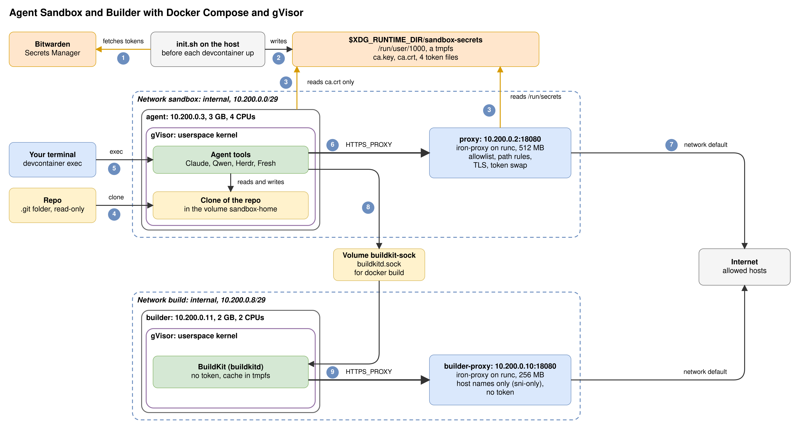
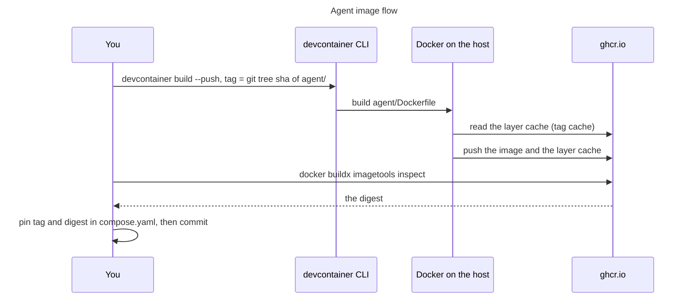
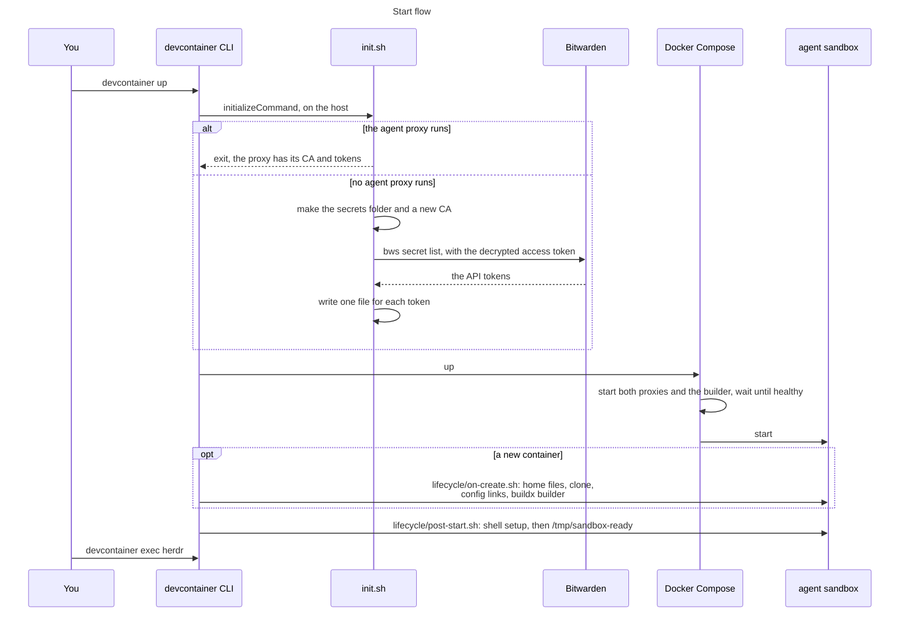
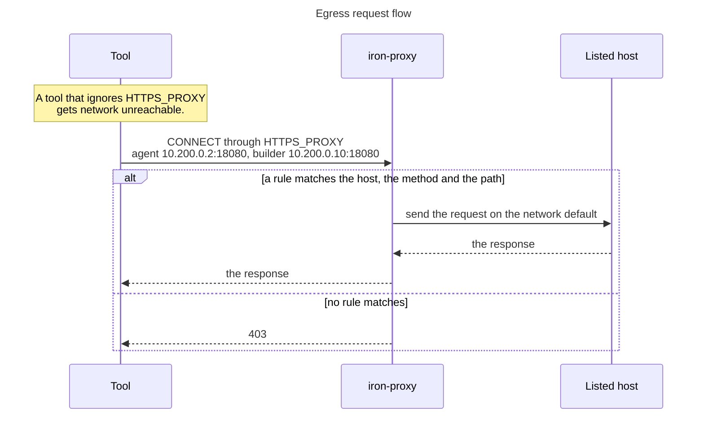
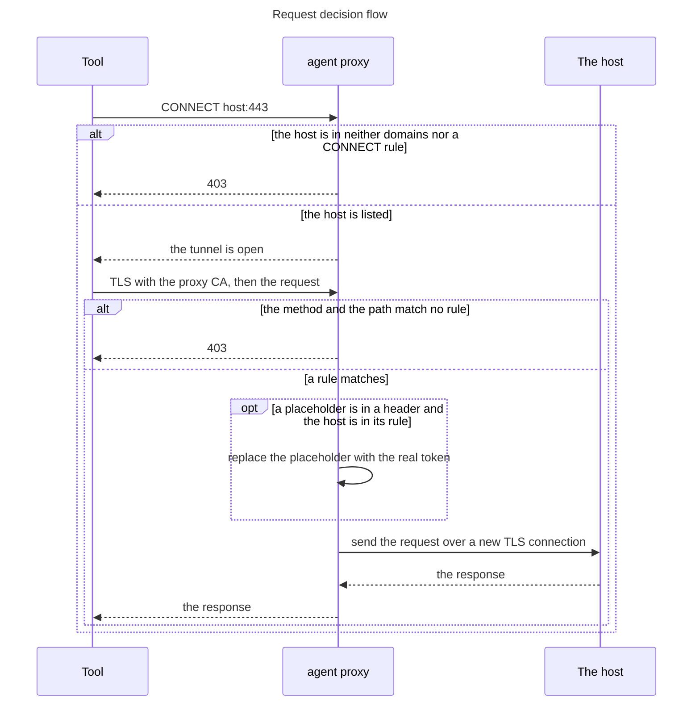
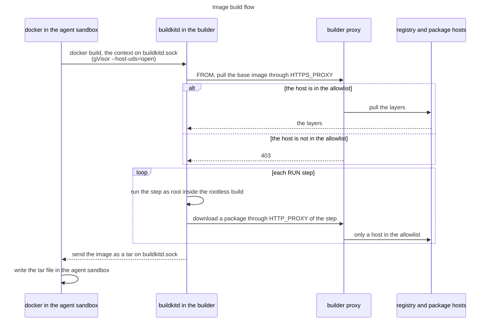
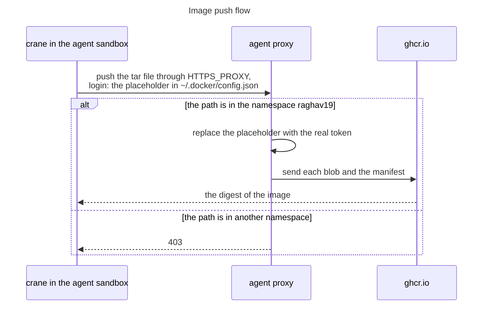

# Flows of the agent sandbox

## The idea

- You build the agent image once for each change of `agent/`.
- Each session starts with `devcontainer up`. `init.sh` runs first, on the host.
- Each request of a tool goes through a proxy. Only the agent proxy holds tokens.
- Each build runs in the builder. Only the agent pushes an image.

## The picture

[](diagrams/architecture.svg)

## Once: build the agent image

### Agent image flow

The host builds the agent image and pushes it. The commands are in [Update the agent image](../README.md#update-the-agent-image).



## Each start

### Start flow

`devcontainer up` runs `init.sh` on the host, then starts the containers.



The agent starts only after both proxies and the builder are healthy. The agent is healthy after `lifecycle/post-start.sh` writes `/tmp/sandbox-ready`. A running proxy keeps the CA and the tokens that it read at its start.

## Each request

### Egress request flow

The agent sandbox and the builder follow this path. Only the proxy IP and the rule set differ. Only the agent proxy swaps a placeholder for a token.



### Request decision flow

The agent proxy judges each request in this order:



The proxy decides on the host at the `CONNECT`, before it sees a path. It reads the method and the path only after it ends TLS with its CA. A host in `domains` takes every method and every path. A host in `rules` takes only the methods and the paths of its rules, so a write goes to one GitHub repository only. The builder proxy has no path rules, because it cannot see a path.

## Each build

### Image build flow

The agent sandbox sends the build. The builder runs it. The builder reaches the internet only through the builder proxy.



The docker config of the agent (`configs/docker-config.json`) gives each `RUN` step the builder proxy as `HTTP_PROXY` and `HTTPS_PROXY`.

Run `docker build` as on any host. A normal Dockerfile builds as it is. The agent sandbox has no Docker daemon, so the build writes a tar file:

```shell
docker build -t ghcr.io/raghav19/<NAME>:<TAG> --output type=docker,dest=/tmp/image.tar .
```

The builder proxy holds no token, so a base image comes from a public registry. For a private base image, the agent sandbox pulls it with `crane` through the agent proxy. It then passes the image to `docker build` as an OCI layout.

### Image push flow

Only the agent sandbox pushes the tar file:



```shell
crane push /tmp/image.tar ghcr.io/raghav19/<NAME>:<TAG>
```

## Lifetimes

- **CA and tokens:** `init.sh` writes them for each new agent proxy. A running proxy keeps what it read at its start. A logout or a reboot deletes the files.
- **BuildKit cache:** a tmpfs in the builder. Each stop wipes it.
- **Volume `sandbox-home`:** the clone, the logins and the histories. `docker compose -p sandbox down` keeps it.

## Where each part is in the repo

- `../init.sh`: the CA and the tokens.
- `../compose.yaml`: the containers, the networks and the mounts.
- `../lifecycle/`: `on-create.sh` and `post-start.sh`.
- `../policy/agent.yaml` and `../policy/builder.yaml`: the rules of the proxies.
- `../agent/devcontainer.json`: the build config of the agent image.

## What comes next

- [Networking](networking.md)
- [Security controls](security-controls.md)
