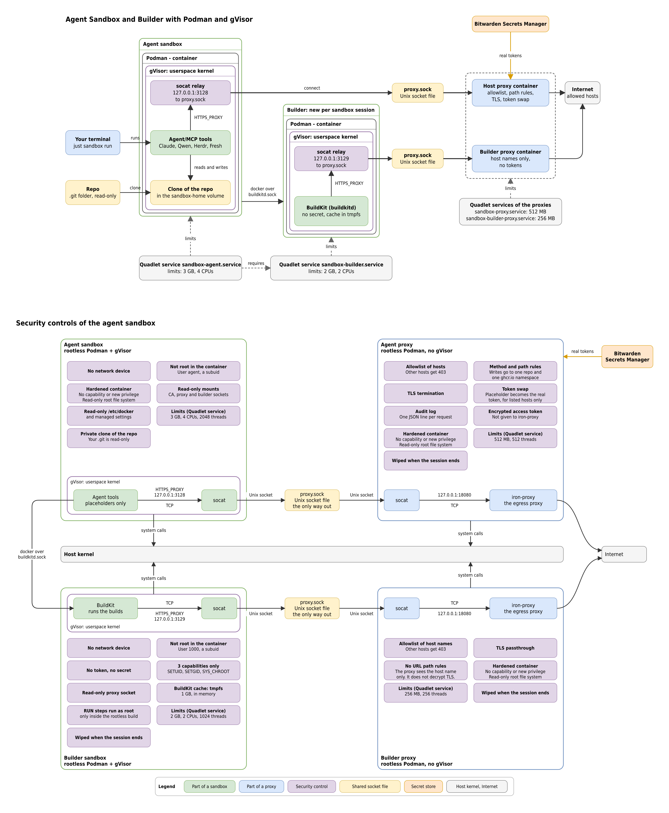
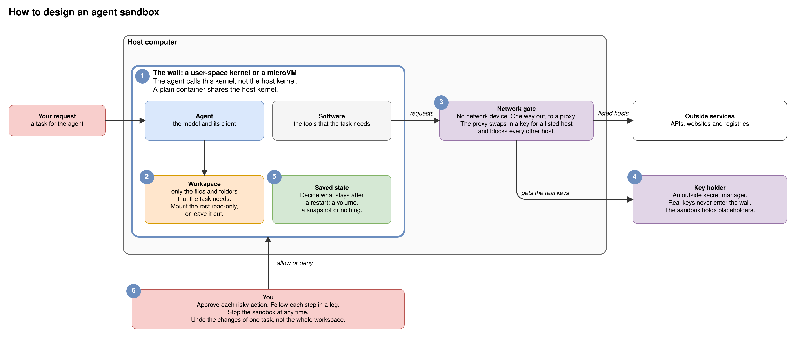

# I built my own sandbox for coding agents

_One way out, no real tokens inside, and a proxy that checks each request._

## Post

Your coding agent has your repo, your tokens and a network connection. One poisoned issue or web page can make it use all three.

I built an agent sandbox to limit that damage. This post shows the problem, the design and the limits.

### This already happened

Four cases from 2025 and 2026 show the three abilities at work:

- **GitHub MCP, May 2025.** A poisoned issue in a public repo made an agent read private repos. The agent then put the data in a public pull request. [Invariant Labs](https://invariantlabs.ai/blog/mcp-github-vulnerability) found it. A GitHub maintainer [calls it](https://github.com/github/github-mcp-server/issues/844) a "lethal trifecta" risk, not a bug. In my sandbox, only the scope of the token limits this path. The proxy cannot see which repository an MCP call targets.
- **Amazon Q Developer, July 2025.** Version 1.84.0 of the extension carried malicious code. Reports say it told the AI agent to delete local files and AWS resources. A syntax error stopped it ([CVE-2025-8217](https://github.com/aws/aws-toolkit-vscode/security/advisories/GHSA-7g7f-ff96-5gcw)). In my sandbox, the agent works in a private clone and holds no real AWS credentials.
- **Nx s1ngularity, August 2025.** A malicious npm package prompted the AI tools on the machine to search for secrets. It sent the results to a new GitHub repo in the account of the victim ([advisory](https://github.com/nrwl/nx/security/advisories/GHSA-cxm3-wv7p-598c)). In my sandbox, the agent holds placeholders, and the proxy gives a `403` to a request that creates a repo. The builder runs `npm install` with no token.
- **Mini Shai-Hulud, April and May 2026.** A malicious npm package stole tokens and `~/.claude.json`. It also planted a Claude Code hook, so the malware runs again when someone opens the repo ([StepSecurity](https://www.stepsecurity.io/blog/a-mini-shai-hulud-has-appeared), [CISA](https://www.cisa.gov/news-events/alerts/2026/05/28/supply-chain-compromises-impact-nx-console-and-github-repositories)). In my sandbox, the builder has no token, and the agent holds placeholders only.

Checks inside the agent fail too. The Claude Code [security advisories](https://github.com/anthropics/claude-code/security/advisories) list three allowlist bugs that could leak data: CVE-2025-55284, CVE-2026-24052 and CVE-2026-54316. So my sandbox puts the gate in a separate container.

Vendors and standards bodies now ask for the same control. [Claude Code](https://code.claude.com/docs/en/sandboxing), [Codex](https://developers.openai.com/codex/agent-approvals-security), [GitHub Copilot](https://docs.github.com/en/copilot/how-tos/use-copilot-agents/coding-agent/customize-the-agent-firewall), [Gemini CLI](https://github.com/google-gemini/gemini-cli/blob/main/docs/cli/sandbox.md) and [Docker](https://docs.docker.com/ai/sandboxes/security/) ship sandboxes. OWASP lists agent risks in its [Top 10 for Agentic Applications](https://genai.owasp.org/2025/12/09/owasp-top-10-for-agentic-applications-the-benchmark-for-agentic-security-in-the-age-of-autonomous-ai/). NIST started an [AI Agent Standards Initiative](https://www.nist.gov/news-events/news/2026/02/announcing-ai-agent-standards-initiative-interoperable-and-secure) in February 2026. Claude Code on the web and Docker Sandboxes [keep credentials out of the sandbox](https://code.claude.com/docs/en/security), as mine does.

### The problem

Three things together make an agent risky:

1. It reads text that you did not write: web pages, issues, packages and code.
2. It reaches private data: your repo, your files and your tokens.
3. It can send data out: a `git push`, an API call or a web request.

A prompt injection hides an instruction in the text that the agent reads. A fooled agent then runs commands with your rights.

A filter that stops most attacks is not enough. One missed attack is enough. The agent has to read, so I cannot remove the first thing. I can limit the other two.

### The idea

Assume that an attacker will fool the agent. Then limit what a fooled agent can do. The sandbox has one step for each ability:

- **Private data.** The agent works in a private clone of the repo. It holds placeholders, not real tokens. The real tokens stay in a proxy.
- **Outside communication.** The agent container has no network device. The only way out is a Unix socket file that leads to the proxy.
- **Untrusted content.** The sandbox cannot stop it, because the agent has to read. The other two steps limit the damage.
- **Builds.** A second container builds the images. It has no token and no network device. It has its own proxy.

### How a request leaves

A tool in the sandbox sends a request to a small relay. The relay passes the bytes to `proxy.sock`. This is a file that the proxy container owns. The proxy container passes the bytes to the proxy.

The proxy checks the host, the method and the path of each request:

- A host that is not on the list gets a `403`.
- A host with rules takes only the methods and the paths of its rules. A write goes to one GitHub repository only.
- A merge, a file removal, a gist, a fork and GraphQL get a `403`.
- If a rule matches, the proxy replaces the placeholder with the real token and sends the request.

The host proxy ends the TLS of each call with its own CA. The sandbox trusts only this CA. The real tokens come from Bitwarden Secrets Manager and stay in memory.

### Builds without a token

The agent runs `docker build` as on any host. The build goes to a second container, the builder, over a socket. The builder runs the build steps. It has no token and no network device.

The builder reaches the internet only through its own proxy. This proxy checks host names only. It holds no token. The builder is new for each session.

### The hard edges

The agent container and the host proxy have a read-only root file system and no capabilities. The agent container does not run as root. The builder keeps three capabilities, because its build tool needs them. The containers run in rootless Podman and gVisor.

gVisor ignores the limits of Podman. So Quadlet turns each container file into a systemd service, and each service holds the memory and CPU limits.

### How to design an agent sandbox

An agent sandbox has six concepts. Use them as a checklist when you build a sandbox.

My sandbox applies each concept:

1. **The wall.** The agent runs in rootless Podman on gVisor, a user-space kernel.
2. **Workspace.** The agent works in a private clone of the repo. The `.git` folder of my checkout is a read-only mount, so the agent cannot change it.
3. **Network gate.** One socket file leads to the proxy. The proxy allows listed hosts, methods and paths.
4. **Key holder.** The proxy replaces each placeholder with the real token.
5. **Saved state.** A volume keeps the clone, the logins and the histories after a restart.
6. **You.** I approve the tool calls in Claude Code. The audit log of the proxy shows each request. One command stops the sandbox. Each task has its own worktree and branch, so I can undo one task.

### The limits

The sandbox limits the damage. It does not make the agent safe. These risks stay:

- gVisor is not a microVM. A bug in gVisor can give an attacker your host user.
- The proxy reads every request. A bug in the proxy can expose the real tokens.
- A prompt injection can still change what the agent tries to do. The model and the client handle that.
- A write to `main` needs branch protection on GitHub. A rule in the proxy cannot see the branch.
- Malware can plant a hook in `.claude/settings.json` or `.vscode/tasks.json` in the clone. Read these files in each diff.
- Data can leave through a listed host. Keep the lists short.

### Further reading

- Anthropic: [Beyond permission prompts: making Claude Code more secure and autonomous](https://www.anthropic.com/engineering/claude-code-sandboxing)
- Claude Code docs: [Sandboxing](https://code.claude.com/docs/en/sandboxing) and [Security](https://code.claude.com/docs/en/security)
- Simon Willison: [The lethal trifecta for AI agents](https://simonwillison.net/2025/Jun/16/the-lethal-trifecta/)
- Simon Willison: [Agents Rule of Two and The Attacker Moves Second](https://simonwillison.net/2025/Nov/2/new-prompt-injection-papers/)
- OWASP: [Top 10 for Agentic Applications](https://genai.owasp.org/2025/12/09/owasp-top-10-for-agentic-applications-the-benchmark-for-agentic-security-in-the-age-of-autonomous-ai/)

### Try it

The code and the README are in my repo: [engineersdaybook/.devcontainer](https://github.com/raghav19/engineersdaybook/tree/main/.devcontainer).

This is a personal setup. It assumes `ghcr.io` and Bitwarden Secrets Manager. The README lists what to change for another registry or secret manager.

What can your agent reach today?

## Images

Upload these files to Medium in this order:

1. `diagrams/sandbox-architecture-and-controls.png`: the picture under the opening paragraph. It holds two diagrams.
2. `diagrams/concepts.png`: the picture in the section "How to design an agent sandbox". Make it on the host first. In `diagrams/`, run `rsvg-convert -z 2 -b white concepts.svg -o concepts.png`.

## Alt text

1. Two diagrams in one image. The top diagram shows the agent sandbox, the builder, the two proxies and the Internet. The bottom diagram lists the security controls of each container.
2. How to design an agent sandbox: the six concepts. A host computer holds the wall, the network gate and the key holder. The wall holds the agent, the software, the workspace and the saved state. The network gate and the key holder are outside the wall. You allow or deny the actions of the sandbox.
