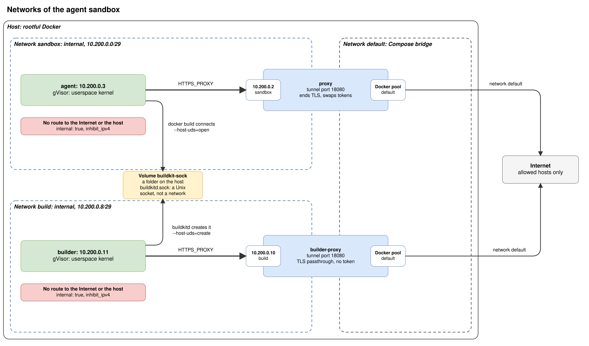

# Networking of the agent sandbox

## The idea

- The agent and the builder must not reach the Internet or the host directly.
- Each one gets out only through its own proxy.
- A Docker internal network gives this: a container on it has no route out.
- Each proxy is on two networks: its internal network and the Compose network `default`.
- The agent and the builder share no network. A Unix socket on the host joins them for builds.

## The picture

## The cast

On the host:

| Part | Job |
|---|---|
| Network `sandbox` | Internal, 10.200.0.0/29. The agent and the agent proxy. |
| Network `build` | Internal, 10.200.0.8/29. The builder and the builder proxy. |
| Network `default` | The Compose bridge. Only the two proxies. Their way to the Internet. |
| Volume `buildkit-sock` | A host folder with `buildkitd.sock`. A socket, not a network. |

The containers:

| Container | Job |
|---|---|
| agent, 10.200.0.3 | gVisor. Sends each request to 10.200.0.2:18080. |
| proxy, 10.200.0.2 | runc. Ends TLS and swaps the tokens. |
| builder, 10.200.0.11 | gVisor. Sends each request to 10.200.0.10:18080. |
| builder proxy, 10.200.0.10 | runc. Passes TLS through. Holds no token. |

## The flow

- Each request: [Egress request flow](flows.md#egress-request-flow) and [Request decision flow](flows.md#request-decision-flow).
- Each build: [Image build flow](flows.md#image-build-flow).

## The addresses

Each internal network is a /29, a block of 8 addresses. In each block, the gateway takes the first host address, the proxy the next one, and the container the one after it. So the builder at .11 has the same place in its block as the agent at .3. The two blocks do not overlap.

## Why the design looks like this

- `internal: true`: the network has no route to the Internet.
- `inhibit_ipv4`: the bridge has no IPv4 address on the host, so a container cannot reach the host.
- Fixed IPs: gVisor cannot use the DNS of Docker to find a proxy by name.
- Two internal networks: the builder cannot reach the agent proxy and its tokens.
- A socket for builds: the agent and the builder need no shared network.
- 10.200.0.0/24: this range overlaps no other range on this host.

## Lifetimes

- `docker compose -p sandbox down` removes the networks. `devcontainer up` makes them again.
- The addresses on the internal networks are fixed. Docker picks the address of each proxy on `default` from its pool.

## Where each part is in the repo

- `../compose.yaml`: the networks, the fixed IPs and `HTTPS_PROXY`.
- `../policy/agent.yaml` and `../policy/builder.yaml`: `tunnel_listen`, the address of each tunnel.
- `../configs/docker-config.json`: the builder proxy for each `RUN` step.
- [Prerequisites](../README.md#prerequisites), step 4: the gVisor runtimes for the socket.

## What comes next

- [Flows](flows.md)
- [Security controls](security-controls.md)
