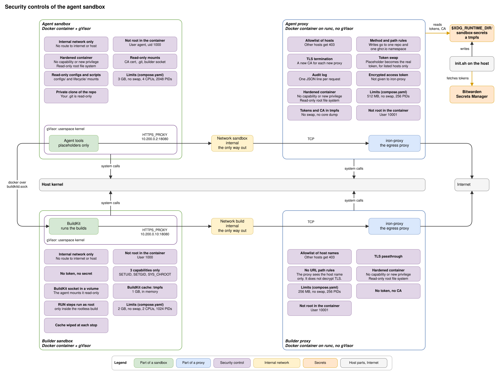

# Security controls of the agent sandbox

## The idea

- Each container has its own set of controls.
- The proxies are the only way out. They allow listed hosts only.
- The real tokens stay in the agent proxy. The agent holds placeholders.

## The picture

The diagram shows each control in the container that has it.

## Notes on the controls

- **No route out.** The internal networks have no route to the Internet or to the host. A tool that ignores `HTTPS_PROXY` gets `network unreachable`.
- **Fixed proxy IPs.** gVisor cannot use the DNS of Docker. So `HTTPS_PROXY` names each proxy by its IP.
- **Builder rights.** BuildKit needs three capabilities. The builder also has a writable root file system and no `no-new-privileges`.
- **Root in a build.** Any holder of `buildkitd.sock` can run any build step as root. The container is the wall.
- **Path rules.** The agent proxy checks the path of each URL. A merge, a file removal, a gist, a fork and GraphQL get `403`.
- **TLS.** Each new agent proxy gets a new CA. The agent trusts only this CA. The builder proxy has no CA.
- **Tokens.** The tokens are files in a tmpfs folder, `$XDG_RUNTIME_DIR/sandbox-secrets`. Only you and the proxy can read them. A logout or a reboot deletes them.
- **Audit log.** `docker logs -f sandbox-proxy-1` shows each request.
- **Limits.** `compose.yaml` limits the memory, the CPUs and the processes of each container. No container uses swap.
- **Session.** The volume `sandbox-home` keeps the clone, the logins and the histories.

## Where each part is in the repo

- `../compose.yaml`: the limits, the capabilities and the read-only mounts.
- `../policy/agent.yaml` and `../policy/builder.yaml`: the allowlists and the path rules.
- `../init.sh`: the CA and the token files.

## What comes next

- [Networking](networking.md)
- [Flows](flows.md)
