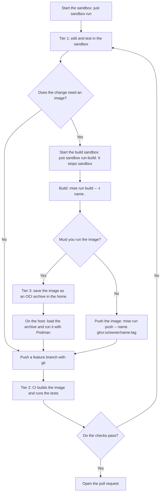

# The Podman sandbox

A sandbox for AI agents. The agent runs in a hardened, rootless Podman container with the `crun` runtime. The container has no network. The only way out is iron-proxy on the host. It allows the listed hosts and swaps placeholders for real tokens. The container never holds a real token. The agent cannot change the sandbox.

**Status:** this folder replaces `.msb/` in steps. `.msb/` stays in use until you switch. The host proxy is in [`proxy/`](proxy/README.md). The CI workflow for tier 2 (see "Developer workflow") is not here yet.

| Path | Content |
|---|---|
| `sandbox.env` | The environment of the container. |
| `image/` | The image, `sandbox-entry`, `sandbox-start` and the `mise` tasks. |
| `justfile` | `build`, `run` and `run-build`. It holds the one `podman run` command. |

## Architecture

[](docs/diagrams/architecture.svg)

## How a request leaves the sandbox

1. A tool sends its request to `HTTPS_PROXY`, which is `http://127.0.0.1:3128`.
2. `sandbox-entry` starts one `socat` relay on that address. It copies the bytes to the Unix socket `/run/sandbox/proxy/proxy.sock`.
3. On the host, a systemd socket unit owns `proxy.sock`. `systemd-socket-proxyd` copies it to the tunnel port of iron-proxy (`127.0.0.1:18080`). There is no `socat` on the host.
4. iron-proxy ends the TLS with its own CA and checks the host. An unlisted host gets `403`. For a listed host, iron-proxy swaps each placeholder (`sandbox-placeholder-<NAME>`) for the real token and sends the request on.

**Why does `--network none` leave no route to the host?** The container has its own loopback interface, and nothing else. Its `127.0.0.1` is not the loopback of the host. Only a file crosses the wall: the socket in the mounted folder.

**Why a relay?** Tools need a TCP address for a proxy. The relay turns that address into the socket. It runs as container root, which is the host user who owns the socket. It has no capability. The agent user cannot open the socket.

**Why is the CA mounted and not installed?** The root file system is read-only, so `update-ca-certificates` cannot run. The `podman run` command mounts `~/.local/state/sandbox/ca.crt` read-only over `/etc/ssl/certs/ca-certificates.crt`. All HTTPS goes through the proxy, which ends the TLS with this CA, so the sandbox trusts this CA only. The command never mounts `ca.key`. If you make a new CA, restart the sandbox.

**The host side:** the units are `sandbox-proxy.service`, `sandbox-bridge.socket` and `sandbox-bridge.service`. iron-proxy uses the ports 18080 to 18089 on `127.0.0.1`. See [`proxy/README.md`](proxy/README.md). `just sandbox run` stops with a message if the socket `$XDG_RUNTIME_DIR/sandbox/proxy.sock` is missing. Start the proxy with `systemctl --user start sandbox-proxy`.

## Install and use

Start the host proxy first. Then build the image and run the sandbox:

```shell
just sandbox build   # the first build takes several minutes
just sandbox run     # starts the container if it does not run, and opens Herdr
```

The first `run` makes the volume `sandbox-home` with `podman volume create -o o=uid=1000,gid=1000`. The container mounts the `.git` folder of the repo that you run `just` in, read-only, and clones it. The clone has the git identity `agent`. Set yours with `git config` in the clone.

| Command | What it does |
|---|---|
| `just sandbox run` | Starts the container if it does not run. Opens Herdr with `podman exec -it -u 0 sandbox sandbox-entry herdr`. The entry drops to `agent`. Close the terminal and the sandbox keeps running. |
| `podman logs -f sandbox` | Follows the log. |
| `podman stop sandbox` | Stops the container. The volume stays. The next `run` replaces the container. |

## Hardening

| Control | What it does |
|---|---|
| `--runtime=crun --network=none` | A small runtime. The container has the loopback interface only. |
| `--read-only` | The agent cannot write to `/etc`, `/usr`, `/opt/mise`, the policy of Claude Code or the CA. |
| tmpfs on `/tmp` and `/run` | Scratch space. A restart empties it. |
| The named volume `sandbox-home` at `/home/agent` | The clone, the logins, the histories and the buildah storage stay here. The start script copies the home files of the image back at each start. |
| `--cap-drop=ALL` | The entry drops the agent to an empty capability set. |
| `--security-opt no-new-privileges` | A setuid program cannot raise a privilege. |
| The default seccomp profile of Podman | A system call filter. A custom profile is not part of this change. |
| User `agent` (uid 1000) | Not root. |
| `--pids-limit`, `--memory`, `--cpus` | 1024 processes, 3 GB, 4 CPUs. |
| Read-only mounts | The CA, the proxy socket folder, the `.git` of the repo and the theme. |

## Developer workflow

The sandbox has no container engine. A build makes an image. You run the image on the host or in CI.



| Tier | Where | Work |
|---|---|---|
| 1 | The sandbox | Lint, render manifests, unit tests: `flux build`, `kubeconform`, `terraform validate`, `pytest`, `go test`. |
| 2 | CI | Build and test the image. The registry push token is not in the sandbox. |
| 3 | The host | Run a container to debug it. |

**Build and push.** `mise` tasks call `buildah`. They work in the build profile. Open its shell with `just sandbox run-build`.

| Run | Docker command |
|---|---|
| `mise run build -- -t name .` | `docker build -t name .` (`buildah bud --isolation chroot`) |
| `mise run login` | `docker login ghcr.io`. The proxy swaps in the real token. |
| `mise run push -- name ghcr.io/owner/name:tag` | `docker push` |

A base image and every download in a `RUN` step go through the proxy, so their hosts must be on the allowlist. **Run the image on the host:** in the build sandbox, save it with `buildah push name oci-archive:/home/agent/name.tar:localhost/name:latest`. The home is the volume `sandbox-home`, so load the archive on the host from the volume:

```shell
podman unshare cat "$(podman volume inspect sandbox-home -f '{{.Mountpoint}}')/name.tar" | podman load
podman run --rm -p 8080:8080 localhost/name:latest
```

### What the build profile gives up

`sandbox-build` adds `CHOWN`, `DAC_OVERRIDE`, `FOWNER`, `SYS_CHROOT`, `SETUID` and `SETGID` to the agent. It has no `SYS_ADMIN`. `buildah` needs them for chroot isolation. They let the agent ignore file permissions in the container and change to any user id, root too. Container root is your host user, but every host path in the container is read-only.

The root file system of `sandbox-build` is **writable**. `buildah` chroot isolation fails on a read-only root. The agent can change `/etc` and `/usr` in this container, and it loses the changes when `run-build` starts a new container. A `RUN` step runs with the authority of the agent. `just sandbox run-build` stops `sandbox`, and `just sandbox run` stops `sandbox-build`, because both write to `sandbox-home`. Use the default sandbox when you do not build.

## What does not work

- **No `podman run`, no `docker`.** The sandbox has no engine. `buildah` builds and pushes.
- **No SSH and no raw TCP.** The proxy passes HTTP and TLS. Use HTTPS remotes for `git`.
- **A tool that ignores `HTTPS_PROXY` fails.** It has no route.
- **No `sudo` and no package install.** The root file system is read-only. Change the image.
- **The agent runs as a sub-user of your host user.** The container shares the host kernel. A microVM is a stronger boundary.
- **Listed hosts can receive data from the agent.** Keep the allowlist short.
