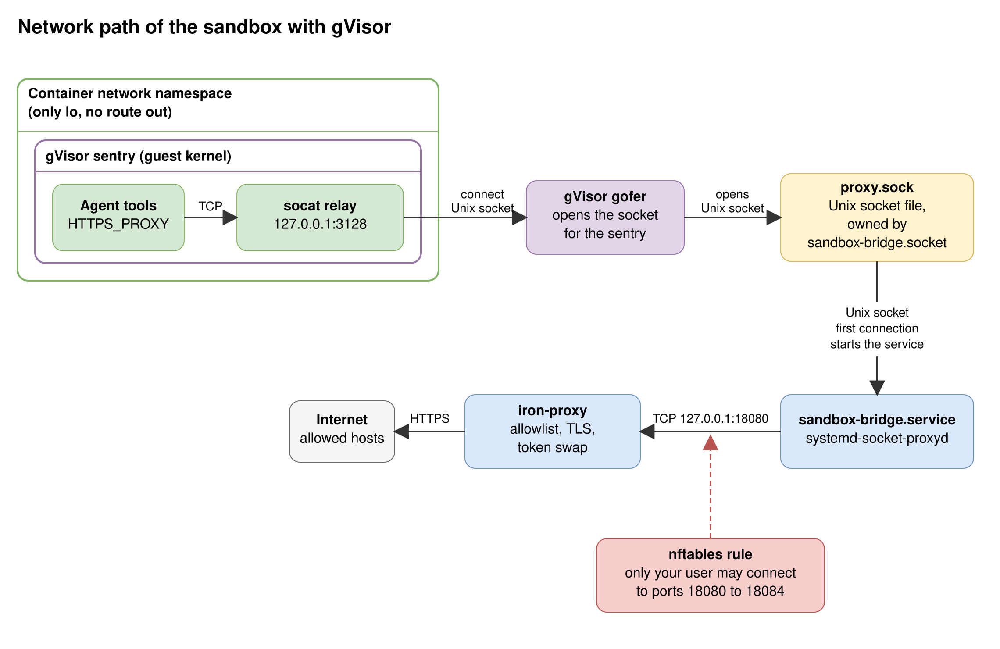
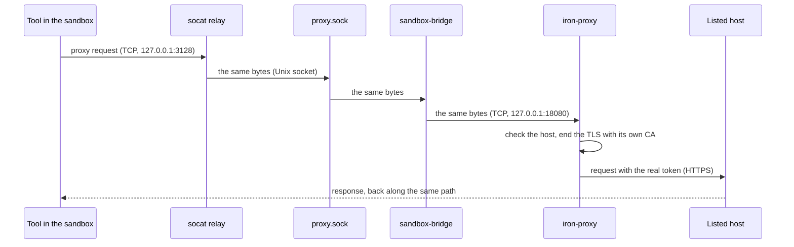
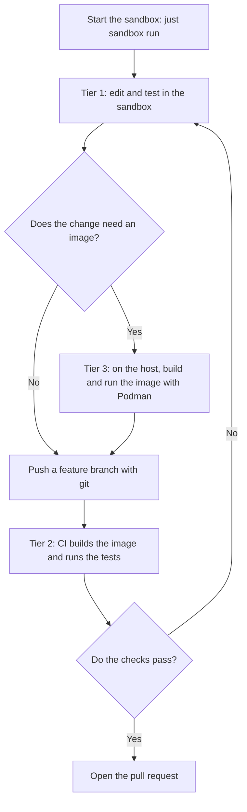

# The dev sandbox on Podman and gVisor

This sandbox is a container for AI agents (Claude Code and Qwen Code), with the Herdr and TTT tools. The agent runs in a rootless [Podman](https://podman.io) container with the [gVisor](https://gvisor.dev) runtime (`runsc`). The container has no network. Its only way out is iron-proxy on the host. iron-proxy allows the listed hosts and swaps placeholders for real tokens.

**Status:** this folder replaces `.msb/` in steps. `.msb/` stays in use until you switch. The CI workflow for tier 2 (see "Developer workflow") is not here yet.

## What we are building

A coding agent that you run without handing it your machine.

- **The agent:** Claude Code and Qwen Code in a rootless Podman container. gVisor runs the system calls of the agent in a user-space kernel. The agent works on a private clone of your repo and holds no real token.
- **The MCP servers:** GitHub, draw.io and the Flux schema catalog. The container loads them from root-owned settings files that the agent cannot change. For Claude Code, a deny list removes five GitHub tools: `merge_pull_request`, `delete_file`, `delete_repository`, `create_repository` and `fork_repository`.
- **The guardrails:** the container has no network except one path to iron-proxy. The proxy holds an allowlist of hosts and swaps token placeholders. The service holds limits. A firewall rule guards the ports of the proxy. The agent reaches the k3s cluster on the host through the same proxy (see "Clusters").

The setup needs a Linux host with systemd, one GitHub repository and secrets in Bitwarden Secrets Manager. There is no daemon of its own. systemd runs the container and the host proxy as services of your user.

What it shows: a fooled agent can do only what the sandbox allows. This follows Anthropic's [How we contain Claude across products](https://www.anthropic.com/engineering/how-we-contain-claude): enforce hard limits in the environment instead of relying on the model.

- **Limit what the agent is able to do, not what it does.** The container reaches only the hosts of the allowlist, through one path. A host that is not listed gets `403`.
- **Keep credentials out of the sandbox.** The container holds placeholders. iron-proxy swaps in the real value in requests to the hosts of that secret only.
- **An allowed host is a capability grant.** Any program in the container can use every listed host. Keep the allowlist to what the work needs.

## Architecture

[](docs/diagrams/architecture.svg)

The container has three levels. The outer level is the agent sandbox. Inside it, Podman runs the container. Inside that, gVisor runs the agent tools and the clone of the repo. A Quadlet service holds the limits. An nftables rule guards the ports of the proxy.

The network path in detail:

[](docs/diagrams/sandbox-network.svg)

## How a request leaves the sandbox

1. A tool sends its request to `HTTPS_PROXY`, which is `http://127.0.0.1:3128`.
2. `sandbox-entry` starts one `socat` relay on that address. It copies the bytes to the Unix socket `/run/sandbox/proxy/proxy.sock`.
3. On the host, a systemd socket unit owns `proxy.sock`. `systemd-socket-proxyd` copies the bytes to the tunnel port of iron-proxy, `127.0.0.1:18080`.
4. iron-proxy ends the TLS with its own CA and checks the host. An unlisted host gets `403`. For a listed host, iron-proxy swaps each placeholder (`sandbox-placeholder-<NAME>`) for the real token and sends the request on.



The connection changes its carrier at three points, and the bytes stay the same. The tool opens a TCP connection to `socat`. `socat` opens a Unix socket connection to `proxy.sock`. `systemd-socket-proxyd` opens a new TCP connection to iron-proxy. The diagram labels the carrier on each line.

| Part | What it is |
|---|---|
| `socat` | Copies bytes between two connections. In the container, it listens on `127.0.0.1:3128` and connects to `proxy.sock`. Tools need a TCP address, and the only way out is a file. |
| `proxy.sock` | One Unix socket file on the host: `$XDG_RUNTIME_DIR/sandbox/proxy.sock`. The container mounts its folder read-only. A connect to this file reaches the host side. |
| `sandbox-bridge.socket` | A systemd unit. It makes and owns `proxy.sock`. There is no second socket file. |
| `sandbox-bridge.service` | A systemd unit. systemd starts it at the first connection. It runs `systemd-socket-proxyd`, which copies the bytes from `proxy.sock` to iron-proxy. iron-proxy listens on TCP only, so the host needs the bridge. |
| The sentry | The guest kernel of gVisor. It runs the system calls of the agent. It runs as your user on the host. |
| The gofer | A gVisor helper process on the host. The sentry does not open host files. The gofer opens them for it. With `host-uds=open`, the gofer connects to `proxy.sock` and gives the open connection to the sentry. |
| The nftables rule | A firewall rule on the host. It lets only your user connect to the ports of the proxy. A TCP port on `127.0.0.1` has no check of the user, so without the rule any local user could use the proxy and its real tokens. |

**Why does `Network=none` leave no route to the host?** The container has an empty network namespace. It holds the loopback interface and nothing else. gVisor uses that namespace as it is (the runsc flag `network=host`, which is not the Podman flag). Its `127.0.0.1` is not the loopback of the host. Only a file crosses the wall: the socket in the mounted folder.

**Why does the host bring up the loopback interface?** gVisor does not let the guest bring up `lo`, and without it `127.0.0.1` has no route. After the start, `ExecStartPost` in `sandbox.container` runs `ip link set lo up` in the network namespace of the container. `socat` can bind before that, and the connect works after it.

**Is `host-uds=open` safe?** gVisor blocks a connect to a host Unix socket by default. This flag allows it for every socket that a mount shows to the guest. The container mounts the proxy folder, the CA, the theme and the `.git` folder of the repo. The guest sees no other host socket. Do not mount a folder that holds another socket.

**Why a relay?** Tools need a TCP address for a proxy. The relay turns that address into the socket. It runs as the user `agent` and has no capability. The folder `$XDG_RUNTIME_DIR` has the mode 0700, so only you and the containers that mount the folder reach the socket.

**Why is the CA mounted and not installed?** The root file system is read-only, so `update-ca-certificates` cannot run. `sandbox.container` mounts `~/.local/state/sandbox/ca.crt` read-only over `/etc/ssl/certs/ca-certificates.crt`. All HTTPS goes through the proxy, which ends the TLS with this CA, so the sandbox trusts this CA only. The container never mounts `ca.key`. If you make a new CA, run `just sandbox run`.

**The host side:** the user units are `sandbox-proxy.service`, `sandbox-bridge.socket` and `sandbox-bridge.service`. The system unit `sandbox-guard.service` loads the firewall rule. See [`proxy/README.md`](proxy/README.md).

## Prerequisites

| Need | Why | Check |
|---|---|---|
| Linux with a systemd user manager | It runs the container and the host proxy. | `systemctl --user is-system-running` |
| `podman` (tested with 6.1.4) | The container engine. | `podman --version` |
| `runsc` (tested with release 20261102.0) | The gVisor runtime. | `runsc --version` |
| No SELinux | `runsc` does not start in an SELinux context other than unconfined. | `getenforce` prints `Disabled`, or the command is missing |
| `ip` and `nsenter` | The unit brings up `lo` in the network namespace of the container. | `ip -V` and `nsenter --version` |
| `nft` and `sudo` | The firewall rule needs root, once. | `nft --version` and `sudo -v` |
| `git`, `openssl` and `systemd-creds` | The clone, the CA and the encrypted credential. | `git --version`, `openssl version` and `systemd-creds --version` |
| `iron-proxy` and `bws`, installed with `mise install` | The proxy and its secret loader. Run `mise install` in your main checkout. | `iron-proxy --version` and `bws --version` |
| `kubectl`, with the kubeconfig of your k3s cluster | `just sandbox setup` reads the CA of the cluster from it and makes the token with it. | `kubectl get --raw /version` |
| Secrets in Bitwarden Secrets Manager | The proxy holds the real tokens. See [what the setup assumes](proxy/README.md#what-this-setup-assumes). | The four keys exist in your Bitwarden project |

`just` stops with a message if a tool of the justfile is missing.

## Getting started

Follow these steps in your main checkout.

```shell
just sandbox setup   # asks for your sudo password and the access token, then installs the proxy, the firewall rule, the container unit and the gVisor flags
just sandbox build   # builds the image, tags it with the commit and pushes it to ghcr.io. The first build takes several minutes.
just sandbox run     # restarts the container and opens Herdr. The volume keeps the clone and the logins.
```

| Step | Command | What it does |
|---|---|---|
| 1 | `setup` | Links `iron-proxy` and `bws`, makes the CA and renders the proxy config and the kubeconfig of the sandbox (see "Clusters"). Installs the firewall rule with `sudo`, encrypts the token and starts the proxy units. Links the container unit, `runsc.conf` and the repo. Run it again after you edit a file in `proxy/`, `cluster.yaml`, `runsc.conf` or `sandbox.container`. |
| 2 | `build` | Builds `image/` and pushes it to `ghcr.io`. The registry cache makes later builds faster. It uses the credential that `setup` makes, and asks for no password. |
| 3 | `run` | Restarts `sandbox.service`. Waits until the container is healthy, then opens Herdr with `podman exec`. Close the terminal and the sandbox keeps running until the next `run`. |

`sandbox.container` uses the volume `sandbox-home`. The first `run` makes it, and the user `agent` owns it. `setup` links `~/.config/sandbox/repo.git` to the `.git` folder of your repo. The unit mounts that link read-only, and the container clones it. The clone starts on the current branch of your repo. Run `git switch` in the clone for another branch. The clone has the git identity `agent`. Set yours with `git config` in the clone.

## Daily use

| You want to | Run |
|---|---|
| Start the sandbox, or make a new container | `just sandbox run` |
| Run one command in the sandbox | `just sandbox run claude --version` |
| See the state | `podman ps` (`starting`, `healthy` or `unhealthy`) and `systemctl --user status sandbox` |
| Follow the log | `podman logs -f sandbox` |
| Stop the sandbox | `just sandbox rm`. The volume stays. |
| Allow one more host | Add it to `proxy/iron-proxy.yaml`, then run `systemctl --user restart sandbox-proxy` |
| Change a token of a service | Change the Bitwarden key, then run `systemctl --user restart sandbox-proxy` |
| Renew the token of the cluster | Run `rm ~/.local/state/sandbox/tokens/k8s_dev`, then `just sandbox setup`. The token lasts one year. |
| Change a tool of the image | Edit `image/`, then run `just sandbox build` and `just sandbox run` |
| Change the unit or the limits | Edit `sandbox.container`, then run `just sandbox run` |
| Start with an empty home | Run `just sandbox rm`, then `podman volume rm sandbox-home`. This removes the clone and the logins. |

Flags go to `podman build`: `just sandbox build --no-cache` updates the tools that the Dockerfile pins by a prefix (`claude` and `qwen`).

## How it works

- **The container.** `sandbox.container` is a Quadlet unit. Quadlet turns it into the service `sandbox.service`, which runs `podman run --replace`. Each `run` makes a new container from the image.
- **The start.** `sandbox-entry` starts the relay, then runs `sandbox-start`. `sandbox-start` copies the home skeleton of the image into the volume, clones the repo, starts Headroom and installs the plugins. Then it writes `/tmp/sandbox-ready`. The health check tests that file.
- **The clone.** The container mounts the `.git` folder of your repo read-only. It cannot read your working tree, your untracked files or your `.env`. Commit on the host before `run`. Push a feature branch from the container and open the pull request on GitHub.
- **The limits.** gVisor ignores the limits of Podman. The service holds them: `MemoryMax=3G` with `MemorySwapMax=0`, `TasksMax=2048` and `CPUQuota=400%`. The kernel kills a sandbox that goes over a limit.
- **The tokens.** The container holds the placeholders `GH_TOKEN`, `CLAUDE_CODE_OAUTH_TOKEN`, `QWEN_API_KEY` and `GHCR_PUSH_TOKEN`. The proxy swaps each one for the real token in requests to the hosts of its rule. See [`proxy/README.md`](proxy/README.md#placeholders).
- **The MCP servers.** `image/configs/agents/managed-settings.json` becomes `/etc/claude-code/managed-settings.json`. `image/configs/agents/qwen-settings.json` becomes `/etc/qwen-code/settings.json`. Root owns both files, and the root file system is read-only. The agent reads them and cannot change them. To change them, run `just sandbox build`.
- **The image.** The files of `image/tools/` list the tools and their versions in six groups: `runtimes`, `headroom`, `infra`, `dev`, `agents` and `lsp`. `mise` installs them. `claude` and `qwen` use a version prefix, so a build takes the newest patch version. The tag of the image is the commit.
- **The firewall rule.** `proxy/sandbox-guard.nft` rejects connections to the proxy ports from every user except you. `setup` copies it to `/etc` with `sudo`, and a system unit loads it at each boot.

## Clusters

The sandbox reaches the k3s cluster on your host through the same proxy as every other host. A plain `kubectl` works in the sandbox with no flag, and so do `flux`, `helm` and `k9s`. The sandbox holds no cluster credential. It holds a placeholder, and the proxy swaps in the real token for that host only.

```text
kubectl in the sandbox    KUBECONFIG=/etc/sandbox/cluster.yaml (a placeholder token, no CA)
  → socat → proxy.sock → bridge → iron-proxy
      the rule:    the host of k3s, and the methods that may pass
      the secret:  tokens/k8s_dev, a file on the host, replaces the placeholder
  → the k3s API on this host
```

- **One kubeconfig for the sandbox.** `cluster.yaml` has one context, `k8s_dev`. The server is `kubernetes.default.svc`, a name that every k3s certificate lists, so the file is the same on each host. `setup` links the file, and the unit mounts it read-only.
- **A name for the local cluster.** The proxy needs a name and not an IP address, and it refuses `127.0.0.1`. So the proxy has its own hosts file, `proxy/hosts`, with one line. It maps `kubernetes.default.svc` to `10.42.0.1`, the address of the bridge `cni0`, where k3s listens too. That is the first address of the default pod range of k3s. The hosts file of your system does not change.
- **One rule and one secret in the proxy.** They are plain text in `proxy/iron-proxy.yaml`. See [the k3s cluster](proxy/README.md#the-k3s-cluster).
- **A token on the host.** `just sandbox setup` makes a token for the ServiceAccount `sandbox-agent` with `kubectl create token`. It writes the token to `~/.local/state/sandbox/tokens/k8s_dev`, and the proxy reads that file. `setup` makes the token once. It lasts one year, and the sandbox never holds it. Run the recipe again to renew it.
- **RBAC is the limit.** The rule allows every method for this host, so the rights of the ServiceAccount decide. It reads the cluster, it cannot read Secrets, and it can write in the namespace `sandbox-dev`. To make the proxy stricter, remove methods from the rule.
- **Another cluster** later means a second context in `cluster.yaml`, and a second rule and secret in `iron-proxy.yaml`.

Run `just sandbox setup`, then `just sandbox run`.

`kubectx` is in the image. With one context it has nothing to switch, and a context switch fails on the read-only file.

## Hardening

`sandbox.container` sets these controls.

| Control | What it does |
|---|---|
| `--runtime=runsc --network=none` | gVisor. The sentry runs the system calls of the agent. The container has an empty network namespace with the loopback interface only. |
| `ReadOnly=true` | The agent cannot write to `/etc`, `/usr`, `/opt/mise`, the settings of Claude Code or the CA. |
| tmpfs on `/tmp` and `/run` | Scratch space. A restart empties it. |
| The named volume `sandbox-home` at `/home/agent` | The clone, the logins and the histories stay here. The start script copies the home files of the image into it at each start. |
| `DropCapability=ALL` | The container has no capability. |
| `NoNewPrivileges=true` | A setuid program cannot raise a privilege. |
| `User=agent` (uid 1000) | The container starts as `agent`, not as root. In rootless Podman, `agent` is a subuid, not your host user. The sentry and the gofer run as your host user. |
| `MemoryMax`, `MemorySwapMax`, `TasksMax`, `CPUQuota` in `[Service]` | 3 GB of memory with no swap, 2048 host threads, 4 CPUs. The kernel kills a sandbox that goes over a limit. |
| Read-only mounts | The CA, the proxy socket folder, the `.git` of the repo and the theme. |
| The nftables rule `proxy/sandbox-guard.nft` | Only your user may connect to the TCP ports 18080 to 18083 and the UDP port 18084 of the proxy, on `127.0.0.1`. It separates users, not programs of the same user. |

The default seccomp profile of Podman applies. gVisor adds its own filter between the sentry and the host. A custom profile is not part of this setup.

## Developer workflow

The sandbox has no container engine. You build and run images on the host with `podman build` and `podman run`. Read the Containerfile that the agent wrote before you build it. A `RUN` step runs on the host with the network of the host, not through the proxy.



| Tier | Where | Work |
|---|---|---|
| 1 | The sandbox | Lint, render manifests, unit tests: `flux build`, `kubeconform`, `terraform validate`, `pytest`, `go test`. |
| 2 | CI | Build and test the image. The registry push token is not in the sandbox. |
| 3 | The host | Build the image with `podman build`. Run a container to debug it. |

## What stays open

- **gVisor is not a microVM.** The sentry is a process on the host kernel. It reduces the host system calls that the agent can reach. The sentry and the gofer run as your host user, so a bug in the sentry gives an attacker your user and not a subuid. A microVM is a stronger boundary.
- **A limit kills the whole sandbox.** With `crun`, one process dies. With gVisor, the kernel kills the sentry, and the service shows `failed`. A memory bomb or a fork bomb ends the sandbox and not the host. Run `just sandbox run` to start it again. The clone stays in the volume.
- **gVisor costs speed.** A new TLS connection through the proxy takes about 2 times longer than with `crun`. See [the handoff](../docs/handoff/podman-gvisor-sandbox.md) for the measurements and the open decisions.
- **The firewall rule separates users only.** A rootless container of your user that has a route to the host loopback can still connect to the proxy ports. Do not give another container such a route. See [`proxy/README.md`](proxy/README.md#the-firewall-rule).
- **Listed hosts can receive data from the agent.** Keep the allowlist short.
- **Each `run` stops the processes in the old container.** An agent that runs in another terminal stops when you run `just sandbox run` again.
- **No container engine, no `sudo`, no package install.** Build and run images on the host. Change the image to add a tool.
- **No SSH and no raw TCP.** The proxy passes HTTP and TLS. Use HTTPS remotes for `git`.
- **A tool that ignores `HTTPS_PROXY` fails.** It has no route.

## When something fails

| You see | Do this |
|---|---|
| `sandbox: missing .../proxy.sock. Run: just sandbox setup` | The proxy is not running. Run `systemctl --user start sandbox-proxy`, or run `just sandbox setup`. |
| `just sandbox setup` stops at the firewall step | `sudo` refused the password, or `nft` could not load the rule. See [Troubleshooting](proxy/README.md#troubleshooting). |
| `sandbox: the container is not healthy` | Run `podman logs sandbox`. `sandbox-start` prints the reason. |
| `systemctl --user status sandbox` shows `failed` | A limit killed the sandbox. Run `just sandbox run`. To raise a limit, edit `[Service]` in `sandbox.container`. |
| Every `podman` command hangs | A stopped `podman` process holds a lock. Run `ps -eo pid,stat,comm \| awk '$3=="podman" && $2 ~ /T/'`, then `kill -KILL <pid>`. |
| A site fails in the sandbox with `403` | The host is not in the allowlist. Add it to `proxy/iron-proxy.yaml`, then run `systemctl --user restart sandbox-proxy`. |
| A tool reports a certificate error | The CA changed. Run `just sandbox run` to mount the new `ca.crt`. |
| A tool reports `connection refused` or `no route` | The tool ignores `HTTPS_PROXY`. Set the proxy in its settings to `http://127.0.0.1:3128`. |
| `claude mcp list` shows `github` as failed, with `Authorization header is badly formatted` | The header in `managed-settings.json` must hold `Bearer sandbox-placeholder-GH_TOKEN`, as text. See [Placeholders](proxy/README.md#placeholders). Run `just sandbox build`, then `just sandbox run`. |
| `socat` reports `Cannot assign requested address` | `lo` is down. `ExecStartPost` did not run `ip link set lo up`. Run `journalctl --user -u sandbox` and check that `ip` and `nsenter` exist. |
| `kubectl` answers `Unauthorized` | The token file is missing or expired. Remove `~/.local/state/sandbox/tokens/k8s_dev`, then run `just sandbox setup`. |
| `kubectl` answers `bad gateway`, and the proxy log shows `x509: certificate signed by unknown authority` | The proxy does not trust the CA of the cluster. Run `just sandbox setup`. It builds `upstream-ca.pem` again from your kubeconfig. |
| `kubectl` answers `Forbidden`, or the proxy log shows `rejected_by: allowlist` | `Forbidden` is the RBAC of the ServiceAccount. `rejected_by: allowlist` means the method is not in the rule of the host in `proxy/iron-proxy.yaml`. |
| `kubectl` answers `bad gateway` with a dial error in the proxy log | k3s is down, or it does not listen on `10.42.0.1`. Start k3s. If your pod range is not `10.42.0.0/16`, change the address in `proxy/hosts` and restart `sandbox-proxy`. |
| `just sandbox build` reports `unauthorized` | The Bitwarden key `GITHUB_TOKEN` needs the scope `write:packages`. |

## Files

| Path | Content |
|---|---|
| `image/` | The image: the `Dockerfile`, `sandbox-entry`, `sandbox-start`, the tool lists in `tools/` and the settings in `configs/`. |
| `sandbox.container` | The Quadlet unit of the container: its environment, hardening flags, mounts, volume and limits. |
| `runsc.conf` | The gVisor flags for Podman, with the reason for each flag. |
| `cluster.yaml` | The kubeconfig of the sandbox for the k3s cluster on this host. `setup` renders it. |
| `justfile` | `setup`, `run`, `rm` and `build`. |
| `proxy/` | The host proxy and the firewall rule. See [`proxy/README.md`](proxy/README.md). |
| `docs/diagrams/` | The diagrams of this README. See [`docs/diagrams/README.md`](docs/diagrams/README.md). |
