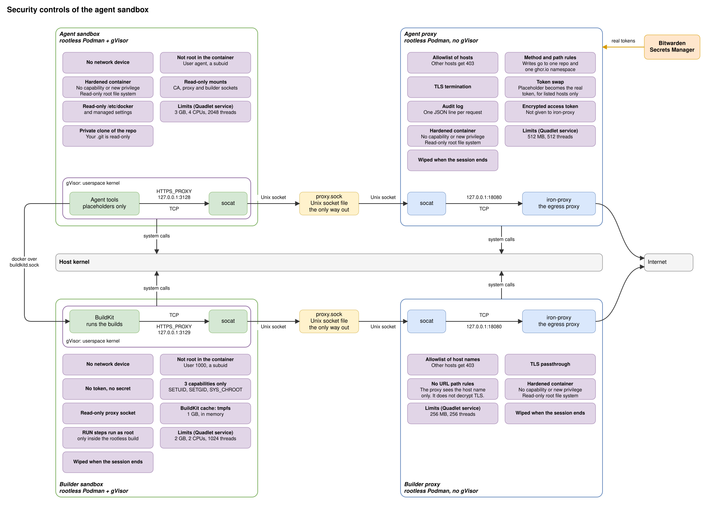
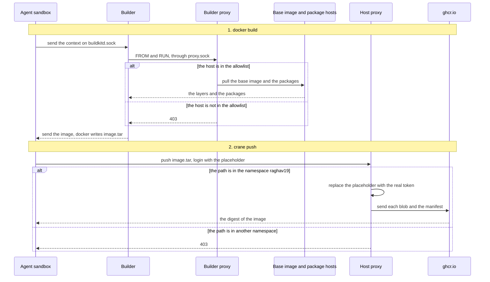

# Agent Sandbox

A sandbox for AI agents. It runs Claude Code, Qwen Code and the Fresh editor in a hardened Podman container. The container is rootless and uses gVisor. A second container, the builder, builds images for the agent.

## The problem

You let a coding agent work on your repository. The agent has three abilities. They are dangerous together:

- **Untrusted content.** The agent reads text that you did not write: web pages, issues, packages and code.
- **Private data.** The agent reaches your repository, your files and your tokens.
- **Outside communication.** The agent can send data to an outside host with a `git push`, an API call or a web request.

A prompt injection hides an instruction in the text that the agent reads. A fooled agent then runs commands with your rights. It can send your private data to an attacker. Simon Willison calls this combination the [lethal trifecta](https://simonwillison.net/2025/Jun/16/the-lethal-trifecta/). A filter that stops most attacks is not enough, because one missed attack is enough.

## The solution

The sandbox keeps the agent useful and limits what a fooled agent can do. It has one step for each ability:

| Ability | What the sandbox does |
|---|---|
| Private data | The agent works in a private clone. It holds placeholders, not real tokens. The real tokens stay in the proxy. |
| Untrusted content | The sandbox cannot stop it, because the agent must read. The other two steps limit the damage. |
| Outside communication | The agent has no network device. The only way out is a file that leads to a proxy. The proxy allows listed hosts, methods and paths only. |

Builds follow the same model. A second container, the builder, runs the build steps. It has no token and no network device. It uses its own proxy, the builder proxy. The agent sandbox uses the host proxy.

The [sandbox of Claude Code](https://www.anthropic.com/engineering/claude-code-sandboxing) uses the same idea. Internet access goes only through a socket to a proxy outside the sandbox. That proxy enforces approved domains.

## What is out of scope

The sandbox limits what a fooled agent can do. Other layers handle the rest. These risks are out of scope:

| Risk | Who handles it |
|---|---|
| A prompt injection changes what the agent tries to do | The model and the client. The sandbox limits only the damage. |
| A tool of the MCP server writes outside this repository | The central MCP gateway. The proxy does not read MCP calls. |
| A write goes to `main` | Branch protection on GitHub. A rule in the proxy cannot see the branch. |
| A token has more scope than the agent needs | The scope of the token. Use a fine-grained token for one repository. |
| A pushed branch holds bad code | You. Read the diff before you merge or check it out. |
| Data leaves through a listed host | The allowlists. Keep them short. |

The sandbox has two limits of its own:

- The proxy reads every request of the agent. A bug in the proxy can expose the real tokens.
- gVisor is not a microVM. A bug in gVisor can give an attacker your host user.

## Architecture

[](docs/diagrams/architecture.svg)

The allowed hosts are in `agent/proxy/iron-proxy.yaml` and `builder/proxy/iron-proxy.yaml`. For the parts and the flows, read [How the sandbox works in detail](docs/internals.md).

## Security controls



The diagram shows each control in the container that has it. The agent sandbox and the builder are above and below the host kernel. Each sandbox runs in gVisor, so its system calls do not reach the host kernel directly. The proxy containers run without gVisor. The diagram calls the proxy of the agent sandbox the agent proxy. The other sections call it the host proxy.

The diagram does not draw these details:

- **One socket.** The only way out is one Unix socket to the proxy of the container. The container cannot see the files, the process or the other ports of the proxy.
- **The builder differs.** It keeps `SETUID`, `SETGID` and `SYS_CHROOT`, because `rootlesskit` needs them. It has no `no-new-privileges`, and its root file system is writable.
- **Root in the builder.** The builder container runs as the user 1000, a subuid, and not as root. A `RUN` step runs as root only inside the rootless build. BuildKit has no authorization, so any holder of `buildkitd.sock` can run any build step as root there. The container is the wall.
- **Path rules.** The path is the part of a URL after the host name. For `https://github.com/raghav19/engineersdaybook`, the path is `/raghav19/engineersdaybook`. A write goes to one GitHub repository and one `ghcr.io` namespace. A merge, a file removal, a gist, a fork and GraphQL get `403`.
- **TLS.** The agent proxy does TLS termination with its own CA, so it can read each request. The sandbox trusts only this CA. The builder proxy does TLS passthrough and has no CA. It checks only the host name.
- **Audit log.** The agent proxy writes each request as one JSON line. Read it with `journalctl --user -u sandbox-proxy`.
- **No Docker daemon.** The agent sandbox has no Docker daemon. `docker` sends the build to the builder on `buildkitd.sock`.
- **Limits.** gVisor ignores the limits of Podman. Each Quadlet service holds the limits of its container.
- **Session.** The builder and both proxies are new for each session. The build cache and the proxy state end with the session. The agent sandbox is new for each run too, but its volume `sandbox-home` stays. It keeps the clone, the logins and the histories.

## Prerequisites

This is a personal setup.

What the setup assumes:

- The image registry is `ghcr.io`. The secret manager is Bitwarden Secrets Manager.
- The Bitwarden project holds `GH_TOKEN`, `CLAUDE_CODE_OAUTH_TOKEN`, `QWEN_API_KEY` and `GITHUB_TOKEN`. `GITHUB_TOKEN` has the scope `write:packages`.
- You have the access token of a machine account that reads that project. Give it only to `just sandbox setup`, which asks for it.

For another registry or secret manager, change `agent/proxy/iron-proxy.yaml`, `agent/proxy/proxy.container` and the `build` recipe.

What the host needs:

| Need | Check |
|---|---|
| A Linux host with a systemd user manager | `systemctl --user is-system-running` |
| `systemd-creds`, to keep the Bitwarden access token | `command -v systemd-creds` |
| `bws`, from `mise install`. `build` uses it to authenticate to `ghcr.io`. | `bws --version` |
| `openssl`, to make the CA | `openssl version` |
| `podman`, `runsc` and `git`. `just` stops if one is missing. | `podman --version` and `runsc --version` |
| `ip` and `nsenter`, to start the loopback of the agent sandbox | `ip -V` and `nsenter --version` |
| 6 GB of free memory: 3 GB for the agent sandbox, 2 GB for the builder and less than 1 GB for the two proxies | `free -h` |
| Linger for your user (optional). The sandbox keeps running after your session ends. | `loginctl enable-linger "$USER"` |

## Quick start

Run these steps in your main checkout.

1. Run `mise install`. It installs `bws`.
2. Run these commands:

```shell
just sandbox setup   # make the CA and the credential, and link the units, the proxy configs and the repo
just sandbox build   # build the four images and push the agent sandbox image to ghcr.io
just sandbox run     # start the proxies, the builder and the agent sandbox, and open Herdr, a terminal workspace manager
```

`setup` needs no root. It asks for the Bitwarden access token only if the credential is missing or unreadable. Run `setup` again after you edit a file in `agent/` or `builder/`.

`podman ps` then shows four containers: `sandbox-proxy`, `sandbox-builder-proxy`, `sandbox-builder` and `sandbox-agent`. `run` starts all four containers. Each unit starts the units that it requires.

## Commands

| Command | What it does |
|---|---|
| `just sandbox setup` | Makes the CA and the credential. Links the container units, the gVisor flags, the proxy configs and the repo. |
| `just sandbox run` | Makes a new agent sandbox, a new builder and two new proxies. Opens Herdr. Add a command to run it in place of Herdr. |
| `just sandbox rm` | Removes the agent sandbox, the builder and both proxies. The volume stays. |
| `just sandbox build` | Builds the four images and pushes the agent sandbox image with the commit tag. `--no-cache` updates the pinned tools. |
| `podman ps` | Shows `(starting)`, `(healthy)` or `(unhealthy)`. |
| `podman logs -f sandbox-agent` | Follows the log of the agent sandbox. |
| `journalctl --user -u sandbox-proxy -f` | Follows the audit log of the host proxy: one JSON line for each request. |
| `podman logs -f sandbox-builder-proxy` | Follows the log of the builder proxy. |

The volume `sandbox-home` keeps the clone, the logins and the histories.

## Build and push in the agent sandbox



1. Run `docker build` as on any host. A normal Dockerfile builds as it is. The agent sandbox has no Docker daemon, so the build writes a tar file:

   ```shell
   docker build -t ghcr.io/raghav19/<NAME>:<TAG> --output type=docker,dest=/tmp/image.tar .
   ```

2. Push the tar file with `crane`:

   ```shell
   crane push /tmp/image.tar ghcr.io/raghav19/<NAME>:<TAG>
   ```

## Troubleshooting

**Why does `run` fail at the start?**

If a unit step fails, `run` stops. Run `journalctl --user -u sandbox-proxy -u sandbox-builder-proxy -u sandbox-builder`. If the image is missing, run `just sandbox build`.

**Why does `run` say that the credential is missing?**

Run `just sandbox setup`.

**Why do I see `Failed to read encrypted credential data: Invalid argument`?**

`bws-token` holds the plain token. Run `just sandbox setup`. It asks for the token again.

**Why does `podman logs sandbox-proxy` show a Bitwarden error?**

The access token is wrong or expired. Remove `~/.config/credstore.encrypted/bws-token`, then run `just sandbox setup`.

**Why does `run` say the agent sandbox is not healthy?**

Run `podman logs sandbox-agent`.

**Why does `run` say the builder is not healthy?**

Run `podman logs sandbox-builder`.

**Why does `docker build` say `failed to connect to the docker API`?**

`DOCKER_CONFIG` and `BUILDX_BUILDER` are missing in your shell. Open a new session with `just sandbox run`.

**Why does a `FROM` or a `RUN` step get `403`?**

The host is not in `builder/proxy/iron-proxy.yaml`. Add it and run `just sandbox run`. The proxy reads its file at start. `run` restarts the agent sandbox, the builder and both proxies.

**Why does `crane push` get `403`?**

The namespace is not `raghav19`. Push to `ghcr.io/raghav19/<NAME>:<TAG>`.

**Why does a GitHub call get `403`?**

The host proxy allows a push to `raghav19/engineersdaybook` and a REST write on its issues and pull requests. It denies a merge, a file write, a removal and GraphQL. To change this, edit `agent/proxy/iron-proxy.yaml` and run `just sandbox run`.

**Why does `systemctl --user status sandbox-agent` show `failed`?**

A limit killed it. Run `just sandbox run`. The clone stays in the volume.

**Why does `systemctl --user status sandbox-builder` show `failed` after `just sandbox rm`?**

This is normal. `buildkitd` exits with code 1 when it stops.

**Why does `run` stop at a `Credential` error of the proxy?**

The file `~/.config/credstore.encrypted/bws-token` is missing or unreadable. Run `just sandbox setup`.

**Why does a tool fail with a connection error?**

The tool ignores `HTTPS_PROXY`. Set the proxy of the tool to `http://127.0.0.1:3128`.

**What do I do after I make a new CA?**

Run `just sandbox run`.
