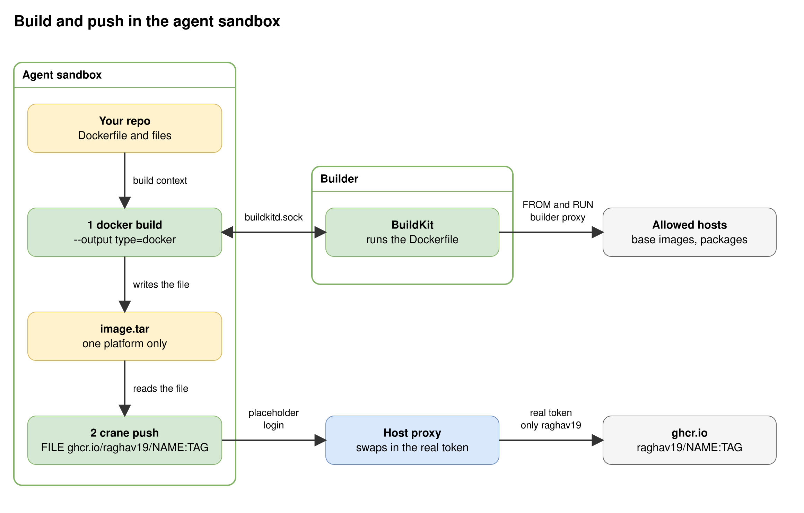

# Agent Sandbox

A sandbox for AI agents. It runs Claude Code, Qwen Code and the Fresh editor in a hardened rootless Podman container with gVisor. A second container, the builder, builds images for the agent.

## What it does

A coding agent reads text that you did not write. That text can hold a prompt injection, and a fooled agent runs commands with your rights. The sandbox limits what the agent can do, not what it chooses to do:

| Limit | What it does |
|---|---|
| No network | Each container has no route out. The only way out is a proxy container with an allowlist. |
| No real token | The agent sandbox holds placeholders. Only the host proxy holds the real tokens. |
| A private clone | The agent works on a clone of your repo. It cannot write to your repo. |
| Narrow writes | GitHub accepts a push and a REST write on issues and pull requests from the agent in this repository only. `ghcr.io` accepts a write in the namespace `raghav19` only. |
| A hardened container | gVisor, no capability, a read-only root file system and limits on memory, CPU and threads. |

## Architecture

[](docs/diagrams/architecture.svg)

## What the agent can reach

- **GitHub.** The agent reads any repository. A push and a REST write (issues, comments, pull requests, reviews) go to this repository only. A merge, a file write, a removal, a gist, a fork and GraphQL get `403`.
- **GitHub MCP server.** The proxy opens the URL. The toolsets and the `deny` list in the settings files limit the tools. You plan a central gateway for this.
- **`ghcr.io`.** The agent reads any namespace and writes in the namespace `raghav19` only.
- **Other hosts.** The agent reaches the hosts in `agent/proxy/iron-proxy.yaml`. Any other host gets `403`.
- **Builds.** A `FROM` or `RUN` step reaches the hosts in `builder/proxy/iron-proxy.yaml`, with no token.

For the parts and the flows, read [How the sandbox works in detail](docs/internals.md).

## Prerequisites

This is a personal setup. Other people can use other tools.

What the setup assumes:

- The image registry is `ghcr.io`. The secret manager is Bitwarden Secrets Manager.
- The Bitwarden project holds `GH_TOKEN`, `CLAUDE_CODE_OAUTH_TOKEN`, `QWEN_API_KEY` and `GITHUB_TOKEN`. `GITHUB_TOKEN` has the scope `write:packages`.
- You have the access token of a machine account that reads that project. `just sandbox setup` asks for it. Do not paste it into a chat or a file.

For another registry or secret manager, change `agent/proxy/iron-proxy.yaml`, `agent/proxy/proxy.container` and the `build` recipe.

What the host needs:

| Need | Check |
|---|---|
| A Linux host with a systemd user manager | `systemctl --user is-system-running` |
| `systemd-creds`, to keep the Bitwarden access token | `command -v systemd-creds` |
| `bws`, from `mise install`. `build` uses it to log in to `ghcr.io`. | `bws --version` |
| `openssl`, to make the CA | `openssl version` |
| `podman`, `runsc` and `git`. `just` stops if one is missing. | `podman --version` and `runsc --version` |
| `ip` and `nsenter`, to bring up the loopback of the container | `ip -V` and `nsenter --version` |
| 6 GB of free memory: 3 GB for the agent sandbox, 2 GB for the builder and less than 1 GB for the two proxies | `free -h` |
| Linger for your user (optional). The sandbox keeps running after you log out. | `loginctl enable-linger "$USER"` |

## Quick start

Run these steps in your main checkout.

1. Run `mise install`. It installs `bws`.
2. Run these commands:

```shell
just sandbox setup   # make the CA and the credential, and link the container units
just sandbox build   # build the four images and push the agent sandbox image to ghcr.io
just sandbox run     # start the proxies, the builder and the agent sandbox, and open Herdr
```

`setup` needs no root. It asks for the Bitwarden access token only if the credential is missing or unreadable. Run `setup` again after you edit a file in `agent/` or `builder/`.

`podman ps` then shows four containers: `sandbox-proxy`, `sandbox-builder-proxy`, `sandbox-builder` and `sandbox-agent`. Each unit starts the next one, so you start no proxy by hand.

## Commands

| Command | What it does |
|---|---|
| `just sandbox setup` | Makes the CA and the credential. Links the container units and the gVisor flags. |
| `just sandbox run` | Makes a new agent sandbox, a new builder and two new proxies. Opens Herdr. Add a command to run it in place of Herdr. |
| `just sandbox rm` | Removes the agent sandbox, the builder and both proxies. The volume stays. |
| `just sandbox build` | Builds the four images and pushes the agent sandbox image with the commit tag. `--no-cache` updates the pinned tools. |
| `podman ps` | Shows `(starting)`, `(healthy)` or `(unhealthy)`. |
| `podman logs -f sandbox-agent` | Follows the log of the agent sandbox. |
| `journalctl --user -u sandbox-proxy -f` | Follows the audit log of the host proxy: one JSON line for each request. |
| `podman logs -f sandbox-builder-proxy` | Follows the log of the builder proxy. |

The volume `sandbox-home` keeps the clone, the logins and the histories.

## Build and push in the agent sandbox

[](docs/diagrams/build-push.svg)

1. Run `docker build` as on any host. A normal Dockerfile builds as it is. The agent sandbox has no Docker daemon, so the build writes a tar file:

   ```shell
   docker build -t ghcr.io/raghav19/<NAME>:<TAG> --output type=docker,dest=/tmp/image.tar .
   ```

2. Push the tar file with `crane`:

   ```shell
   crane push /tmp/image.tar ghcr.io/raghav19/<NAME>:<TAG>
   ```

Rules:

- `docker build`, `docker buildx build` and `docker buildx bake` work. Add `--output type=docker,dest=FILE`. One platform only.
- Without `--output`, the image stays in the cache of the builder.
- `--push`, `--load`, `docker push`, `run`, `images`, `tag` and `compose` fail. There is no daemon and no image store. Use `crane push`.
- A `FROM` or `RUN` step reaches only the hosts in `builder/proxy/iron-proxy.yaml`. An unlisted host gets `403`. To add a host, edit the file and run `just sandbox setup`.
- For a private base image, run `crane pull --format oci REF /tmp/base`. Then add `--build-context NAME=oci-layout:///tmp/base@sha256:DIGEST`.

## Troubleshooting

- **`run` fails at the start.** A failed step of a unit fails the start. Run `journalctl --user -u sandbox-proxy -u sandbox-builder-proxy -u sandbox-builder`. If the image is missing, run `just sandbox build`.
- **`run` says that the credential is missing.** Run `just sandbox setup`.
- **`Failed to read encrypted credential data: Invalid argument`.** `bws-token` holds the plain token. Run `just sandbox setup`. It asks for the token again.
- **`podman logs sandbox-proxy` shows a Bitwarden error.** The access token is wrong or expired. Remove `~/.config/credstore.encrypted/bws-token`, then run `just sandbox setup`.
- **`run` says the agent sandbox is not healthy.** Run `podman logs sandbox-agent`.
- **`run` says the builder is not healthy.** Run `podman logs sandbox-builder`.
- **`docker build` says `failed to connect to the docker API`.** `DOCKER_CONFIG` and `BUILDX_BUILDER` are missing in your shell. Open a new session with `just sandbox run`.
- **A `FROM` or a `RUN` step gets `403`.** The host is not in `builder/proxy/iron-proxy.yaml`. Add it and run `just sandbox setup`.
- **`crane push` gets `403`.** The namespace is not `raghav19`.
- **A GitHub call gets `403`.** The host proxy allows a push to `raghav19/engineersdaybook` and a REST write on its issues and pull requests. It denies a merge, a file write, a removal and GraphQL. To change this, edit `agent/proxy/iron-proxy.yaml` and run `just sandbox run`.
- **`status sandbox-agent` shows `failed`.** A limit killed it. Run `just sandbox run`. The clone stays in the volume.
- **`status sandbox-builder` shows `failed` after `just sandbox rm`.** This is normal. `buildkitd` exits with code 1 when it stops.
- **`run` stops at a `Credential` error of the proxy.** The file `~/.config/credstore.encrypted/bws-token` is missing or unreadable. Run `just sandbox setup`.
- **A tool fails with a connection error.** The tool ignores `HTTPS_PROXY`.
- **You made a new CA.** Run `just sandbox run`.

## Where the files are

Each part has its own folder, with its proxy.

```text
.sandbox/
  agent/
    sandbox-agent.container     the unit of the agent sandbox
    runsc.conf                  the gVisor flags of runsc
    image/                      the Dockerfile, sandbox-start, mise.toml, tools, configs
    proxy/                      the host proxy: iron-proxy.yaml, proxy.container and Containerfile (iron-proxy, socat, bws)
  builder/
    sandbox-builder.container   the unit of the builder
    runsc.conf                  the gVisor flags of runsc-builder
    image/                      the Containerfile
    proxy/                      the builder proxy: iron-proxy.yaml, proxy.container and Containerfile (iron-proxy, socat)
  docs/                         how the sandbox works in detail, and the diagrams
  justfile                      setup, run, rm and build
  AGENTS.md                     the rules for an agent that edits the image
```

The two `proxy/` folders have the same file names. The builder `Containerfile` has no `bws`. `just sandbox setup` links the units into `~/.config/containers/systemd` as `sandbox-proxy.container` for the agent sandbox and `sandbox-builder-proxy.container` for the builder. It links the builder config as `iron-proxy-builder.yaml`.
