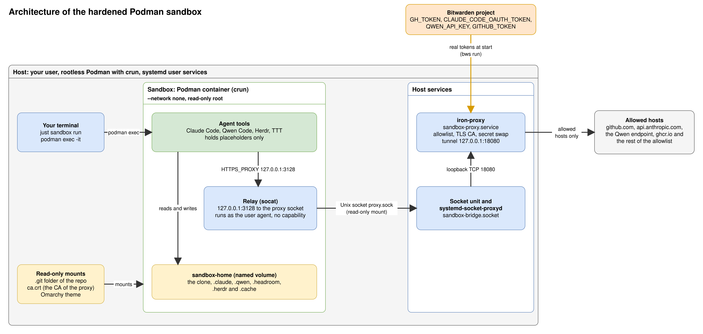
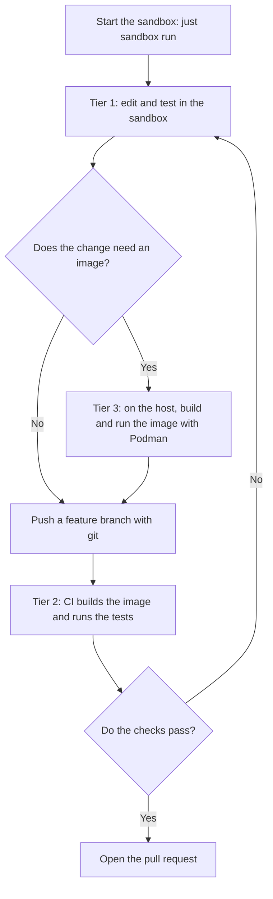

# The Podman sandbox

A sandbox for AI agents. The agent runs in a hardened, rootless Podman container with the `crun` runtime. The container has no network. The only way out is iron-proxy on the host. It allows the listed hosts and swaps placeholders for real tokens. The container never holds a real token. The agent cannot change the sandbox.

**Status:** this folder replaces `.msb/` in steps. `.msb/` stays in use until you switch. The host proxy is in [`proxy/`](proxy/README.md). The CI workflow for tier 2 (see "Developer workflow") is not here yet.

| Path | Content |
|---|---|
| `image/` | The image, `sandbox-entry`, `sandbox-start` and the `mise` tasks. |
| `compose.yaml` | The two containers: their environment, hardening flags, mounts and volumes. |
| `justfile` | `run`. It starts the container with `podman-compose up -d` and opens Herdr in it. |

## Architecture

[](docs/diagrams/architecture.svg)

## How a request leaves the sandbox

1. A tool sends its request to `HTTPS_PROXY`, which is `http://127.0.0.1:3128`.
2. `sandbox-entry` starts one `socat` relay on that address. It copies the bytes to the Unix socket `/run/sandbox/proxy/proxy.sock`.
3. On the host, a systemd socket unit owns `proxy.sock`. `systemd-socket-proxyd` copies it to the tunnel port of iron-proxy (`127.0.0.1:18080`). There is no `socat` on the host.
4. iron-proxy ends the TLS with its own CA and checks the host. An unlisted host gets `403`. For a listed host, iron-proxy swaps each placeholder (`sandbox-placeholder-<NAME>`) for the real token and sends the request on.

**Why does `--network none` leave no route to the host?** The container has its own loopback interface, and nothing else. Its `127.0.0.1` is not the loopback of the host. Only a file crosses the wall: the socket in the mounted folder.

**Why a relay?** Tools need a TCP address for a proxy. The relay turns that address into the socket. It runs as the user agent and has no capability. The socket has the mode 0666, so the agent opens it. Only you and the containers that mount the folder reach it, because `$XDG_RUNTIME_DIR` has the mode 0700.

**Why is the CA mounted and not installed?** The root file system is read-only, so `update-ca-certificates` cannot run. `compose.yaml` mounts `~/.local/state/sandbox/ca.crt` read-only over `/etc/ssl/certs/ca-certificates.crt`. All HTTPS goes through the proxy, which ends the TLS with this CA, so the sandbox trusts this CA only. The file never mounts `ca.key`. If you make a new CA, restart the sandbox.

**The host side:** the units are `sandbox-proxy.service`, `sandbox-bridge.socket` and `sandbox-bridge.service`. iron-proxy uses the ports 18080 to 18089 on `127.0.0.1`. See [`proxy/README.md`](proxy/README.md). `just sandbox run` stops with a message if the socket `$XDG_RUNTIME_DIR/sandbox/proxy.sock` is missing. Start the proxy with `systemctl --user start sandbox-proxy`.

## Install and use

Start the host proxy first. You need `podman-compose` (tested with version 1.6.0). Then build the image and run the sandbox:

```shell
podman build .sandbox/image -t localhost/sandbox-dev:latest   # once. The first build takes several minutes.
just sandbox run     # starts the container if it does not run, and opens Herdr
```

`compose.yaml` declares the volume `sandbox-home`. The first `run` makes it. The owner of `/home/agent` in the image, user `agent`, becomes the owner of a new volume. The container mounts the `.git` folder of the repo that you run `just` in, read-only, and clones it. The clone has the git identity `agent`. Set yours with `git config` in the clone.

| Command | What it does |
|---|---|
| `just sandbox run` | Starts the container if it does not run. Opens Herdr with `podman exec -it sandbox herdr`. Close the terminal and the sandbox keeps running. |
| `podman logs -f sandbox` | Follows the log. |
| `podman stop sandbox` | Stops the container. The volume stays. The next `run` replaces the container. |

## Hardening

`compose.yaml` sets these controls.

| Control | What it does |
|---|---|
| `--runtime=crun --network=none` | A small runtime. The container has the loopback interface only. |
| `--read-only` | The agent cannot write to `/etc`, `/usr`, `/opt/mise`, the policy of Claude Code or the CA. |
| tmpfs on `/tmp` and `/run` | Scratch space. A restart empties it. |
| The named volume `sandbox-home` at `/home/agent` | The clone, the logins and the histories stay here. The start script copies the home files of the image back at each start. |
| `--cap-drop=ALL` | The container has no capability. |
| `--security-opt no-new-privileges` | A setuid program cannot raise a privilege. |
| The default seccomp profile of Podman | A system call filter. A custom profile is not part of this change. |
| `user: agent` (uid 1000) | The container starts as `agent`, not as root. In rootless Podman, `agent` is a subuid, not your host user. |
| `--pids-limit`, `--memory`, `--cpus` | 1024 processes, 3 GB, 4 CPUs. |
| Read-only mounts | The CA, the proxy socket folder, the `.git` of the repo and the theme. |

## Developer workflow

The sandbox has no container engine. You build and run images on the host with `podman build` and `podman run`. Read the Containerfile that the agent wrote before you build it. A `RUN` step runs on the host with the network of the host, not through the proxy.



| Tier | Where | Work |
|---|---|---|
| 1 | The sandbox | Lint, render manifests, unit tests: `flux build`, `kubeconform`, `terraform validate`, `pytest`, `go test`. |
| 2 | CI | Build and test the image. The registry push token is not in the sandbox. |
| 3 | The host | Build the image with `podman build`. Run a container to debug it. |

## What does not work

- **No `podman`, no `docker`, no `buildah`.** The sandbox has no container engine. Build and run images on the host.
- **No SSH and no raw TCP.** The proxy passes HTTP and TLS. Use HTTPS remotes for `git`.
- **A tool that ignores `HTTPS_PROXY` fails.** It has no route.
- **No `sudo` and no package install.** The root file system is read-only. Change the image.
- **The agent runs as a sub-user of your host user.** The container shares the host kernel. A microVM is a stronger boundary.
- **Listed hosts can receive data from the agent.** Keep the allowlist short.
