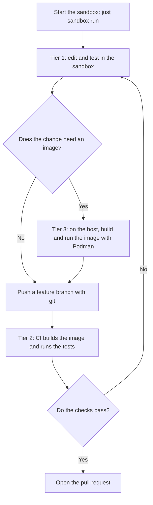

# The Podman sandbox

A sandbox for AI agents. The agent runs in a hardened, rootless Podman container with the gVisor runtime (`runsc`). gVisor runs the system calls of the agent in a user-space kernel, the sentry. The container has no network. The only way out is iron-proxy on the host. It allows the listed hosts and swaps placeholders for real tokens. The container never holds a real token. The agent cannot change the sandbox.

**Status:** this folder replaces `.msb/` in steps. `.msb/` stays in use until you switch. The host proxy is in [`proxy/`](proxy/README.md). The CI workflow for tier 2 (see "Developer workflow") is not here yet.

| Path | Content |
|---|---|
| `image/` | The image, `sandbox-entry`, `sandbox-start` and the `mise` tasks. |
| `sandbox.container` | The Quadlet unit of the container: its environment, hardening flags, mounts, volume and limits. |
| `justfile` | `setup`, `run`, `rm` and `build`. `setup` installs the host proxy, links the unit and registers gVisor. `run` starts the unit and opens Herdr in the container. |

## Architecture

[](docs/diagrams/architecture.svg)

The network path in detail:

[](docs/diagrams/sandbox-network.svg)

## How a request leaves the sandbox

1. A tool sends its request to `HTTPS_PROXY`, which is `http://127.0.0.1:3128`.
2. `sandbox-entry` starts one `socat` relay on that address. It copies the bytes to the Unix socket `/run/sandbox/proxy/proxy.sock`.
3. On the host, a systemd socket unit owns `proxy.sock`. `systemd-socket-proxyd` copies it to the tunnel port of iron-proxy (`127.0.0.1:18080`). There is no `socat` on the host.
4. iron-proxy ends the TLS with its own CA and checks the host. An unlisted host gets `403`. For a listed host, iron-proxy swaps each placeholder (`sandbox-placeholder-<NAME>`) for the real token and sends the request on.

| Part | What it is |
|---|---|
| `socat` | Copies bytes between two connections. In the container, it listens on `127.0.0.1:3128` and connects to `proxy.sock`. Tools need a TCP address, and the only way out is a file. |
| `proxy.sock` | One Unix socket file on the host: `$XDG_RUNTIME_DIR/sandbox/proxy.sock`. The container mounts its folder read-only. A connect to this file reaches the host side. |
| `sandbox-bridge.socket` | A systemd unit. It makes and owns `proxy.sock`. There is no second socket file. |
| `sandbox-bridge.service` | A systemd unit. systemd starts it at the first connection. It runs `systemd-socket-proxyd`, which copies the bytes from `proxy.sock` to iron-proxy at `127.0.0.1:18080`. iron-proxy listens on TCP only, so the host needs the bridge. |
| The sentry | The guest kernel of gVisor. It runs the system calls of the agent. It runs as your user on the host. |
| The gofer | A gVisor helper process on the host. The sentry does not open host files. The gofer opens them for it. With `host-uds=open`, the gofer connects to `proxy.sock` and gives the open connection to the sentry. |

**Why does `--network none` leave no route to the host?** The container has an empty network namespace. It holds the loopback interface and nothing else. gVisor uses that namespace as it is (the runsc flag `network=host`, which is not the Podman flag). Its `127.0.0.1` is not the loopback of the host. Only a file crosses the wall: the socket in the mounted folder.

**Why does the host bring up the loopback interface?** gVisor does not let the guest bring up `lo`, and without it `127.0.0.1` has no route. After the start, `ExecStartPost` in `sandbox.container` runs `ip link set lo up` in the network namespace of the container. `socat` can bind before that, and the connect works after it.

**Is `host-uds=open` safe?** gVisor blocks a connect to a host Unix socket by default. This flag allows it for every socket that a mount shows to the guest. The container mounts the proxy folder, the CA, the theme and the `.git` folder. A test found no other host socket in the guest. Do not mount a folder that holds another socket.

**Why a relay?** Tools need a TCP address for a proxy. The relay turns that address into the socket. It runs as the user agent and has no capability. The socket has the mode 0666, so the agent opens it. Only you and the containers that mount the folder reach it, because `$XDG_RUNTIME_DIR` has the mode 0700.

**Why is the CA mounted and not installed?** The root file system is read-only, so `update-ca-certificates` cannot run. `sandbox.container` mounts `~/.local/state/sandbox/ca.crt` read-only over `/etc/ssl/certs/ca-certificates.crt`. All HTTPS goes through the proxy, which ends the TLS with this CA, so the sandbox trusts this CA only. The file never mounts `ca.key`. If you make a new CA, restart the sandbox.

**The host side:** the units are `sandbox-proxy.service`, `sandbox-bridge.socket` and `sandbox-bridge.service`. iron-proxy uses the ports 18080 to 18089 on `127.0.0.1`. See [`proxy/README.md`](proxy/README.md). `just sandbox run` stops with a message if the socket `$XDG_RUNTIME_DIR/sandbox/proxy.sock` is missing. Start the proxy with `systemctl --user start sandbox-proxy`.

## Install and use

The host needs `podman`, `runsc` (gVisor), `git`, `openssl`, `systemd-creds`, `ip` and `nsenter`. The tests used `runsc` release 20261102.0 and Podman 6.1.4. The host also needs `iron-proxy` and `bws`: run `mise install` in your main checkout, because `mise.toml` lists them. `just` stops with a message if `runsc`, `iron-proxy`, `bws` or another tool of the justfile is missing. Follow these steps in your main checkout:

1. Check [what the setup assumes](proxy/README.md#what-this-setup-assumes): the registry is `ghcr.io`, the secret manager is Bitwarden Secrets Manager, and the secrets are already there.
2. Set up the host. It links `iron-proxy` and `bws`, makes the CA, links the container unit, registers gVisor in `~/.config/containers/containers.conf.d/runsc.conf`, encrypts the token and starts the proxy units. Run it again after you edit a file in `proxy/` or `sandbox.container`.
3. Build the image.
4. Run the sandbox.

```shell
just sandbox setup   # asks for the access token, then installs the host proxy, the container unit and the gVisor runtime
just sandbox build   # builds the image, tags it with the commit and pushes it to ghcr.io. The first build takes several minutes.
just sandbox run     # starts the container if it is not running, and opens Herdr
```

`sandbox.container` uses the volume `sandbox-home`. The first `run` makes it. The owner of `/home/agent` in the image, user `agent`, becomes the owner of a new volume. `run` writes a drop-in file, `~/.config/containers/systemd/sandbox.container.d/checkout.conf`, because Quadlet does not read shell variables. The file mounts the `.git` folder of the repo that you run `just` in, read-only, and names its branch. The container clones that folder. The clone has the git identity `agent`. Set yours with `git config` in the clone.

| Command | What it does |
|---|---|
| `just sandbox setup` | Installs and starts the host proxy, links the container unit and registers gVisor. Asks for the Bitwarden access token if the credential is missing. Run it again after you edit a file in `proxy/` or `sandbox.container`. |
| `just sandbox run` | Starts `sandbox.service` if it is not running. A running container stays as it is. Waits until the container is healthy, then opens Herdr with `podman exec`. Close the terminal and the sandbox keeps running. |
| `podman ps` | Shows `(starting)`, `(healthy)` or `(unhealthy)` for the container. It is healthy after `sandbox-start` finishes. |
| `podman logs -f sandbox` | Follows the log. |
| `systemctl --user status sandbox` | Shows the service. `failed` means a limit killed the sandbox. `just sandbox run` starts it again. |
| `just sandbox rm` | Stops the service and removes the container. The volume stays. Run it after you edit `sandbox.container` or rebuild the image, then run `just sandbox run`. `podman stop sandbox` does the same, because the service removes a stopped container. |
| `just sandbox build` | Builds the image, tags it with the commit and pushes it to `ghcr.io`. The registry cache makes later builds faster. It needs the credential that `just sandbox setup` makes, and asks for no password. Flags go to `podman build`: `just sandbox build --no-cache` updates the tools that the Dockerfile pins by a prefix. |

## Hardening

`sandbox.container` sets these controls.

| Control | What it does |
|---|---|
| `--runtime=runsc --network=none` | gVisor. The sentry runs the system calls of the agent. The container has an empty network namespace with the loopback interface only. |
| `--read-only` | The agent cannot write to `/etc`, `/usr`, `/opt/mise`, the policy of Claude Code or the CA. |
| tmpfs on `/tmp` and `/run` | Scratch space. A restart empties it. |
| The named volume `sandbox-home` at `/home/agent` | The clone, the logins and the histories stay here. The start script copies the home files of the image back at each start. |
| `--cap-drop=ALL` | The container has no capability. |
| `--security-opt no-new-privileges` | A setuid program cannot raise a privilege. |
| The default seccomp profile of Podman | A system call filter. Not tested under gVisor. gVisor has its own filter between the sentry and the host. A custom profile is not part of this change. |
| `User=agent` (uid 1000) | The container starts as `agent`, not as root. In rootless Podman, `agent` is a subuid, not your host user. The sentry and the gofer run as your host user. |
| `MemoryMax`, `MemorySwapMax`, `TasksMax`, `CPUQuota` in `[Service]` | 3 GB of memory with no swap, 2048 host threads, 4 CPUs. gVisor ignores the limits of Podman, so they are on the service. The kernel kills a sandbox that goes over a limit. |
| Read-only mounts | The CA, the proxy socket folder, the `.git` of the repo and the theme. |

## Developer workflow

The sandbox has no container engine. You build and run images on the host with `podman build` and `podman run`. Read the Containerfile that the agent wrote before you build it. A `RUN` step runs on the host with the network of the host, not through the proxy.



| Tier | Where | Work |
|---|---|---|
| 1 | The sandbox | Lint, render manifests, unit tests: `flux build`, `kubeconform`, `terraform validate`, `pytest`, `go test`. |
| 2 | CI | Build and test the image. The registry push token is not in the sandbox. |
| 3 | The host | Build the image with `podman build`. Run a container to debug it. |

## What does not work

- **No `podman`, no `docker`, no `buildah`.** The sandbox has no container engine. Build and run images on the host.
- **No SSH and no raw TCP.** The proxy passes HTTP and TLS. Use HTTPS remotes for `git`.
- **A tool that ignores `HTTPS_PROXY` fails.** It has no route.
- **No `sudo` and no package install.** The root file system is read-only. Change the image.
- **gVisor is not a microVM.** The sentry is a process on the host kernel. It reduces the host system calls that the agent can reach. The sentry and the gofer run as your host user. A bug in the sentry gives an attacker your user, not a subuid. A microVM is a stronger boundary.
- **A limit kills the whole sandbox.** With `crun`, one process dies. With gVisor, the kernel kills the sentry, and the service shows `failed`. A memory bomb or a fork bomb ends the sandbox and not the host. Run `just sandbox run` to start it again. The clone stays in the volume.
- **gVisor is slower.** In an earlier test, new TLS connections took about 2 times longer. See [the handoff](../docs/handoff/podman-gvisor-sandbox.md).
- **Listed hosts can receive data from the agent.** Keep the allowlist short.
