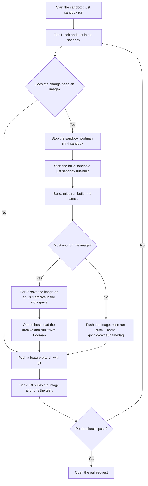

# The Podman sandbox

A sandbox for AI agents. The agent runs in a hardened, rootless Podman container with the `crun` runtime. The container has no network. The only way out is iron-proxy on the host. It allows the listed hosts and swaps placeholders for real tokens. The container never holds a real token. The agent cannot change the sandbox.

**Status:** this folder replaces `.msb/` in steps. `.msb/` stays in use until you switch. The host proxy is in [`proxy/`](proxy/README.md). Set it up first. The CI workflow for tier 2 (see "Developer workflow") is not here yet.

| Path | Content |
|---|---|
| `compose.yaml` | The hardened container, the build profile and the self-test. |
| `seccomp.json` | The seccomp profile. |
| `egress-selftest.sh` | The self-test. It runs in the container as the user `agent`. |
| `image/` | The image, `sandbox-entry`, `sandbox-start` and the `mise` tasks. |
| `justfile` | `build`, `run` and `run-build`. |

## Architecture

[](docs/diagrams/architecture.svg)

## How a request leaves the sandbox

1. A tool sends its request to `HTTPS_PROXY`, which is `http://127.0.0.1:3128`.
2. `sandbox-entry` starts one `socat` relay on that address. It copies the bytes to the Unix socket `/run/sandbox/proxy/proxy.sock`.
3. On the host, a systemd socket unit owns `proxy.sock`. `systemd-socket-proxyd` copies it to the tunnel port of iron-proxy (`127.0.0.1:18080`). There is no `socat` on the host.
4. iron-proxy ends the TLS with its own CA and checks the host. An unlisted host gets `403`. For a listed host, iron-proxy swaps each placeholder (`sandbox-placeholder-<NAME>`) for the real token and sends the request on.

**Why does `--network none` leave no route to the host?** The container has its own loopback interface, and nothing else. Its `127.0.0.1` is not the loopback of the host. Only a file crosses the wall: the socket in the mounted folder. Nothing else in the container can reach the host.

**Why a relay?** Tools need a TCP address for a proxy. The relay turns that address into the socket. It runs as container root, which is the host user who owns the socket. It has no capability. The agent user cannot open the socket.

**Why is the CA mounted and not installed?** The root file system is read-only, so `update-ca-certificates` cannot run. The compose file mounts `~/.local/state/sandbox/ca.crt` read-only over `/etc/ssl/certs/ca-certificates.crt`. All HTTPS goes through the proxy, which ends the TLS with this CA, so the sandbox trusts this CA only. The compose file never mounts `ca.key`. If you make a new CA, restart the sandbox.

**The host side:** the units are `sandbox-proxy.service`, `sandbox-bridge.socket` and `sandbox-bridge.service`. Start them with `systemctl --user start sandbox-proxy sandbox-bridge.socket`. iron-proxy uses the ports 18080 to 18089 on `127.0.0.1`. See [`proxy/README.md`](proxy/README.md).

## Hardening

| Control | What it does |
|---|---|
| `runtime: crun`, `network_mode: none` | A small runtime. The container has the loopback interface only. |
| `read_only: true` | The agent cannot write to `/etc`, `/usr`, `/opt/mise`, the policy of Claude Code or the CA. |
| tmpfs for `/tmp`, `/run` and `/home/agent` | Scratch space. A restart gives the agent a clean home. Only the named volumes keep data. |
| `cap_drop: [ALL]` | The entry drops the agent to an empty capability set. |
| `no-new-privileges` | A setuid program cannot raise a privilege. |
| `seccomp.json` | A system call filter. See below. |
| User `agent` (uid 1000) | Not root. |
| `pids_limit`, `mem_limit`, `cpus` | 1024 processes, 3 GB, 4 CPUs. |
| Read-only mounts | The CA, the proxy socket folder, the `.git` of the repo and the theme. |

`egress-selftest.sh` proves the network and the read-only checks as `agent`. Run it with the proxy up. For a test, start the proxy with dummy tokens (see the proxy README):

```shell
export SANDBOX_DIR=$PWD/.sandbox SANDBOX_GIT_DIR=$(git rev-parse --path-format=absolute --git-common-dir)
podman-compose -p sandbox -f .sandbox/compose.yaml --profile selftest run --rm selftest
```

### The seccomp profile

`seccomp.json` is `/usr/share/containers/seccomp.json` without these system calls: `ptrace`, `bpf`, `keyctl`, `add_key`, `request_key`, `userfaultfd`, `perf_event_open`, `io_uring_setup`, `io_uring_enter`, `io_uring_register`, `kexec_load`, `kexec_file_load`, `open_by_handle_at`, `unshare`, `setns`, `mount`, `umount2` and `pivot_root`. The default profile allows `ptrace`, `unshare`, `setns`, `mount`, `umount2`, `pivot_root` and `keyctl` with no condition.

`seccomp-build.json` is the build profile. It removes the same calls except `unshare`, `setns`, `mount`, `umount2` and `pivot_root`, because `buildah` needs a user namespace. To review or make the files again:

```shell
common='"ptrace","bpf","keyctl","add_key","request_key","userfaultfd","perf_event_open","io_uring_setup","io_uring_enter","io_uring_register","kexec_load","kexec_file_load","open_by_handle_at"'
make() { jq --argjson rm "[$1]" '.syscalls |= (map(.names -= $rm) | map(select(.names | length > 0)))' /usr/share/containers/seccomp.json; }
make "$common" > .sandbox/seccomp-build.json
make "$common,\"unshare\",\"setns\",\"mount\",\"umount2\",\"pivot_root\"" > .sandbox/seccomp.json
```

## Developer workflow

The sandbox has no container engine. A build makes an image. You run the image on the host or in CI.



| Tier | Where | Work |
|---|---|---|
| 1 | The sandbox | Lint, render manifests, unit tests: `flux build`, `kubeconform`, `terraform validate`, `pytest`, `go test`. |
| 2 | CI | Build and test the image. The registry push token is not in the sandbox. |
| 3 | The host | Run a container to debug it. |

**Build and push.** `mise` tasks call `buildah`. They work in the build profile.

| Run | Docker command |
|---|---|
| `mise run build -- -t name .` | `docker build -t name .` (`buildah bud --isolation chroot`) |
| `mise run login` | `docker login ghcr.io`. The proxy swaps in the real token. |
| `mise run push -- name ghcr.io/owner/name:tag` | `docker push` |

A base image and every download in a `RUN` step go through the proxy, so their hosts must be on the allowlist. **Run the image on the host:** save it with `buildah push name oci-archive:/home/agent/engineersdaybook/name.tar:localhost/name:latest`. Then load it from the workspace volume:

```shell
podman unshare cat "$(podman volume inspect sandbox-workspace -f '{{.Mountpoint}}')/engineersdaybook/name.tar" | podman load
podman run --rm -p 8080:8080 localhost/name:latest
```

### What the build profile gives up

`sandbox-build` adds `CHOWN`, `DAC_OVERRIDE`, `FOWNER`, `SYS_CHROOT`, `SETUID` and `SETGID` to the agent. It has no `SYS_ADMIN`. `buildah` needs them for chroot isolation. They let the agent ignore file permissions in the container and change to any user id, root too. Container root is your host user, but every host path in the container is read-only.

The root file system of `sandbox-build` is **writable**. `buildah` chroot isolation fails on a read-only root. The agent can change `/etc` and `/usr` in this container, and it loses the changes at `podman rm`. A `RUN` step runs with the authority of the agent. Use the default sandbox when you do not build, and run only one of the two. `just sandbox run-build` opens its shell through `sandbox-entry`. A plain `podman exec -u agent` shell has no capability.

## Getting started

Prerequisites: `podman` with `crun`, `podman-compose`, `just`, `jq`, a range of 65536 ids in `/etc/subuid`, and the host proxy.

```shell
just sandbox build   # the first build takes several minutes
just sandbox run     # starts the sandbox if it does not run, and opens Herdr
```

Close the terminal and the sandbox keeps running. Run `just sandbox run` again for the same Herdr session. Other commands:

```shell
podman ps -a --filter name=^sandbox   # status
podman rm -f sandbox sandbox-build    # stop. The volumes stay. `podman volume rm sandbox-<name>` removes one
```

## What does not work

- **No `podman run`, no `docker`.** The sandbox has no engine. `buildah` builds and pushes.
- **No SSH and no raw TCP.** The proxy passes HTTP and TLS. Use HTTPS remotes for `git`.
- **A tool that ignores `HTTPS_PROXY` fails.** It has no route.
- **A tool that needs a user namespace or `ptrace` fails.** The seccomp profile denies them. A browser sandbox is an example.
- **No `sudo` and no package install.** The root file system is read-only. Change the image.
- **The agent runs as a sub-user of your host user.** The container shares the host kernel. A microVM is a stronger boundary.
- **Listed hosts can receive data from the agent.** Keep the allowlist short.
