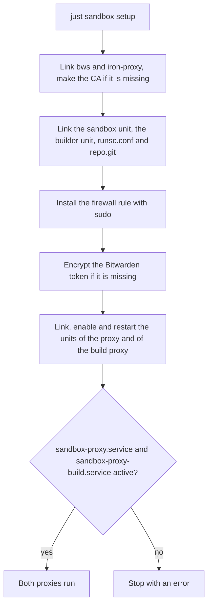
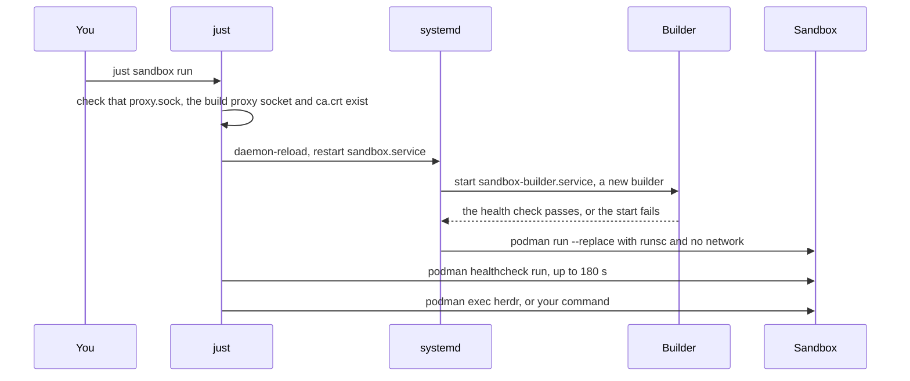
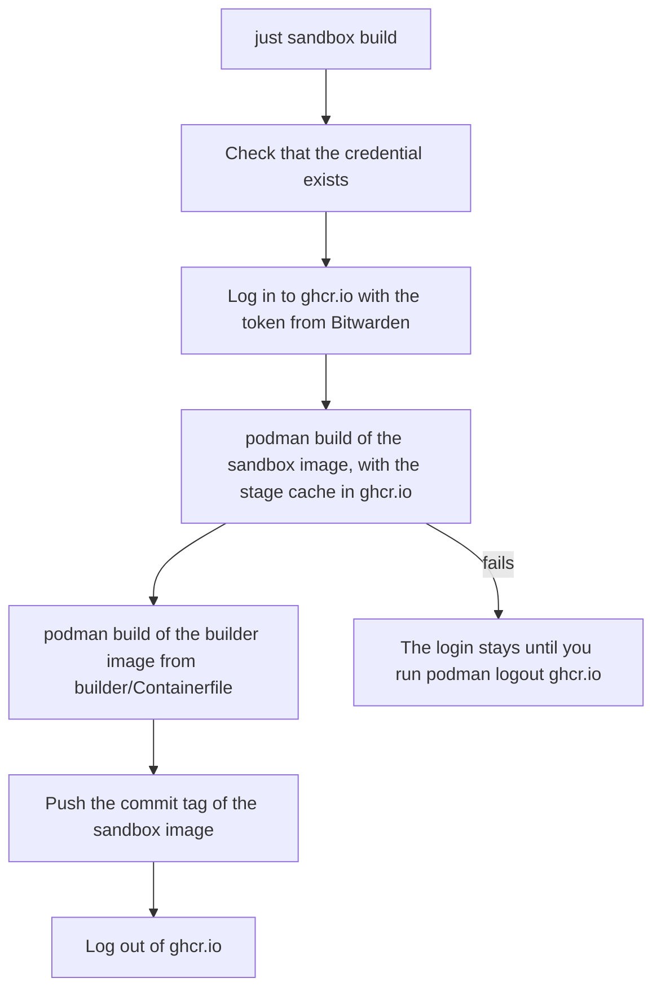
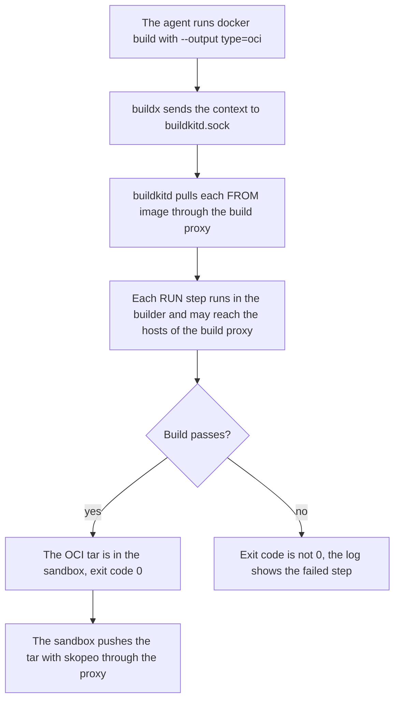

# Agent Sandbox

A sandbox for AI agents. It runs Claude Code, Qwen Code and the Fresh editor in a hardened rootless Podman container with gVisor.

## The problem and the solution

**The problem.** A coding agent reads text that you did not write: issues, web pages, packages and files. That text can hold a prompt injection. A fooled agent runs commands with your rights. It can read your tokens, send your data to an outside host or change files in your repo. The rules of a model do not stop this, because its defenses are not certain.

**The solution.** Limit what the agent can do, not what it chooses to do. The sandbox sets four limits:

- **No network.** The container has no route out. The only way out is a host proxy with an allowlist.
- **No real token.** The container holds placeholders. The proxy puts in the real token for the listed hosts only.
- **A private clone.** The agent works on a clone of your repo. It cannot write to your repo.
- **A hardened container.** gVisor, no capability, a read-only root file system and limits on memory, CPU and threads.

A fooled agent can use only what the sandbox allows.

## Architecture

[](docs/diagrams/architecture.svg)

The sandbox has two containers: the agent sandbox and the builder. Both run in gVisor and have no network device. The agent sandbox reaches the internet only through the host proxy. The builder reaches it only through the build proxy, which checks host names and holds no token. A request of the agent sandbox goes this way:

1. A tool sends its request to `HTTPS_PROXY` (`http://127.0.0.1:3128`).
2. `socat` in the container copies the bytes to the Unix socket `proxy.sock`.
3. On the host, `systemd-socket-proxyd` copies them to iron-proxy (`127.0.0.1:18080`).
4. iron-proxy checks the host. An unlisted host gets `403`. For a listed host, iron-proxy replaces each placeholder with the real token and sends the request.

For the details, see [How it works in detail](docs/internals.md).

## Quick start

Run these steps in your main checkout.

1. Read [what the setup assumes](proxy/README.md#what-this-setup-assumes). The registry is `ghcr.io`. The secret manager is Bitwarden Secrets Manager. The secrets already exist.
2. Run `mise install`. It installs `bws` and `iron-proxy`. The host also needs `podman`, `runsc`, `git`, `openssl`, `systemd-creds`, `systemd-socket-proxyd`, `ip`, `nsenter`, `nft` and `sudo`. The sandbox has a memory limit of 3 GB and the builder has a limit of 2 GB.
3. Run these commands:

```shell
just sandbox setup   # install the host proxies, the firewall rule and the container units
just sandbox build   # build the image and push it to ghcr.io
just sandbox run     # start the container and open Herdr
```

`setup` asks for your `sudo` password. It asks for the Bitwarden access token only if the credential is missing or unreadable. Run it again after you edit a file in `proxy/`, `builder/`, `runsc.conf` or `sandbox.container`.

## Commands

| Command | What it does |
|---|---|
| `just sandbox setup` | Installs the host proxy, the build proxy, the firewall rule, the container units and the gVisor flags. |
| `just sandbox run` | Makes a new container from the image and opens Herdr. Herdr needs a terminal. Add a command to run it in place of Herdr. |
| `just sandbox rm` | Stops the service and removes the container and the builder. The volume stays. |
| `just sandbox build` | Builds the image of the sandbox and the image of the builder. Tags the sandbox image with the commit and pushes it. `just sandbox build --no-cache` updates the pinned tools. |
| `podman ps` | Shows `(starting)`, `(healthy)` or `(unhealthy)`. |
| `podman logs -f sandbox` | Follows the log of the container. |

The volume `sandbox-home` keeps the clone, the logins and the histories. Each `run` stops the processes of the old container.

## Builder

The agent builds an image with `docker`. `docker` sends the build through `buildx` to BuildKit (`buildkitd`), which runs in a second container, the builder. The builder runs in gVisor and has no network device. It holds no secret.

1. `sandbox.service` requires `sandbox-builder.service`. The builder starts first.
2. `buildkitd` makes the socket `$XDG_RUNTIME_DIR/sandbox/buildkit/buildkitd.sock` in a folder on the host.
3. The sandbox mounts the folder read-only at `/run/sandbox/buildkit`.
4. `DOCKER_CONFIG=/etc/docker` and `BUILDX_BUILDER=sandbox` make `docker build` use the builder `sandbox`. The definition of this builder is in the read-only folder `/etc/docker`, so the agent cannot change it.
5. A stop or a restart of `sandbox.service` stops the builder. The state of `buildkitd` is in memory, so the cache and every file of the build are gone.

The Podman health check of the builder runs `buildctl debug workers` inside the builder. If it fails at the start, `just sandbox run` fails. If it fails later, Podman stops the builder and systemd restarts it with an empty cache.

### Build and push

Run `docker build` as you do on any host. A normal Dockerfile builds as it is. The builder pulls each `FROM` image. A `RUN` step can download from the hosts on the allowlist of the build proxy.

```shell
docker build -t ghcr.io/raghav19/<NAME>:<TAG> --output type=oci,dest=/tmp/image.tar .
```

The sandbox has no Docker daemon, so the result is a tar file. Without `--output`, the result stays in the cache of the builder and `docker` prints a warning. The sandbox pushes the tar with `skopeo`. The builder never pushes, so it holds no registry login.

```shell
skopeo inspect oci-archive:/tmp/image.tar
skopeo copy --dest-creds "raghav19:$GHCR_PUSH_TOKEN" oci-archive:/tmp/image.tar docker://ghcr.io/raghav19/<NAME>:<TAG>
```

`GHCR_PUSH_TOKEN` holds a placeholder. The proxy replaces it with the real token. Without `--dest-creds`, the push fails with `403`.

| Command | In the sandbox |
|---|---|
| `docker build`, `docker buildx build`, `docker buildx bake` | Work. Use `--output type=oci,dest=FILE`. |
| `docker build --push`, `--load` | Fail. The builder has no registry login, and there is no daemon. |
| `docker push`, `docker run`, `docker images`, `docker tag`, `docker compose` | Fail. There is no Docker daemon and no local image store. |

### The build proxy

The builder reaches the internet through a second proxy, the build proxy. It is a second instance of iron-proxy in the mode `sni-only`. It passes TLS through to the real host and checks only the host name. It holds no token and no CA, so a build step trusts the real certificate of the host.

| Part | Detail |
|---|---|
| Hosts | The list `domains` in `proxy/iron-proxy-build.yaml`: image registries, package registries (Go, npm, PyPI, Debian, Alpine, HashiCorp) and GitHub downloads. An unlisted host gets `403`. To add a host, edit the file and run `just sandbox setup`. |
| Path | A relay in the builder (`socat`, `127.0.0.1:3129`) copies the bytes to the socket `$XDG_RUNTIME_DIR/sandbox-build/proxy.sock`. `systemd-socket-proxyd` joins it to the build proxy (`127.0.0.1:18085`). |
| Variables | `HTTPS_PROXY` and `HTTP_PROXY` in the builder point to the relay. `/etc/docker/config.json` has the same address in `proxies`, so `docker` passes it to each `RUN` step. |
| Isolation | The builder mounts only the folder `sandbox-build`. It cannot see `proxy.sock` of the sandbox, and nothing listens on `127.0.0.1:3128` in the builder. A build step cannot get a real token. |
| Private images | The build proxy cannot add a login. Pull a private base image in the sandbox with `skopeo copy ... oci:/tmp/base:TAG`, and give it to the build with `--build-context NAME=oci-layout:///tmp/base@sha256:DIGEST`. |

| Fact | Detail |
|---|---|
| Who may connect | Any process that reaches the socket. BuildKit has no authorization. The agent and the builder use the same subuid, and no other user reaches the folder. |
| What a build step can do | Run any command as root in the builder. It can reach the hosts of the build proxy and nothing else. The wall is the builder container: no network device, no secret, and no mount except the two socket folders. |
| What stays off | The entitlements `network.host`, `security.insecure` and `device`. BuildKit denies them by default. Do not enable them. |
| Limits | 2 GB of memory with no swap, 1 GB of cache in `tmpfs`, 1024 host threads, 2 CPUs. A build that fills the cache fails with "No space left on device". The builder stays up. |

## Command flows

The flows of `setup`, `run` and `build`, and the flow of a build in the sandbox.

### Setup

`just sandbox setup` runs once. Run it again after you edit a file in `proxy/`, `builder/`, `runsc.conf` or `sandbox.container`.



If a step fails, `setup` stops. The proxy does not start after a failed firewall step.

### Run

`just sandbox run` starts a new sandbox and a new builder.



The builder starts first. If its health check fails, the start fails and `run` stops with an error.

### Build the image

`just sandbox build` builds the image of the sandbox and pushes it to `ghcr.io`.



### Build in the sandbox

The agent builds an image with `docker`. The builder runs the build. See [One build](docs/internals.md#one-build) for the steps in order.



## Security controls

Each row is one attack of an injected agent and the control that stops it.

| If the agent tries to | What stops it |
|---|---|
| Plant a git hook or a config change in your repo | The agent works in a clone, not in your checkout. The `.git` folder of your repo is a read-only mount. |
| Steal a token | The container holds placeholders. The real tokens stay on the host. |
| Send data to an unlisted host | The container has no network. The proxy answers `403` for a host that is not on the allowlist. |
| Break out of the container | gVisor, no capability, `no-new-privileges` and a user that is not root. |
| Use the proxy from another process | The firewall rule lets only your user connect to the ports of the proxy and of the build proxy. |
| Move code to your host | The only way out is a `git push` to GitHub through the proxy. You read the branch before you check it out. |
| Use all memory, CPU or threads | The service limits. The kernel kills the sandbox, not the host. |

`sandbox.container` sets these controls.

| Control | What it does |
|---|---|
| `--runtime=runsc --network=none` | gVisor. The sentry runs the system calls of the agent. The container has an empty network namespace with the loopback interface only. |
| `--read-only` | The agent cannot write to `/etc`, `/usr`, `/opt/mise`, the policy of Claude Code or the CA. |
| tmpfs on `/tmp` and `/run` | Scratch space. A restart empties it. |
| The named volume `sandbox-home` at `/home/agent` | The clone, the logins and the histories stay here. The start script copies the home files of the image back at each start. |
| The repo in clone mode | The unit mounts the `.git` folder of your repo at `/run/sandbox/source`, read-only. At the first start, `sandbox-start` clones it to `/home/agent/engineersdaybook` in the volume. Git runs the hooks in `.git/hooks` and reads `.git/config` on the host, so a writable `.git` would let an injected agent plant code that runs on the host. The agent can change only its clone. The `origin` of the clone is the GitHub URL. |
| `--cap-drop=ALL` | The container has no capability. |
| `--security-opt no-new-privileges` | A setuid program cannot raise a privilege. |
| The default seccomp profile of Podman | A system call filter. gVisor has its own filter between the sentry and the host. |
| `User=agent` (uid 1000) | The container starts as `agent`, not as root. In rootless Podman, `agent` is a subuid, not your host user. The sentry and the gofer run as your host user. |
| `MemoryMax`, `MemorySwapMax`, `TasksMax`, `CPUQuota` in `[Service]` | 3 GB of memory with no swap, 2048 host threads, 4 CPUs. gVisor ignores the limits of Podman, so they are on the service. The kernel kills a sandbox that goes over a limit. |
| Read-only mounts | The CA, the proxy socket folder, the `.git` of the repo and the theme. |
| The nftables rule `proxy/sandbox-guard.nft` | Only your user may connect to the ports of the proxy and the build proxy on `127.0.0.1`. The ports are TCP 18080 to 18083 and 18085 to 18088, and UDP 18084 and 18089. It separates users. It does not separate programs of the same user. `just sandbox setup` installs it with `sudo`. |

## Limits

- Build images with `docker build` and push them with `skopeo`. See [Builder](#builder). A build step reaches only the hosts of the build proxy.
- No SSH and no raw TCP. Use HTTPS remotes. A tool that ignores `HTTPS_PROXY` has no route.
- No `sudo` and no package install. Change the image.
- gVisor is not a microVM. A bug in the sentry gives an attacker your host user.
- The firewall rule separates users only. A rootless container of your user that has a route to the host loopback can still connect to the proxy ports.
- The clone starts on the current branch of your repo. Commits use the name `agent` and the email `agent@localhost`. The unit sets them in `GIT_AUTHOR_NAME`, `GIT_AUTHOR_EMAIL`, `GIT_COMMITTER_NAME` and `GIT_COMMITTER_EMAIL`, and `git config` does not change them. To commit as yourself, set these four variables in the shell.
- Listed hosts can receive data from the agent. Keep the allowlist short.
- A branch that the agent pushes can hold hooks or settings files. Read the diff before you check it out on the host.

## Troubleshooting

| Symptom | Action |
|---|---|
| `run` says `proxy.sock` is missing | Run `systemctl --user start sandbox-proxy`. If systemd reports a start limit, run `systemctl --user reset-failed sandbox-proxy` first. If the proxy does not start, run `just sandbox setup`. |
| `run` says the container is not healthy | Run `podman logs sandbox`. |
| `run` fails and the builder is not healthy | Run `podman logs sandbox-builder`. |
| `run` says `sandbox-build/proxy.sock` is missing | Run `systemctl --user start sandbox-proxy-build`, or run `just sandbox setup`. |
| `docker build` says `failed to connect to the docker API` | The variables `DOCKER_CONFIG` and `BUILDX_BUILDER` are missing in your shell. Open a new session with `just sandbox run`. |
| A `FROM` or a `RUN` step gets `403` | The host is not in `proxy/iron-proxy-build.yaml`. Add it and run `just sandbox setup`. |
| `systemctl --user status sandbox` shows `failed` | A limit killed the sandbox. Run `just sandbox run`. The clone stays in the volume. |
| `systemctl --user status sandbox-builder` shows `failed` after `just sandbox rm` | This is normal. `buildkitd` exits with code 1 when it stops. |
| A tool fails with a connection error | The tool ignores `HTTPS_PROXY` and has no route. |
| You made a new CA | Restart the sandbox with `just sandbox run`. |

## Files

| Path | Content |
|---|---|
| `sandbox.container` | The Quadlet unit: environment, hardening, mounts and limits. |
| `runsc.conf` | The gVisor flags for Podman, for the sandbox (`runsc`) and for the builder (`runsc-builder`). |
| `builder/` | The builder: the Quadlet unit `sandbox-builder.container`, the `Containerfile` and the relay script `relay-entry`. |
| `justfile` | The `setup`, `run`, `rm` and `build` recipes. |
| `image/` | The Dockerfile, `sandbox-entry`, `sandbox-start` and the `mise` tasks. |
| `proxy/` | The host proxy. See [`proxy/README.md`](proxy/README.md). |

## References

- Anthropic, [How we contain Claude across products](https://www.anthropic.com/engineering/how-we-contain-claude) (25 May 2026). Set hard limits in the environment first. Keep credentials out of the sandbox. Treat an allowlist as a grant of capability. Limit access to the repo.
- Simon Willison, [The lethal trifecta](https://simonwillison.net/2025/Jun/16/the-lethal-trifecta/) (June 2025). An agent with private data, untrusted content and a way to send data out can leak the data.
