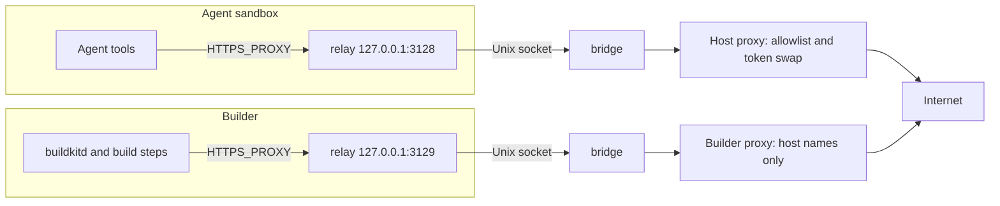
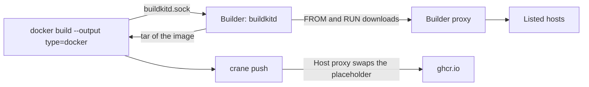

# Agent Sandbox

A sandbox for AI agents. It runs Claude Code, Qwen Code and the Fresh editor in a hardened rootless Podman container with gVisor. A second container, the builder, builds images for the agent.

## The problem and the solution

A coding agent reads text that you did not write: issues, web pages, packages and files. That text can hold a prompt injection. A fooled agent runs commands with your rights. The rules of a model do not stop this.

The sandbox limits what the agent can do, not what it chooses to do:

| Limit | What it does |
|---|---|
| No network | Each container has no route out. The only way out is a proxy on the host with an allowlist. |
| No real token | The agent sandbox holds placeholders. Only the host proxy holds the real tokens. |
| A private clone | The agent works on a clone of your repo. It cannot write to your repo. |
| A hardened container | gVisor, no capability, a read-only root file system and limits on memory, CPU and threads. |

## Architecture

[](docs/diagrams/architecture.svg)

Both containers use the same model for each call to the outside. A relay in the container copies the bytes to a Unix socket. A bridge on the host joins the socket to a proxy.



The detail is in [How the sandbox works](docs/internals.md). The names are in [The names](docs/internals.md#the-names).

## Quick start

Run these steps in your main checkout.

1. Read [what the setup assumes](proxy/README.md#what-this-setup-assumes). The registry is `ghcr.io`. The secret manager is Bitwarden Secrets Manager. The secrets already exist.
2. Run `mise install`. It installs `bws` and `iron-proxy`. The host also needs `podman`, `runsc`, `git`, `openssl`, `systemd-creds`, `systemd-socket-proxyd`, `ip`, `nsenter`, `nft` and `sudo`. The agent sandbox needs 3 GB of memory and the builder needs 2 GB.
3. Run these commands:

```shell
just sandbox setup   # install the proxies, the firewall rule and the container units
just sandbox build   # build the images and push the agent sandbox image to ghcr.io
just sandbox run     # start the builder and the agent sandbox, and open Herdr
```

`setup` asks for your `sudo` password. It asks for the Bitwarden access token only if the credential is missing or unreadable. Run `setup` again after you edit a file in `proxy/`, `builder/`, `runsc.conf` or `sandbox-agent.container`.

## Commands

| Command | What it does |
|---|---|
| `just sandbox setup` | Installs both proxies, the firewall rule, the container units and the gVisor flags. |
| `just sandbox run` | Makes a new agent sandbox and a new builder. Opens Herdr. Add a command to run it in place of Herdr. |
| `just sandbox rm` | Removes the agent sandbox and the builder. The volume stays. |
| `just sandbox build` | Builds both images and pushes the agent sandbox image with the commit tag. `--no-cache` updates the pinned tools. |
| `podman ps` | Shows `(starting)`, `(healthy)` or `(unhealthy)`. |
| `podman logs -f sandbox-agent` | Follows the log of the agent sandbox. |

The volume `sandbox-home` keeps the clone, the logins and the histories. For the flows of these commands, see [the phases](docs/internals.md#the-flow-in-phases).

## Build and push in the agent sandbox

Run `docker build` as on any host. A normal Dockerfile builds as it is. The agent sandbox has no Docker daemon, so the build writes a tar file, and `crane` pushes it.

```shell
docker build -t ghcr.io/raghav19/<NAME>:<TAG> --output type=docker,dest=/tmp/image.tar .
crane push /tmp/image.tar ghcr.io/raghav19/<NAME>:<TAG>
```



| Command | Result |
|---|---|
| `docker build`, `docker buildx build`, `docker buildx bake` | Work. Add `--output type=docker,dest=FILE`. One platform only. |
| `docker build --push`, `--load` | Fail. The builder holds no login, and there is no daemon. |
| `docker push`, `run`, `images`, `tag`, `compose` | Fail. There is no daemon and no image store. Use `crane push FILE REF`. |
| `docker build` without `--output` | The result stays in the cache of the builder. `docker` prints a warning. |

Facts about the build:

| Topic | Detail |
|---|---|
| Login | `crane` reads the placeholder login of `ghcr.io` in `/etc/docker/config.json`. The host proxy swaps in the real token. The builder never pushes. |
| Builder choice | `DOCKER_CONFIG=/etc/docker` and `BUILDX_BUILDER=sandbox` select the builder. The folder `/etc/docker` is read-only, so the agent cannot change the endpoint. |
| Hosts | The `domains` list in `proxy/iron-proxy-builder.yaml`. An unlisted host gets `403`. To add a host, edit the file and run `just sandbox setup`. |
| Private base image | The builder proxy adds no login. Run `crane pull --format oci REF /tmp/base` in the agent sandbox. Then add `--build-context NAME=oci-layout:///tmp/base@sha256:DIGEST`. |
| Who may connect | Any process that reaches `buildkitd.sock`. BuildKit has no authorization. Only the agent sandbox mounts the socket folder. |
| A build step can | Run any command as root in the builder and reach the listed hosts. It has no token, no other mount and no network device. |
| Off by default | The entitlements `network.host`, `security.insecure` and `device`. Do not enable them. |
| Limits | 2 GB of memory with no swap, 1 GB of cache in `tmpfs`, 1024 threads, 2 CPUs. A full cache fails the build. The builder stays up. |
| Health | Podman runs `buildctl debug workers` in the builder. A failure at the start fails `run`. A later failure restarts the builder with an empty cache. |

## Security controls

Each row is one attack of an injected agent and the control that stops it.

| If the agent tries to | What stops it |
|---|---|
| Plant a git hook or a config change in your repo | It works in a clone. The `.git` folder of your repo is a read-only mount. |
| Steal a token | The agent sandbox holds placeholders. The real tokens stay on the host. |
| Send data to an unlisted host | No network. The proxies answer `403`. |
| Get a token through a build step | The builder cannot reach the host proxy. The builder proxy holds no token. |
| Break out of the container | gVisor, no capability, `no-new-privileges` and a user that is not root. |
| Use a proxy from another process | The firewall rule lets only your user connect to the proxy ports. |
| Move code to your host | The only way out is a `git push` to GitHub. You read the branch before you check it out. |
| Use all memory, CPU or threads | The service limits. The kernel kills the container, not the host. |

`sandbox-agent.container` sets these controls for the agent sandbox:

| Control | What it does |
|---|---|
| `--runtime=runsc --network=none` | gVisor runs the system calls. The network namespace has only the loopback. |
| `--read-only` | No write to `/etc`, `/usr`, `/opt/mise`, the policy of Claude Code or the CA. |
| tmpfs on `/tmp` and `/run` | Scratch space. A restart empties it. |
| Volume `sandbox-home` at `/home/agent` | Keeps the clone, the logins and the histories. |
| The repo in clone mode | The unit mounts `.git` read-only at `/run/sandbox/source`. `sandbox-start` clones it into the volume. The agent changes only the clone. |
| `--cap-drop=ALL`, `no-new-privileges` | No capability. A setuid program cannot raise a privilege. |
| `User=agent` (uid 1000) | A subuid in rootless Podman, not your host user. |
| `MemoryMax`, `MemorySwapMax`, `TasksMax`, `CPUQuota` | 3 GB with no swap, 2048 threads, 4 CPUs. gVisor ignores the limits of Podman, so the service holds them. |
| Read-only mounts | The CA, the socket folders, the `.git` of the repo and the theme. |
| `proxy/sandbox-guard.nft` | Only your user may connect to the ports of both proxies on `127.0.0.1`. It separates users, not programs of one user. |

## Limits

- Use HTTPS remotes. There is no SSH and no raw TCP. A tool that ignores `HTTPS_PROXY` has no route.
- No `sudo` and no package install in the agent sandbox. Change the image.
- gVisor is not a microVM. A bug in the sentry gives an attacker your host user.
- The firewall rule separates users only. A rootless container of your user with a route to the host loopback can still connect to the proxy ports.
- Commits use the name `agent` and the email `agent@localhost`. To commit as yourself, set `GIT_AUTHOR_NAME`, `GIT_AUTHOR_EMAIL`, `GIT_COMMITTER_NAME` and `GIT_COMMITTER_EMAIL` in the shell.
- Listed hosts can receive data from the agent. Keep both allowlists short.
- A branch that the agent pushes can hold hooks or settings files. Read the diff before you check it out.

## Troubleshooting

| Symptom | Action |
|---|---|
| `run` says `proxy.sock` is missing | Run `systemctl --user start sandbox-proxy`. After a start limit, run `systemctl --user reset-failed sandbox-proxy` first. Then run `just sandbox setup`. |
| `run` says `sandbox-builder-proxy/proxy.sock` is missing | Run `systemctl --user start sandbox-builder-proxy`, or run `just sandbox setup`. |
| `run` says the agent sandbox is not healthy | Run `podman logs sandbox-agent`. |
| `run` says the builder is not healthy | Run `podman logs sandbox-builder`. |
| `docker build` says `failed to connect to the docker API` | `DOCKER_CONFIG` and `BUILDX_BUILDER` are missing in your shell. Open a new session with `just sandbox run`. |
| A `FROM` or a `RUN` step gets `403` | The host is not in `proxy/iron-proxy-builder.yaml`. Add it and run `just sandbox setup`. |
| `status sandbox-agent` shows `failed` | A limit killed it. Run `just sandbox run`. The clone stays in the volume. |
| `status sandbox-builder` shows `failed` after `just sandbox rm` | Normal. `buildkitd` exits with code 1 when it stops. |
| A tool fails with a connection error | The tool ignores `HTTPS_PROXY`. |
| You made a new CA | Run `just sandbox run`. |

## Files

| Path | Content |
|---|---|
| `sandbox-agent.container` | The Quadlet unit of the agent sandbox. |
| `builder/` | The builder: the unit `sandbox-builder.container`, the `Containerfile` and `relay-entry`. |
| `runsc.conf` | The gVisor flags for `runsc` (agent sandbox) and `runsc-builder`. |
| `image/` | The Dockerfile, `sandbox-entry`, `sandbox-start` and the `mise` tasks. |
| `proxy/` | Both proxies, their bridges and the firewall rule. See [`proxy/README.md`](proxy/README.md). |
| `justfile` | The recipes `setup`, `run`, `rm` and `build`. |

## References

- Anthropic, [How we contain Claude across products](https://www.anthropic.com/engineering/how-we-contain-claude) (25 May 2026). Set hard limits in the environment. Keep credentials out of the sandbox. Treat an allowlist as a grant of capability.
- Simon Willison, [The lethal trifecta](https://simonwillison.net/2025/Jun/16/the-lethal-trifecta/) (June 2025). An agent with private data, untrusted content and a way out can leak the data.
