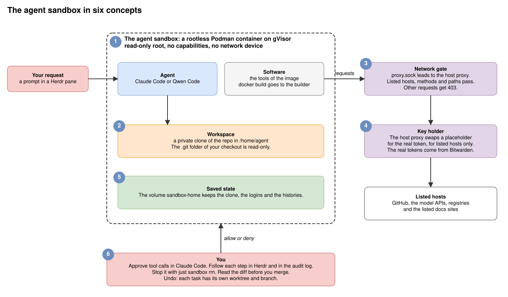
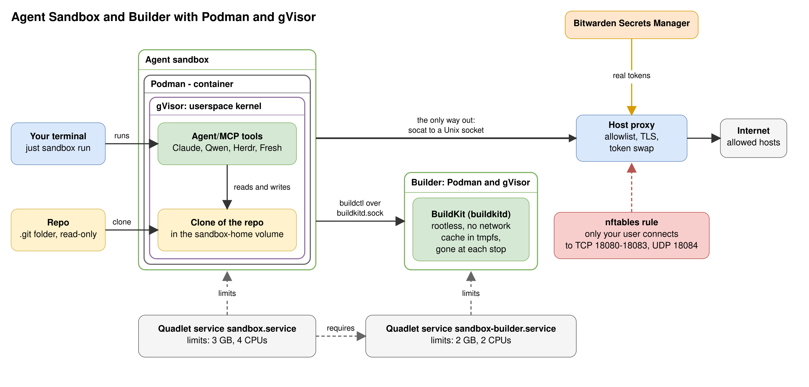
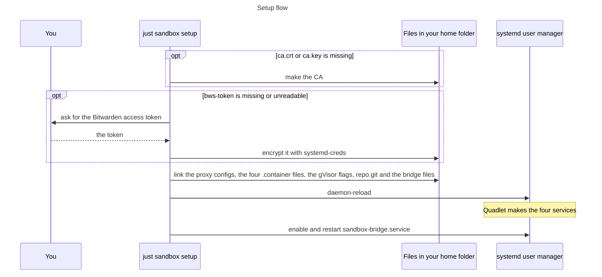
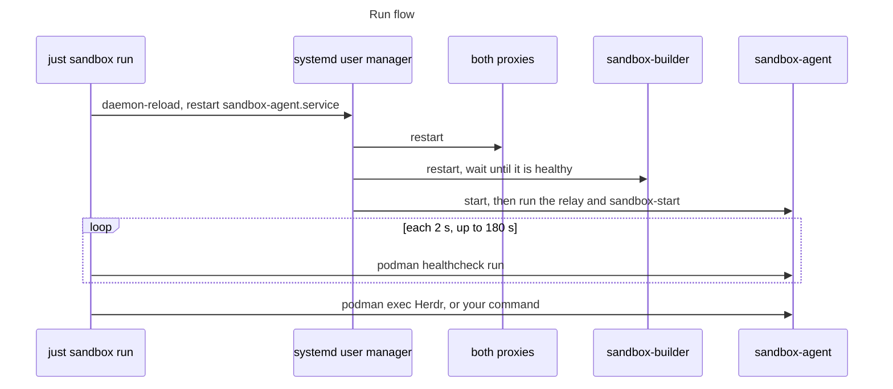
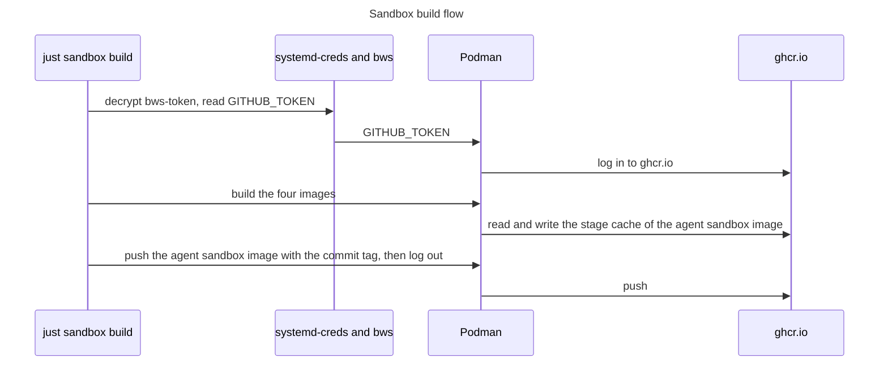
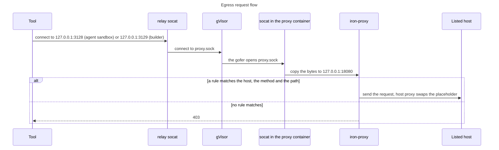
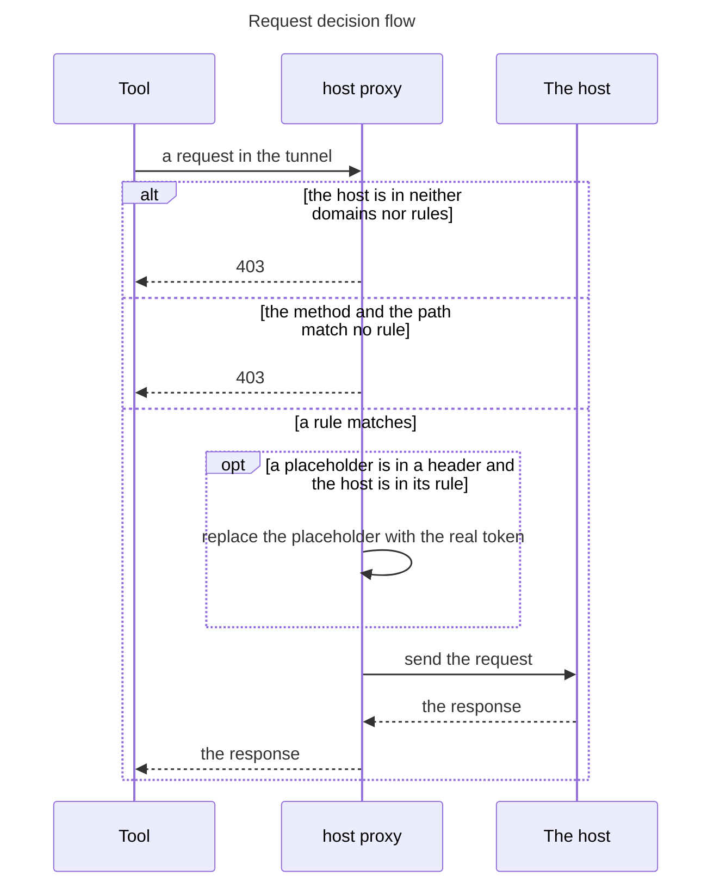
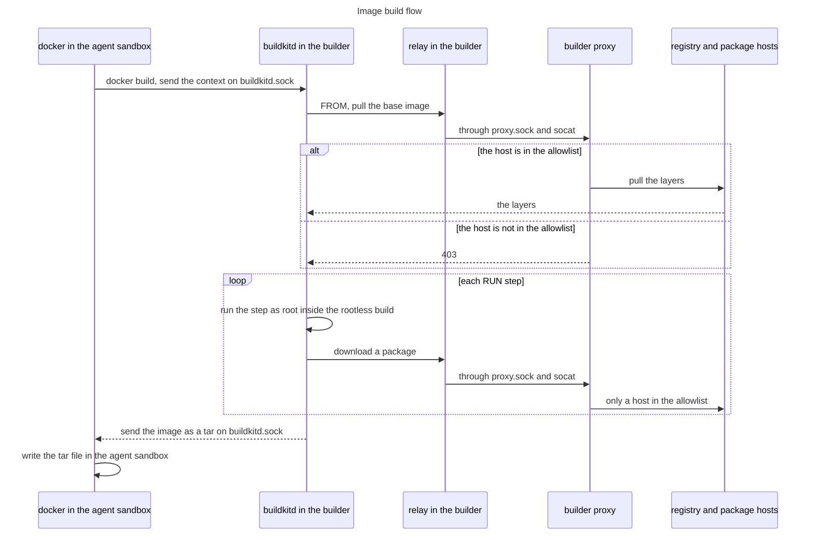
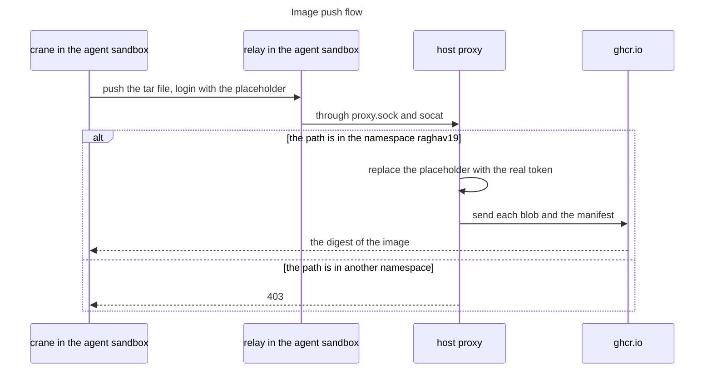
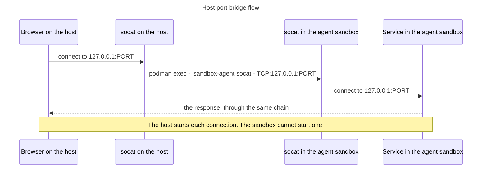

# Agent Sandbox

A sandbox for AI agents. It runs Claude Code, Qwen Code and the Fresh editor in a hardened Podman container. The container is rootless and uses gVisor. A second container, the builder, builds images for the agent.

## The problem

You let a coding agent work on your repository. The agent has three abilities. They are dangerous together:

- **Untrusted content.** The agent reads text that you did not write: web pages, issues, packages and code.
- **Private data.** The agent reaches your repository, your files and your tokens.
- **Outside communication.** The agent can send data to an outside host with a `git push`, an API call or a web request.

A prompt injection hides an instruction in the text that the agent reads. A fooled agent then runs commands with your rights. Simon Willison calls this combination the [lethal trifecta](https://simonwillison.net/2025/Jun/16/the-lethal-trifecta/). A filter that stops most attacks is not enough, because one missed attack is enough.

These attacks already happened:

| Date | Case | What limits it here | Source |
|---|---|---|---|
| 2025-05 | GitHub MCP. A poisoned issue in a public repo made an agent leak private repo data into a public pull request. | The scope of the token. The proxy cannot see the repository of an MCP call. | [Invariant Labs](https://invariantlabs.ai/blog/mcp-github-vulnerability), [GitHub issue](https://github.com/github/github-mcp-server/issues/844) |
| 2025-07 | Amazon Q Developer 1.84.0 carried malicious code (CVE-2025-8217). Reports say it told the agent to delete local files and AWS resources. A syntax error stopped it. | A private clone. No real AWS credentials. | [Advisory](https://github.com/aws/aws-toolkit-vscode/security/advisories/GHSA-7g7f-ff96-5gcw) |
| 2025-08 | Nx `s1ngularity`. A malicious npm package prompted the AI tools on the machine to search for secrets. It sent them to a new repo in the account of the victim. | Placeholders instead of tokens. The proxy gives a `403` to a request that creates a repo. The builder has no token. | [Advisory](https://github.com/nrwl/nx/security/advisories/GHSA-cxm3-wv7p-598c) |
| 2026-04 | Mini Shai-Hulud. A malicious npm package stole tokens and `~/.claude.json`. It planted a Claude Code hook that runs again when someone opens the repo. | The builder has no token. The agent holds placeholders only. You read the agent config files in each diff. | [StepSecurity](https://www.stepsecurity.io/blog/a-mini-shai-hulud-has-appeared), [CISA](https://www.cisa.gov/news-events/alerts/2026/05/28/supply-chain-compromises-impact-nx-console-and-github-repositories) |

Checks inside the agent fail too. The Claude Code [security advisories](https://github.com/anthropics/claude-code/security/advisories) list three allowlist bugs that could leak data: CVE-2025-55284, CVE-2026-24052 and CVE-2026-54316. So this sandbox puts the gate in a separate container. The note [agent-sandbox-incidents](../docs/research/agent-sandbox-incidents.md) has the details and the sources.

## The solution

The sandbox keeps the agent useful and limits what a fooled agent can do. It has one step for each ability, and one for builds:

| Ability | What the sandbox does |
|---|---|
| Private data | The agent works in a private clone. It holds placeholders, not real tokens. The real tokens stay in the proxy. |
| Untrusted content | The sandbox cannot stop it, because the agent must read. The other two steps limit the damage. |
| Outside communication | The agent has no network device. The only way out is a file that leads to a proxy. The proxy allows listed hosts, methods and paths only. |
| Builds | A second container, the builder, runs the build steps. It has no token and no network device. It uses its own proxy, the builder proxy. The agent sandbox uses the host proxy. |

The [sandbox of Claude Code](https://www.anthropic.com/engineering/claude-code-sandboxing) uses the same idea: a socket to a proxy outside the sandbox, which enforces approved domains.

### How to design an agent sandbox

An agent sandbox has six concepts. Use the diagram as a checklist when you build a sandbox.



This sandbox applies each concept as follows:

| Concept | This sandbox |
|---|---|
| 1 The wall | A rootless Podman container on gVisor, a user-space kernel. The root file system is read-only. The container has no capabilities. |
| 2 Workspace | A private clone of the repo. The `.git` folder of your checkout is a read-only mount. |
| 3 Network gate | `proxy.sock` leads to the host proxy. The proxy allows listed hosts, methods and paths. |
| 4 Key holder | The host proxy swaps a placeholder for the real token. The real tokens come from Bitwarden. |
| 5 Saved state | The volume `sandbox-home` keeps the clone, the logins and the histories. Herdr restores the panes. |
| 6 You | You approve tool calls in Claude Code and follow the panes in Herdr and the audit log. `just sandbox rm` stops the sandbox. Each task has its own worktree and branch. |

## What is out of scope

The sandbox limits what a fooled agent can do. Other layers handle the rest. These risks are out of scope:

| Risk | Who handles it |
|---|---|
| A prompt injection changes what the agent tries to do | The model and the client. The sandbox limits only the damage. |
| A tool of the MCP server writes outside this repository | The central MCP gateway. The proxy does not read MCP calls. |
| A write goes to `main` | Branch protection on GitHub. A rule in the proxy cannot see the branch. |
| A token has more scope than the agent needs | The scope of the token. Use a fine-grained token for one repository. |
| A pushed branch holds bad code | You. Read the diff before you merge or check it out. Read the agent config files too: `.claude/` and `.vscode/tasks.json`. |
| Data leaves through a listed host | The allowlists. Keep them short. |

The sandbox has two limits of its own:

- The proxy reads every request of the agent. A bug in the proxy can expose the real tokens.
- gVisor is not a microVM. A bug in gVisor can give an attacker your host user.

## How it works

[](docs/diagrams/architecture.svg)

Each proxy runs in its own container, with the default Podman network. The allowed hosts are in `agent/proxy/iron-proxy.yaml` and `builder/proxy/iron-proxy.yaml`.

## Security controls


The diagram shows each control in the container that has it. It calls the proxy of the agent sandbox the agent proxy. The other sections call it the host proxy.

Notes on the controls:

- **One socket.** The container cannot see the files, the process or the other ports of the proxy.
- **The builder.** `rootlesskit` needs the three capabilities. The builder has no `no-new-privileges`, and its root file system is writable.
- **Root in the builder.** BuildKit has no authorization. Any holder of `buildkitd.sock` can run any build step as root in the build. The container is the wall.
- **Path rules.** The path is the part of a URL after the host name. For `https://github.com/raghav19/engineersdaybook`, the path is `/raghav19/engineersdaybook`. A merge, a file removal, a gist, a fork and GraphQL get `403`.
- **TLS.** The agent proxy reads each request with its own CA, and the sandbox trusts only this CA. The builder proxy has no CA.
- **Audit log.** Read it with `journalctl --user -u sandbox-proxy`.
- **Limits.** Quadlet turns each container file into a systemd service. gVisor ignores the limits of Podman, so each service holds the limits of its container.
- **Session.** The volume `sandbox-home` keeps the clone, the logins and the histories of the agent sandbox.

## Flows

### Setup flow

`setup` changes only files in your home folder, and it restarts only the bridge. `run` starts the containers.



### Run flow

`run` restarts the agent sandbox. systemd restarts the units that it requires, so each session has a new builder and new proxies.



### Sandbox build flow

`build` runs on the host and makes the images of the sandbox. The Image build flow below makes an image for your project. `build` stops at the first error, so the login stays until you run `podman logout ghcr.io`.



### Egress request flow

Both containers follow this path. Only the relay port, the proxy and the rule set differ.



### Request decision flow

The host proxy judges each request in this order:



A host in `domains` takes every method and every path. A host in `rules` takes only the methods and the paths of its rules, so a write goes to one GitHub repository only. The builder proxy has no path rules, because it cannot see a path.

### Image build flow

The agent sandbox sends the build. The builder runs it. The builder reaches the internet only through its own proxy.



Run `docker build` as on any host. A normal Dockerfile builds as it is. The agent sandbox has no Docker daemon, so the build writes a tar file:

```shell
docker build -t ghcr.io/raghav19/<NAME>:<TAG> --output type=docker,dest=/tmp/image.tar .
```

The builder proxy holds no token, so a base image comes from a public registry. For a private base image, the agent sandbox pulls it with `crane` through the host proxy. It then passes the image to `docker build` as an OCI layout.

### Image push flow

Only the agent sandbox pushes the tar file:



```shell
crane push /tmp/image.tar ghcr.io/raghav19/<NAME>:<TAG>
```

## Prerequisites

This is a personal setup.

What the setup assumes:

- The image registry is `ghcr.io`. The secret manager is Bitwarden Secrets Manager.
- The Bitwarden project holds `GH_TOKEN`, `CLAUDE_CODE_OAUTH_TOKEN`, `QWEN_API_KEY` and `GITHUB_TOKEN`. `GITHUB_TOKEN` has the scope `write:packages`.
- You have the access token of a machine account that reads that project. Give it only to `just sandbox setup`, which asks for it.

For another registry or secret manager, change `agent/proxy/iron-proxy.yaml`, `agent/proxy/proxy.container` and the `build` recipe.

What the host needs:

| Need | Check |
|---|---|
| A Linux host with a systemd user manager | `systemctl --user is-system-running` |
| `systemd-creds`, to keep the Bitwarden access token | `command -v systemd-creds` |
| `bws`, from `mise install`. `build` uses it to authenticate to `ghcr.io`. | `bws --version` |
| `openssl`, to make the CA | `openssl version` |
| `socat`, for the host bridge. `just` stops if it is missing. | `socat -V` |
| `podman`, `runsc` and `git`. `just` stops if one is missing. | `podman --version` and `runsc --version` |
| `ip` and `nsenter`, to start the loopback of the agent sandbox | `ip -V` and `nsenter --version` |
| 6 GB of free memory: 3 GB for the agent sandbox, 2 GB for the builder and less than 1 GB for the two proxies | `free -h` |
| Linger for your user (optional). The sandbox keeps running after your session ends. | `loginctl enable-linger "$USER"` |

## Quick start

Run these steps in your main checkout.

1. Run `mise install`. It installs `bws`.
2. Run these commands:

```shell
just sandbox setup   # once, and again after you edit a file in agent/ or builder/
just sandbox build   # build the images and push the agent sandbox image
just sandbox run     # start the containers and open Herdr, a terminal workspace manager
```

`setup` needs no root. It asks for the Bitwarden access token only if the credential is missing or unreadable.

`podman ps` then shows four containers: `sandbox-proxy`, `sandbox-builder-proxy`, `sandbox-builder` and `sandbox-agent`. 

The flows of the three commands are in [Flows](#flows).

## Decisions

- [Quadlet units, not Docker Compose or Podman Compose](docs/adr/0001-quadlet-over-compose.md)

## Commands

| Command | What it does |
|---|---|
| `just sandbox run <command>` | Runs your command in place of Herdr. |
| `just sandbox rm` | Removes the agent sandbox, the builder and both proxies. The volume stays. |
| `just sandbox build --no-cache` | Updates the pinned tools. |
| `podman ps` | Shows `(starting)`, `(healthy)` or `(unhealthy)`. |
| `podman logs -f sandbox-agent` | Follows the log of the agent sandbox. |
| `journalctl --user -u sandbox-proxy -f` | Follows the audit log of the host proxy: one JSON line for each request. |
| `podman logs -f sandbox-builder-proxy` | Follows the log of the builder proxy. |

## Open a port of the sandbox on the host

The host bridge opens a port of a service in the agent sandbox on the loopback of the host.
### Add a port

1. Add the port number to `agent/ports` in your main checkout. Write one port in each line.
2. Run `systemctl --user restart sandbox-bridge.service`.
3. Run `curl -s http://127.0.0.1:<port>/`. The port is open when the service in the sandbox answers.

If step 3 fails, run `journalctl --user -u sandbox-bridge -n 20`. A `bad port` line names a wrong entry in `agent/ports`. An `Address already in use` line names a port that a program on the host holds. Only that port fails.

### Host port bridge flow

The unit `sandbox-bridge.service` runs `bridge.sh` on the host, not in the sandbox. For each port, `bridge.sh` starts a `socat` on the host.



### Rules of the bridge

| Rule | Value |
|---|---|
| Address on the host | `127.0.0.1` only |
| Target in the sandbox | `127.0.0.1:<the same port>` only |
| Ports | 1024 to 65535. Any other entry stops the bridge. |
| Who adds a port | You, in your checkout. The agent edits its own clone, so it cannot add a port. |
| Connections | At most 8 at the same time for each port |
| Sandbox stopped | The connection closes at once. |
| No port in the list | `bridge.sh` exits at once. This is not an error. |

The agent controls what answers on a listed port. Open the page in a browser that holds no important logins.

To remove the bridge, run `systemctl --user disable --now sandbox-bridge.service`.

## Token usage

The token usage plugin of Herdr (`pseudovar.token-usage`) shows the usage in the sidebar of Herdr, one row for each agent pane. Press `prefix+u` to open the dashboard. Run `tu report --month` for a table in the terminal.

The plugin reads the logs of Claude Code and makes no network call. The cost is an estimate from list prices. The image pins the plugin to one commit in `agent/image/Dockerfile`.

## Troubleshooting

| Symptom | Fix |
|---|---|
| `run` stops at the start | Run `journalctl --user -u sandbox-proxy -u sandbox-builder-proxy -u sandbox-builder`. If the image is missing, run `just sandbox build`. |
| `run` says the credential is missing, or the proxy shows a `Credential` error | The file `~/.config/credstore.encrypted/bws-token` is missing or unreadable. Run `just sandbox setup`. |
| `Failed to read encrypted credential data: Invalid argument` | `bws-token` holds the plain token. Run `just sandbox setup`. It asks for the token again. |
| `podman logs sandbox-proxy` shows a Bitwarden error | The access token is wrong or expired. Remove `~/.config/credstore.encrypted/bws-token`, then run `just sandbox setup`. |
| `run` says a container is not healthy | Run `podman logs sandbox-agent` or `podman logs sandbox-builder`. |
| `docker build` says `failed to connect to the docker API` | `DOCKER_CONFIG` and `BUILDX_BUILDER` are missing in your shell. Open a new session with `just sandbox run`. |
| A `FROM` or a `RUN` step gets `403` | The host is not in `builder/proxy/iron-proxy.yaml`. Add it and run `just sandbox run`. The proxy reads its file at start. `run` restarts the agent sandbox, the builder and both proxies. |
| `crane push` gets `403` | The namespace is not `raghav19`. Push to `ghcr.io/raghav19/<NAME>:<TAG>`. |
| A GitHub call gets `403` | The host proxy allows a push to `raghav19/engineersdaybook` and a REST write on its issues and pull requests. It denies a merge, a file write, a removal and GraphQL. To change this, edit `agent/proxy/iron-proxy.yaml` and run `just sandbox run`. |
| `systemctl --user status sandbox-agent` shows `failed` | A limit killed it. Run `just sandbox run`. The clone stays in the volume. |
| `systemctl --user status sandbox-builder` shows `failed` after `just sandbox rm` | This is normal. `buildkitd` exits with code 1 when it stops. |
| A tool fails with a connection error | The tool ignores `HTTPS_PROXY`. Set the proxy of the tool to `http://127.0.0.1:3128`. |
| You made a new CA | Run `just sandbox run`. |

## References

- Anthropic: [Beyond permission prompts: making Claude Code more secure and autonomous](https://www.anthropic.com/engineering/claude-code-sandboxing) (2025-10-20)
- Claude Code docs: [Sandboxing](https://code.claude.com/docs/en/sandboxing) and [Security](https://code.claude.com/docs/en/security)
- Simon Willison: [The lethal trifecta for AI agents](https://simonwillison.net/2025/Jun/16/the-lethal-trifecta/) (2025-06-16)
- Simon Willison: [Agents Rule of Two and The Attacker Moves Second](https://simonwillison.net/2025/Nov/2/new-prompt-injection-papers/) (2025-11-02)
- Nasr, Carlini, Tramèr and others: [The Attacker Moves Second](https://arxiv.org/abs/2510.09023) (2025-10-10)
- OWASP: [Top 10 for Agentic Applications](https://genai.owasp.org/2025/12/09/owasp-top-10-for-agentic-applications-the-benchmark-for-agentic-security-in-the-age-of-autonomous-ai/) (2025-12-09)
- NIST: [AI Agent Standards Initiative](https://www.nist.gov/news-events/news/2026/02/announcing-ai-agent-standards-initiative-interoperable-and-secure) (2026-02-17)
- Vendor sandboxes: [Codex](https://developers.openai.com/codex/agent-approvals-security), [GitHub Copilot firewall](https://docs.github.com/en/copilot/how-tos/use-copilot-agents/coding-agent/customize-the-agent-firewall), [Gemini CLI](https://github.com/google-gemini/gemini-cli/blob/main/docs/cli/sandbox.md) and [Docker Sandboxes](https://docs.docker.com/ai/sandboxes/security/)
- Claude Code [security advisories](https://github.com/anthropics/claude-code/security/advisories)
- Research note: [agent-sandbox-incidents](../docs/research/agent-sandbox-incidents.md)
