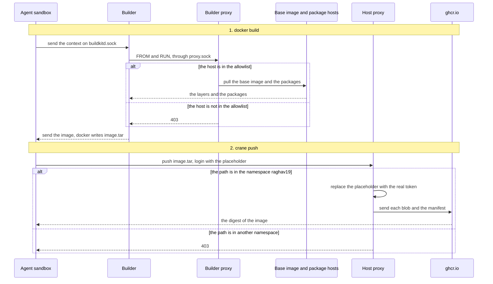

# Agent Sandbox

A sandbox for AI agents. It runs Claude Code, Qwen Code and the Fresh editor in a hardened rootless Podman container with gVisor. A second container, the builder, builds images for the agent.

## The problem

You let a coding agent work on your repository. The agent has three abilities. They are dangerous together:

- **Untrusted content.** The agent reads text that you did not write: web pages, issues, packages and code.
- **Private data.** The agent reaches your repository, your files and your tokens.
- **Outside communication.** The agent can send data out with a `git push`, an API call or a web request.

A prompt injection hides an instruction in the text that the agent reads. A fooled agent then runs commands with your rights. It can send your private data to an attacker. Simon Willison calls this combination the [lethal trifecta](https://simonwillison.net/2025/Jun/16/the-lethal-trifecta/). A filter that stops most attacks is not enough, because one missed attack is enough.

## The solution

The sandbox keeps the agent useful and limits what a fooled agent can do. It has one step for each ability:

| Ability | What the sandbox does |
|---|---|
| Private data | The agent works in a private clone. It holds placeholders, not real tokens. The real tokens stay in the proxy. |
| Untrusted content | The sandbox cannot stop it, because the agent must read. The other two steps limit the damage. |
| Outside communication | The agent has no network device. The only way out is a file that leads to a proxy. The proxy allows listed hosts, methods and paths only. |

Builds follow the same model. A second container, the builder, runs the build steps. It has no token, no network device and its own proxy.

The [sandbox of Claude Code](https://www.anthropic.com/engineering/claude-code-sandboxing) uses the same idea. Internet access goes only through a socket to a proxy outside the sandbox. That proxy enforces approved domains.

## What is out of scope

The sandbox limits what a fooled agent can do. Other layers handle the rest. These risks are out of scope:

| Risk | Who handles it |
|---|---|
| A prompt injection changes what the agent tries to do | The model and the client. The sandbox limits only the damage. |
| A tool of the MCP server writes outside this repository | The central MCP gateway. The proxy does not read MCP calls. |
| A write goes to `main` | Branch protection on GitHub. A rule in the proxy cannot see the branch. |
| A token has more scope than the agent needs | The scope of the token. Use a fine-grained token for one repository. |
| A pushed branch holds bad code | You. Read the diff before you merge or check it out. |
| Data leaves through a listed host | The allowlists. Keep them short. |

The sandbox has two limits of its own:

- The proxy reads every request of the agent. A bug in the proxy can expose the real tokens.
- gVisor is not a microVM. A bug in gVisor can give an attacker your host user.

## Architecture

[](docs/diagrams/architecture.svg)

## Security controls

The table lists the controls from the outside in. The last column of each row names the Podman containers that have the control.

| Layer | Control | Applies to | What it stops |
|---|---|---|---|
| Container | Rootless Podman | All containers | A container escape gives an attacker your user and not root. |
| Container | Limits on memory and threads | All containers | A runaway or hostile process cannot use up the host. |
| Container | A user that is not root | Agent sandbox, builder | A process in the container has no root rights. |
| Container | No capability, `no-new-privileges`, read-only root file system | Agent sandbox, proxies | A process cannot gain rights or change its image. The builder is the exception. It keeps `SETUID`, `SETGID` and `SYS_CHROOT`, has no `no-new-privileges` and has a writable `tmpfs`, because `rootlesskit` needs them. |
| Kernel | gVisor | Agent sandbox, builder | A system call of a hostile command goes to gVisor and not to the Linux kernel of your host. |
| Egress | No network device | Agent sandbox, builder | A tool that ignores the proxy settings has no route out. |
| Egress | One Unix socket to its own proxy | Agent sandbox, builder | The only way out is the tunnel port of the proxy. The container cannot see the files, the process or the other ports of the proxy. |
| Egress | Allowlist of hosts | Agent proxy, builder proxy | Any other host gets `403`. The builder proxy lists registries, package hosts and release hosts. The agent proxy lists the hosts that the agent needs. |
| Egress | Rules for the method and the path | Agent proxy | A write goes to one GitHub repository and one `ghcr.io` namespace. A merge, a file removal, a gist, a fork and GraphQL get `403`. |
| Egress | Token swap | Agent proxy | The agent holds placeholders. The proxy puts in the real token for the listed hosts only. The builder has no token. |
| Egress | Audit log | Agent proxy | Each request is one JSON line in `journalctl --user -u sandbox-proxy`. |
| Workspace | A private clone, with your `.git` mounted read-only | Agent sandbox | The agent cannot plant a git hook or change your repository. A push goes to GitHub, and you read the branch. |
| Build | A separate builder | Builder | A `RUN` step runs as root in a container with no token and no network device. The agent has no Docker daemon. |
| Policy | Read-only `/etc/docker` and managed settings | Agent sandbox | The agent cannot add a builder, change the endpoint or edit its own policy. |
| Session | New containers for each session | Builder, proxies | The build cache and the proxy state end with the session. |

## What the agent can reach

- **GitHub.** The agent reads any repository. A push and a REST write (issues, comments, pull requests, reviews) go to this repository only. A merge, a file write, a removal, a gist, a fork and GraphQL get `403`.
- **GitHub MCP server.** The proxy opens the URL. The toolsets and the `deny` list in the settings files limit the tools. You plan a central gateway for this.
- **`ghcr.io`.** The agent reads any namespace and writes in the namespace `raghav19` only.
- **Other hosts.** The agent reaches the hosts in `agent/proxy/iron-proxy.yaml`. Any other host gets `403`.
- **Builds.** A `FROM` or `RUN` step reaches the hosts in `builder/proxy/iron-proxy.yaml`, with no token.

For the parts and the flows, read [How the sandbox works in detail](docs/internals.md).

## Prerequisites

This is a personal setup. Other people can use other tools.

What the setup assumes:

- The image registry is `ghcr.io`. The secret manager is Bitwarden Secrets Manager.
- The Bitwarden project holds `GH_TOKEN`, `CLAUDE_CODE_OAUTH_TOKEN`, `QWEN_API_KEY` and `GITHUB_TOKEN`. `GITHUB_TOKEN` has the scope `write:packages`.
- You have the access token of a machine account that reads that project. `just sandbox setup` asks for it. Do not paste it into a chat or a file.

For another registry or secret manager, change `agent/proxy/iron-proxy.yaml`, `agent/proxy/proxy.container` and the `build` recipe.

What the host needs:

| Need | Check |
|---|---|
| A Linux host with a systemd user manager | `systemctl --user is-system-running` |
| `systemd-creds`, to keep the Bitwarden access token | `command -v systemd-creds` |
| `bws`, from `mise install`. `build` uses it to log in to `ghcr.io`. | `bws --version` |
| `openssl`, to make the CA | `openssl version` |
| `podman`, `runsc` and `git`. `just` stops if one is missing. | `podman --version` and `runsc --version` |
| `ip` and `nsenter`, to bring up the loopback of the container | `ip -V` and `nsenter --version` |
| 6 GB of free memory: 3 GB for the agent sandbox, 2 GB for the builder and less than 1 GB for the two proxies | `free -h` |
| Linger for your user (optional). The sandbox keeps running after you log out. | `loginctl enable-linger "$USER"` |

## Quick start

Run these steps in your main checkout.

1. Run `mise install`. It installs `bws`.
2. Run these commands:

```shell
just sandbox setup   # make the CA and the credential, and link the container units
just sandbox build   # build the four images and push the agent sandbox image to ghcr.io
just sandbox run     # start the proxies, the builder and the agent sandbox, and open Herdr
```

`setup` needs no root. It asks for the Bitwarden access token only if the credential is missing or unreadable. Run `setup` again after you edit a file in `agent/` or `builder/`.

`podman ps` then shows four containers: `sandbox-proxy`, `sandbox-builder-proxy`, `sandbox-builder` and `sandbox-agent`. Each unit starts the next one, so you start no proxy by hand.

## Commands

| Command | What it does |
|---|---|
| `just sandbox setup` | Makes the CA and the credential. Links the container units and the gVisor flags. |
| `just sandbox run` | Makes a new agent sandbox, a new builder and two new proxies. Opens Herdr. Add a command to run it in place of Herdr. |
| `just sandbox rm` | Removes the agent sandbox, the builder and both proxies. The volume stays. |
| `just sandbox build` | Builds the four images and pushes the agent sandbox image with the commit tag. `--no-cache` updates the pinned tools. |
| `podman ps` | Shows `(starting)`, `(healthy)` or `(unhealthy)`. |
| `podman logs -f sandbox-agent` | Follows the log of the agent sandbox. |
| `journalctl --user -u sandbox-proxy -f` | Follows the audit log of the host proxy: one JSON line for each request. |
| `podman logs -f sandbox-builder-proxy` | Follows the log of the builder proxy. |

The volume `sandbox-home` keeps the clone, the logins and the histories.

## Build and push in the agent sandbox



1. Run `docker build` as on any host. A normal Dockerfile builds as it is. The agent sandbox has no Docker daemon, so the build writes a tar file:

   ```shell
   docker build -t ghcr.io/raghav19/<NAME>:<TAG> --output type=docker,dest=/tmp/image.tar .
   ```

2. Push the tar file with `crane`:

   ```shell
   crane push /tmp/image.tar ghcr.io/raghav19/<NAME>:<TAG>
   ```

## Troubleshooting

**Why does `run` fail at the start?**

A failed step of a unit fails the start. Run `journalctl --user -u sandbox-proxy -u sandbox-builder-proxy -u sandbox-builder`. If the image is missing, run `just sandbox build`.

**Why does `run` say that the credential is missing?**

Run `just sandbox setup`.

**Why do I see `Failed to read encrypted credential data: Invalid argument`?**

`bws-token` holds the plain token. Run `just sandbox setup`. It asks for the token again.

**Why does `podman logs sandbox-proxy` show a Bitwarden error?**

The access token is wrong or expired. Remove `~/.config/credstore.encrypted/bws-token`, then run `just sandbox setup`.

**Why does `run` say the agent sandbox is not healthy?**

Run `podman logs sandbox-agent`.

**Why does `run` say the builder is not healthy?**

Run `podman logs sandbox-builder`.

**Why does `docker build` say `failed to connect to the docker API`?**

`DOCKER_CONFIG` and `BUILDX_BUILDER` are missing in your shell. Open a new session with `just sandbox run`.

**Why does a `FROM` or a `RUN` step get `403`?**

The host is not in `builder/proxy/iron-proxy.yaml`. Add it and run `just sandbox run`. The proxy reads its file at start, and `run` restarts the agent sandbox, the builder and both proxies.

**Why does `crane push` get `403`?**

The namespace is not `raghav19`.

**Why does a GitHub call get `403`?**

The host proxy allows a push to `raghav19/engineersdaybook` and a REST write on its issues and pull requests. It denies a merge, a file write, a removal and GraphQL. To change this, edit `agent/proxy/iron-proxy.yaml` and run `just sandbox run`.

**Why does `status sandbox-agent` show `failed`?**

A limit killed it. Run `just sandbox run`. The clone stays in the volume.

**Why does `status sandbox-builder` show `failed` after `just sandbox rm`?**

This is normal. `buildkitd` exits with code 1 when it stops.

**Why does `run` stop at a `Credential` error of the proxy?**

The file `~/.config/credstore.encrypted/bws-token` is missing or unreadable. Run `just sandbox setup`.

**Why does a tool fail with a connection error?**

The tool ignores `HTTPS_PROXY`.

**What do I do after I make a new CA?**

Run `just sandbox run`.
