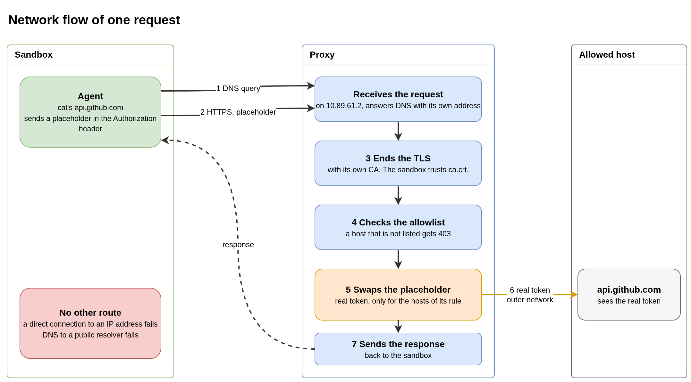

# The Podman sandbox

This folder will replace `.msb/`. The sandbox is a krun microVM that rootless Podman starts. It runs Claude Code, Qwen Code, Herdr and the [TTT](https://github.com/eugenioenko/ttt) editor. A second container, the egress proxy, is the only way out of the sandbox. The proxy holds the real tokens. The sandbox holds placeholders.

**Status:** the image, the proxy, the compose file, the start of the sandbox and the ssh access. The CI guard, the signed artifact and the SPIFFE identity come in later changes. `.msb/` stays in use until the last of them. The research note is `docs/research/podman-sandbox-runtimes.md`. The handoff is `docs/handoff/podman-krun-sandbox.md`.

## Contents

1. [Architecture](#architecture)
2. [Network flow](#network-flow)
3. [Secrets](#secrets)
4. [Prerequisites](#prerequisites)
5. [Getting started](#getting-started)
6. [Daily use](#daily-use)
7. [How you get in](#how-you-get-in)
8. [What `run` starts](#what-run-starts)
9. [Volumes](#volumes)
10. [Files in this folder](#files-in-this-folder)
11. [Why this design](#why-this-design)
12. [Limits and open items](#limits-and-open-items)
13. [Troubleshooting](#troubleshooting)
14. [Changes from `.msb/image/`](#changes-from-msbimage)

## Architecture


Two containers run on your host, both as your user, without root:

| | Sandbox | Proxy |
|---|---|---|
| Container name | `sandbox-vm` | `sandbox-proxy` |
| What it is | A krun microVM with its own Linux kernel | A normal container (iron-proxy, pinned by digest) |
| Host user ids | 100000 to 165535 | 200000 to 265535 |
| Networks | `inner` only | `inner` and `outer` |
| Holds | Placeholders, the clone, the agent histories | The real tokens, the CA key, the allowlist |
| Hardening | VM boundary, all capabilities dropped except five, no new privileges | All capabilities dropped except `NET_BIND_SERVICE`, read-only root, no new privileges |

The two containers have different user id ranges. Neither can read the files or processes of the other. They talk over one network only: `inner`.

The sandbox has no Podman socket, no `privileged` flag, no host network and no device. It mounts these host paths:

| Mount | Mode | Content |
|---|---|---|
| `~/.ssh/id_ed25519.pub` | read-only | The public key that may log in |
| `ca.crt` | read-only | The public certificate of the proxy CA |
| `.git` folder of the host repo | read-only | The source of the clone |
| Omarchy theme folder | read-only | Colors for the editor |

## Network flow



| Network | Subnet | Hosts | Rule |
|---|---|---|---|
| `inner` (`sandbox-inner`) | 10.89.61.0/24 | proxy 10.89.61.2, sandbox 10.89.61.10 | Internal: Podman gives it no gateway. Podman DNS is off. |
| `outer` (`sandbox-outer`) | 10.89.62.0/24 | proxy 10.89.62.2 | A normal network with a way to the internet. The sandbox is not on it. |

One request goes through these steps:

1. The agent asks the DNS server `10.89.61.2` (the proxy) for a host. The proxy answers with its own address.
2. The agent sends HTTPS to the proxy. The `Authorization` header has the placeholder.
3. The proxy ends the TLS with its own CA. The sandbox trusts the certificate `ca.crt`.
4. The proxy checks the host against the allowlist in `proxy/iron-proxy.yaml`. A host that is not listed gets 403.
5. The proxy replaces the placeholder with the real token. It does this for the hosts of that token only.
6. The proxy sends the request on `outer` to the real host.
7. The proxy sends the response back to the sandbox.

The egress self-test checks the wall. It runs in the sandbox with dummy tokens (`just sandbox selftest`):

| Check | What it proves |
|---|---|
| Direct HTTPS to an IP address fails | The sandbox has no other route. |
| No default route | `inner` is internal. |
| A host that is not listed gets 403 | The allowlist works. |
| An allowed URL gets 200 | DNS and the CA trust work. |
| No container socket, not root, `CapEff` is 0 | The sandbox cannot reach the engine or gain rights. |
| No real token in the environment or under `$HOME` | The sandbox holds placeholders only. |

The proxy listens on DNS, HTTP and HTTPS only. The tunnel listener (CONNECT and SOCKS5) is off. The metrics listen on the loopback inside the proxy container, so the sandbox cannot reach them.

## Secrets

The Bitwarden access token stays on the host. It is never in the proxy or the sandbox. `bws run` uses it to read the project keys, and the proxy gets four of them.

| Bitwarden key | What the sandbox holds | What the proxy does | Hosts of the swap |
|---|---|---|---|
| `GH_TOKEN` | `sandbox-placeholder-GH_TOKEN` | Replaces it | `github.com`, `api.github.com`, `api.githubcopilot.com` |
| `CLAUDE_CODE_OAUTH_TOKEN` | `sandbox-placeholder-CLAUDE_CODE_OAUTH_TOKEN` | Replaces it | `api.anthropic.com` |
| `QWEN_API_KEY` | `sandbox-placeholder-QWEN_API_KEY` | Replaces it | `token-plan.ap-southeast-1.maas.aliyuncs.com` |
| `GITHUB_TOKEN` (scope `write:packages`) | `sandbox-placeholder-GHCR_PUSH_TOKEN` | Replaces it. `compose.yaml` maps the key to the proxy variable `GHCR_PUSH_TOKEN`. | `ghcr.io` |

The swap works on the `Authorization` header only.

What the design protects, and what it does not:

- **Theft.** The sandbox never sees a real value, so the agent cannot copy it out.
- **Use.** The agent can still call an allowed host, and the proxy adds the real token. A prompt injection can use the token this way. The scope of the token is the only limit. msb and Docker sbx have the same limit.
- **Storage.** The real tokens sit in the environment of the proxy container. `podman inspect` shows them to your user, and Podman keeps a copy in its container storage while the container exists. A Podman secret does the same (tested). The sandbox cannot read either place. `compose.yaml` has a `TODO:` for an iron-proxy source that reads Bitwarden or runs a command.
- **The CA key.** It is a Podman secret (`sandbox-ca-key`) that only the proxy gets.

To limit the damage of a use, keep the tokens narrow:

- `GH_TOKEN`: a token for this repository only, with the permissions contents, issues and pull requests.
- `GITHUB_TOKEN`: the scope `write:packages` and nothing else.
- Protect `main` on GitHub with a required review.

## Prerequisites

Do these steps once on the host.

1. **Install the tools.** You need `podman`, `crun` with `+LIBKRUN`, `libkrun` and `libkrunfw`. The command `crun --version` must show `+LIBKRUN`. You need `podman-compose` 1.6.0 or newer, `openssl`, `ssh`, `just`, `bws` and `age`. In this repo, `mise install` gives `just`, `bws` and `age`. Every recipe stops with a message if a tool is missing.
2. **Open `/dev/kvm`** for your user. `ls -l /dev/kvm` must show that your user can read and write it.
3. **Check the user id ranges.** The static maps use the host ids 100000 to 165535 (sandbox) and 200000 to 265535 (proxy). `/etc/subuid` and `/etc/subgid` must give your user a range that covers both. Example line: `rana:100000:1441792`.
4. **Have an ssh key** at `~/.ssh/id_ed25519` and `~/.ssh/id_ed25519.pub`. Make one with `ssh-keygen -t ed25519`. The sandbox accepts this key. If the key has a passphrase, load it in `ssh-agent`.
5. **Commit your work.** The sandbox clones the committed files of the branch that you have checked out.
6. **Set up Bitwarden.** Make a machine account and a project for the sandbox. The project holds the four keys of the table in "Secrets" and no other key. Then encrypt the access token of the machine account once, in your own terminal and not in an agent session:

   ```shell
   mkdir -p ~/.config/bws
   ( read -rsp 'Bitwarden access token: ' token && echo && printf %s "$token" | age -p -o ~/.config/bws/access-token.age )
   chmod 600 ~/.config/bws/access-token.age
   ```

   - The command asks for the token (not shown). Then `age -p` asks for a new passphrase. Use a long one.
   - If the environment has `BWS_ACCESS_TOKEN`, the recipes use it and do not ask for the passphrase.
   - For the EU cloud, set `BWS_SERVER_URL=https://vault.bitwarden.eu`.
7. **Make the four tokens** and copy each one to its Bitwarden key:
   - `GH_TOKEN`: a GitHub token with the narrow scope above. `.msb/README.md`, prerequisite 5, describes a GitHub App token that `just msb github-login` makes.
   - `CLAUDE_CODE_OAUTH_TOKEN`: run `claude setup-token` on the host and sign in with your subscription.
   - `QWEN_API_KEY`: subscribe to the Token Plan (international site, Singapore region) in the Alibaba Cloud Model Studio console and make an API key. The key and the endpoint must be of the same plan and region.
   - `GITHUB_TOKEN`: a classic token with the scope `write:packages`.

## Getting started

Run the commands in the root of the repository, on the host.

1. Check the wall with dummy tokens. This needs no Bitwarden and no ssh key:

   ```shell
   just sandbox selftest
   ```

   The first run builds the image. This takes several minutes. Every line must show `PASS` or `SKIP`.
2. Start the sandbox:

   ```shell
   just sandbox run
   ```

   The recipe makes the CA and builds the image. It asks for the Bitwarden passphrase and starts the proxy and the sandbox. Then it opens Herdr over ssh in the clone.
3. In the first Herdr pane, start an agent: `claude` or `qwen`.
4. Close the terminal when you are done. The sandbox keeps running. Run `just sandbox run` again to get the same Herdr session at once.

## Daily use

```shell
just sandbox run                      # open Herdr in the sandbox. Starts the sandbox first if it does not run.
just sandbox run claude --version     # run one command over ssh in place of Herdr
just sandbox selftest                 # check the wall with dummy tokens
just sandbox build                    # build the image
just sandbox ca                       # make a new CA (run `just sandbox down` first)
just sandbox down                     # remove the containers and the networks. The volumes stay.
```

- `run` starts the sandbox once. After that, an attach takes under one second. It builds nothing and asks for no passphrase.
- To use a new image, run `just sandbox down` and then `just sandbox run`. The start builds the image.
- `run` executes one command (`exec <command>`). Give it one command and no `&&`.
- A sandbox that `down` removed comes back with a new container. Herdr restores its layout from the volume. A restored pane has a shell, because Herdr does not restart agents.

### Resume a session

The history of each agent is in a volume, and a volume is a folder on the host. It stays after `down` and after a new container. Claude Code keeps its sessions by working folder. The clone is always `~/engineersdaybook`, so a new sandbox finds them. Start the agent again in the pane.

| Agent | Resume the newest session | Pick a session | Volume |
|---|---|---|---|
| Claude Code | `claude --continue` | `claude --resume` | `sandbox-claude-home` |
| Qwen Code | `qwen -c` | `qwen --resume` | `sandbox-qwen-home` |

Test: a file in `~/.claude/projects` and in `~/.qwen` was still there after `down` and a new `run`. The volume folder belongs to a mapped user id, so read it from the host with `podman unshare ls <folder>`.

## How you get in

Krun has no `podman exec`, so the sandbox has an `sshd`. The msb VM has none, because the `msb` command on the host is its ssh server.

- `sandbox-entry` starts `sshd` as root. It listens on port 2222 in the sandbox. Port 22 needs a capability that the sandbox does not have.
- `compose.yaml` publishes the port on `127.0.0.1:2222` of the host only. The sandbox network stays internal, so the port adds no way out.
- Only the key `~/.ssh/id_ed25519` can log in, and only as the user agent. No password, no root, no port forwarding, no agent forwarding.
- The server key of `sshd` is new for each container. `sandbox-entry` runs `ssh-keygen -A`, and the image has no server key. The ssh command does not check the server key, as the msb ssh config does, because the connection is a port on your loopback.
- An ssh session does not inherit the environment of the container. `sandbox-entry` writes it to `/etc/environment`, so a session has the placeholders and the other values. A session has no capability (`CapEff` is 0).

## What `run` starts

`just sandbox run` does these steps:

1. It makes the CA if there is none. The certificate goes to `~/.local/state/sandbox/ca.crt`. The key goes to the Podman secret `sandbox-ca-key`.
2. It checks that `~/.ssh/id_ed25519.pub` exists.
3. If `sandbox-vm` does not run, it builds the image, then runs `bws run -- podman-compose up -d sandbox`. This starts the proxy and then the sandbox. Bitwarden gives the real tokens to the proxy only.
4. It waits up to 180 seconds for the file `/tmp/sandbox-ready` in the sandbox.
5. It opens `ssh -t` into the clone and starts Herdr, or the command that you gave.

Inside the sandbox, two scripts run in order. The image has them as the `ENTRYPOINT` and the default command, because they need two users:

- `sandbox-entry` runs as root. It mounts the ext4 file for nested Podman and gives `/dev/net/tun` to the group `agent`. It adds the proxy CA to the trust store and starts `sshd`. Then it drops to the user `agent`.
- `sandbox-start` runs as the user `agent`. Each step does nothing if its work exists:
  1. It clones the host repo into `~/engineersdaybook`, on the branch of the host checkout. The source is the `.git` folder, mounted read-only at `/run/sandbox/source`. The clone has `origin` set to GitHub, so a push goes to a feature branch. Only committed work reaches the clone.
  2. It installs the `prek` hooks of the clone.
  3. It starts Headroom on `127.0.0.1:8787`. The `.claude/settings.json` of the repo points Claude Code to it.
  4. It installs the plugins of Claude Code. A failure prints a warning.
  5. It links the Herdr session files to the volume, writes `/tmp/sandbox-ready` and waits.

## Volumes

A volume stays after `just sandbox down`. Remove one with `podman volume rm`. `compose.yaml` gives each volume to the user agent with the option `uid=101000,gid=101000`. The ids are the ids of the host user namespace: 100000 (the start of the static map) plus 1000 (the user agent). A volume that exists before you change the option keeps its old owner. Remove it first.

| Volume | Folder in the sandbox | Content |
|---|---|---|
| `sandbox-workspace` | `~/engineersdaybook` | The clone. The work of the agent stays here. |
| `sandbox-claude-home` | `~/.claude` | The settings, the sessions and the plugins of Claude Code. |
| `sandbox-qwen-home` | `~/.qwen` | The sessions of Qwen Code. |
| `sandbox-headroom-home` | `~/.headroom` | The history and the settings of Headroom. |
| `sandbox-herdr` | `~/.herdr` | The layout of Herdr. A new sandbox restores the panes. |
| `sandbox-terraform-providers` | `~/.cache/terraform-providers` | The Terraform provider cache. |
| `sandbox-state` | `/var/lib/sandbox` | The ext4 file with the images of nested Podman. |

## Files in this folder

| Path | Content |
|---|---|
| `compose.yaml` | The sandbox, the proxy, the two networks and the volumes. |
| `proxy/iron-proxy.yaml` | The allowlist of hosts and the secret swaps. It has placeholders and variable names, never a real value. |
| `justfile` | The recipes `run`, `selftest`, `build`, `ca` and `down`. |
| `image/` | The image. It is the image of `.msb/image/` with the changes that krun needs. |
| `egress-selftest.sh` | The egress self-test. It runs inside the sandbox. |
| `docs/diagrams/` | The sources and the images of the two diagrams. |
| `AGENTS.md` | The rules for a change to the tools of the image. |

To allow one more host, add it to `proxy/iron-proxy.yaml`. Then run `just sandbox down` and `just sandbox run`. To add a secret, add a placeholder to `compose.yaml` (service `sandbox`), a `secrets` rule to `proxy/iron-proxy.yaml`, a variable to the service `proxy` and a key to the Bitwarden project.

## Why this design

- **The proxy is a container next to the sandbox.** This is the sidecar or egress-gateway pattern. The agent and the credential holder run apart, and the agent has no other exit. Podman and crun only start the VM. They give the guest the internet, and they have no policy engine.
- **msb and Docker sbx are different.** They own the VMM and its network. The proxy is part of their host process, so the guest has one route by construction. Podman with krun has no such part, so the internal network does this job.
- **A proxy on the host was tested and not chosen.** A process in the rootless network namespace of Podman can bind the bridge address. A krun microVM on the internal network reached it, and the internet stayed blocked. This needs `podman unshare` and a start order. A host process on the loopback is not reachable from the microVM. Podman with `pasta` and `--map-host-loopback` reaches it, but it leaves the internet open.
- **The tokens come from `bws run`.** Bitwarden is the source of truth. iron-proxy has no Bitwarden source, so the tokens pass through the environment of the proxy.

## Limits and open items

- **One sandbox at a time.** The sandbox has a fixed address on `inner`.
- **A passphrase at each start.** `run` asks for the Bitwarden passphrase only when it starts the sandbox. A token in the keyring (`secret-tool`) would remove the prompt. This is not built.
- **Use without theft.** See "Secrets".
- **Not in this change:** the CI guard and CODEOWNERS for this folder, the signed artifact and the SPIFFE identity.
- **Not tested:** the real tokens end to end through the proxy (test N5 in the research note). Also untested: a second terminal in the same Herdr session, and a real `claude --continue` after `down`.
- **iron-proxy:** the SNI and `Host` header mismatch (domain fronting) is not tested.

## Troubleshooting

| Symptom | Cause and fix |
|---|---|
| `sandbox: no ssh key` | `~/.ssh/id_ed25519.pub` is missing. Run `ssh-keygen -t ed25519`. |
| `required variable GITHUB_TOKEN is missing` (or another key) | The Bitwarden project lacks that key, or the machine account cannot read it. To list the keys, run `BWS_ACCESS_TOKEN=$(age -d ~/.config/bws/access-token.age) bws secret list \| jq -r '.[].key'`. |
| `requested ip address 10.89.61.10 is already allocated` | A container from an earlier run still exists. Run `just sandbox down`. |
| A site fails in the sandbox with 403 | The host is not in `proxy/iron-proxy.yaml`. Add it, then run `just sandbox down` and `just sandbox run`. |
| `ssh` asks for a passphrase and fails | Your key has a passphrase. Load it with `ssh-add`. |
| A volume shows `nobody` as the owner | You made the volume before the owner option existed. Remove it with `podman volume rm`, then run again. |
| `the sandbox is not ready` | `run` prints the last log lines. Run `just sandbox run` again. If the cause is in `compose.yaml` or the image, run `just sandbox down` first. |
| A new CA is needed | Run `just sandbox down`, then `just sandbox ca`, then `just sandbox run`. |

## Changes from `.msb/image/`

| Change | Reason |
|---|---|
| `sandbox-entry` replaces `sandbox-boot`. | krun has no `podman exec`. The entry is the `ENTRYPOINT` of the image. It runs as root, then drops to the user `agent` and runs the command. The default command is `sandbox-start`. |
| `sandbox-entry` mounts an ext4 image on `~/.local/share/containers`. | The overlay driver of nested Podman cannot use the virtiofs disk of the microVM. A volume, a tmpfs and the `vfs` driver fail too. `force_mask` does not fix it. Spike N1 calls the ext4 image fix B. |
| `sandbox-entry` gives `/dev/net/tun` to the group `agent`. | Nested containers use pasta for the network, and pasta opens `/dev/net/tun`. |
| `sandbox-entry` runs `e2fsck -p` before it mounts the file, and mounts with `discard`. | The VM never unmounts the file system, so `e2fsck` checks it at each start. With `discard`, the file on the host shrinks when Podman removes data. Test: 300 MiB written and removed. The file went from 435 MiB to 135 MiB. |
| The image has `e2fsprogs` and `openssh-server`. | `sandbox-entry` needs `mkfs.ext4`, and the sandbox needs an `sshd`. |
| `TMPDIR=/dev/shm`. | Buildah fails with its temporary folder on virtiofs (spike N1). |
| `fuse-overlayfs` is not installed. | Native overlay works under krun. |
| The SPIRE agent is not installed. | A krun guest cannot reach the Workload API socket. The identity is an open decision. |
| The placeholder of the GitHub token is `$GH_TOKEN`. | The placeholder of msb (`$MSB_GH_TOKEN`) does not exist here. |
