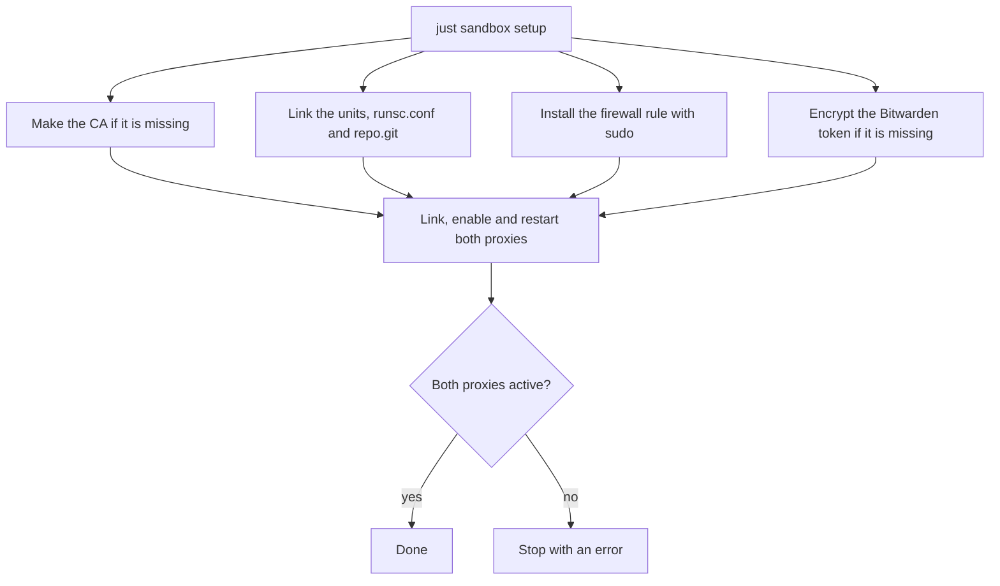
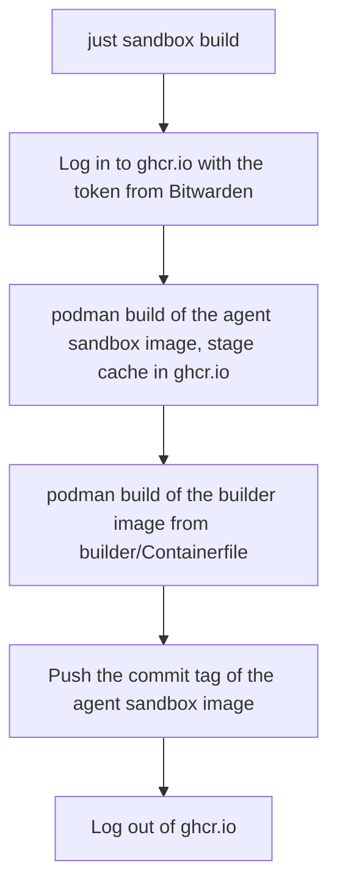
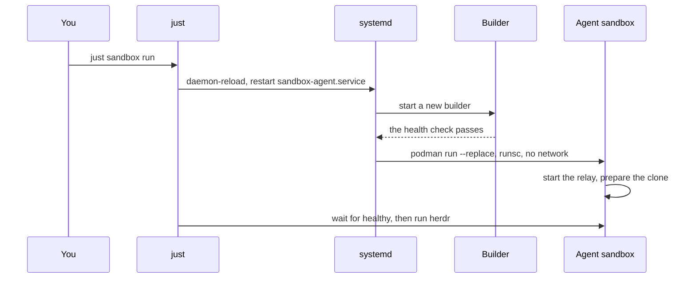
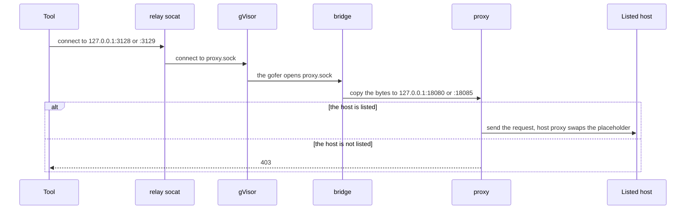
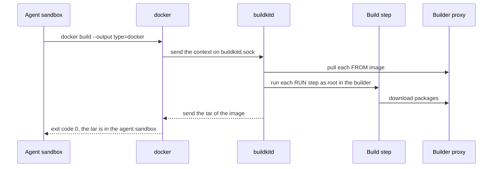
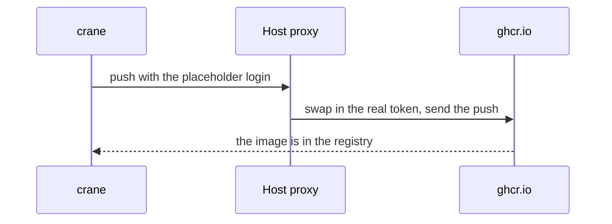

# How the sandbox works in detail

## The idea

- Each container has no network. Only a file can cross to the host.
- A relay in the container turns the proxy address that tools expect into that file.
- On the host, a bridge joins the file to a proxy.
- The host proxy holds the real tokens. The builder proxy holds none.
- Both proxies allow listed hosts only.
- The agent sandbox sends a build to the builder through a socket in a shared folder.

## The picture

## The cast

In the agent sandbox:

| Part | Job |
|---|---|
| `sandbox-entry` | The command of the container. Starts the relay, then runs your command. |
| relay (`socat`) | Listens on `127.0.0.1:3128`. Copies the bytes to `proxy.sock`. |
| `sandbox-start` | Prepares the home and the clone, starts Headroom, writes `/tmp/sandbox-ready`. |
| `docker` and `buildx` | The client of the builder. The read-only folder `/etc/docker` holds its settings. |
| `crane` | Pushes the tar of a build. Reads the placeholder login from `/etc/docker/config.json`. |

In the builder:

| Part | Job |
|---|---|
| `buildkitd` | BuildKit, rootless. Runs each build step as root in the builder. |
| relay (`socat`) | Started by `relay-entry`. Listens on `127.0.0.1:3129`. Copies the bytes to the socket of the builder proxy. |
| cache | A 1 GB `tmpfs`. Holds the layers of the build. |

In gVisor, on the host, as your user:

| Part | Job |
|---|---|
| sentry | The guest kernel. Runs the system calls. |
| gofer | A helper. Opens host files for the sentry. |

On the host:

| Part | Job |
|---|---|
| `sandbox-agent.service` | The Quadlet unit of the agent sandbox. Requires the builder. |
| `sandbox-builder.service` | The Quadlet unit of the builder. |
| `sandbox-bridge.socket` and `.service` | Make `proxy.sock` and copy its bytes to the host proxy. |
| `sandbox-proxy.service` | The host proxy: iron-proxy with the real tokens from Bitwarden. |
| `sandbox-builder-bridge.socket` and `.service` | Make the second `proxy.sock` and copy its bytes to the builder proxy. |
| `sandbox-builder-proxy.service` | The builder proxy: iron-proxy in the mode `sni-only`, with no token. |
| `sandbox-guard.service` | Loads the firewall rule `sandbox-guard.nft`. |

## The flow in phases

### Setup, once

`setup` stops at the first failed step. The proxies do not start after a failed firewall step. It asks for the Bitwarden token only if the credential is missing or unreadable.

### Build the images

### Each run

The builder starts first. A failed health check fails the start. `just` waits up to 180 seconds for the agent sandbox. It is healthy after `sandbox-start` writes `/tmp/sandbox-ready`.

### One call to the outside

Both containers follow this path. Only the relay port, the proxy and the rule set differ.

The bytes stay the same. The carrier changes three times: TCP to the relay, a Unix socket to the bridge, and TCP to the proxy. The host proxy ends the TLS with its CA. The builder proxy passes the TLS through.

### One build

A failed build gives a code other than 0. The registry token for a pull comes from `docker` in the agent sandbox, through the host proxy.

### One push

The builder never pushes and holds no login.

## Lifetimes

| Item | Lifetime |
|---|---|
| Agent sandbox | New at each `just sandbox run`. |
| `/tmp` and `/run` in the agent sandbox | `tmpfs`. A restart empties them. |
| Volume `sandbox-home` | Stays until you remove it. Holds the clone, the logins and the histories. |
| Clone | Made at the first start, when the workspace has no `.git` folder. |
| Builder | New for each sandbox session. A stop or a restart of `sandbox-agent.service` removes it. |
| Cache of the builder | `tmpfs`. Lives as long as the builder. |
| CA | Made by `setup` for 365 days. `setup` keeps an existing CA. After a new CA, run `just sandbox run`. |
| Bitwarden access token | Encrypted with `systemd-creds` in `~/.config/credstore.encrypted/bws-token`, mode 0400. |
| Firewall rule | `sandbox-guard.service` loads it at each boot, before the network. |

## Why the design looks like this

| Choice | Reason |
|---|---|
| `--network none` | The container has an empty network namespace. Only a file in a mounted folder crosses. |
| `network=host` in `runsc.conf` (agent sandbox) | gVisor then uses that empty namespace. Its own stack has no loopback. |
| `network=none` in `runsc-builder` | The builder has no network device. The relay needs only the gVisor loopback. |
| The host brings up `lo` | gVisor does not let the guest bring up the loopback. `ExecStartPost` runs `ip link set lo up`. |
| `host-uds` flags | gVisor blocks a connect to a host Unix socket by default. The agent sandbox uses `open`. The builder uses `all`: it makes `buildkitd.sock` and connects to its proxy socket. |
| A relay in each container | Tools need a TCP proxy address. The relay turns it into the socket. It runs without a capability. |
| Socket mode 0666 | In rootless Podman, the container user is a subuid. `$XDG_RUNTIME_DIR` has mode 0700, so only you and the mounting containers reach it. |
| A bridge on the host | iron-proxy listens on TCP only. `systemd-socket-proxyd` joins the socket to it. The host needs no `socat`. |
| The CA is a mount | The root file system takes no writes. The unit mounts `ca.crt` read-only. It never mounts `ca.key`. |
| The firewall rule | A TCP port on `127.0.0.1` has no user check. Without the rule, any local user could use the proxies. |
| Limits on the service | gVisor ignores the limits of Podman. `[Service]` holds `MemoryMax`, `MemorySwapMax`, `TasksMax` and `CPUQuota`. |
| A second container for builds | A build step runs as root, and the agent can send any step. The wall is the builder container. |
| A second proxy for the builder | The host proxy ends TLS with its own CA, which a base image does not trust. `sni-only` is global in iron-proxy, so the builder needs its own instance. |
| The builder cannot reach the host proxy | It mounts only its own socket folder. A hostile step cannot get a swapped token. |
| `/etc/docker` is read-only | The agent cannot add a builder or change the endpoint. `buildx` writes only to two `tmpfs` folders. |
| The push runs in the agent sandbox | `docker` cannot push a tar without a daemon, and the builder holds no login. |
| `no-new-privileges` off in the builder | `newuidmap` needs it. With it on, `rootlesskit` hangs. |
| The socket folder belongs to subuid 1000 | The builder and the agent share that subuid. The folder has mode 0700. |
| The cache is in `tmpfs` | A stop removes it. It counts against `MemoryMax`. |
| The health check fails the start | `Notify=healthy` holds `sandbox-agent.service`. `HealthOnFailure=kill` replaces a bad builder. |

## The names

| Term | Meaning |
|---|---|
| agent sandbox | The container `sandbox-agent`. It runs the agent and its tools. |
| builder | The container `sandbox-builder`. It runs `buildkitd`. New for each sandbox session. |
| host proxy | iron-proxy with the allowlist and the real tokens. `sandbox-proxy.service`. |
| builder proxy | A second iron-proxy for the builder. Checks host names only. Holds no token. |
| relay | `socat` in a container. Copies a local TCP port to `proxy.sock`. |
| bridge | A socket unit and `systemd-socket-proxyd` on the host. Joins `proxy.sock` to a proxy. |
| tunnel | The CONNECT port of a proxy: `127.0.0.1:18080` (host proxy) or `:18085` (builder proxy). |
| placeholder | The text `sandbox-placeholder-<NAME>`. The agent sandbox holds it in place of a token. |
| Quadlet | A Podman feature. Turns a `.container` file into a systemd service. |
| BuildKit | The build engine. `buildkitd` is its daemon, `buildx` is the client plugin of `docker`. |
| OCI layout | A folder that holds an image. `crane pull --format oci` makes one. |
| sentry and gofer | The two parts of gVisor. See [the cast](#the-cast). |

## Where each part is in the repo

| Path | Part |
|---|---|
| [`sandbox-agent.container`](../sandbox-agent.container) | The unit of the agent sandbox. |
| [`builder/`](../builder) | The builder: unit, `Containerfile` and `relay-entry`. |
| [`runsc.conf`](../runsc.conf) | The gVisor flags of both containers. |
| [`image/`](../image) | `sandbox-entry` (relay), `sandbox-start` and `configs/tools/docker-config.json`. |
| [`proxy/`](../proxy) | The proxies, the bridges and the firewall rule. |
| [`justfile`](../justfile) | `setup`, `run`, `rm` and `build`. |

## What comes next

Read the [README of the proxies](../proxy/README.md) for the ports, the placeholders and the hardening of the proxy unit.
