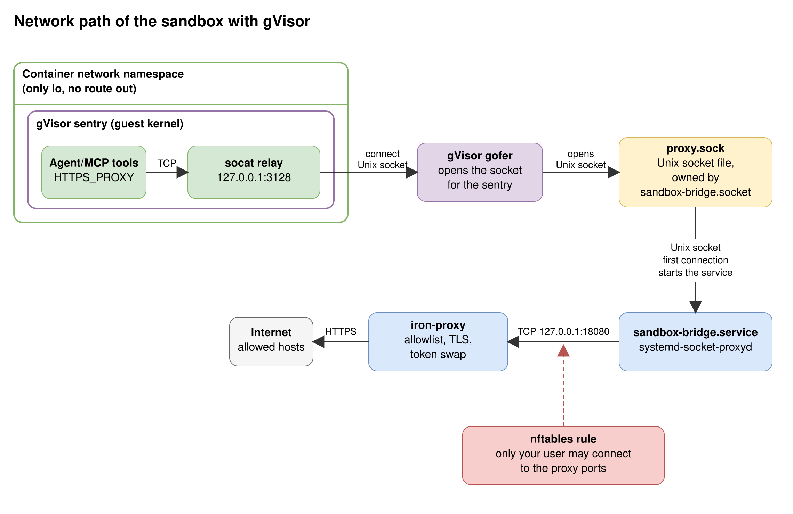
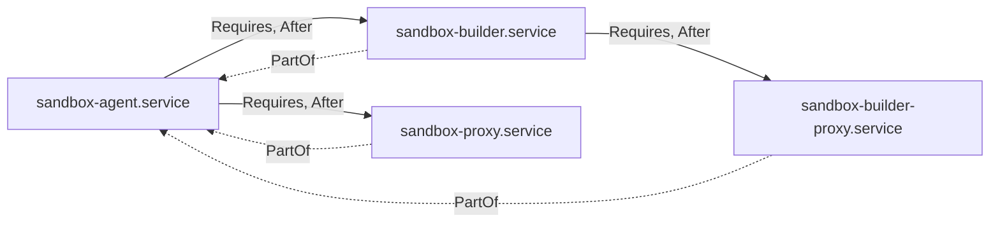
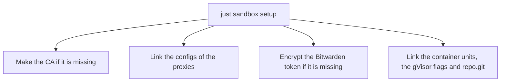
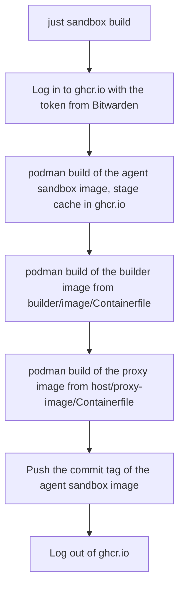
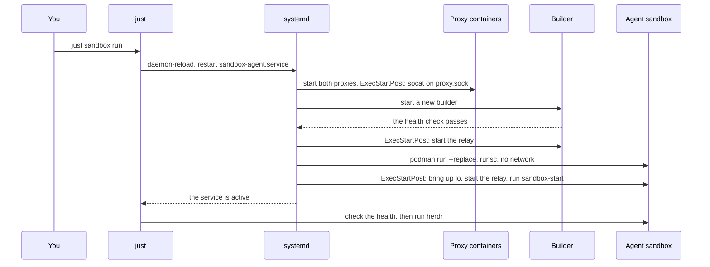
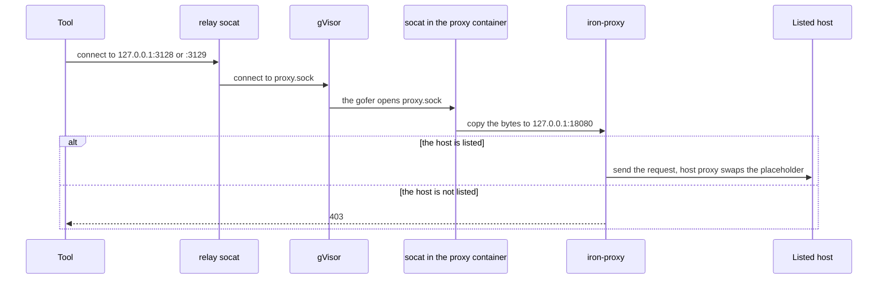
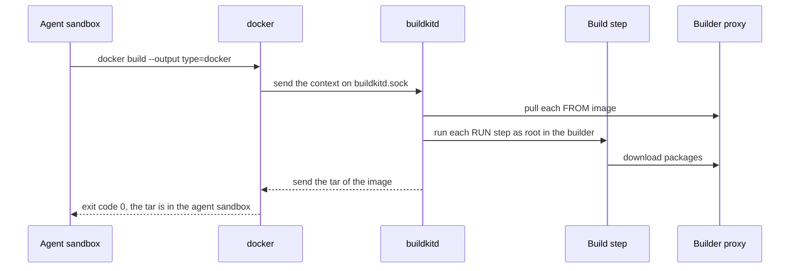
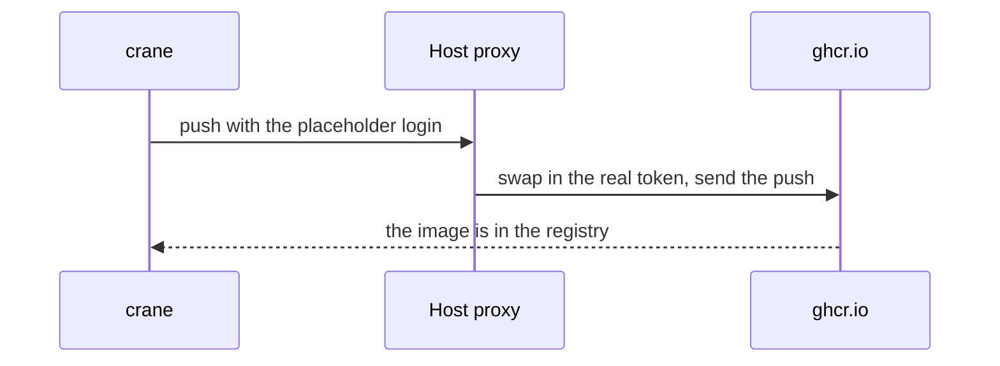

# How the sandbox works in detail

## The idea

- Each container has no network. Only a file can cross to the host.
- A relay in the container turns the proxy address that tools expect into that file.
- Each proxy runs in its own container. A `socat` there joins the file to the proxy.
- The host proxy holds the real tokens. The builder proxy holds none.
- Both proxies allow listed hosts only.
- The agent sandbox sends a build to the builder through a socket in a shared folder.
- Quadlet turns each container file into a systemd service. The service limits memory, CPU and threads.

## The picture

[](diagrams/architecture.svg)

The network path of the agent sandbox, inside gVisor:

[](diagrams/sandbox-network.svg)

Quadlet turns each `.container` file into a systemd service. The service holds the limits of the whole sandbox, because gVisor ignores the limits of Podman:

[](diagrams/quadlet.svg)

## The cast

In the agent sandbox:

| Part | Job |
|---|---|
| `sleep infinity` | The command of the container. It keeps the container alive. An init process passes the stop signal to it. |
| relay (`socat`) | Started by `ExecStartPost`. Listens on `127.0.0.1:3128`. Copies the bytes to `proxy.sock`. |
| `sandbox-start` | Runs with `podman exec` from `ExecStartPost`. Prepares the home and the clone, starts Headroom, writes `/tmp/sandbox-ready`. |
| `docker` and `buildx` | The client of the builder. The read-only folder `/etc/docker` holds its settings. |
| `crane` | Pushes the tar of a build. Reads the placeholder login from `/etc/docker/config.json`. |

In the builder:

| Part | Job |
|---|---|
| `buildkitd` | BuildKit, rootless. Runs each build step as root in the builder. |
| relay (`socat`) | Started by `ExecStartPost`. Listens on `127.0.0.1:3129`. Copies the bytes to the socket of the builder proxy. |
| cache | A 1 GB `tmpfs`. Holds the layers of the build. |

In gVisor, on the host, as your user:

| Part | Job |
|---|---|
| sentry | The guest kernel. Runs the system calls. |
| gofer | A helper. Opens host files for the sentry. |

In each proxy container:

| Part | Job |
|---|---|
| `socat` | Started by `ExecStartPost`. Listens on `proxy.sock`. Copies the bytes to the tunnel port `127.0.0.1:18080` of `iron-proxy`. |
| `iron-proxy` | The proxy. The host proxy holds the real tokens. The builder proxy checks host names only. |
| `bws` | In the host proxy only. Gets the real tokens from Bitwarden. It reads the credential `bws-token`. |

On the host:

| Part | Job |
|---|---|
| `sandbox-agent.service` | The Quadlet unit of the agent sandbox. Requires the builder and the host proxy. |
| `sandbox-builder.service` | The Quadlet unit of the builder. Requires the builder proxy. |
| `sandbox-proxy.service` | The Quadlet unit of the host proxy container. |
| `sandbox-builder-proxy.service` | The Quadlet unit of the builder proxy container. It uses the mode `sni-only` and holds no token. |

Each unit is a Quadlet `.container` file. The dependencies of the units:



`Requires` and `After` start the target first. `PartOf` passes a stop or a restart of the target to the unit. A stop of the agent sandbox stops the builder and both proxies. The real tokens are in memory only while a sandbox runs.

## The flow in phases

### Setup, once



`setup` needs no root and starts no container. Run `just sandbox build` next.

### Build the images



### Each run



The proxies and the builder start first. A failed health check fails the start. The start of each unit has `ExecStartPost` steps, and a failed step fails the start. The agent sandbox is active after `sandbox-start` ends. It is healthy after `sandbox-start` writes `/tmp/sandbox-ready`.

### One call to the outside

Both containers follow this path. Only the relay port, the proxy and the rule set differ.



The bytes stay the same. The carrier changes three times: TCP to the relay, a Unix socket to the `socat` in the proxy container, and TCP to the proxy. The host proxy ends the TLS with its CA. The builder proxy passes the TLS through.

### One build



A failed build gives a code other than 0. The registry token for a pull comes from `docker` in the agent sandbox, through the host proxy.

### One push



The builder never pushes and holds no login.

## Lifetimes

| Item | Lifetime |
|---|---|
| Agent sandbox | New at each `just sandbox run`. |
| `/tmp` and `/run` in the agent sandbox | `tmpfs`. A restart empties them. |
| Volume `sandbox-home` | Stays until you remove it. Holds the clone, the logins and the histories. |
| Clone | Made at the first start, when the workspace has no `.git` folder. |
| Builder | New for each sandbox session. A stop or a restart of `sandbox-agent.service` removes it. |
| Cache of the builder | `tmpfs`. Lives as long as the builder. |
| CA | Made by `setup` for 365 days. `setup` keeps an existing CA. After a new CA, run `just sandbox run`. |
| Proxies | New for each sandbox session. A stop or a restart of `sandbox-agent.service` removes them. |
| Bitwarden access token | Encrypted with `systemd-creds` in `~/.config/credstore.encrypted/bws-token`, mode 0400. systemd decrypts it to memory for the host proxy. |
| Real tokens | In the memory of the host proxy only, while a sandbox runs. They are not on disk. |

## Why the design looks like this

| Choice | Reason |
|---|---|
| `--network none` | The container has an empty network namespace. Only a file in a mounted folder crosses. |
| `network=host` in `agent/runsc.conf` | gVisor then uses that empty namespace. Its own stack has no loopback. |
| `network=none` in `builder/runsc.conf` | The builder has no network device. The relay needs only the gVisor loopback. |
| The host brings up `lo` | gVisor does not let the guest bring up the loopback. `ExecStartPost` runs `ip link set lo up`. |
| `host-uds` flags | gVisor blocks a connect to a host Unix socket by default. The agent sandbox uses `open`. The builder uses `all`: it makes `buildkitd.sock` and connects to its proxy socket. |
| A relay in each container | Tools need a TCP proxy address. The relay turns it into the socket. It runs without a capability. |
| Socket mode 0666 | In rootless Podman, the container user is a subuid. `$XDG_RUNTIME_DIR` has mode 0700, so only you and the mounting containers reach it. |
| A `socat` in each proxy container | iron-proxy listens on TCP only. `socat` joins the Unix socket to it. |
| No port on the host | The tunnel port exists only in the network namespace of the proxy container. No other program on the host reaches it, so the port needs no firewall rule. |
| The proxies are containers | One kind of unit for every part. A container limits what a proxy bug can reach. |
| The tokens stay out of the Podman storage | The unit mounts the systemd credential `bws-token`. `bws` puts the real tokens in the environment of `iron-proxy` only. `podman run -e` would write them into the config of the container. |
| The CA is a mount | The root file system takes no writes. The unit mounts `ca.crt` read-only. It never mounts `ca.key`. |
| Limits on the service | gVisor ignores the limits of Podman. `[Service]` holds `MemoryMax`, `MemorySwapMax`, `TasksMax` and `CPUQuota`. |
| A second container for builds | A build step runs as root, and the agent can send any step. The wall is the builder container. |
| A second proxy for the builder | The host proxy ends TLS with its own CA, which a base image does not trust. `sni-only` is global in iron-proxy, so the builder needs its own instance. Each proxy has its own network namespace, so both use the same ports. |
| The builder cannot reach the host proxy | It mounts only its own socket folder. A hostile step cannot get a swapped token. |
| `/etc/docker` is read-only | The agent cannot add a builder or change the endpoint. `buildx` writes only to two `tmpfs` folders. |
| The push runs in the agent sandbox | `docker` cannot push a tar without a daemon, and the builder holds no login. |
| `no-new-privileges` off in the builder | `newuidmap` needs it. |
| The socket folder belongs to subuid 1000 | The builder and the agent share that subuid. The folder has mode 0700. |
| The cache is in `tmpfs` | A stop removes it. It counts against `MemoryMax`. |
| The health check fails the start | `Notify=healthy` holds `sandbox-agent.service`. `HealthOnFailure=kill` replaces a bad builder. |

## Security controls

Each row is one attack of an injected agent and the control that stops it.

| If the agent tries to | What stops it |
|---|---|
| Plant a git hook or a config change in your repo | It works in a clone. The `.git` folder of your repo is a read-only mount. |
| Steal a token | The agent sandbox holds placeholders. The real tokens stay on the host. |
| Send data to an unlisted host | No network. The proxies answer `403`. |
| Push to a registry namespace that is not yours | The host proxy answers `403` for a write outside `raghav19`. |
| Get a token through a build step | The builder cannot reach the host proxy. The builder proxy holds no token. |
| Break out of the container | gVisor, no capability, `no-new-privileges` and a user that is not root. |
| Reach a proxy port from the host | No port exists on the host. The ports are inside the proxy containers. |
| Move code to your host | The only way out is a `git push` to GitHub. You read the branch before you check it out. |
| Use all memory, CPU or threads | The service limits. The kernel kills the container, not the host. |

`sandbox-agent.container` sets these controls for the agent sandbox:

| Control | Effect |
|---|---|
| `--runtime=runsc --network=none` | gVisor runs the system calls. The network namespace has only the loopback. |
| `--read-only` | No write to `/etc`, `/usr`, `/opt/mise`, the policy of Claude Code or the CA. |
| tmpfs on `/tmp` and `/run` | Scratch space. A restart empties it. |
| Volume `sandbox-home` at `/home/agent` | Keeps the clone, the logins and the histories. |
| The repo in clone mode | The unit mounts `.git` read-only at `/run/sandbox/source`. `sandbox-start` clones it into the volume. |
| `--cap-drop=ALL`, `no-new-privileges` | No capability. A setuid program cannot raise a privilege. |
| `User=agent` (uid 1000) | A subuid in rootless Podman, not your host user. |
| `MemoryMax`, `MemorySwapMax`, `TasksMax`, `CPUQuota` | 3 GB with no swap, 2048 threads, 4 CPUs. |
| Read-only mounts | The CA, the socket folders, the `.git` of the repo and the theme. |

The builder has the same model with other values: `runsc-builder`, three capabilities, 2 GB with no swap, 1024 threads, 2 CPUs and a 1 GB `tmpfs` cache.

## The proxies

### Ports

Both proxies use the same ports on `127.0.0.1`. Each proxy runs in its own container, so the ports exist only inside it and not on the host. The agent sandbox and the builder use only the tunnel.

| Port | Listener |
|---|---|
| 18080 | The tunnel (TCP). `socat` connects to it. |
| 18081 | HTTP |
| 18082 | HTTPS |
| 18083 | Metrics |
| 18084 | DNS (UDP) |

### The rules for ghcr.io

The host proxy checks the `CONNECT` first, before it sees a path. So `ghcr.io` has a rule for each step:

| Rule | Allows |
|---|---|
| `CONNECT` | The tunnel to `ghcr.io`. |
| `GET`, `HEAD` on `/token`, `/v2/` and `/v2/*` | The login and reads in any namespace. |
| `POST`, `PATCH`, `PUT` on `/v2/raghav19/*` | Writes in the namespace `raghav19` only. |

### Placeholders

The agent sandbox holds a placeholder. The host proxy replaces it in the `Authorization` header of a request to the hosts of its rule. Each value must equal a `proxy_value` line in `agent/proxy/iron-proxy.yaml`.

| Placeholder, and the variable of the proxy | Hosts |
|---|---|
| `sandbox-placeholder-GH_TOKEN`, from `GH_TOKEN` | `github.com`, `api.github.com`, `api.githubcopilot.com` |
| `sandbox-placeholder-CLAUDE_CODE_OAUTH_TOKEN`, from `CLAUDE_CODE_OAUTH_TOKEN` | `api.anthropic.com` |
| `sandbox-placeholder-QWEN_API_KEY`, from `QWEN_API_KEY` | `token-plan.ap-southeast-1.maas.aliyuncs.com` |
| `sandbox-placeholder-GHCR_PUSH_TOKEN`, from `GITHUB_TOKEN`. The login is in `/etc/docker/config.json`. | `ghcr.io` |

`agent/image/configs/agents/managed-settings.json` holds the text of the placeholder for the GitHub MCP server, because Claude Code does not expand `$GH_TOKEN` in a header. Qwen Code expands the variable itself.

### Hardening of the proxy containers

The proxies read requests that the agent controls. A bug gives an attacker what the container holds. This is the mounted files, the network of the container and, in the host proxy, the real tokens in memory. The units limit this.

| Setting | Effect |
|---|---|
| `ReadOnly=true` | No write to the root file system. `/tmp` is a `tmpfs`. |
| `DropCapability=ALL`, `NoNewPrivileges=true` | No capability. A setuid program cannot raise a privilege. |
| Rootless Podman | The container runs in a user namespace. It has no file of another user. |
| Read-only mounts | The config and the CA. The host proxy also gets the credential `bws-token`. |
| `RunInit=true` (host proxy) | An init process passes the stop signal to `bws`. Without it, the stop waits for a kill. |
| `MemoryMax`, `MemorySwapMax`, `TasksMax` | 512 MB (host proxy) or 256 MB (builder proxy) with no swap. |

The host proxy sees only these files: its config, `ca.crt`, `ca.key`, the credential and the folder of `proxy.sock`. The builder proxy sees its config and its socket folder. A container cannot restrict its own network, so the allowlist is the control. Treat `iron-proxy.yaml` and `iron-proxy-builder.yaml` as the most important files.

## Limits

- Use HTTPS remotes. There is no SSH and no raw TCP. A tool that ignores `HTTPS_PROXY` has no route.
- No `sudo` and no package install in the agent sandbox. Change the image.
- gVisor is not a microVM. A bug in the sentry gives an attacker your host user.
- Commits use the name `agent` and the email `agent@localhost`. To commit as yourself, set `GIT_AUTHOR_NAME`, `GIT_AUTHOR_EMAIL`, `GIT_COMMITTER_NAME` and `GIT_COMMITTER_EMAIL` in the shell.
- Listed hosts can receive data from the agent. Keep both allowlists short.
- The proxy parses every request of the agent. A bug in iron-proxy can give an attacker the real tokens of the host proxy. Pin the image by digest.
- A branch that the agent pushes can hold hooks or settings files. Read the diff before you check it out.
- A build step runs any command as root in the builder. It reaches only the hosts of the builder proxy.
- BuildKit has no authorization. Any process that mounts `buildkitd.sock` can send a build.
- `--output type=docker` supports one platform. The cache of the builder ends with the builder.

## The names

| Term | Meaning |
|---|---|
| agent sandbox | The container `sandbox-agent`. It runs the agent and its tools. |
| builder | The container `sandbox-builder`. It runs `buildkitd`. New for each sandbox session. |
| host proxy | The container `sandbox-proxy`: iron-proxy with the allowlist and the real tokens. |
| builder proxy | The container `sandbox-builder-proxy`: a second iron-proxy for the builder. Checks host names only. Holds no token. |
| relay | `socat` in the agent sandbox or the builder. Copies a local TCP port to `proxy.sock`. |
| tunnel | The CONNECT port of a proxy: `127.0.0.1:18080` inside the proxy container. `socat` in that container joins `proxy.sock` to it. |
| placeholder | The text `sandbox-placeholder-<NAME>`. The agent sandbox holds it in place of a token. |
| Quadlet | A Podman feature. Turns a `.container` file into a systemd service. |
| BuildKit | The build engine. `buildkitd` is its daemon, `buildx` is the client plugin of `docker`. |
| OCI layout | A folder that holds an image. `crane pull --format oci` makes one. |
| sentry and gofer | The two parts of gVisor. See [the cast](#the-cast). |

## Where each part is in the repo

Each part has its own folder. Both lanes use the proxy image and the setup guide, so they have a folder of their own.

```text
.sandbox/
  agent/
    sandbox-agent.container     the unit of the agent sandbox
    runsc.conf                  the gVisor flags of runsc
    image/                      the Dockerfile, sandbox-start, mise.toml, tools, configs
    proxy/                      the host proxy: iron-proxy.yaml and proxy.container
  builder/
    sandbox-builder.container   the unit of the builder
    runsc.conf                  the gVisor flags of runsc-builder
    image/                      the Containerfile
    proxy/                      the builder proxy: iron-proxy.yaml and proxy.container
  host/
    proxy-image/Containerfile   the image of both proxies: iron-proxy, socat and bws
    README.md                   the guide to set up the proxies
  docs/                         this document and the diagrams
  justfile                      setup, run, rm and build
```

The two `proxy/` folders have the same file names. `just sandbox setup` links the units into `~/.config/containers/systemd` as `sandbox-proxy.container` for the agent sandbox and `sandbox-builder-proxy.container` for the builder. It links the builder config as `iron-proxy-builder.yaml`.

## What comes next

Read the [guide to set up the proxies](../host/README.md) for the steps and the daily commands.
