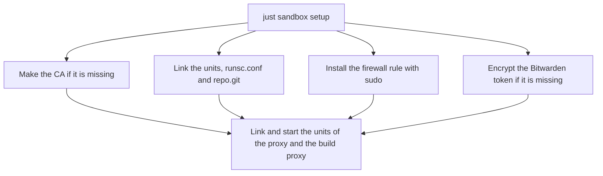
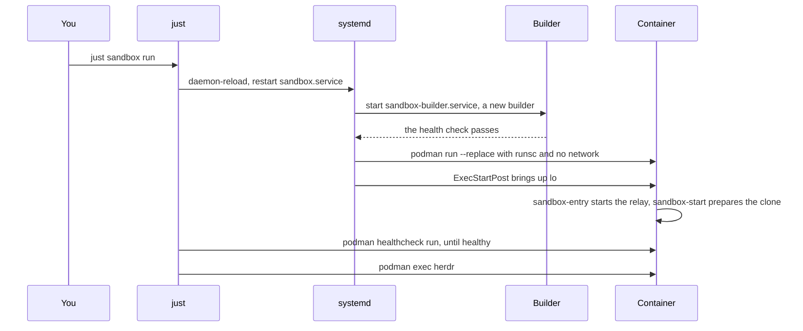
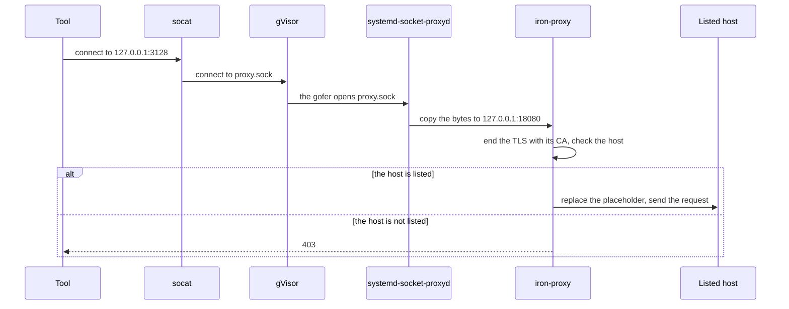
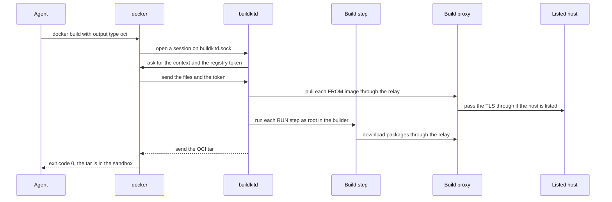

# How the sandbox works in detail

## The idea

- The container has no network. Only a file can cross from the container to the host.
- A relay in the container turns the proxy address that tools expect into that file.
- The host end of the file leads to a proxy that holds the real tokens.
- The proxy allows listed hosts only. It replaces each placeholder with the real token.
- A firewall rule keeps other users off the ports of the proxy.
- A second container, the builder, builds images. It has no network device and no secret. It reaches only the hosts of a build proxy that holds no token.
- The agent sends a build to the builder through a socket in a shared folder. Each sandbox session gets a new builder.

## The picture

## The cast

In the container:

- `sandbox-entry`: the command of the container. It starts the relay, then runs your command.
- `socat`: the relay. It listens on `127.0.0.1:3128` and copies the bytes to `proxy.sock`.
- `sandbox-start`: prepares the home and the clone, starts Headroom and writes `/tmp/sandbox-ready`.
- `docker` and its plugin `buildx`: the client of the builder. `DOCKER_CONFIG` and `BUILDX_BUILDER` select the builder `sandbox`. Its definition is in the read-only folder `/etc/docker`.
- `skopeo`: pushes the OCI tar of a build to a registry.

In the builder container (gVisor, no network device):

- `buildkitd`: BuildKit, rootless. It runs each build step as root in the builder.
- `socat` (started by `relay-entry`): the relay. It listens on `127.0.0.1:3129` and copies the bytes to the socket of the build proxy.
- The cache: a `tmpfs` of 1 GB. It holds the layers of the build.

In gVisor, on the host, as your user:

- The sentry: the guest kernel. It runs the system calls of the agent.
- The gofer: a helper process. It opens host files for the sentry.

On the host:

- `sandbox.service`: the Quadlet unit that runs the container.
- `sandbox-builder.service`: the Quadlet unit that runs the builder. `sandbox.service` requires it.
- `sandbox-bridge.socket`: makes and owns `proxy.sock`.
- `sandbox-bridge.service`: runs `systemd-socket-proxyd`. It copies the bytes from `proxy.sock` to iron-proxy.
- `sandbox-proxy.service`: runs iron-proxy with the real tokens from Bitwarden.
- `sandbox-proxy-build.service`: runs the build proxy, a second iron-proxy in the mode `sni-only`. It holds no token.
- `sandbox-bridge-build.socket` and `sandbox-bridge-build.service`: make `$XDG_RUNTIME_DIR/sandbox-build/proxy.sock` and copy its bytes to the build proxy.
- `sandbox-guard.service`: loads the firewall rule `sandbox-guard.nft`.

## The flow in phases

### Setup, once

`setup` makes a CA only if `ca.crt` or `ca.key` is missing. It asks for your `sudo` password for the firewall rule. It asks for the Bitwarden access token only if the credential is missing or unreadable. At the end, it checks that `sandbox-proxy.service` is active.

### Each run

Each `run` makes a new container from the image and a new builder. The builder starts first. If its health check fails, the start fails. The recipe waits up to 180 seconds for the health check of the container. The container is healthy after `sandbox-start` writes `/tmp/sandbox-ready`.

### One request

The bytes stay the same. The carrier changes at three points: TCP to `socat`, a Unix socket to the bridge, and a new TCP connection to iron-proxy.

### One build

`docker` waits until the build ends. A failed build gives a code other than 0. The registry token comes from the client, because `docker` gets it through the proxy of the sandbox. The builder pulls and downloads only through the build proxy. An unlisted host gets `403`. The sandbox pushes the OCI tar with `skopeo`, through the proxy of the sandbox. The builder never pushes.

## Lifetimes

- **The container:** new at each `just sandbox run`.
- **`/tmp` and `/run` in the container:** tmpfs. A restart empties them.
- **The volume `sandbox-home`:** stays until you remove it. It holds the clone, the logins and the histories. `sandbox-start` copies the home files of the image back at each start.
- **The clone:** made at the first start, when the workspace has no `.git` folder.
- **The builder:** new for each sandbox session. A stop or a restart of `sandbox.service` removes it.
- **The cache of the builder:** in `tmpfs`. It lives as long as the builder.
- **The CA:** made by `setup` with a life of 365 days. `setup` keeps an existing CA. After you make a new CA, restart the sandbox with `just sandbox run`.
- **The Bitwarden access token:** encrypted with `systemd-creds` in `~/.config/credstore.encrypted/bws-token`, mode 0400.
- **The firewall rule:** `sandbox-guard.service` loads it at each boot, before the network.

## Why the design looks like this

- **`--network none`.** The container has an empty network namespace. Its `127.0.0.1` is not the loopback of the host. Only a file in a mounted folder crosses.
- **`network=host` in `runsc.conf`.** gVisor then uses that empty namespace. With its own network stack, the guest has no loopback.
- **The host brings up `lo`.** gVisor does not let the guest bring up the loopback interface. `ExecStartPost` in `sandbox.container` runs `ip link set lo up` in the network namespace of the container.
- **`host-uds=open`.** gVisor blocks a connect to a host Unix socket by default. This flag allows the guest to connect to `proxy.sock`. Do not mount a folder that holds another socket.
- **A relay.** Tools need a TCP address for a proxy. The relay turns that address into the socket. It runs as the user `agent` and has no capability.
- **The socket has mode 0666.** In rootless Podman, `agent` is a subuid, not your user. Only you and the containers that mount the folder reach the socket, because `$XDG_RUNTIME_DIR` has mode 0700.
- **A bridge.** iron-proxy listens on TCP only. `systemd-socket-proxyd` joins the socket to the tunnel port. There is no `socat` on the host.
- **The CA is a mount.** The root file system takes no writes, so `update-ca-certificates` cannot run. The unit mounts `ca.crt` read-only over `/etc/ssl/certs/ca-certificates.crt`. The sandbox trusts this CA only. The file never mounts `ca.key`.
- **The firewall rule.** A TCP port on `127.0.0.1` has no check of the user. Without the rule, any local user could use the proxy and its real tokens.
- **Limits on the service.** gVisor ignores the limits of Podman. `MemoryMax`, `MemorySwapMax`, `TasksMax` and `CPUQuota` are in `[Service]` of `sandbox.container` and of `sandbox-builder.container`.
- **A second container for builds.** A build step runs as root in the builder, and the agent can send any step. The wall is the builder container: gVisor, no network, no secret and limits.
- **`runsc-builder` in `runsc.conf`.** `network=none`: the builder has no network device, and the relay uses the loopback of gVisor. `host-uds=all`: `buildkitd` makes its socket, and the relay connects to the socket of the build proxy.
- **A second proxy for the builder.** The proxy of the sandbox ends TLS with its own CA. A base image of a build step does not trust that CA, so a `RUN` step fails on the certificate. The build proxy passes TLS through, so the step sees the real certificate. The mode `sni-only` is global in iron-proxy, so the builder needs its own instance.
- **The builder cannot reach the token proxy.** The builder mounts only the folder `sandbox-build`. It cannot see `proxy.sock` of the sandbox, and nothing listens on `127.0.0.1:3128` in the builder. A hostile build step cannot get a swapped token.
- **The config of docker is read-only.** `/etc/docker` is on the read-only root file system. `buildx` writes only `buildx/activity` and `buildx/refs`, which are `tmpfs`. The agent cannot add a builder or change the endpoint.
- **The push is in the sandbox.** `docker` has no way to push a local tar without a daemon, and the builder holds no login. `skopeo` in the sandbox pushes through the proxy, which replaces the placeholder.
- **`no-new-privileges` is off for the builder.** `newuidmap` needs it. With it on, `rootlesskit` hangs with no log and no socket.
- **The socket folder belongs to the subuid 1000.** The builder and the agent are the user 1000 in their containers, so they are the same subuid on the host. The agent may connect. The folder has mode 0700.
- **The cache is in `tmpfs`.** A stop removes it, and no build file stays on the host. It counts against `MemoryMax`.
- **The health check fails the start.** `Notify=healthy` holds `sandbox.service` until `buildctl debug workers` passes inside the builder. `HealthOnFailure=kill` stops an unhealthy builder, and systemd starts a new one.

## The names

- **Quadlet:** a Podman feature. It turns `sandbox.container` into the service `sandbox.service`.
- **iron-proxy:** the host proxy. It has the allowlist and the secret rules.
- **Placeholder:** the text `sandbox-placeholder-<NAME>`. The container holds it in place of a token.
- **Tunnel:** the CONNECT port of iron-proxy, `127.0.0.1:18080`.
- **Builder:** the container that runs `buildkitd`.
- **Build proxy:** the second iron-proxy, for the builder. It passes TLS through and checks only the host name.
- **OCI layout:** a folder that holds an image. `skopeo copy ... oci:/folder` makes one, and `docker build --build-context` gives it to a build.
- **Sentry and gofer:** the two parts of gVisor in the cast above.

## Where each part is in the repo

- [`sandbox.container`](../sandbox.container): the Quadlet unit.
- [`runsc.conf`](../runsc.conf): the gVisor flags of the sandbox and of the builder.
- [`builder/sandbox-builder.container`](../builder/sandbox-builder.container): the builder unit.
- [`builder/Containerfile`](../builder/Containerfile) and [`builder/relay-entry`](../builder/relay-entry): the builder image and its relay.
- [`image/configs/tools/docker-config.json`](../image/configs/tools/docker-config.json): the proxy settings of the build steps.
- [`justfile`](../justfile): `setup`, `run`, `rm` and `build`.
- [`image/sandbox-entry`](../image/sandbox-entry): the relay.
- [`image/sandbox-start`](../image/sandbox-start): the home, the clone and Headroom.
- [`proxy/iron-proxy.yaml`](../proxy/iron-proxy.yaml): the allowlist and the secret rules.
- [`proxy/sandbox-bridge.socket`](../proxy/sandbox-bridge.socket) and [`proxy/sandbox-bridge.service`](../proxy/sandbox-bridge.service): the bridge.
- [`proxy/sandbox-proxy.service`](../proxy/sandbox-proxy.service): the proxy unit.
- [`proxy/iron-proxy-build.yaml`](../proxy/iron-proxy-build.yaml), [`proxy/sandbox-proxy-build.service`](../proxy/sandbox-proxy-build.service), [`proxy/sandbox-bridge-build.socket`](../proxy/sandbox-bridge-build.socket) and [`proxy/sandbox-bridge-build.service`](../proxy/sandbox-bridge-build.service): the build proxy and its bridge.
- [`proxy/sandbox-guard.nft`](../proxy/sandbox-guard.nft) and [`proxy/sandbox-guard.service`](../proxy/sandbox-guard.service): the firewall rule.

## What comes next

Read the [README of the host proxy](../proxy/README.md) for the ports, the placeholders and the hardening of the proxy unit.
