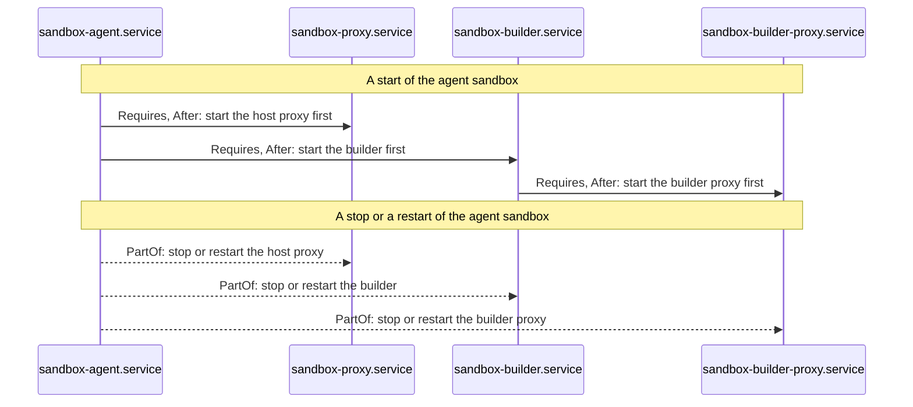
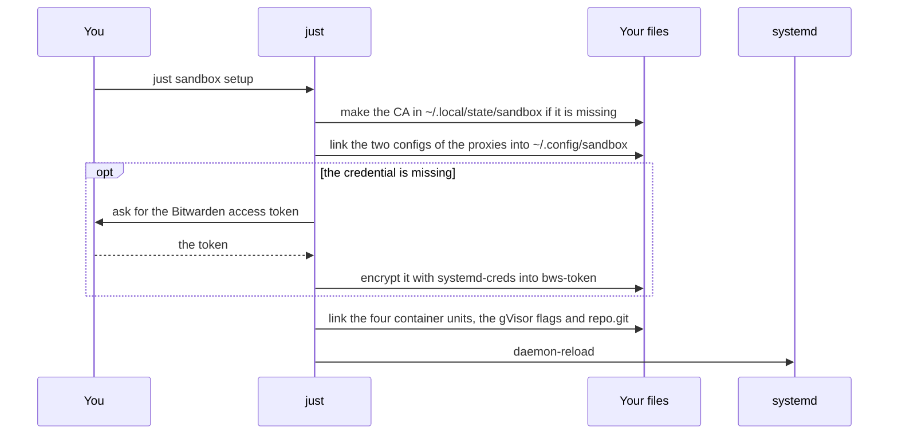
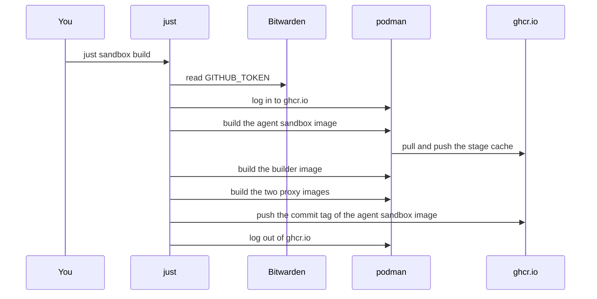
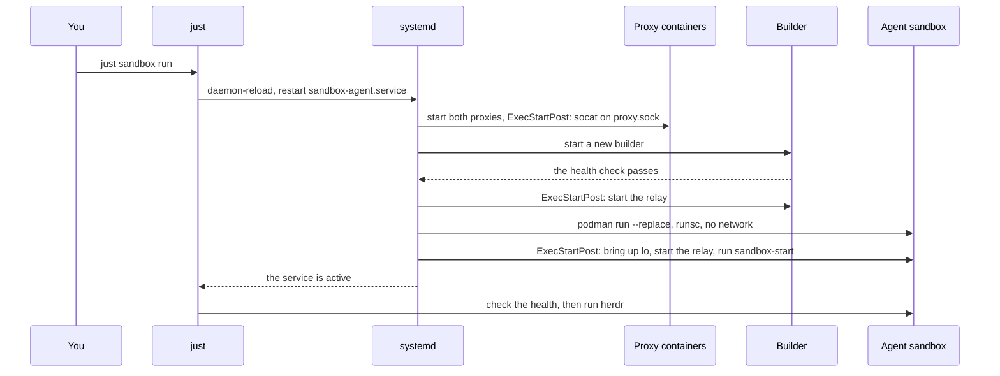
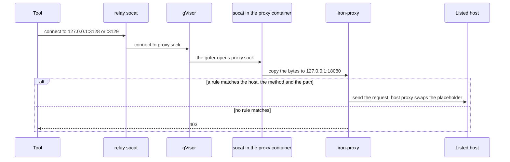
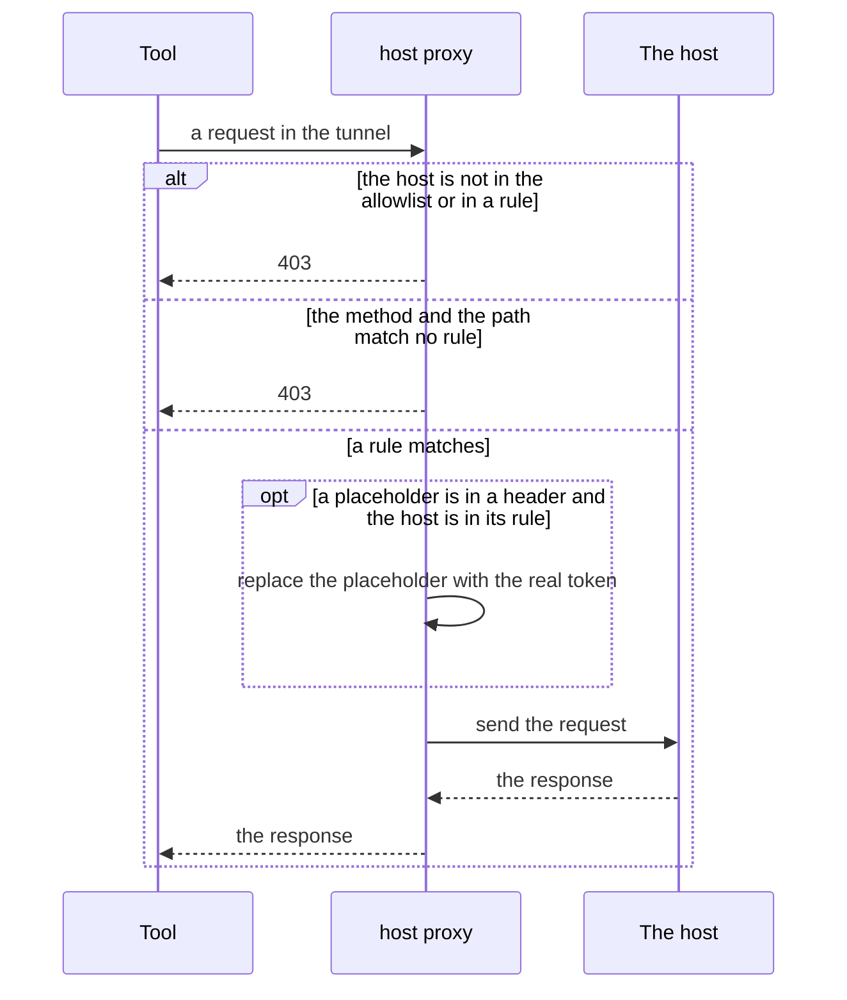
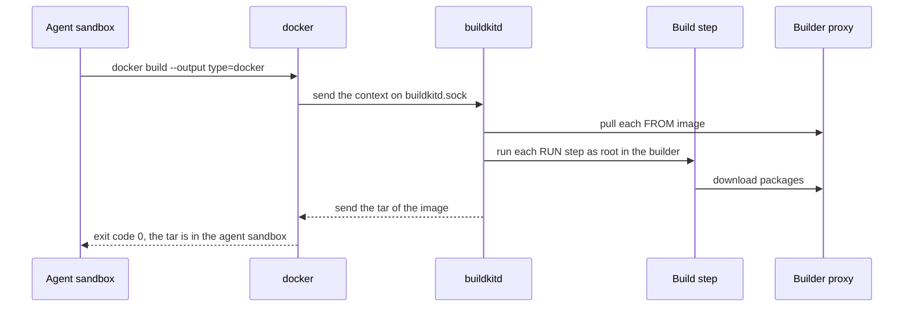
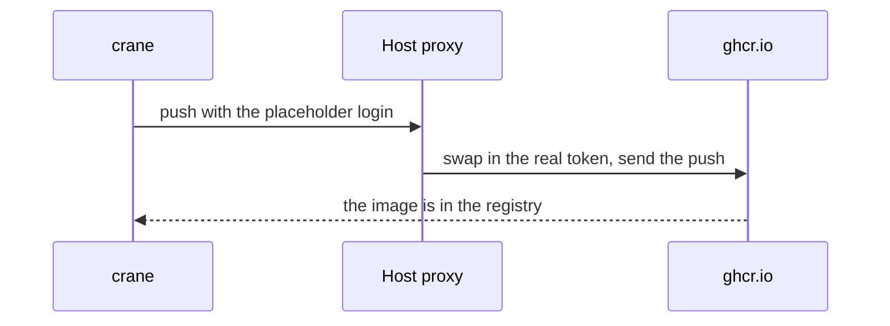

# How the sandbox works in detail

## The idea

- Each container has no network. Only a file can cross to the host.
- A relay in the container turns the proxy address that tools expect into that file.
- Each proxy runs in its own container. A `socat` there joins the file to the proxy.
- The host proxy holds the real tokens. The builder proxy holds none.
- Both proxies allow listed hosts only. The host proxy also checks the method and the path, so a write goes to one GitHub repository only.
- The agent sandbox sends a build to the builder through a socket in a shared folder.
- Quadlet turns each container file into a systemd service. The service limits memory, CPU and threads.

## The picture

The network path of the agent sandbox and the builder, inside gVisor:

Quadlet turns each `.container` file into a systemd service. The service holds the limits of the whole sandbox, because gVisor ignores the limits of Podman:

## The cast

In the agent sandbox:

| Part | Job |
|---|---|
| `sleep infinity` | The command of the container. It keeps the container alive. An init process passes the stop signal to it. |
| relay (`socat`) | Started by `ExecStartPost`. Listens on `127.0.0.1:3128`. Copies the bytes to `proxy.sock`. |
| `sandbox-start` | Runs with `podman exec` from `ExecStartPost`. Prepares the home and the clone, starts Headroom, writes `/tmp/sandbox-ready`. |
| `docker` and `buildx` | The client of the builder. The read-only folder `/etc/docker` holds its settings. |
| `crane` | Pushes the tar of a build. Reads the placeholder login from `/etc/docker/config.json`. |

In the builder:

| Part | Job |
|---|---|
| `buildkitd` | BuildKit, rootless. Runs each build step as root in the builder. |
| relay (`socat`) | Started by `ExecStartPost`. Listens on `127.0.0.1:3129`. Copies the bytes to the socket of the builder proxy. |
| cache | A 1 GB `tmpfs`. Holds the layers of the build. |

In gVisor, on the host, as your user:

| Part | Job |
|---|---|
| sentry | The guest kernel. Runs the system calls. |
| gofer | A helper. Opens host files for the sentry. |

In each proxy container:

| Part | Job |
|---|---|
| `socat` | Started by `ExecStartPost`. Listens on `proxy.sock`. Copies the bytes to the tunnel port `127.0.0.1:18080` of `iron-proxy`. |
| `iron-proxy` | The proxy. The host proxy holds the real tokens. The builder proxy checks host names only. |
| `bws` | In the host proxy only. Gets the real tokens from Bitwarden. It reads the credential `bws-token`. |

On the host:

| Part | Job |
|---|---|
| `sandbox-agent.service` | The Quadlet unit of the agent sandbox. Requires the builder and the host proxy. |
| `sandbox-builder.service` | The Quadlet unit of the builder. Requires the builder proxy. |
| `sandbox-proxy.service` | The Quadlet unit of the host proxy container. |
| `sandbox-builder-proxy.service` | The Quadlet unit of the builder proxy container. It uses the mode `sni-only` and holds no token. |

Each unit is a Quadlet `.container` file. The dependencies of the units:

`Requires` and `After` start the target first. `PartOf` passes a stop or a restart of the target to the unit. A stop of the agent sandbox stops the builder and both proxies. The real tokens are in memory only while a sandbox runs.

## The flow in phases

### Setup, once

`setup` needs no root and starts no container. Run `just sandbox build` next.

### Build the images

### Each run

The proxies and the builder start first. A failed health check fails the start. The start of each unit has `ExecStartPost` steps, and a failed step fails the start. The agent sandbox is active after `sandbox-start` ends. It is healthy after `sandbox-start` writes `/tmp/sandbox-ready`.

### One call to the outside

Both containers follow this path. Only the relay port, the proxy and the rule set differ.

The host proxy judges each request in this order:

A host in `domains` takes every method and every path. A host in `rules` takes only the methods and the paths of its rules. The builder proxy has no path rules, because it cannot see a path.

The bytes stay the same. The carrier changes three times: TCP to the relay, a Unix socket to the `socat` in the proxy container, and TCP to the proxy. The host proxy ends the TLS with its CA. The builder proxy passes the TLS through.

### One build

A failed build gives a code other than 0. The registry token for a pull comes from `docker` in the agent sandbox, through the host proxy.

### One push

The builder never pushes and holds no login.
