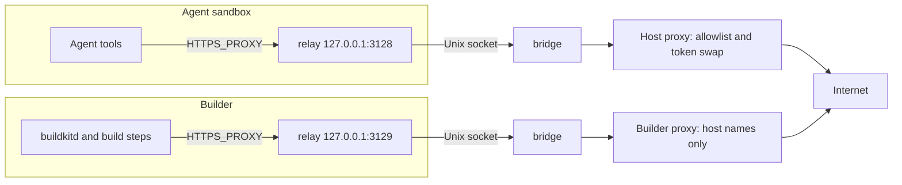
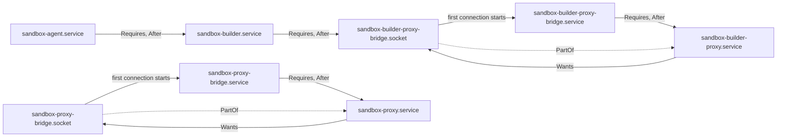
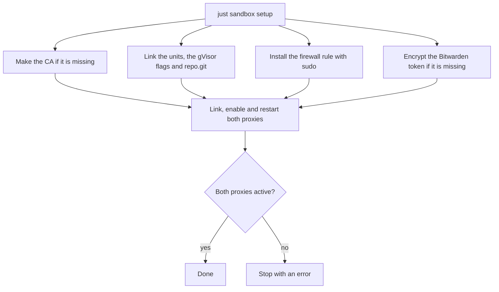
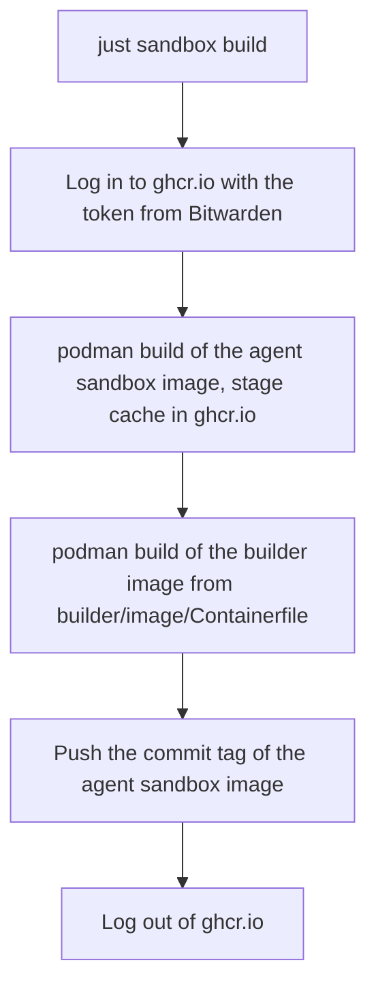
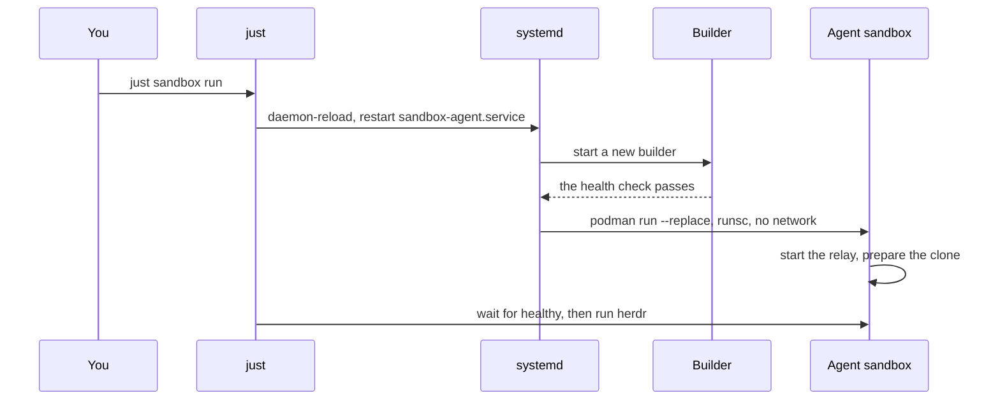
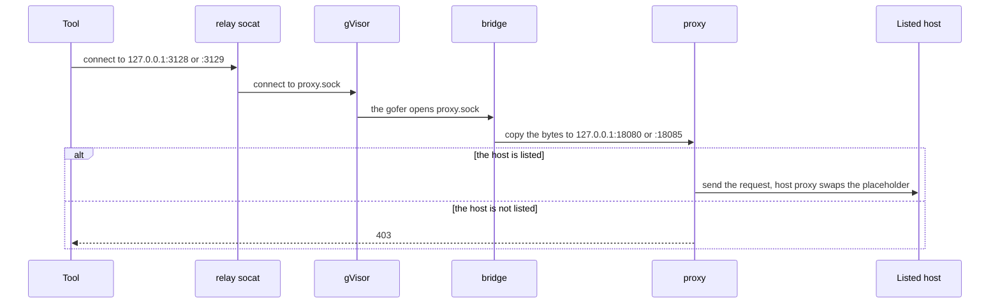
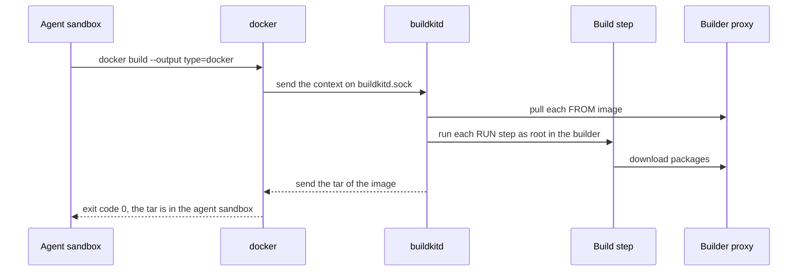
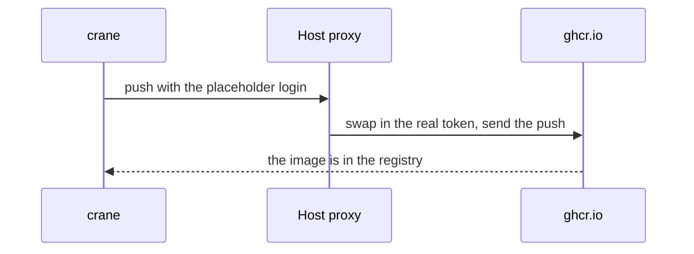
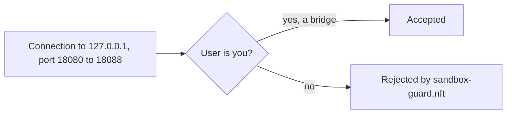

# How the sandbox works in detail

## The idea

- Each container has no network. Only a file can cross to the host.
- A relay in the container turns the proxy address that tools expect into that file.
- On the host, a bridge joins the file to a proxy.
- The host proxy holds the real tokens. The builder proxy holds none.
- Both proxies allow listed hosts only.
- The agent sandbox sends a build to the builder through a socket in a shared folder.

## The picture

[](diagrams/architecture.svg)

Both containers use one model for each call to the outside:



The network path of the agent sandbox, inside gVisor:

[](diagrams/sandbox-network.svg)

## The cast

In the agent sandbox:

| Part | Job |
|---|---|
| `sandbox-entry` | The command of the container. Starts the relay, then runs your command. |
| relay (`socat`) | Listens on `127.0.0.1:3128`. Copies the bytes to `proxy.sock`. |
| `sandbox-start` | Prepares the home and the clone, starts Headroom, writes `/tmp/sandbox-ready`. |
| `docker` and `buildx` | The client of the builder. The read-only folder `/etc/docker` holds its settings. |
| `crane` | Pushes the tar of a build. Reads the placeholder login from `/etc/docker/config.json`. |

In the builder:

| Part | Job |
|---|---|
| `buildkitd` | BuildKit, rootless. Runs each build step as root in the builder. |
| relay (`socat`) | Started by `relay-entry`. Listens on `127.0.0.1:3129`. Copies the bytes to the socket of the builder proxy. |
| cache | A 1 GB `tmpfs`. Holds the layers of the build. |

In gVisor, on the host, as your user:

| Part | Job |
|---|---|
| sentry | The guest kernel. Runs the system calls. |
| gofer | A helper. Opens host files for the sentry. |

On the host:

| Part | Job |
|---|---|
| `sandbox-agent.service` | The Quadlet unit of the agent sandbox. Requires the builder. |
| `sandbox-builder.service` | The Quadlet unit of the builder. |
| `sandbox-proxy-bridge.socket` and `.service` | Make `proxy.sock` and copy its bytes to the host proxy. |
| `sandbox-proxy.service` | The host proxy: iron-proxy with the real tokens from Bitwarden. |
| `sandbox-builder-proxy-bridge.socket` and `.service` | Make the second `proxy.sock` and copy its bytes to the builder proxy. |
| `sandbox-builder-proxy.service` | The builder proxy: iron-proxy in the mode `sni-only`, with no token. |
| `sandbox-guard.service` | Loads the firewall rule `sandbox-guard.nft`. |

The units of one proxy share a name prefix. `systemctl --user status 'sandbox-proxy*'` shows the host proxy and its bridge. `systemctl --user status 'sandbox-builder-proxy*'` shows the builder proxy and its bridge.

The dependencies of the units:



`Requires` and `After` start the target first. `Wants` starts the target with the unit. `PartOf` passes a stop or a restart of the target to the unit. The agent sandbox does not require the host proxy. `just sandbox run` checks that its socket exists.

## The flow in phases

### Setup, once



`setup` stops at the first failed step. The proxies do not start after a failed firewall step.

### Build the images



### Each run



The builder starts first. A failed health check fails the start. `just` waits up to 180 seconds for the agent sandbox. It is healthy after `sandbox-start` writes `/tmp/sandbox-ready`.

### One call to the outside

Both containers follow this path. Only the relay port, the proxy and the rule set differ.



The bytes stay the same. The carrier changes three times: TCP to the relay, a Unix socket to the bridge, and TCP to the proxy. The host proxy ends the TLS with its CA. The builder proxy passes the TLS through.

### One build



A failed build gives a code other than 0. The registry token for a pull comes from `docker` in the agent sandbox, through the host proxy.

### One push



The builder never pushes and holds no login.

## Lifetimes

| Item | Lifetime |
|---|---|
| Agent sandbox | New at each `just sandbox run`. |
| `/tmp` and `/run` in the agent sandbox | `tmpfs`. A restart empties them. |
| Volume `sandbox-home` | Stays until you remove it. Holds the clone, the logins and the histories. |
| Clone | Made at the first start, when the workspace has no `.git` folder. |
| Builder | New for each sandbox session. A stop or a restart of `sandbox-agent.service` removes it. |
| Cache of the builder | `tmpfs`. Lives as long as the builder. |
| CA | Made by `setup` for 365 days. `setup` keeps an existing CA. After a new CA, run `just sandbox run`. |
| Bitwarden access token | Encrypted with `systemd-creds` in `~/.config/credstore.encrypted/bws-token`, mode 0400. |
| Firewall rule | `sandbox-guard.service` loads it at each boot, before the network. |

## Why the design looks like this

| Choice | Reason |
|---|---|
| `--network none` | The container has an empty network namespace. Only a file in a mounted folder crosses. |
| `network=host` in `agent/runsc.conf` | gVisor then uses that empty namespace. Its own stack has no loopback. |
| `network=none` in `builder/runsc.conf` | The builder has no network device. The relay needs only the gVisor loopback. |
| The host brings up `lo` | gVisor does not let the guest bring up the loopback. `ExecStartPost` runs `ip link set lo up`. |
| `host-uds` flags | gVisor blocks a connect to a host Unix socket by default. The agent sandbox uses `open`. The builder uses `all`: it makes `buildkitd.sock` and connects to its proxy socket. |
| A relay in each container | Tools need a TCP proxy address. The relay turns it into the socket. It runs without a capability. |
| Socket mode 0666 | In rootless Podman, the container user is a subuid. `$XDG_RUNTIME_DIR` has mode 0700, so only you and the mounting containers reach it. |
| A bridge on the host | iron-proxy listens on TCP only. `systemd-socket-proxyd` joins the socket to it. The host needs no `socat`. |
| The CA is a mount | The root file system takes no writes. The unit mounts `ca.crt` read-only. It never mounts `ca.key`. |
| The firewall rule | A TCP port on `127.0.0.1` has no user check. See [The firewall rule](#the-firewall-rule). |
| Limits on the service | gVisor ignores the limits of Podman. `[Service]` holds `MemoryMax`, `MemorySwapMax`, `TasksMax` and `CPUQuota`. |
| A second container for builds | A build step runs as root, and the agent can send any step. The wall is the builder container. |
| A second proxy for the builder | The host proxy ends TLS with its own CA, which a base image does not trust. `sni-only` is global in iron-proxy, so the builder needs its own instance. |
| The builder cannot reach the host proxy | It mounts only its own socket folder. A hostile step cannot get a swapped token. |
| `/etc/docker` is read-only | The agent cannot add a builder or change the endpoint. `buildx` writes only to two `tmpfs` folders. |
| The push runs in the agent sandbox | `docker` cannot push a tar without a daemon, and the builder holds no login. |
| `no-new-privileges` off in the builder | `newuidmap` needs it. |
| The socket folder belongs to subuid 1000 | The builder and the agent share that subuid. The folder has mode 0700. |
| The cache is in `tmpfs` | A stop removes it. It counts against `MemoryMax`. |
| The health check fails the start | `Notify=healthy` holds `sandbox-agent.service`. `HealthOnFailure=kill` replaces a bad builder. |

## Security controls

Each row is one attack of an injected agent and the control that stops it.

| If the agent tries to | What stops it |
|---|---|
| Plant a git hook or a config change in your repo | It works in a clone. The `.git` folder of your repo is a read-only mount. |
| Steal a token | The agent sandbox holds placeholders. The real tokens stay on the host. |
| Send data to an unlisted host | No network. The proxies answer `403`. |
| Push to a registry namespace that is not yours | The host proxy answers `403` for a write outside `raghav19`. |
| Get a token through a build step | The builder cannot reach the host proxy. The builder proxy holds no token. |
| Break out of the container | gVisor, no capability, `no-new-privileges` and a user that is not root. |
| Use a proxy from another process | The firewall rule lets only your user connect to the proxy ports. |
| Move code to your host | The only way out is a `git push` to GitHub. You read the branch before you check it out. |
| Use all memory, CPU or threads | The service limits. The kernel kills the container, not the host. |

`sandbox-agent.container` sets these controls for the agent sandbox:

| Control | Effect |
|---|---|
| `--runtime=runsc --network=none` | gVisor runs the system calls. The network namespace has only the loopback. |
| `--read-only` | No write to `/etc`, `/usr`, `/opt/mise`, the policy of Claude Code or the CA. |
| tmpfs on `/tmp` and `/run` | Scratch space. A restart empties it. |
| Volume `sandbox-home` at `/home/agent` | Keeps the clone, the logins and the histories. |
| The repo in clone mode | The unit mounts `.git` read-only at `/run/sandbox/source`. `sandbox-start` clones it into the volume. |
| `--cap-drop=ALL`, `no-new-privileges` | No capability. A setuid program cannot raise a privilege. |
| `User=agent` (uid 1000) | A subuid in rootless Podman, not your host user. |
| `MemoryMax`, `MemorySwapMax`, `TasksMax`, `CPUQuota` | 3 GB with no swap, 2048 threads, 4 CPUs. |
| Read-only mounts | The CA, the socket folders, the `.git` of the repo and the theme. |

The builder has the same model with other values: `runsc-builder`, three capabilities, 2 GB with no swap, 1024 threads, 2 CPUs and a 1 GB `tmpfs` cache.

## The proxies

### Ports

The two proxies reserve **18080 to 18089 on 127.0.0.1**. The containers use only the tunnel of their proxy.

| Port | Listener |
|---|---|
| 18080 to 18084 | Host proxy: tunnel (TCP 18080), HTTP (18081), HTTPS (18082), metrics (18083), DNS (UDP 18084). |
| 18085 to 18089 | Builder proxy: tunnel (TCP 18085), HTTP (18086), HTTPS (18087), metrics (18088), DNS (UDP 18089). |

### The firewall rule

A TCP or UDP port on `127.0.0.1` has no user check. Without a rule, any local program could connect and send placeholders to get real tokens.



- `sandbox-guard.nft` has one clause for TCP (18080 to 18083, 18085 to 18088) and one for UDP (18084, 18089).
- `just sandbox setup` copies the rule to `/etc/sandbox-guard.nft` and the unit to `/etc/systemd/system/`. Root owns the copies. The unit loads the rule at each boot, before the network.
- The table is `inet sandbox_guard`. It does not change `ufw` or another firewall.
- It separates users, not programs of one user. A rootless container of your user with a route to the host loopback can still connect.
- `$XDG_RUNTIME_DIR` has mode 0700 and guards `proxy.sock`.

### The rules for ghcr.io

The host proxy checks the `CONNECT` first, before it sees a path. So `ghcr.io` has a rule for each step:

| Rule | Allows |
|---|---|
| `CONNECT` | The tunnel to `ghcr.io`. |
| `GET`, `HEAD` on `/token`, `/v2/` and `/v2/*` | The login and reads in any namespace. |
| `POST`, `PATCH`, `PUT` on `/v2/raghav19/*` | Writes in the namespace `raghav19` only. |

### Placeholders

The agent sandbox holds a placeholder. The host proxy replaces it in the `Authorization` header of a request to the hosts of its rule. Each value must equal a `proxy_value` line in `agent/proxy/iron-proxy.yaml`.

| Placeholder, and the variable of the proxy | Hosts |
|---|---|
| `sandbox-placeholder-GH_TOKEN`, from `GH_TOKEN` | `github.com`, `api.github.com`, `api.githubcopilot.com` |
| `sandbox-placeholder-CLAUDE_CODE_OAUTH_TOKEN`, from `CLAUDE_CODE_OAUTH_TOKEN` | `api.anthropic.com` |
| `sandbox-placeholder-QWEN_API_KEY`, from `QWEN_API_KEY` | `token-plan.ap-southeast-1.maas.aliyuncs.com` |
| `sandbox-placeholder-GHCR_PUSH_TOKEN`, from `GITHUB_TOKEN`. The login is in `/etc/docker/config.json`. | `ghcr.io` |

`agent/image/configs/agents/managed-settings.json` holds the text of the placeholder for the GitHub MCP server, because Claude Code does not expand `$GH_TOKEN` in a header. Qwen Code expands the variable itself.

### Hardening of the proxy units

The proxies read requests that the agent controls. A bug gives an attacker the rights of your user. The units limit what a proxy can do. Check the score with `systemd-analyze --user security sandbox-proxy.service`.

| Directive | Effect |
|---|---|
| `NoNewPrivileges=yes` | No gain of rights through a setuid program. |
| `PrivateTmp=yes` | A private `/tmp`. |
| `ProtectHome=tmpfs` | An empty `/home`. `BindReadOnlyPaths=` adds back only the files that the proxy needs. |
| `SystemCallFilter=@system-service` | Only the system calls of a normal service. No `ptrace`, `mount`, module loading, `reboot` or `unshare`. |
| `SystemCallArchitectures=native` | No 32-bit calls on a 64-bit host. |
| `RestrictAddressFamilies=AF_INET AF_INET6 AF_UNIX` | No raw packet sockets and no netlink sockets. |
| `RestrictNamespaces=yes`, `RestrictRealtime=yes` | No new namespace. No real-time scheduling. |
| `ProtectKernelTunables=yes`, `ProtectKernelModules=yes`, `ProtectControlGroups=yes`, `ProtectClock=yes` | No change of kernel settings, modules, control groups or the clock. |

The proxy sees only these paths in `/home`: the two configs in `~/.config/sandbox`, the CA in `~/.local/state/sandbox` (the host proxy only), `~/.local/share/mise` and `~/.config/sandbox/bin`. A user unit cannot restrict the network, so the allowlist is the control. Treat `iron-proxy.yaml` and `iron-proxy-builder.yaml` as the most important files.

## Limits

- Use HTTPS remotes. There is no SSH and no raw TCP. A tool that ignores `HTTPS_PROXY` has no route.
- No `sudo` and no package install in the agent sandbox. Change the image.
- gVisor is not a microVM. A bug in the sentry gives an attacker your host user.
- Commits use the name `agent` and the email `agent@localhost`. To commit as yourself, set `GIT_AUTHOR_NAME`, `GIT_AUTHOR_EMAIL`, `GIT_COMMITTER_NAME` and `GIT_COMMITTER_EMAIL` in the shell.
- Listed hosts can receive data from the agent. Keep both allowlists short.
- A branch that the agent pushes can hold hooks or settings files. Read the diff before you check it out.
- A build step runs any command as root in the builder. It reaches only the hosts of the builder proxy.
- BuildKit has no authorization. Any process that mounts `buildkitd.sock` can send a build.
- `--output type=docker` supports one platform. The cache of the builder ends with the builder.

## The names

| Term | Meaning |
|---|---|
| agent sandbox | The container `sandbox-agent`. It runs the agent and its tools. |
| builder | The container `sandbox-builder`. It runs `buildkitd`. New for each sandbox session. |
| host proxy | iron-proxy with the allowlist and the real tokens. `sandbox-proxy.service`. |
| builder proxy | A second iron-proxy for the builder. Checks host names only. Holds no token. |
| relay | `socat` in a container. Copies a local TCP port to `proxy.sock`. |
| bridge | A socket unit and `systemd-socket-proxyd` on the host. Joins `proxy.sock` to a proxy. |
| tunnel | The CONNECT port of a proxy: `127.0.0.1:18080` (host proxy) or `:18085` (builder proxy). |
| placeholder | The text `sandbox-placeholder-<NAME>`. The agent sandbox holds it in place of a token. |
| Quadlet | A Podman feature. Turns a `.container` file into a systemd service. |
| BuildKit | The build engine. `buildkitd` is its daemon, `buildx` is the client plugin of `docker`. |
| OCI layout | A folder that holds an image. `crane pull --format oci` makes one. |
| sentry and gofer | The two parts of gVisor. See [the cast](#the-cast). |

## Where each part is in the repo

Each part has its own folder. The firewall rule and the setup guide are on the host, so they have a folder of their own.

```text
.sandbox/
  agent/
    sandbox-agent.container     the unit of the agent sandbox
    runsc.conf                  the gVisor flags of runsc
    image/                      the Dockerfile, sandbox-entry, sandbox-start, mise.toml, tools, configs
    proxy/                      the host proxy: iron-proxy.yaml, sandbox-proxy.service, sandbox-proxy-bridge.*
  builder/
    sandbox-builder.container   the unit of the builder
    runsc.conf                  the gVisor flags of runsc-builder
    image/                      the Containerfile and relay-entry
    proxy/                      the builder proxy: iron-proxy-builder.yaml, sandbox-builder-proxy.service, sandbox-builder-proxy-bridge.*
  host/
    sandbox-guard.nft           the firewall rule for both proxies
    sandbox-guard.service       loads the rule
    README.md                   the guide to set up the proxies
  docs/                         this document and the diagrams
  justfile                      setup, run, rm and build
```

## What comes next

Read the [guide to set up the proxies](../host/README.md) for the steps and the daily commands.
