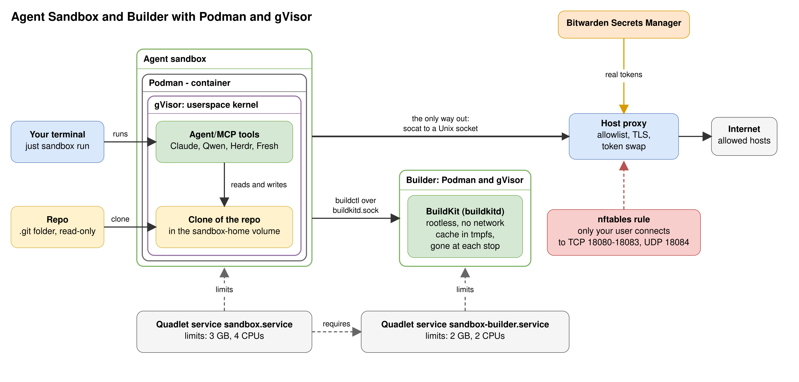
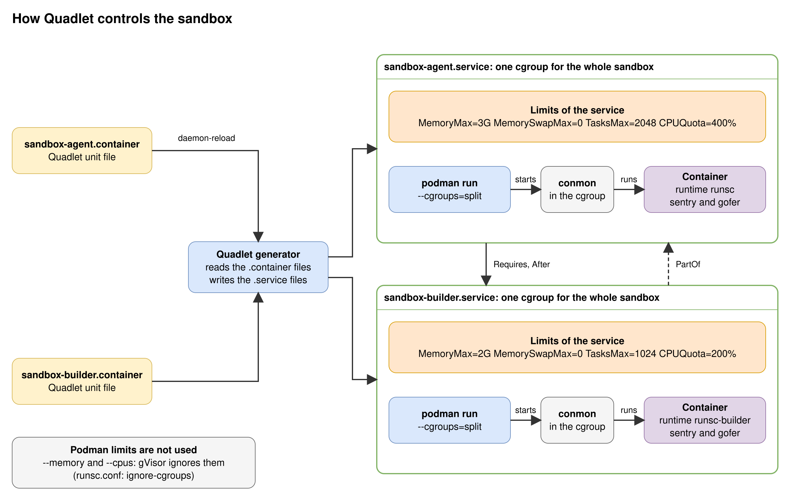
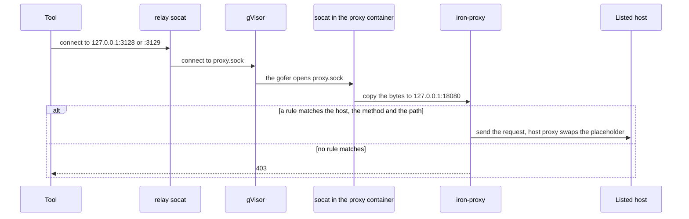
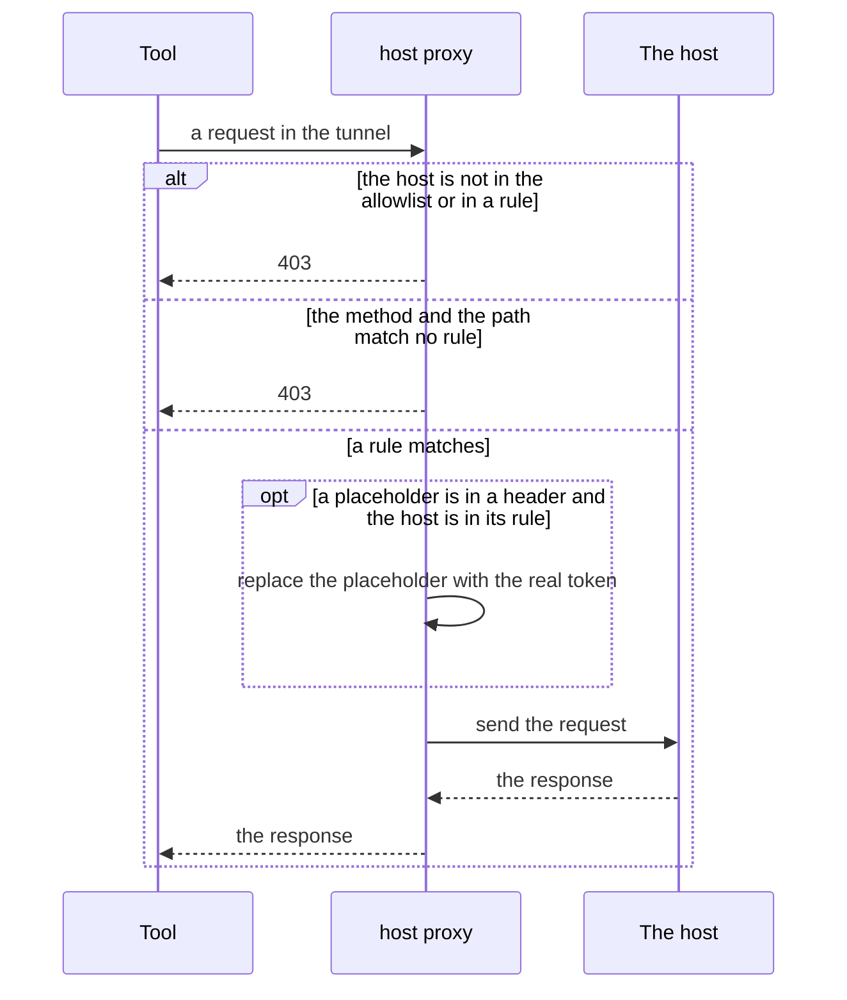
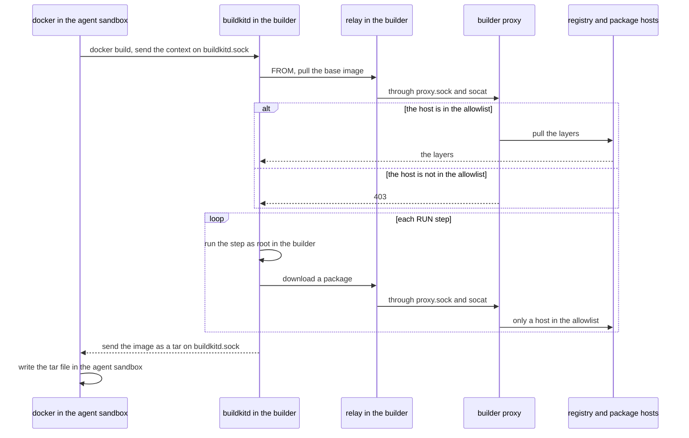
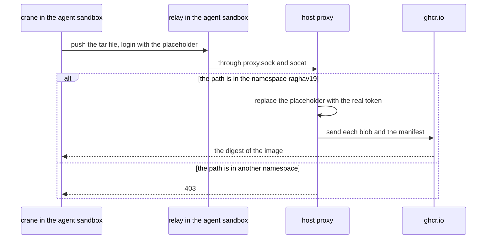

# How the sandbox works in detail

## The idea

- Each container has no network. Only a file can cross to the host.
- A relay in the container turns the proxy address that tools expect into that file.
- Each proxy runs in its own container. A `socat` there joins the file to the proxy.
- The host proxy holds the real tokens. The builder proxy holds none.
- Both proxies allow listed hosts only. The host proxy also checks the method and the path, so a write goes to one GitHub repository only.
- The agent sandbox sends a build to the builder through a socket in a shared folder.
- Quadlet turns each container file into a systemd service. The service limits memory, CPU and threads.

## The picture

The architecture diagram names the files: the unit file of each container, the folder of its image, the proxy configs, the CA and the credential.

The network path of the agent sandbox and the builder, inside gVisor:

Quadlet turns each `.container` file into a systemd service. The service holds the limits of the whole sandbox, because gVisor ignores the limits of Podman:

## The flows

### One call from the agent sandbox

Both containers follow this path. Only the relay port, the proxy and the rule set differ.

The host proxy judges each request in this order:

A host in `domains` takes every method and every path. A host in `rules` takes only the methods and the paths of its rules. The builder proxy has no path rules, because it cannot see a path.

The bytes stay the same. The carrier changes three times: TCP to the relay, a Unix socket to the `socat` in the proxy container, and TCP to the proxy. The host proxy ends the TLS with its CA. The builder proxy passes the TLS through.

### One build

The agent sandbox sends the build. The builder runs it. The builder reaches the internet only through its own proxy.

A failed build gives a code other than 0. The builder proxy holds no token, so a base image comes from a public registry. For a private base image, the agent sandbox pulls it with `crane` through the host proxy. It then passes the image to `docker build` as an OCI layout.

### One push

The agent sandbox pushes the tar file. The builder takes no part in the push and holds no login.

