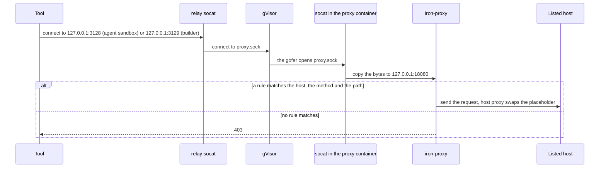
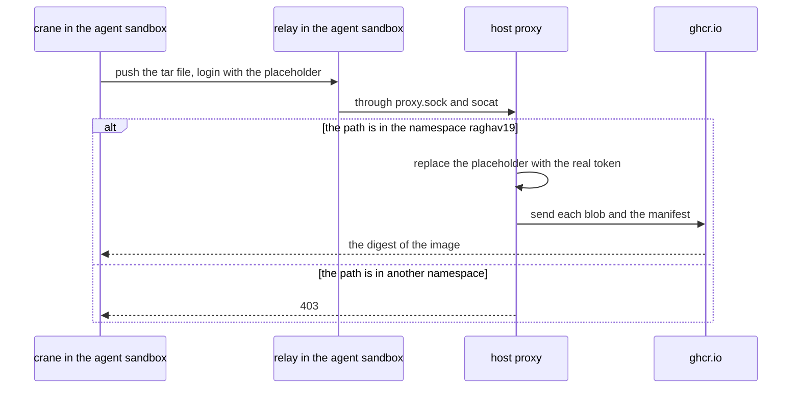

# How the sandbox works in detail

## The idea

- The agent sandbox and the builder have `Network=none`. Only a Unix socket leads to the host.
- A relay in each of them turns the proxy address that tools expect into that socket.
- Each proxy runs in its own container, with the default Podman network. A `socat` in that container joins the socket to `iron-proxy`.
- The host proxy holds the real tokens. The builder proxy holds none. The diagram of the security controls calls the host proxy the agent proxy.
- Both proxies allow listed hosts only.
- The host proxy ends the TLS with its CA, so it can read each request. The builder proxy passes the TLS through.
- The agent sandbox sends a build to the builder through a socket in a shared folder.
- Quadlet turns each container file into a systemd service. The service limits memory, CPU and threads, because gVisor ignores the limits of Podman.

## The picture

The network path of the agent sandbox and the builder, inside gVisor:

How Quadlet controls the sandbox:

The controls of each container are in the diagram in the section "Security controls" of `../README.md`.

## The flows

### One call from a container

Both containers follow this path. Only the relay port, the proxy and the rule set differ.

The host proxy judges each request in this order:

A host in `domains` takes every method and every path. A host in `rules` takes only the methods and the paths of its rules, so a write goes to one GitHub repository only. The builder proxy has no path rules, because it cannot see a path.

### One build

The agent sandbox sends the build. The builder runs it. The builder reaches the internet only through its own proxy.

The builder proxy holds no token, so a base image comes from a public registry. For a private base image, the agent sandbox pulls it with `crane` through the host proxy. It then passes the image to `docker build` as an OCI layout.

### One push

Only the agent sandbox pushes the tar file.

