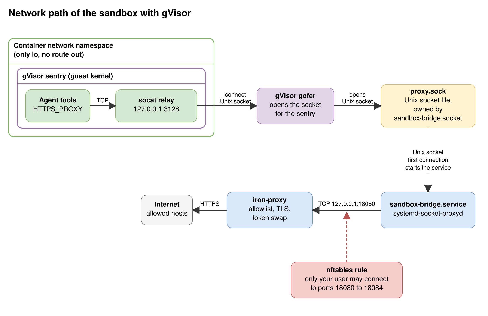
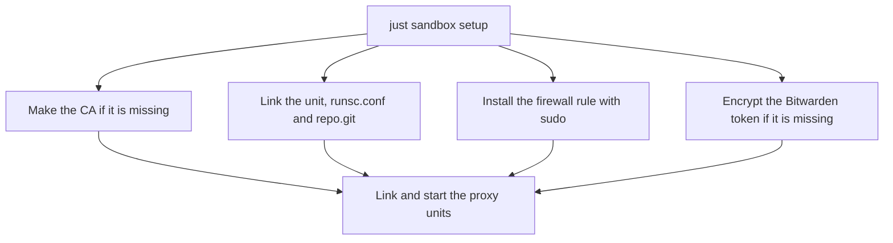
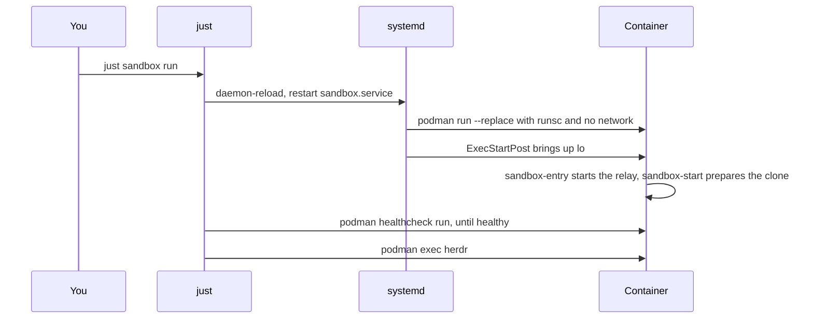
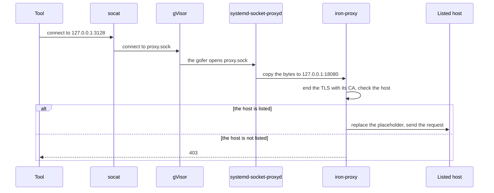

# How the sandbox works in detail

## The idea

- The container has no network. Only a file can cross from the container to the host.
- A relay in the container turns the proxy address that tools expect into that file.
- The host end of the file leads to a proxy that holds the real tokens.
- The proxy allows listed hosts only. It replaces each placeholder with the real token.
- A firewall rule keeps other users off the ports of the proxy.

## The picture

## The cast

In the container:

- `sandbox-entry`: the command of the container. It starts the relay, then runs your command.
- `socat`: the relay. It listens on `127.0.0.1:3128` and copies the bytes to `proxy.sock`.
- `sandbox-start`: prepares the home and the clone, starts Headroom and writes `/tmp/sandbox-ready`.

In gVisor, on the host, as your user:

- The sentry: the guest kernel. It runs the system calls of the agent.
- The gofer: a helper process. It opens host files for the sentry.

On the host:

- `sandbox.service`: the Quadlet unit that runs the container.
- `sandbox-bridge.socket`: makes and owns `proxy.sock`.
- `sandbox-bridge.service`: runs `systemd-socket-proxyd`. It copies the bytes from `proxy.sock` to iron-proxy.
- `sandbox-proxy.service`: runs iron-proxy with the real tokens from Bitwarden.
- `sandbox-guard.service`: loads the firewall rule `sandbox-guard.nft`.

## The flow in phases

### Setup, once

`setup` makes a CA only if `ca.crt` or `ca.key` is missing. It asks for your `sudo` password for the firewall rule. It asks for the Bitwarden access token only if the credential is missing or unreadable. At the end, it checks that `sandbox-proxy.service` is active.

### Each run

Each `run` makes a new container from the image. The recipe waits up to 180 seconds for the health check. The container is healthy after `sandbox-start` writes `/tmp/sandbox-ready`.

### One request

The bytes stay the same. The carrier changes at three points: TCP to `socat`, a Unix socket to the bridge, and a new TCP connection to iron-proxy.

## Lifetimes

- **The container:** new at each `just sandbox run`.
- **`/tmp` and `/run` in the container:** tmpfs. A restart empties them.
- **The volume `sandbox-home`:** stays until you remove it. It holds the clone, the logins and the histories. `sandbox-start` copies the home files of the image back at each start.
- **The clone:** made at the first start, when the workspace has no `.git` folder.
- **The CA:** made by `setup` with a life of 365 days. `setup` keeps an existing CA. After you make a new CA, restart the sandbox with `just sandbox run`.
- **The Bitwarden access token:** encrypted with `systemd-creds` in `~/.config/credstore.encrypted/bws-token`, mode 0400.
- **The firewall rule:** `sandbox-guard.service` loads it at each boot, before the network.

## Why the design looks like this

- **`--network none`.** The container has an empty network namespace. Its `127.0.0.1` is not the loopback of the host. Only a file in a mounted folder crosses.
- **`network=host` in `runsc.conf`.** gVisor then uses that empty namespace. With its own network stack, the guest has no loopback.
- **The host brings up `lo`.** gVisor does not let the guest bring up the loopback interface. `ExecStartPost` in `sandbox.container` runs `ip link set lo up` in the network namespace of the container.
- **`host-uds=open`.** gVisor blocks a connect to a host Unix socket by default. This flag allows the guest to connect to `proxy.sock`. Do not mount a folder that holds another socket.
- **A relay.** Tools need a TCP address for a proxy. The relay turns that address into the socket. It runs as the user `agent` and has no capability.
- **The socket has mode 0666.** In rootless Podman, `agent` is a subuid, not your user. Only you and the containers that mount the folder reach the socket, because `$XDG_RUNTIME_DIR` has mode 0700.
- **A bridge.** iron-proxy listens on TCP only. `systemd-socket-proxyd` joins the socket to the tunnel port. There is no `socat` on the host.
- **The CA is a mount.** The root file system takes no writes, so `update-ca-certificates` cannot run. The unit mounts `ca.crt` read-only over `/etc/ssl/certs/ca-certificates.crt`. The sandbox trusts this CA only. The file never mounts `ca.key`.
- **The firewall rule.** A TCP port on `127.0.0.1` has no check of the user. Without the rule, any local user could use the proxy and its real tokens.
- **Limits on the service.** gVisor ignores the limits of Podman. `MemoryMax`, `MemorySwapMax`, `TasksMax` and `CPUQuota` are in `[Service]` of `sandbox.container`.

## The names

- **Quadlet:** a Podman feature. It turns `sandbox.container` into the service `sandbox.service`.
- **iron-proxy:** the host proxy. It has the allowlist and the secret rules.
- **Placeholder:** the text `sandbox-placeholder-<NAME>`. The container holds it in place of a token.
- **Tunnel:** the CONNECT port of iron-proxy, `127.0.0.1:18080`.
- **Sentry and gofer:** the two parts of gVisor in the cast above.

## Where each part is in the repo

- [`sandbox.container`](../sandbox.container): the Quadlet unit.
- [`runsc.conf`](../runsc.conf): the gVisor flags.
- [`justfile`](../justfile): `setup`, `run`, `rm` and `build`.
- [`image/sandbox-entry`](../image/sandbox-entry): the relay.
- [`image/sandbox-start`](../image/sandbox-start): the home, the clone and Headroom.
- [`proxy/iron-proxy.yaml`](../proxy/iron-proxy.yaml): the allowlist and the secret rules.
- [`proxy/sandbox-bridge.socket`](../proxy/sandbox-bridge.socket) and [`proxy/sandbox-bridge.service`](../proxy/sandbox-bridge.service): the bridge.
- [`proxy/sandbox-proxy.service`](../proxy/sandbox-proxy.service): the proxy unit.
- [`proxy/sandbox-guard.nft`](../proxy/sandbox-guard.nft) and [`proxy/sandbox-guard.service`](../proxy/sandbox-guard.service): the firewall rule.

## What comes next

Read the [README of the host proxy](../proxy/README.md) for the ports, the placeholders and the hardening of the proxy unit.
