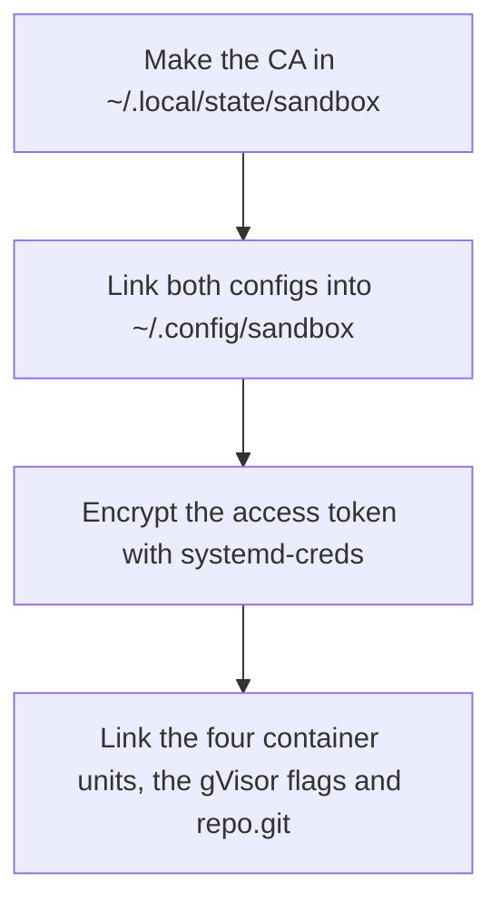

# The proxies of the sandbox

Two iron-proxy containers run on the host as Quadlet units. They are the only way out of the other containers. Read the [Prerequisites](../README.md#prerequisites) first. For the ports, the placeholders and the hardening, read [The proxies](../docs/internals.md#the-proxies).

| | Host proxy | Builder proxy |
|---|---|---|
| Serves | The agent sandbox | The builder |
| Config | `agent/proxy/iron-proxy.yaml` | `builder/proxy/iron-proxy.yaml` |
| Unit | `sandbox-proxy.service` | `sandbox-builder-proxy.service` |
| Container | `sandbox-proxy` | `sandbox-builder-proxy` |
| Socket | `$XDG_RUNTIME_DIR/sandbox/proxy.sock` | `$XDG_RUNTIME_DIR/sandbox-builder-proxy/proxy.sock` |
| TLS | Ends it with the CA of the sandbox | Passes it through (`sni-only`) |
| Tokens | Real tokens from Bitwarden | None |

The host proxy uses the image `localhost/sandbox-proxy`. The builder proxy uses `localhost/sandbox-builder-proxy`, which has no `bws`. Each `proxy/` folder has the `Containerfile` of its image.

## Step 1: run the setup

```bash
just sandbox setup
```

It needs no root. It asks for the access token only if the credential is missing. Nothing shows as you type. The recipe skips a step that you already did.



## Step 2: build the images

```bash
just sandbox build
```

This builds the agent sandbox image, the builder image and the two proxy images.

## Step 3: start and check

```bash
just sandbox run
podman ps
```

`podman ps` shows four containers: `sandbox-proxy`, `sandbox-builder-proxy`, `sandbox-builder` and `sandbox-agent`. Each unit starts the next one, so you start no proxy by hand.

## Daily use

```bash
just sandbox run                          # starts the proxies, the builder and the agent sandbox
just sandbox rm                           # stops all four containers
journalctl --user -u sandbox-proxy -f     # the audit log: one JSON line for each request
podman logs -f sandbox-builder-proxy      # the log of the builder proxy
```

A proxy stops and starts with the agent sandbox. After you edit an `iron-proxy.yaml` file, run `just sandbox run`.

## Troubleshooting

Run `journalctl --user -u sandbox-proxy`. The first two items come from `just` and systemd, not from the proxy.

- **`Failed to read encrypted credential data: Invalid argument`.** `bws-token` holds the plain token. Run `just sandbox setup`. It asks for the token again.
- **The unit says `Failed to load credential bws-token`.** The file `~/.config/credstore.encrypted/bws-token` is missing. Run `just sandbox setup`.
- **`podman logs sandbox-proxy` shows a Bitwarden error.** The access token is wrong or expired. Remove `~/.config/credstore.encrypted/bws-token`, then run `just sandbox setup`.
- **`Error: localhost/sandbox-proxy:latest: image not known`.** The same error can name `sandbox-builder-proxy`. Run `just sandbox build`.
- **`status sandbox-builder` shows `failed` after `just sandbox rm`.** This is normal. `buildkitd` exits with code 1 when it stops.
