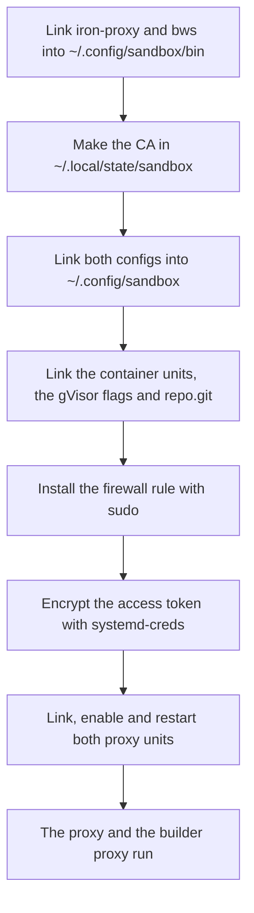

# The proxies of the sandbox

Two iron-proxy instances run on the host as systemd user services. They are the only way out of the containers. Read the [Prerequisites](../README.md#prerequisites) first. This guide sets them up. For the ports, the firewall rule, the placeholders and the hardening, read [The proxies](../docs/internals.md#the-proxies).

| | Host proxy | Builder proxy |
|---|---|---|
| Serves | The agent sandbox | The builder |
| Config | `agent/proxy/iron-proxy.yaml` | `builder/proxy/iron-proxy.yaml` |
| Unit | `sandbox-proxy.service` | `sandbox-builder-proxy.service` |
| Socket | `$XDG_RUNTIME_DIR/sandbox/proxy.sock` | `$XDG_RUNTIME_DIR/sandbox-builder-proxy/proxy.sock` |
| TLS | Ends it with the CA of the sandbox | Passes it through (`sni-only`) |
| Tokens | Real tokens from Bitwarden | None |

## Step 1: run the setup

```bash
just sandbox setup
```

It asks for your `sudo` password, and for the access token only if the credential is missing. Nothing shows as you type. The recipe skips a step that you already did.



If the firewall step fails, the recipe stops and the proxies do not start.

## Step 2: check the proxies

```bash
systemctl --user status sandbox-proxy.service sandbox-proxy-bridge.socket sandbox-builder-proxy.service sandbox-builder-proxy-bridge.socket
ls "$XDG_RUNTIME_DIR/sandbox/proxy.sock" "$XDG_RUNTIME_DIR/sandbox-builder-proxy/proxy.sock"
```

The status shows `active`, and both socket files exist. Next, run `just sandbox build` and `just sandbox run` from the [README](../README.md#quick-start).

## Daily use

```bash
systemctl --user start sandbox-proxy.service     # starts the socket too
systemctl --user stop sandbox-proxy.service      # stops the socket and the bridge too
systemctl --user restart sandbox-proxy.service   # also after you edit iron-proxy.yaml
journalctl --user -u sandbox-proxy -f            # the audit log: one JSON line for each request
```

Use the same commands with `sandbox-builder-proxy` for the builder proxy. systemd starts the bridge at the first connection, and the bridge starts the proxy. The first connection can fail while the proxy starts. `just sandbox run` does not start a proxy. It stops if a proxy socket is missing.

## Remove the firewall rule

Run `sudo systemctl disable --now sandbox-guard`. Then remove `/etc/sandbox-guard.nft` and `/etc/systemd/system/sandbox-guard.service`.

## Troubleshooting

Run `journalctl --user -u sandbox-proxy`. The first two rows come from `just`, not from the proxy.

| Text | Fix |
|---|---|
| `Failed to read encrypted credential data: Invalid argument` | `bws-token` holds the plain token. Run `just sandbox setup`. It asks for the token again. |
| `just sandbox setup` stops at the firewall step | `sudo` refused or `nft` could not load the rule. Run `sudo -v`, then `sudo nft -c -f /etc/sandbox-guard.nft` and `journalctl -u sandbox-guard`. Run `setup` again. |
| `Bad system call` | The filter bans a call. Add the group that you need to `SystemCallFilter=`, for example `@network-io`. |
| An address family error | Add `AF_NETLINK` to `RestrictAddressFamilies=`. |
| `No such file or directory` for a path in `/home` | Add the path to a `BindReadOnlyPaths=` line of the unit. |
| `No such file or directory` for `~/.config/sandbox/bin/bws` or `iron-proxy` | Run `mise install`, then `just sandbox setup`. |
