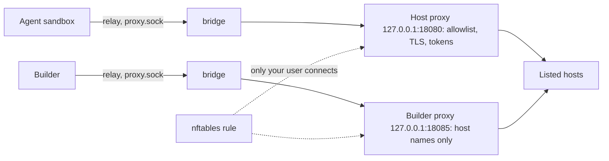
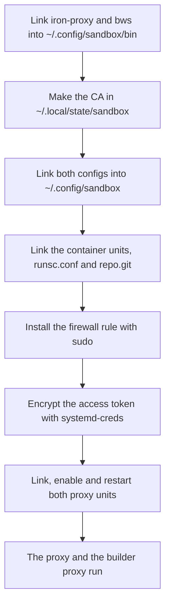

# The proxies of the sandbox

Two iron-proxy instances run on the host as systemd user services. They are the only way out of the containers. Neither container has a network. For the terms, see [The names](../docs/internals.md#the-names).



| | Host proxy | Builder proxy |
|---|---|---|
| Serves | The agent sandbox | The builder |
| Config | `iron-proxy.yaml` | `iron-proxy-builder.yaml` |
| Unit | `sandbox-proxy.service` | `sandbox-builder-proxy.service` |
| Socket | `$XDG_RUNTIME_DIR/sandbox/proxy.sock` | `$XDG_RUNTIME_DIR/sandbox-builder-proxy/proxy.sock` |
| TLS | Ends it with the CA of the sandbox | Passes it through (`sni-only`) |
| Tokens | Real tokens from Bitwarden | None |

## Set up the proxies

Do these steps once. After you edit a file in this folder, run `just sandbox setup` again.

### What this setup assumes

This is a personal setup. Other people can use other tools.

- The image registry is `ghcr.io`. The secret manager is Bitwarden Secrets Manager.
- The Bitwarden project holds `GH_TOKEN`, `CLAUDE_CODE_OAUTH_TOKEN`, `QWEN_API_KEY` and `GITHUB_TOKEN`. `GITHUB_TOKEN` has the scope `write:packages`.
- You have the access token of a machine account that reads that project. `just sandbox setup` asks for it. Do not paste it into a chat or a file.

For another registry or secret manager, change `iron-proxy.yaml`, `sandbox-proxy.service` and the `build` recipe.

### Before you start

| Need | Check |
|---|---|
| A Linux host with a systemd user manager | `systemctl --user is-system-running` |
| `systemd-creds` and `systemd-socket-proxyd`. The unit uses `/usr/lib/systemd/systemd-socket-proxyd`. | `command -v systemd-creds` and `ls /usr/lib/systemd/systemd-socket-proxyd` |
| `iron-proxy` and `bws` from `mise install` | `iron-proxy --version` and `bws --version` |
| `openssl`, to make the CA | `openssl version` |
| `podman`, `runsc` and `git`. `just` stops if one is missing. | `podman --version` and `runsc --version` |
| `sudo` and `nft`, for the firewall rule | `sudo -v` and `nft --version` |
| Linger for your user (optional). The proxies keep running after you log out. | `loginctl enable-linger "$USER"` |

### Step 1: run the setup

```bash
just sandbox setup
```

It asks for your `sudo` password, and for the access token only if the credential is missing. Nothing shows as you type. The recipe skips a step that you already did.



If the firewall step fails, the recipe stops and the proxies do not start.

### Step 2: check the proxies

```bash
systemctl --user status sandbox-proxy.service sandbox-bridge.socket sandbox-builder-proxy.service sandbox-builder-bridge.socket
ls "$XDG_RUNTIME_DIR/sandbox/proxy.sock" "$XDG_RUNTIME_DIR/sandbox-builder-proxy/proxy.sock"
```

The status shows `active`, and both socket files exist. Next, run `just sandbox build` and `just sandbox run` from the [README](../README.md#quick-start).

## Ports

The two proxies reserve **18080 to 18089 on 127.0.0.1**. The containers use only the tunnel of their proxy.

| Port | Listener |
|---|---|
| 18080 to 18084 | Host proxy: tunnel (TCP 18080), HTTP (18081), HTTPS (18082), metrics (18083), DNS (UDP 18084). |
| 18085 to 18089 | Builder proxy: tunnel (TCP 18085), HTTP (18086), HTTPS (18087), metrics (18088), DNS (UDP 18089). |

## The firewall rule

A TCP or UDP port on `127.0.0.1` has no user check. Without a rule, any local program can connect and send the placeholders to get the real tokens from the host proxy.

`sandbox-guard.nft` rejects each connection to the ports above from a user other than yours. The TCP clause covers 18080 to 18083 and 18085 to 18088. The UDP clause covers 18084 and 18089. The bridges run as you, so they still connect. If you add a listener, add it to the right clause.

| Topic | Detail |
|---|---|
| Install | `just sandbox setup` replaces `@UID@`, copies the rule to `/etc/sandbox-guard.nft` and `sandbox-guard.service` to `/etc/systemd/system/`. The unit loads the rule at each boot, before the network. |
| Owner | The copies belong to root. A link to your repo would let you change what root runs. |
| Table | Its own table, `inet sandbox_guard`. It does not change `ufw` or another firewall. |
| Check | `sudo nft list table inet sandbox_guard` and `systemctl status sandbox-guard`. |
| Remove | `sudo systemctl disable --now sandbox-guard`. Remove `/etc/sandbox-guard.nft` and `/etc/systemd/system/sandbox-guard.service`. |
| Not covered | Programs of the same user. A rootless container of your user with `pasta` networking can reach the host loopback. Do not give another container a route to these ports. |
| Not covered | `proxy.sock`. The mode 0700 of `$XDG_RUNTIME_DIR` guards it. |

## Files

| File | Job |
|---|---|
| `iron-proxy.yaml` | Allowlist and secret rules of the host proxy. |
| `sandbox-proxy.service` | Starts the host proxy with the real tokens from Bitwarden. |
| `sandbox-bridge.socket` and `.service` | Make `proxy.sock` (mode 0666, folder mode 0711) and join it to the tunnel. |
| `iron-proxy-builder.yaml` | Host names and the mode `sni-only` of the builder proxy. |
| `sandbox-builder-proxy.service` | Starts the builder proxy. No token and no `bws`. |
| `sandbox-builder-bridge.socket` and `.service` | The same bridge for the builder proxy. |
| `sandbox-guard.nft` and `sandbox-guard.service` | The firewall rule. `setup` copies them to `/etc`. |

The bridge exists because the containers have no network and iron-proxy listens on TCP only. If iron-proxy later listens on a Unix socket, remove the bridge files and set `tunnel_listen` to the socket path.

## Daily use

```bash
systemctl --user start sandbox-proxy.service     # starts the socket too
systemctl --user stop sandbox-proxy.service      # stops the socket and the bridge too
systemctl --user restart sandbox-proxy.service   # also after you edit iron-proxy.yaml
journalctl --user -u sandbox-proxy -f            # the audit log: one JSON line for each request
```

Use the same commands with `sandbox-builder-proxy` for the builder proxy. systemd starts the bridge at the first connection, and the bridge starts the proxy. The first connection can fail while the proxy starts.

`just sandbox run` does not start a proxy. It stops if a proxy socket is missing.

## Placeholders

The agent sandbox holds the placeholder. The host proxy replaces it in the `Authorization` header of a request to the hosts of its rule. Any other host gets `403` at the CONNECT. Each value must equal a `proxy_value` line in `iron-proxy.yaml`.

| Placeholder, and the variable of the proxy | Hosts |
|---|---|
| `sandbox-placeholder-GH_TOKEN`, from `GH_TOKEN` | `github.com`, `api.github.com`, `api.githubcopilot.com` |
| `sandbox-placeholder-CLAUDE_CODE_OAUTH_TOKEN`, from `CLAUDE_CODE_OAUTH_TOKEN` | `api.anthropic.com` |
| `sandbox-placeholder-QWEN_API_KEY`, from `QWEN_API_KEY` | `token-plan.ap-southeast-1.maas.aliyuncs.com` |
| `sandbox-placeholder-GHCR_PUSH_TOKEN`, from `GITHUB_TOKEN`. The login is in `/etc/docker/config.json`. | `ghcr.io` |

Claude Code does not expand `$GH_TOKEN` in its GitHub MCP header. `image/configs/agents/managed-settings.json` holds the placeholder text. Qwen Code expands the variable itself.

## Hardening of the proxy units

The proxies read requests that the agent controls, and the host proxy holds the real tokens. A bug gives an attacker the rights of your user. The lines in the units limit what a proxy can do. Check the result with `systemd-analyze --user security sandbox-proxy.service`. A lower score is better.

| Directive | Effect |
|---|---|
| `NoNewPrivileges=yes` | No gain of rights through a setuid program. |
| `PrivateTmp=yes` | A private `/tmp`. No read of the temporary files of other programs. |
| `ProtectHome=tmpfs` | An empty `/home`. No read of `~/.ssh`, other repos or browser data. |
| `BindReadOnlyPaths=` | Adds back only the files that the proxy needs, read-only. |
| `SystemCallFilter=@system-service` | Only the system calls of a normal service. Blocks `ptrace`, `mount`, module loading, `reboot` and `unshare`. |
| `SystemCallArchitectures=native` | No 32-bit calls on a 64-bit host. Closes a way around the filter. |
| `RestrictAddressFamilies=AF_INET AF_INET6 AF_UNIX` | No raw packet sockets and no netlink sockets. |
| `RestrictNamespaces=yes` | No new namespace. Many exploits start with one. |
| `RestrictRealtime=yes` | No real-time scheduling. A real-time process can freeze the desktop. |
| `ProtectKernelTunables=yes`, `ProtectKernelModules=yes` | No write to `/proc/sys` or `/sys`. No kernel module. |
| `ProtectControlGroups=yes`, `ProtectClock=yes` | No change of the control group tree or the clock. |

The units leave out lines that do not lower the score: `LockPersonality=`, `ProtectHostname=` and `UMask=`. They have no `CapabilityBoundingSet=`, because a user unit has no capabilities. They have no `MemoryDenyWriteExecute=`, because it can break programs that make code at run time. A user unit cannot restrict the network, because `IPAddressDeny=` does nothing there and the proxy must reach the internet. The allowlist is the control. Treat `iron-proxy.yaml` and `iron-proxy-builder.yaml` as the most important files.

The proxy sees only these paths in `/home`:

| Path | Why |
|---|---|
| `~/.config/sandbox/iron-proxy.yaml` and `iron-proxy-builder.yaml` | The configs. They are links, and the bind gives the files that they point to. |
| `~/.local/state/sandbox/ca.crt` and `ca.key` | The CA. Only the host proxy uses it. |
| `~/.local/share/mise` and `~/.config/sandbox/bin` | The installed tools and the links to `iron-proxy` and `bws`. |

If you point a config at another file, add a `BindReadOnlyPaths=` line for it in the unit.

## Troubleshooting

Run `journalctl --user -u sandbox-proxy`. The first two rows come from `just`, not from the proxy.

| Text | Fix |
|---|---|
| `Failed to read encrypted credential data: Invalid argument` | `bws-token` holds the plain token. Run `just sandbox setup`. It asks for the token again. |
| `just sandbox setup` stops at the firewall step | `sudo` refused or `nft` could not load the rule. Run `sudo -v`, then `sudo nft -c -f /etc/sandbox-guard.nft` and `journalctl -u sandbox-guard`. Run `setup` again. |
| `just sandbox setup` fails at `systemctl --user link` | Old transient units `sandbox-proxy` and `sandbox-bridge` have the same names. Run `systemctl --user stop sandbox-proxy sandbox-bridge`, then `setup` again. |
| `Bad system call` | The filter bans a call. Add the group that you need to `SystemCallFilter=`, for example `@network-io`. |
| An address family error | Add `AF_NETLINK` to `RestrictAddressFamilies=`. |
| `No such file or directory` for a path in `/home` | Add the path to a `BindReadOnlyPaths=` line. |
| `No such file or directory` for `~/.config/sandbox/bin/bws` or `iron-proxy` | Run `mise install`, then `just sandbox setup`. |
