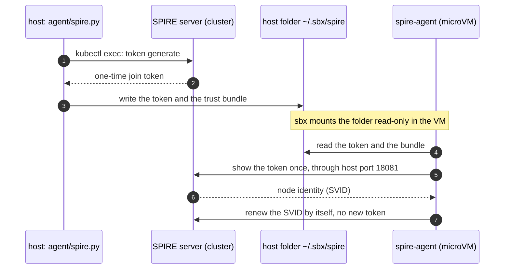
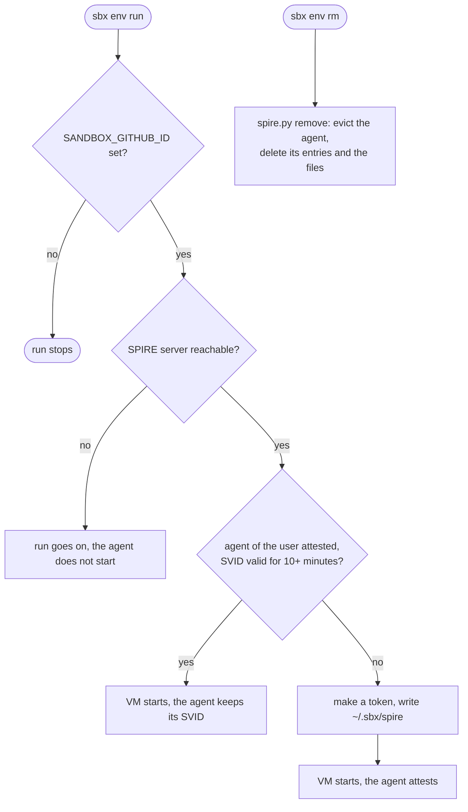

# The dev sandbox


## Prerequisites

1. **Install the tools.** You need [mise](https://mise.jdx.dev), VS Code and Docker. Then run:

   ```shell
   mise trust && mise install
   eval "$(mise activate bash)"
   ```

2. **Create a [Github App](https://docs.github.com/en/apps/creating-github-apps/about-creating-github-apps/deciding-when-to-build-a-github-app)** in GitHub. The agent reaches GitHub with the OAuth token of this App. The gateway holds that token.
   - Install the App on the one repository the agent needs. Give it only these permissions: contents, issues and pull requests (write). Give it no administration.
   - Add the callback URL `http://127.0.0.1:8765/callback`.
   - Turn on **Expire user authorization tokens**.
   - Generate a client secret.
   - Put the client id in `.sbx/agent/agent.just`.

3. **Use ghcr.io as the kit registry.** The kits are private packages under `ghcr.io/raghav19/dev-agent-sandbox`.
   - Create a GitHub token for ghcr.io. It needs `read:packages` to pull the kits. It also needs `write:packages` to push them.
   - Store it as the secret `GITHUB_TOKEN` (see the next step).

4. **Choose a secret manager.** The commands read secrets by name through `agent/bws-secret.sh`. The script reads Bitwarden Secrets Manager. To use another manager, change this one script. Store these secrets in it:

   | Secret | What it is | Who reads it |
   |---|---|---|
   | `GITHUB_TOKEN` | the ghcr.io token from the previous step | `host setup`, `agent setup` |
   | `GITHUB_APP_CLIENT_SECRET` | the client secret of the GitHub App | `agent setup` |

5. **Save the access token of the secret manager** in a file that only you can read. The sbx daemon runs the secret command on its own. It has no terminal, none of your shell variables and no mise on its path. It cannot ask you for the token, so it reads the token from a file.
   - The path `~/.config/bws/access-token` is only the default of `agent/bws-secret.sh`. Any path works. Set `BWS_ACCESS_TOKEN_FILE` to that path when you run `agent setup`.
   - The file must have mode 600 or 400.

   ```shell
   mkdir -p ~/.config/bws && (umask 077; cat > ~/.config/bws/access-token)   # paste the token, then press Ctrl-D
   ```

6. **Commit your work.** The sandbox clone holds only committed files.

## Getting started

Run these commands in order. Each command is safe to run again.

```shell
just sandbox host setup      # 1. once per machine
just sandbox agent setup     # 2. once per machine
just sandbox agent kube      # 3. once per kind cluster (optional)
just sandbox run             # 4. every day
```

| Step | Command | What it does for you |
|---|---|---|
| 1 | `host setup` | Logs in to ghcr.io with `GITHUB_TOKEN`. Sets the sbx settings: kits only from docker.io and this repo, and no SSH agent forwarding. Installs the sbx daemon as a systemd user service and starts it. Connects VS Code: runs `sbx setup ssh` and installs the Remote-SSH extension. |
| 2 | `agent setup` | Installs the agent skills. Registers the ghcr.io secret, so the VM can push to ghcr.io without the token. Registers the MCP servers (draw.io, the Flux schema catalog and GitHub) on the sbx gateway. |
| 3 | `agent kube` | Creates the sandbox identity on your kind cluster. The agent can read every namespace and change workloads and Flux objects. It cannot read a Secret. Then it writes `.sbx/kubeconfig`. |
| 4 | `run` | Checks that the daemon runs. Writes a new kubeconfig token. Creates the sandbox from `sbxenv.yaml`, or starts it. Attaches the MCP servers. Writes the VS Code Remote-SSH settings. Opens VS Code on the sandbox. |

The first `run` shows the sbx plan and asks you to approve it. A browser opens once for the GitHub consent. Run Claude Code in the VS Code terminal. It runs inside the sandbox.

To change what the VM may reach, edit `kits/policy/policy.yaml`. Then run `agent allow-hosts` and `agent kit-build policy`. Create a new sandbox to use the new kit.

### Node identity of the VM (SPIRE)

The VM proves to the SPIRE server of your cluster that it is an approved machine. It shows a one-time token once. After that it keeps its identity by itself.



`sbxenv.yaml` runs `spire.py` on the host before every create and run of the sandbox, and before its removal:



Prerequisites on the host:

- `python3` (3.8 or later), `kubectl` and `yq`.
- A current `kubectl` context for the cluster that runs the SPIRE server.
- `SANDBOX_GITHUB_ID`: the numeric id of your GitHub account. The login does not work.

Run:

```shell
export SANDBOX_GITHUB_ID=$(gh api user --jq .id)
sbx settings set env.rememberHostCommands true   # optional: approve the host command once, not at every run
just sandbox run
just sandbox agent spire-enroll                  # optional: make the token by hand
```

## Token savings with Headroom

The dev-tools kit has [Headroom](https://github.com/headroomlabs-ai/headroom) at a pinned version. Headroom is a proxy that compresses the input of Claude Code. To open the dashboard on the host:

1. Connect to the sandbox with VS Code (`just sandbox run`).
2. Open the **Ports** tab. Choose **Forward a Port** and enter `8787`.
3. Open `http://localhost:8787/dashboard` in the browser of the host.

The proxy listens only on `127.0.0.1` in the VM, so `sbx ports --publish` cannot reach it. Do not bind the proxy to `0.0.0.0`. The proxy has no login for the model routes.

## When something fails

- The daemon does not start. Read the reason with `journalctl --user -u sbx-daemon.service`.
- `host setup` stops and names a missing requirement. Run the command that it prints, then run `host setup` again.
- To delete the daemon service, run `systemctl --user disable --now sbx-daemon.service`. Then delete `~/.config/systemd/user/sbx-daemon.service`.
- The SPIRE agent does not attest. Read `~/.spire/agent.log` in the VM.
  - "no trust bundle": the host script did not run, or the VM has no `~/.sbx/spire` mount. Remove the sandbox and create it again.
  - The token was used or has expired: on the host, run `SPIRE_ENROLL_FORCE=1 just sandbox agent spire-enroll`, then restart the sandbox.
  - The connection to `host.docker.internal:18081` fails: the kind cluster was created before the port mapping. Run `just clusters/kind/down` and `just clusters/kind/up` in `code/mcp-sandbox/part-3-mcp-guardrails`.
