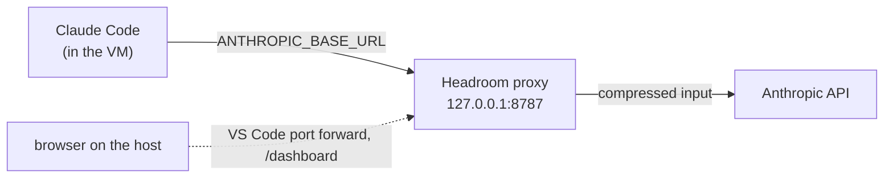

# Headroom

The dev-tools kit has [Headroom](https://github.com/headroomlabs-ai/headroom) at a pinned version. Headroom is a proxy that compresses the input of Claude Code.

## Open the dashboard

1. Connect to the sandbox with VS Code (`just sandbox run`).
2. Open the **Ports** tab. Choose **Forward a Port** and enter `8787`.
3. Read the **Local Address** column of the Ports tab. Open `http://<local address>/dashboard` in the browser of the host.

If port 8787 is in use on the host, VS Code forwards to another local port, for example 8788. The proxy in the VM stays on 8787. Only the local address changes.
