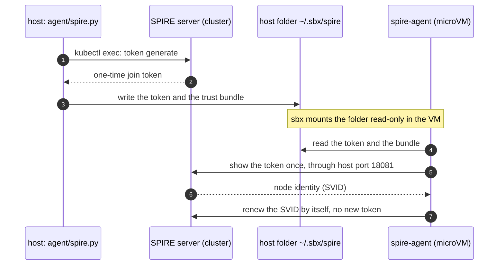
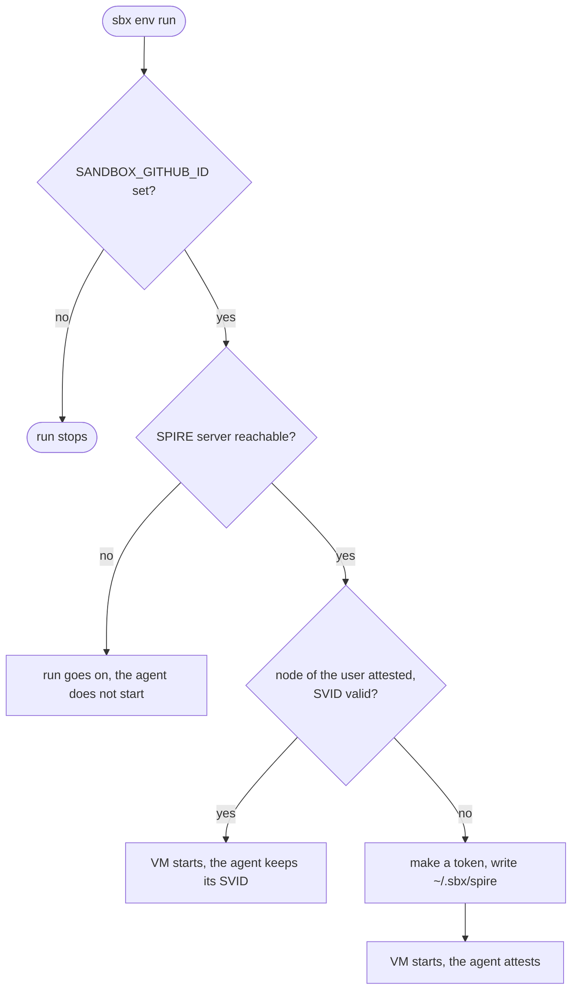

# Node identity of the VM

The VM proves to the SPIRE server of your cluster that it is an approved machine. It shows a one-time token once. After that it keeps its identity by itself.



`sbxenv.yaml` runs `agent/spire.py` on the host before every create and run of the sandbox:



Prerequisites on the host:

- `python3` (3.13 or later) and `kubectl`.
- A current `kubectl` context for the cluster that runs the SPIRE server.
- `SANDBOX_GITHUB_ID`: the numeric id of your GitHub account. The login does not work. The root `mise.toml` sets it, so `eval "$(mise activate bash)"` is enough. For another account, put your own id in `mise.local.toml`: `[env]` and `SANDBOX_GITHUB_ID = "<id>"` (`gh api user --jq .id` prints it).

Run:

```shell
sbx settings set env.rememberHostCommands true   # optional: approve the host command once, not at every run
just sandbox run
just sandbox agent spire-enroll                  # optional: make the token by hand
```

## When something fails

The log of the SPIRE agent is `~/.spire/agent.log` in the VM.

- "no trust bundle": the host script did not run, or the VM has no `~/.sbx/spire` mount. Remove the sandbox and create it again.
- The token was used or has expired: run `just sandbox run` again. The script makes a new token when no node of the user has a valid SVID.
- You created the sandbox again, and the old node still has a valid SVID: the script skips the token, and the new VM cannot join. Nothing evicts the old node. On the host, run `SPIRE_ENROLL_FORCE=1 just sandbox agent spire-enroll`, then restart the sandbox.
- The connection to `host.docker.internal:18081` fails: the kind cluster was created before the port mapping. Run `just clusters/kind/down` and `just clusters/kind/up` in `code/mcp-sandbox/part-3-mcp-guardrails`.
