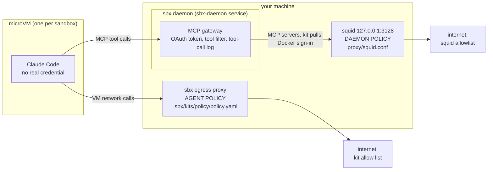
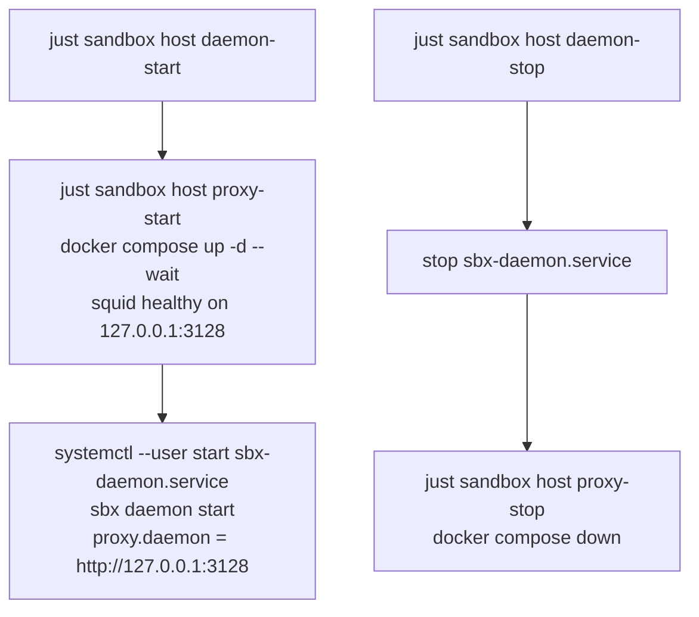

# The sbx daemon, and what keeps it on a short leash

The sandbox is a VM, but the VM does not make every network call itself. The **sbx daemon** runs on your machine, outside the VM, and makes the MCP calls, kit pulls
and Docker sign-in for it. The VM's egress rules do not cover those calls, so they go through a small squid proxy with an allowlist. Two separate things run it:
systemd keeps the daemon up, and a Docker container is the proxy. Recipes start them in order.

## Where it sits



## How it starts



At login, linger starts `sbx-daemon.service` (after Docker), and Docker restarts the squid container because of `restart: unless-stopped`. Nothing orders the two
at login: the daemon can come up a few seconds before squid is healthy. After a `daemon-stop` the container is gone, so run `just sandbox host daemon-start` (not
a reboot) to bring both back.

## Files

| File | What it is |
|---|---|
| `host.just` | the recipes of `just sandbox host ...`: `login`, `proxy-install`, `proxy-start`, `proxy-stop`, `daemon-install` (once per machine; its comments hold the steps, checks and undo), `daemon-start`, `daemon-stop`, `daemon-restart` and `vscode-setup` |
| `systemd/sbx-daemon.service` | runs the sbx daemon, supervised and restarted on failure |
| `proxy/compose.yaml` | the squid container, listening on `127.0.0.1:3128` only |
| `proxy/squid.conf` | the allowlist: the file to edit to let the daemon reach another host |

## Install

sbx comes from mise (`mise install`); the daemon unit runs it from the mise install dir.

```shell
just sandbox host proxy-install      # step 2, once per machine: pulls the squid image
just sandbox host daemon-install     # step 3, once per machine, and after editing the unit: copies and enables it, sets proxy.daemon. Starts nothing
just sandbox host daemon-start       # step 4: starts the proxy, then the daemon; prints the journal if the daemon does not stay up
just sandbox host daemon-stop        # stops the daemon, then the proxy. Ends running sandboxes
just sandbox host daemon-restart     # stop then start, e.g. after editing squid.conf
```

If the daemon will not start, the reason is in `journalctl --user -u sbx-daemon.service`, not in `docker logs sbx-daemon-egress` (squid only).
The unit runs `sbx daemon start` in the foreground so systemd can supervise it; `--detach` would make it exit and the unit stop.
