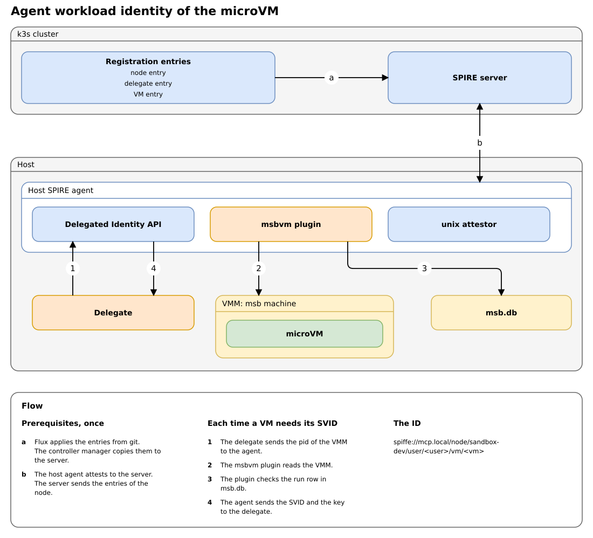
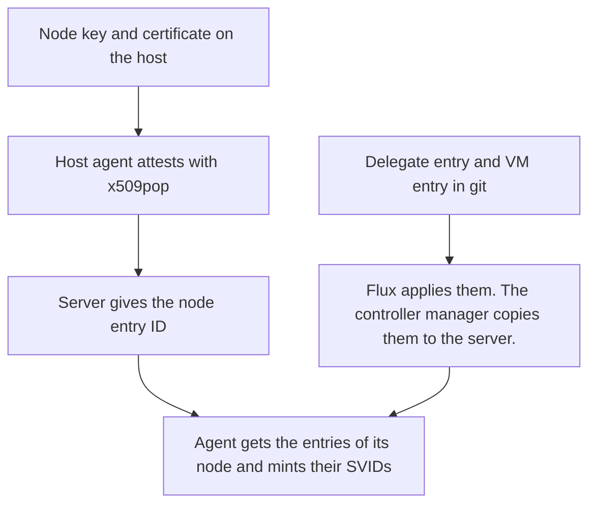
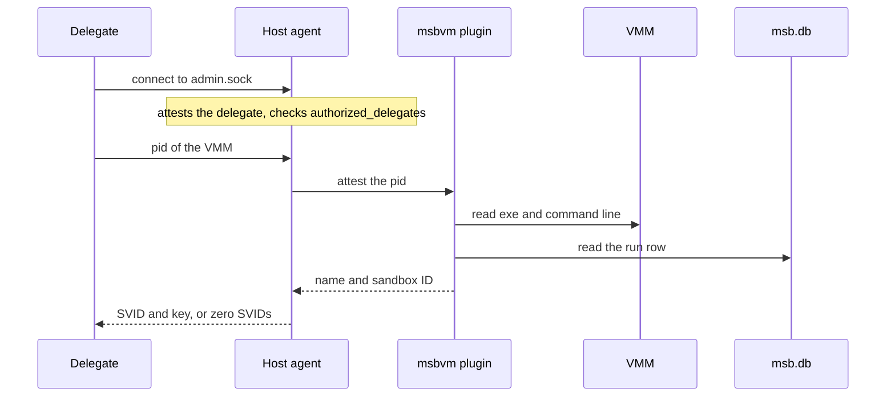
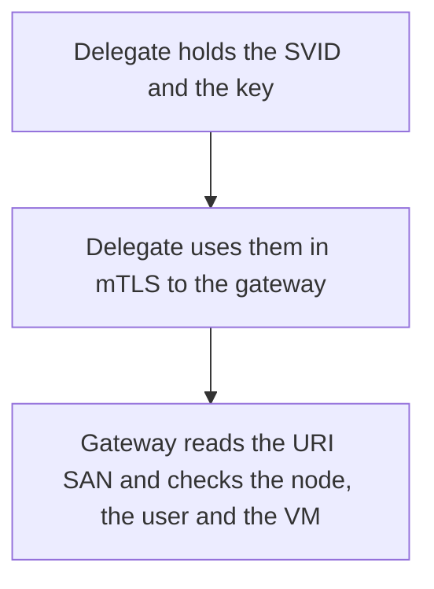

# Workload attestation of the microVM

This guide explains how a microVM gets its own SPIFFE ID. Read the [node attestation guide](../../mcp-sandbox/part-3-mcp-guardrails/docs/node-attestation.md) first. It explains the first proof, the proof of the node. This guide explains the second proof, the proof of the VM.

The lists and the diagrams are narrow on purpose. They read well in the GitHub mobile app.

**Status.** The node attestation exists. The flow in this guide is a design. The spike proved it on the host with a throwaway SPIRE server. No part of it is in this repo as code yet. [ADR 0001](adr/0001-delegated-identity-for-the-microvm.md) records the decision. This design replaces the Envoy design of [Zero trust: workload attestation](../../mcp-sandbox/part-3-mcp-guardrails/docs/zero-trust-workload-attestation.md).

## The idea

1. The microVM is the workload. It gets a SPIFFE ID of its own. Its private key stays on the host.
2. SPIRE 1.15.5 has no attestor for a VM. Its attestors read facts about a host process. They start from the pid of the caller.
3. So a delegate on the host gives the agent the pid of the VMM. The VMM is the host process that runs the VM.
4. A plugin, `msbvm`, turns the pid into the VM name and the sandbox ID. It uses facts that `msb` records.
5. The agent matches an entry. It gives the SVID and the key to the delegate. The VM never sees them.

The ID has three parts: the node, the user and the VM. Example: `spiffe://mcp.local/node/sandbox-dev/user/raghav19/vm/<vm-name>`.

## The picture

The letters a and b are the prerequisites. They happen once. The numbers 1 to 4 happen each time a VM needs its SVID. The panel below the diagram repeats the steps in words. The orange parts are the ones that we write.

## The cast

In the cluster (k3s):

- **SPIRE server.** It keeps the registration entries and issues the SVIDs. It checks the node with `x509pop`.
- **Node entry `sandbox-node`.** It gives the attested node the ID `spiffe://mcp.local/node/sandbox-dev`. It is the parent of the other entries. It exists.
- **Delegate entry.** It gives the delegate its own ID. It does not exist yet.
- **VM entry.** It gives a VM its ID. Its selectors are `msbvm:name:<vm>` and `unix:uid:<uid>`. It does not exist yet.

On the host:

- **Host SPIRE agent.** It attests as the node. It serves the Delegated Identity API on `admin.sock`. It runs the attestors on the pid that the delegate sends.
- **`unix` attestor.** It is part of SPIRE. It turns a pid into the uid of the process.
- **`msbvm` plugin.** It is a Go plugin that we write. It turns a pid into the VM name and the sandbox ID.
- **Delegate.** It is a Go program that we write. It sends the pid and holds the SVID and the key.
- **VMM.** It is the process `msb machine --name <vm> --sandbox-id <id>`. It runs one microVM.
- **`msb.db`.** It is the database of `msb`. Each start of a VM adds a `run` row with the pid and the start time.

In the microVM: no part of this flow. The VM holds no key and has no socket of the agent. The agent in the VM from the node attestation stays for now. ADR 0001 lists its fate as an open decision.

## The flow in three phases

### Phase 1: prerequisites (once)

The host agent attests with `x509pop`, as the VM agent does today. Which certificate it uses is an open decision. The entries are objects in git, like the node entry. The agent mints the SVIDs of all entries of its node at start. The server is not involved when the delegate calls later.

The agent config loads the `msbvm` plugin with `plugin_cmd` and `plugin_checksum`. It also sets `admin_socket_path` and `authorized_delegates`. The admin socket must be in a different folder from the Workload API socket. The agent refuses to start otherwise.

### Phase 2: each time a VM needs its SVID

The pid is the input. It is not a selector, because it changes at each start. The plugin needs three checks to agree. The exe is `msb`. The command line names the VM. The `run` row has the same pid and start time. The agent also runs the `unix` attestor on the pid. Then it matches the VM entry.

A refusal is an empty response with zero SVIDs. It is not an error. The delegate must treat zero SVIDs as a failure. The delegate must also hold a `pidfd`, so that a recycled pid is never sent.

The spike proved this phase with five tests. The real VMM got its SVID. A pid that is not a VMM got zero SVIDs. A fake `msb` with the same exe name and command line got zero SVIDs, because it has no `run` row.

### Phase 3: while the VM runs

Nobody tested this phase. The spike parsed the SVID and the key. It did not use them in a connection. It is also open whether agentgateway can read a URI SAN in a rule.

## What lives how long

- **Node certificate.** 90 days. cert-manager renews it 30 days before the end, with a new key.
- **Agent SVID.** The server default is 4 hours (`default_x509_svid_ttl`). The agent re-attests by itself, about every 2 hours.
- **VM SVID.** Not tested. The server default is 4 hours.
- **Pid of the VMM.** Until the VM stops. A new start gives a new pid.
- **`run` row.** One row for each start of the VM.

## Why the design looks like this

- **A delegate holds the key.** The VM is the workload, and the key must stay outside the VM.
- **The agent runs on the host.** It can read `/proc` and the database of `msb`. An agent in the VM cannot.
- **The input is a pid.** The agent attests a pid with its own attestors. With selectors only, the delegate alone says which VM it is.
- **The plugin checks the `run` row.** A fake `msb` can copy the exe name and the command line. It cannot make a `run` row.
- **The Delegated Identity API, not the Broker API.** The Broker API is experimental in 1.15.5.
- **One agent for each user.** The API does not limit a delegate to certain VMs.
- **The plugin is in Go.** The SPIRE plugin SDK is Go only.

## The names

[`CONTEXT.md`](../CONTEXT.md) defines node, node entry, microVM, VMM, delegate and agent workload identity. These names are also in this guide:

- **SVID** is the short-lived certificate that SPIRE issues for a SPIFFE ID.
- **Selector** is a fact that the agent learns about a workload. Example: `msbvm:name:<vm>`. The type of a selector is the name of the plugin.
- **Workload attestor** is an agent plugin. It turns the pid of a caller into selectors.
- **Delegated Identity API** lets a trusted program ask the agent for the SVID of another workload. The agent serves it on `admin.sock`.
- **`authorized_delegates`** is the list of SPIFFE IDs that may call the Delegated Identity API.
- **Sandbox ID** is the number that `msb` gives to a VM. It is in the command line of the VMM and in `msb.db`.
- **`run` row** is the record of one start of a VM in `msb.db`. It has the pid, the status and the start time.
- **`pidfd`** is a handle to a process. It stays valid when another process gets the same pid number.

## Where each part is in the repo

- Node entry: [`platform/addons/spire/node-entry.yaml`](../../mcp-sandbox/part-3-mcp-guardrails/platform/addons/spire/node-entry.yaml)
- Node certificate for the VM: [`platform/addons/spire/node-certificate.yaml`](../../mcp-sandbox/part-3-mcp-guardrails/platform/addons/spire/node-certificate.yaml)
- `just msb node-cert`: [`.msb/justfile`](../../../.msb/justfile)
- Config of the agent in the VM: [`.msb/image/configs/spire/spire-agent.conf`](../../../.msb/image/configs/spire/spire-agent.conf)
- Spike code (not production code): [the spike handoff](../../mcp-sandbox/part-3-mcp-guardrails/docs/handoff/microvm-attestation-spike.md)

These folders do not exist yet: `plugin/`, `delegate/`, `agent/` and `tests/`. They are in the [README](../README.md).

## What comes next

Read [ADR 0001](adr/0001-delegated-identity-for-the-microvm.md) for the open decisions. Read the [spike handoff](../../mcp-sandbox/part-3-mcp-guardrails/docs/handoff/microvm-attestation-spike.md) for the plan in PRs. The evidence is in the section "Spike results" of the [research note](../../../docs/research/microvm-workload-attestation-spire.md).
