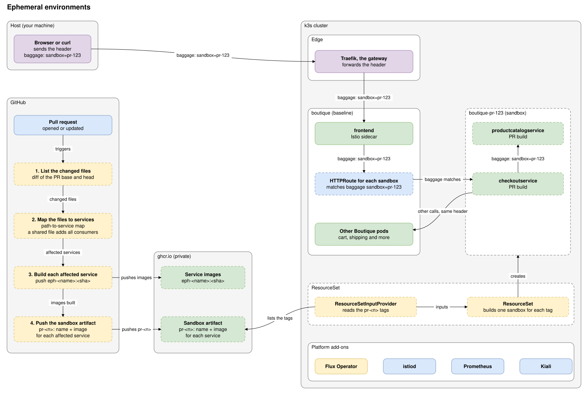

# Ephemeral environments on k3s with Flux

Preview environments for the Online Boutique microservices. The goal: a pull request gets its own short-lived sandbox, and Istio and Kiali show the calls between the sandbox and a shared baseline.

This folder holds the platform that comes first. It is a fresh k3s cluster with Traefik, Istio, Prometheus, Kiali and the Boutique as baseline. Flux delivers it from one OCI artifact in a private registry. The sandbox flow is not built yet.



The solid boxes exist in this repo, and the steps below build them. The dashed boxes are the sandbox flow and do not exist yet.

## What the cluster looks like

The cluster is a fresh k3s v1.37 or later. It has the packaged Traefik and the packaged Gateway API CRDs. Do not start it with `--disable traefik`. No other project may use these namespaces:

- `kube-system`: Traefik, with the Gateway `traefik-gateway`. k3s installs both.
- `flux-system`: the Flux Operator and the Flux controllers.
- `istio-system`: `istiod`, Prometheus and Kiali.
- `boutique`: the 12 Boutique pods, each with an Istio sidecar.
- `ephemeral-env`: an empty namespace for objects that belong to the whole project.

## Set up from scratch

Run every command on the host, in the folder `code/ephemeral-env`. The recipes `publish` and `up` refuse to run in the sandbox VM, because the tokens must stay on the host.

1. Install k3s on a clean host. The version is the one that `code/mcp-sandbox/part-3-mcp-guardrails/clusters/k3s/justfile` pins:

   ```sh
   curl -sfL https://get.k3s.io | sudo INSTALL_K3S_VERSION=v1.37.1+k3s1 sh -
   sudo k3s kubectl wait --for=condition=Ready node --all --timeout=5m
   ```

2. Copy the kubeconfig to your user. k3s names the context `default`. Set `KUBE_CONTEXT` if yours has another name.

   ```sh
   mkdir -p ~/.kube && sudo cp /etc/rancher/k3s/k3s.yaml ~/.kube/config && sudo chown "$USER" ~/.kube/config
   ```

3. Install these tools: `just`, `kubectl`, `helm`, `yq`, `kustomize`, `flux` and `flux-schema`.
4. Make two GitHub tokens. Export them in your shell and never write them in a file in the repo:
   - `GHCR_TOKEN` with `write:packages`. `just publish` uses it.
   - `GHCR_PULL_TOKEN` with `read:packages`. `up` writes it into the cluster Secret `ghcr-pull`.
5. Check the manifests. The check needs the network, because the Boutique release is a remote file:

   ```sh
   just check
   ```

6. Publish the platform as an OCI artifact. On `main`, this also moves the tag `latest`:

   ```sh
   just publish
   ```

7. Hand the cluster to Flux. `up` stops when a node is not Ready, when the Gateway API CRDs are missing, or when the Traefik Deployment is missing:

   ```sh
   just clusters/k3s/up
   ```

   To pull a tag from a branch, run `just clusters/k3s/up <tag>`. `just publish` prints the tag.

## Check that it works

```sh
kubectl -n flux-system get fluxinstance flux            # READY True
kubectl -n flux-system get ocirepository flux-system    # READY True, with the tag as the revision
kubectl -n flux-system get kustomization                # four Kustomizations, READY True
kubectl -n istio-system get helmrelease                 # istio-base and istiod, READY True
kubectl -n istio-system get deploy prometheus kiali     # both available
kubectl -n boutique get pods                            # 12 pods, all Running
kubectl get gatewayclass traefik                        # ACCEPTED True
curl -s -o /dev/null -w '%{http_code}\n' http://127.0.0.1/                                           # 200, the shop
curl -s -o /dev/null -w '%{http_code}\n' -H 'Host: kiali.localhost' http://127.0.0.1/kiali/api/status  # 200
```

Open the shop at `http://localhost/` and Kiali at `http://kiali.localhost/kiali` in a browser on the host. In Kiali, pick the namespace `boutique` to see the graph.

## Change the platform

Edit a file in `platform/`, run `just check`, merge to `main`, and run `just publish`. Flux pulls the new artifact and applies it in order.

## Tear down

```sh
kubectl delete fluxinstance flux -n flux-system     # deletes the Flux controllers
helm uninstall flux-operator -n flux-system
kubectl delete ns flux-system ephemeral-env boutique istio-system
kubectl delete -f clusters/k3s/traefik-config.yaml  # Traefik returns to the k3s defaults
```

Flux never deletes the Istio CRDs. Delete them by hand with `kubectl delete crd` for the `istio.io` group. Deleting a CRD deletes every object of its kind. To delete the cluster too, run `/usr/local/bin/k3s-uninstall.sh`. Delete the old tags on the GitHub packages page.

## Docs

- [The platform and how Flux delivers it](docs/platform.md): the idea, the parts, the flow, the lifetimes and the reasons for the design.
- [Diagrams](docs/diagrams/README.md): the architecture diagram, with its `.drawio` source.
- [What the commands checked and what they did not](../../docs/research/ephemeral-env-platform-gaps.md): the research note.

## Folders

| Folder | Content |
|---|---|
| `platform/` | Everything in the OCI artifact: `addons/`, `apps/` and the order in `sync.yaml`. |
| `clusters/k3s/` | The files that you apply from the host: the Flux instance, the Traefik config and `up`. |
| `docs/` | The topic doc and the diagrams. |
