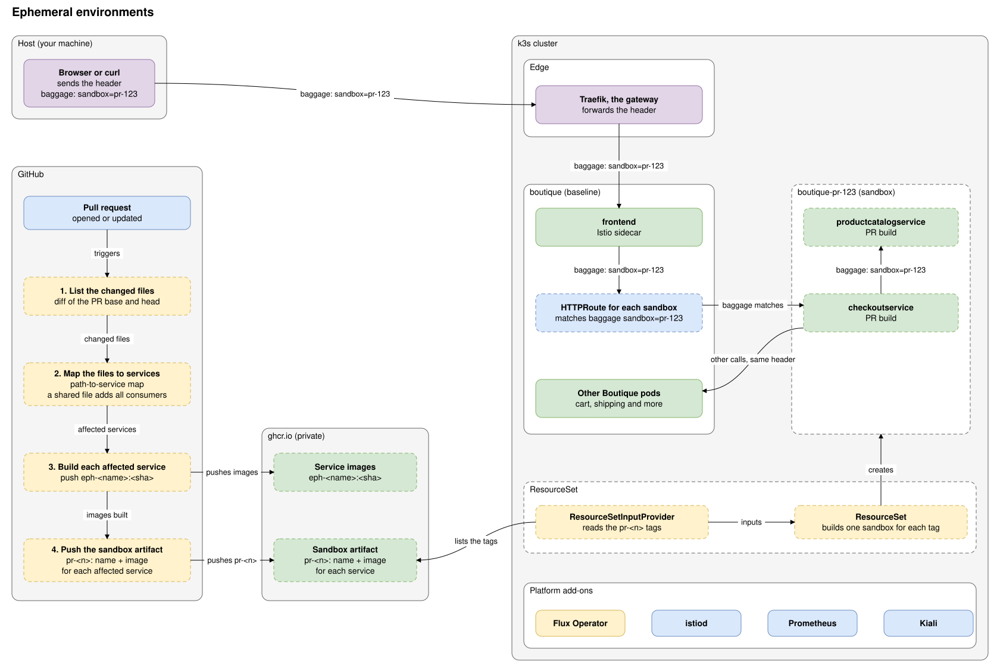
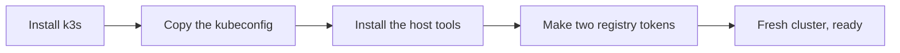
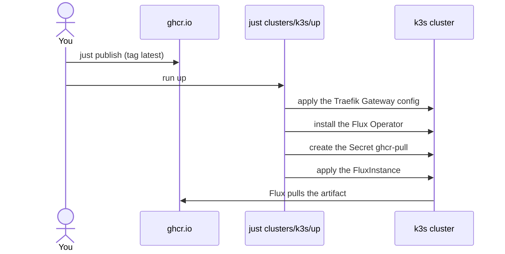
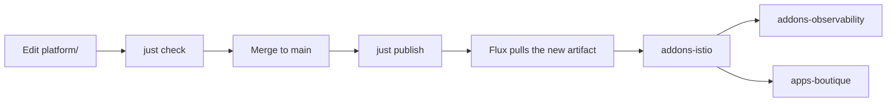
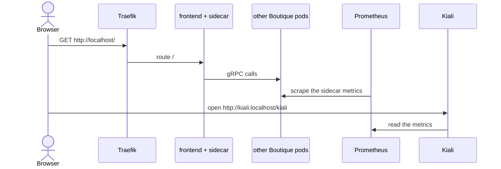
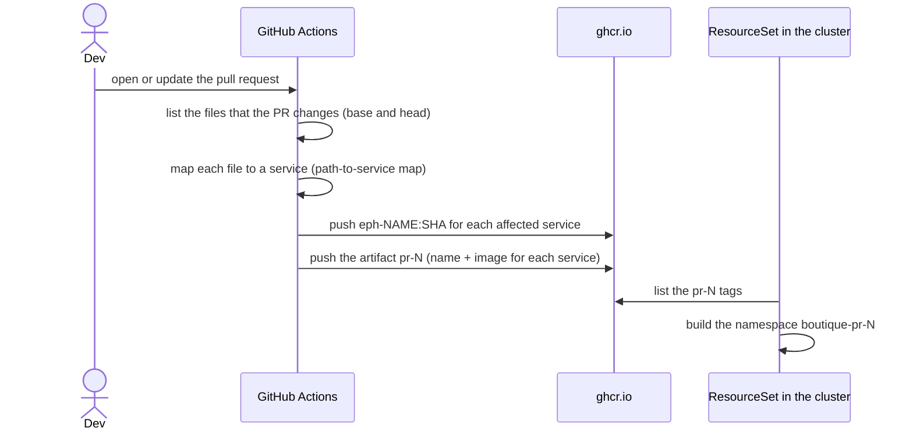

# The platform and how Flux delivers it

## The idea

- A pull request that changes one or two Online Boutique services gets its own short-lived sandbox. The sandbox runs only the changed services. All other services come from a shared baseline.
- CI finds the affected services from the diff of the pull request and builds only those.
- Istio carries the calls between the baseline and a sandbox. Kiali draws them.
- The platform under this idea is a fresh k3s cluster. It has Traefik as ingress, Istio as the mesh, Prometheus and Kiali for the graph, and the Boutique as the baseline.
- Flux delivers the platform from one OCI artifact in a private registry. Git holds the source. The cluster never reads Git. This is the gitless model.
- This doc covers the platform and its bring-up. The sandbox flow is not built yet.

## The picture

The solid boxes exist in this repo. The dashed boxes are the sandbox flow, which is not built yet.

The header is the main idea. A client sends `baggage: sandbox=pr-123`. Traefik is the gateway at the edge and forwards the header unchanged. The baseline frontend passes it on to its next call. The baseline route reads the header and sends the call to the sandbox `checkoutservice`. Each service passes the header on, so every hop sees the same value. A call to a service that the sandbox does not run goes out of the sandbox to the baseline Service. It carries the same header.

## The cast

On the host (your machine):
- `just`: runs the recipes `check`, `publish` and `up`.
- `flux push artifact`: pushes `platform/` to the registry. `just publish` calls it.
- A browser: opens the shop and Kiali.

On GitHub (planned):
- GitHub Actions: lists the files that a pull request changes, finds the affected services, builds them and pushes the sandbox artifact.

In the registry `ghcr.io` (private):
- The artifact `ghcr.io/raghav19/ephemeral-env/platform`. It holds a copy of `platform/` and the Git revision that it came from.
- The service images and one sandbox artifact for each pull request (planned).

In the cluster, by namespace:
- `kube-system`: Traefik, with the Gateway `traefik-gateway`. k3s installs both.
- `flux-system`: the Flux Operator, the controllers (source, kustomize and helm) and the sync objects. `up` installs the operator.
- `istio-system`: `istiod`, Prometheus and Kiali.
- `boutique`: the 12 Boutique pods, each with an Istio sidecar.
- `ephemeral-env`: an empty namespace for objects that belong to the whole project.

## The flow in phases

The commands of each phase are in the [README](../README.md).

### Phase 1: prerequisites (once)

The cluster must be a fresh k3s with its packaged Traefik and Gateway API CRDs. The host needs a kubeconfig, the tools of the recipes and two tokens. One token writes to the registry and one token reads from it.

### Phase 2: bring-up (once)

You publish first, so the artifact exists when Flux starts. `up` checks the cluster contract and then installs Flux. The recipes refuse to run in the sandbox VM, because the tokens must stay on the host.

### Phase 3: each change

Flux applies the new artifact in this order. `addons-istio` goes first and must be Ready. `addons-observability` and `apps-boutique` wait for it. The Boutique must wait, because a pod that starts before the injection webhook exists has no sidecar.

### Phase 4: while the system runs

The `loadgenerator` pod sends requests to the frontend all the time, so the Kiali graph of the namespace `boutique` has traffic without a browser. Flux checks the artifact tag and re-applies the platform on its own timers (see "Lifetimes").

### Phase 5: each pull request (planned, not built yet)

CI lists the files that the pull request changes. A path-to-service map turns each file into a service folder under `services/`. A change in a shared file, such as `protos/demo.proto`, adds every service that uses it. Only the affected services build. The sandbox artifact lists each one with its image, and the `ResourceSet` builds one sandbox from that list.

## Lifetimes

- **`GHCR_TOKEN`**: lives in your shell. You make it and you revoke it.
- **`GHCR_PULL_TOKEN`**: lives in the cluster Secret `ghcr-pull` until you delete the namespace `flux-system`.
- **A tag `<branch>-<sha8>`**: stays in the registry until you delete it. `latest` moves each time you publish from `main`.
- **The sync**: Flux checks the artifact tag every minute (the default of the `FluxInstance` sync). The three child Kustomizations reconcile every 10 minutes.
- **A sandbox tag `pr-N` (planned)**: lives until the pull request closes. A scheduled sweep deletes tags that no open pull request owns.
- **Prometheus data**: lives in an `emptyDir`. A pod restart loses it.
- **The Istio CRDs and the namespace `istio-system`**: Flux never prunes them.

## Why the design looks like this

- **One OCI artifact instead of a Git sync.** Many sandboxes will write to the registry at the same time. A registry takes parallel writes. A Git branch gives merge conflicts.
- **The `FluxInstance` and the Traefik config are not in the artifact.** An artifact cannot then delete Flux.
- **Child Kustomizations with `dependsOn` and `wait`.** The Boutique needs `istiod` before its pods start.
- **`istiod` is the CA, with no SPIRE.** The Boutique pods then need no extra annotation.
- **A `baggage` header is the routing key.** The Go services copy it from each incoming call to each outgoing call, so it reaches every hop without a code change.
- **Traefik stays the ingress.** k3s already ships it. The only change is the `HelmChartConfig` that turns on the Gateway provider.
- **Kiali is view-only and has a host name.** The sample Kiali login is anonymous and its role can change Istio objects. The route matches only `kiali.localhost`.
- **Flux reads the Boutique release from its pinned URL.** The baseline is the unchanged upstream app. This is the one place where the cluster reads something outside the registry.

## The names

- **platform**: the folder `platform/` and the content of the artifact.
- **artifact**: the OCI image that `flux push artifact` makes from `platform/`.
- **host**: the machine that runs k3s and the recipes. A sandbox VM is not the host.
- **baseline**: the Boutique in the namespace `boutique`.
- **sandbox**: the short-lived environment of one pull request. It is not built yet.
- **affected service**: a service whose files the pull request changes, or that uses a changed shared file.
- **path-to-service map**: the list that tells CI which service owns which path.
- **`latest`**: the tag that `FluxInstance.spec.sync.ref` follows by default.
- **`ghcr-pull`**: the Secret that Flux uses to pull from the private registry.
- **`kiali.localhost`**: the host name of the Kiali route. A browser resolves it to the loopback address.

## Where each part is in the repo

- [`justfile`](../justfile): `check` and `publish`.
- [`clusters/k3s/justfile`](../clusters/k3s/justfile): `up`.
- [`clusters/k3s/flux-instance.yaml`](../clusters/k3s/flux-instance.yaml): Flux and its sync of the artifact.
- [`clusters/k3s/traefik-config.yaml`](../clusters/k3s/traefik-config.yaml): the Traefik Gateway provider.
- [`platform/sync.yaml`](../platform/sync.yaml): the order of the three Kustomizations.
- [`platform/addons/istio/`](../platform/addons/istio): the Istio base chart and `istiod`.
- [`platform/addons/observability/`](../platform/addons/observability): Prometheus, Kiali and the Kiali route.
- [`platform/apps/boutique/`](../platform/apps/boutique): the namespace, the release URL and the shop route.
- [`diagrams/`](diagrams): the architecture diagram.

## What comes next

The sandbox flow comes next. A Flux `ResourceSet` builds one sandbox for each pull request from a small input: a name and an image. A route sends requests that carry a sandbox header to the sandbox services. Read [the research note](../../../docs/research/ephemeral-env-platform-gaps.md) for the open questions and the things that no command checked.
