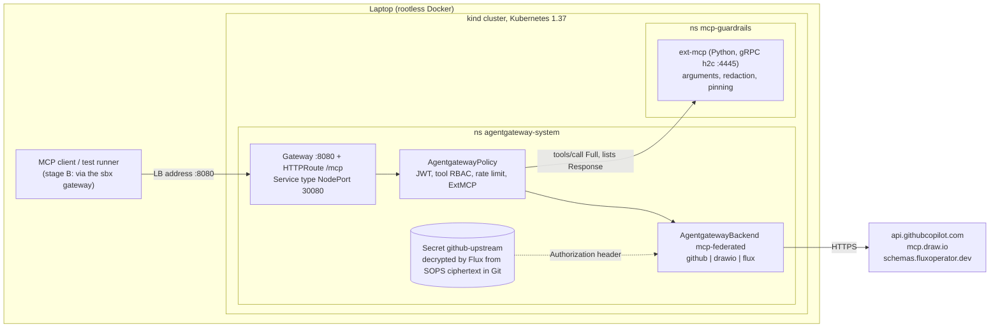
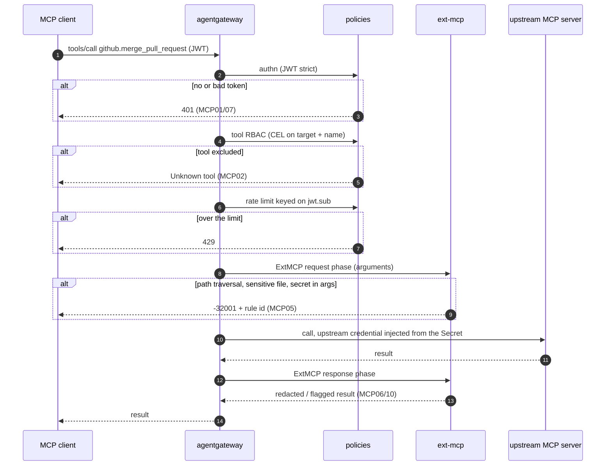
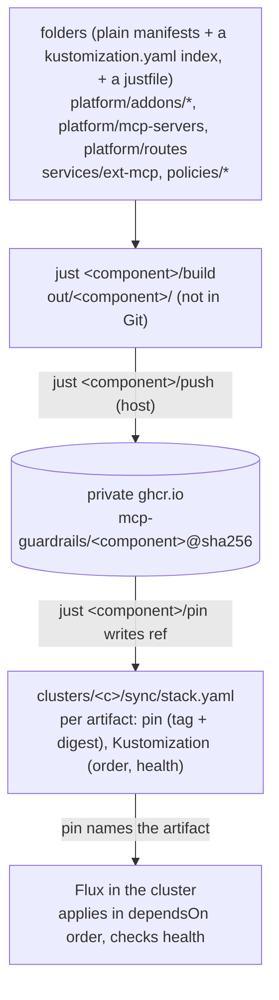
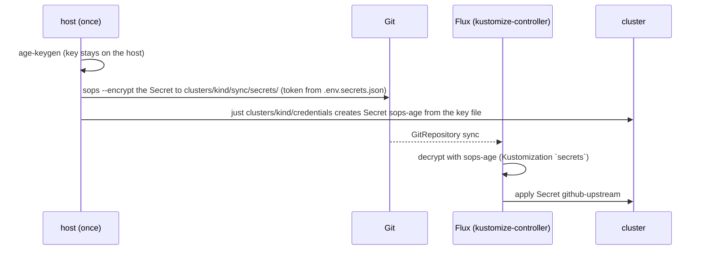

# Part 3: MCP guardrails with agentgateway on kind

Part 1 showed the attack. Part 2 contained one local MCP server. [agent-sandbox](../../agent-sandbox/README.md) put the agent in a microVM. This part puts a **policy point on the MCP path**: every call to a remote MCP server goes through [agentgateway](https://agentgateway.dev) running in a local kind cluster, where tool, argument and response rules apply, mapped to the [OWASP MCP Top 10](https://owasp.org/www-project-mcp-top-10/).

> **Status (stage A, Flux hand-over written).** Manifests, the Flux stack and the cluster folder are written, and every component has a justfile (`just build`, `validate`,
> `push`, `pin`), and the root justfile has `diff`. `just <component>/build` runs for all ten components with the real v1.6.0 charts, and `just diff` renders them. **Not yet run against a cluster**:
> `just clusters/kind/up`, `credentials` and `down` refuse to run in the sandbox: they need the host (real ghcr.io token, your sops key). `just <component>/push` and Flux itself need the host too. The rootless-Docker gateway reachability question below is the first thing to prove.
> **Per-cluster values are being redesigned**: `values/` and `clusters/<c>/values.env` are not applied by `just build` yet (see "How a value gets in").
> Stage B (chaining the sbx gateway to this one, sandbox-driven tests, Keycloak) follows a spike.

## What this builds

- **A gateway in front of three remote MCP servers**: GitHub, draw.io and the Flux schema catalog, federated behind one `/mcp` endpoint with target-prefixed tool names.
- **Two runs you can compare**: baseline (gateway in path, nothing enforced) and every policy on. A baseline cluster is a stack without the policy and `ext-mcp-isolation` entries. Same attacks, two results.
- **Values as data**: one flat `values.env` per layer (fleet, cluster, and a region when one exists) with declarative wiring rules; not applied by `just build` yet (see "How a value gets in").
- **One artifact per independently deployable unit**: each addon, route set, MCP server registration and policy is its own OCI artifact in a private registry; a cluster's `stack.yaml` pins which one it runs. What must change together travels inside one artifact. What must only be ready first is a `dependsOn`. Rollout and rollback of one unit is an edit of its `ref.digest` in the cluster's `stack.yaml`.
- **Review before merge**: `just diff` is a plan-style diff of what Flux would apply (the objects of the artifact, and the objects each chart renders), locally and in CI. `just <component>/push` publishes an artifact, `just <component>/pin` writes its tag and digest into `stack.yaml`. Nothing applies it until a pin in `main` names it.
- **One imperative step**: `just clusters/kind/up` creates the cluster and installs Flux; `just clusters/kind/credentials` adds the two Secrets Flux needs. Everything else is Git and the registry.

## Architecture



## One request, step by step



## How the manifests are composed



### One artifact, from folder to cluster

```text
 platform/addons/agentgateway/          just build                    stack.yaml                      cluster
 ├── justfile                           kustomize build the folder    ┌ OCIRepository "agentgateway"  ┐
 ├── kustomization.yaml (index)                                       │   url ghcr.io/…/agentgateway  │
 ├── namespace.yaml                     ──► out/agentgateway ───────► │   tag + digest  (the pin)     │ ──► Flux applies the 5 objects
 ├── crds.yaml        (chart + release)        just push / just pin   ├ Kustomization "agentgateway"  ┤         │
 └── controller.yaml  (chart + release)                               │   dependsOn gateway-api, wait │         ▼
                                                                      └───────────────────────────────┘   helm-controller installs the charts
```

Two things carry the word "Kustomization": `kustomization.yaml` in a folder is only a build index (kustomize loads folders, not loose files), and a Flux `Kustomization`
in `stack.yaml` applies one artifact (order, health). Two things carry the word "OCIRepository": the pin of our artifact on `ghcr.io`, and, inside the artifact, the third-party chart source for a HelmRelease.

### How a value gets in

**Not applied by `just build` yet.** The component folders hold the fleet values, and `values/` (with `values/wiring` and `clusters/<name>/values.env`) is not read by any
recipe. For the kind cluster, which has no overrides, the raw build of every component equals what that layer produced. How per-cluster values reach the manifests
(Flux `postBuild.substitute`, or a per-cluster kustomize layer) is the next design step.

A chart value is an edit of `spec.values` in the HelmRelease. `just diff` renders the chart and shows what the value changes in the objects the chart creates.

A change moves only the artifacts whose folder it touches.

### How a secret gets in



The agent never holds this value. The gateway reads it from the Secret and sets the upstream `Authorization` header. No artifact holds a secret or a ciphertext: the
Secret reaches the cluster from `clusters/<name>/sync/secrets` through Flux, never through a component folder. Secret detection is the job of a `prek` hook (the tool is
in the tool lists; the hook configuration is not written yet). The sandbox VM has neither the token nor the age key.

## Directory structure

```text
part-3-mcp-guardrails/
├── README.md
├── justfile                     the entry point: `just diff`, `just clusters/kind/<recipe>`, `just tests/run`, `just <component>/<recipe>`
├── lib/                         lib.just (build, validate, push, pin: imported by every component)
├── preview/                     kustomizations.yaml: one Flux Kustomization per component, the input of `just diff` (flate)
├── .krmignore                   what flate skips (clusters/, out/, tests/)
├── platform/                    the gateway and what it needs
│   ├── addons/                  one folder per Kubernetes addon: gateway-api (CRDs); agentgateway (namespace, CRD chart, controller chart, both HelmRelease)
│   ├── mcp-servers/             the registered MCP servers behind /mcp (one AgentgatewayBackend)
│   └── routes/                  Gateway, AgentgatewayParameters, HTTPRoute
├── policies/                    one folder per control: authn-jwt, tool-rbac, rate-limit, ext-mcp-checks, ext-mcp-isolation
├── values/                      values.env (fleet layer) + kustomization.yaml (the ConfigMap) + wiring/ (key -> field paths)
├── services/ext-mcp/            justfile + kustomization.yaml (the artifact is deploy/), rules.py (+ tests), Dockerfile, deploy/ (namespace, Deployment, Service)
├── clusters/
│   └── kind/                    one folder per cluster (the environment)
│       ├── values.env           this cluster's overrides
│       ├── kind-config.yaml     read by `just clusters/kind/up`
│       └── sync/                read by Flux from Git: stack.yaml (pins, Kustomizations, order, health), flux-instance.yaml, secrets/ (age ciphertext)
├── out/                         gitignored: what `just <component>/build` writes, one folder per artifact, and the push result `<component>.json`
└── tests/
    ├── attacks/                 one folder per OWASP id: run.sh, driven by lib.sh
    └── servers/evil-mcp/        fixture server (stub)
```

An **artifact** is one independently deployable unit; the folder, the justfile, the Kustomization in `stack.yaml` and the pin have the same name (`services/ext-mcp` for `ext-mcp`).
`preview/kustomizations.yaml` lists the same names with their folders for `just diff`. The artifacts: `gateway-api`, `agentgateway`, `mcp-servers`, `routes`, `ext-mcp`,
`ext-mcp-isolation`, `authn-jwt`, `rate-limit`, `tool-rbac`, `ext-mcp-checks`, and `secrets` (from Git, not an artifact).

A second cluster is a new `clusters/<name>/` folder with its own `stack.yaml`. A region layer is not built yet. One pushed artifact can be pinned by several clusters.

## Versions

Latest stable at 2026-10-10, checked against the GitHub release APIs, for Kubernetes **1.37**:

| Item | Pin | Where |
|---|---|---|
| Kubernetes (kind node image) | `v1.37.0@sha256:a1ed56cf…` (kind v0.33.0 default) | `clusters/kind/kind-config.yaml` |
| kind | 0.33.0 | root `mise.toml` |
| Gateway API (experimental channel) | v1.6.3 | `platform/addons/gateway-api/` |
| agentgateway (CRDs and controller) | v1.6.0 | `platform/addons/agentgateway/crds.yaml`, `controller.yaml` (`just validate` fails if they differ) |
| kubectl / kustomize / helm | 1.37 / 5.8.3 / 4.3.0 | root `mise.toml` |
| just / flate / prek | 1.58 / 0.6.5 / 0.5 | root `mise.toml`, `.sbx/agent/tools.toml` |
| Flux (distribution, via the Flux Operator) | 2.9.6 | `clusters/kind/sync/flux-instance.yaml` |
| Flux Operator chart | 0.61.0 (not checked against the registry) | `clusters/kind/justfile` |
| Which version a cluster runs | one tag (the commit) and one sha256 digest per artifact | `clusters/kind/sync/stack.yaml` (`ref.tag`, `ref.digest`) |

agentgateway v1.6.0 lists Kubernetes 1.32 to 1.37 and Gateway API 1.4 to 1.6 as supported. Chart, CRD and image versions live in the component folders. The pin decides which pushed artifact a cluster runs.

## Getting started

Prerequisites: rootless Docker as in [`code/rootless-docker`](../../rootless-docker), `mise install` at the repo root, and your age key for `sops`.
Steps marked **host** run on your machine. The sandbox VM has no age key, no cluster and no registry credential.

1. **Look at what a cluster gets (anywhere).** From the folder of the component, or from here with the folder in the name: `just platform/routes/build` writes `out/routes/`
   (one file per object), `just platform/routes/validate` also checks it with `flux schema validate` (the hosted schema catalog needs the network), and
   `just diff` is the plan-style diff of the whole repo against `origin/main`, changed components only, with every chart rendered by flate (in the sandbox VM the chart registry needs a host approval first).
2. **Secret and keys (host, once).** Follow [`clusters/kind/sync/secrets/README.md`](clusters/kind/sync/secrets/README.md): a cluster age key, a `.sops.yaml` rule, the encrypted
   `github-upstream` Secret. Add `GHCR_USER`, `GHCR_PULL_TOKEN` and `GHCR_PUSH_TOKEN` (classic PAT, `read:packages` / `write:packages`) to `.env.secrets.json`.
   Check on the host that the GitHub token can call the GitHub MCP server (`tools/list` returns the `github_*` tools). It was created for pulling the kit image;
   if it lacks the permissions you need, add a dedicated key.
3. **Push the artifacts (host).** Commit the component, then `sops exec-env .env.secrets.json 'just platform/routes/push'`. It validates, then pushes `out/routes/` as
   `ghcr.io/raghav19/mcp-guardrails/routes:<commit>` and saves the result in `out/routes.json`. `just platform/routes/pin` writes that tag and digest into `ref` of the OCIRepository
   in `clusters/kind/sync/stack.yaml` (replacing `tag: unpinned`); commit it and open the pull request. (Make the registry packages private; the pull token is for them.)
4. **Create the cluster (host).** `just clusters/kind/up` creates kind, installs the Flux Operator and applies the FluxInstance. It needs no credential. Then
   `just clusters/kind/credentials` creates the two Secrets Flux waits for (`sops-age`, `ghcr-pull`); it decrypts the `ghcr.io` token of `.sbx/secrets.json` itself, so no env vars. Flux syncs `clusters/kind/sync` and applies the artifacts in order. Watch:
   `kubectl -n flux-system get kustomizations`. Until the branch merges, set `spec.sync.ref` in `flux-instance.yaml` to your branch.
5. **Check the gateway.** It answers on `http://127.0.0.1:8080/mcp` (host port 8080 -> NodePort 30080); `tools/list` with the MCP Inspector should show `github_*`, `drawio_*`, `flux_*`.
6. **Run the attacks:** `just tests/run`. The expected results follow the stack: with the policy entries (`authn-jwt` and the others) the run is the guarded one, without them it is
   the baseline. To compare, remove those entries from `stack.yaml`, push, and let Flux apply.
7. **Tear down.** `just clusters/kind/down`.

To change something:

```sh
just diff                           # plan-style diff against origin/main, changed components only: the objects Flux would apply, charts rendered (flags go to flate: -o github)
just policies/rate-limit/validate    # build out/rate-limit/ and check it against the schemas
just policies/rate-limit/push        # host: push out/rate-limit/ as :<commit>, print the digest
just policies/rate-limit/pin         # write the tag and digest into stack.yaml; commit it and open the pull request
#   merge: Flux applies the new pin
```

To roll one artifact back: `git revert` the commit that pinned it and merge. The other artifacts stay as they are.
A change that needs two units moves both pins in one pull request. Flux applies them in `dependsOn` order.

`just tests/run` refuses to run unless `kubectl`'s current context is `kind-mcp-guardrails`.

## Policies and what they map to

Each policy is its own artifact, so one policy rolls out or back alone.

| Control | Folder | OWASP MCP | Test |
|---|---|---|---|
| JWT, strict | `policies/authn-jwt` | MCP01, MCP07 | `MCP07-no-token` |
| Upstream credential held by the gateway | SOPS Secret in `clusters/<name>/sync/secrets` + `platform/mcp-servers` `auth.secretRef` | MCP01 | (inspect: nothing client-side) |
| Tool deny list (CEL, target + name) | `policies/tool-rbac` | MCP02 | `MCP02-destructive-tool` |
| Rate limit per `jwt.sub` | `policies/rate-limit` | MCP02, MCP10 | to write |
| Argument and response checks, pinning | `policies/ext-mcp-checks` + `services/ext-mcp` | MCP03, 05, 06, 10 | `rules.py` unit tests; attack cases to write |
| Only the gateway may call ext-mcp | `policies/ext-mcp-isolation` | MCP04, MCP09 | to write |
| Access logs and traces | not wired | MCP08 | to write |

MCP04 (supply chain) and MCP06 (intent flow subversion) are reduced here, not solved.

## Known gaps and open risks

- **The gateway is reached through a NodePort, not a LoadBalancer, and that path is not yet verified end to end.** cloud-provider-kind does not work on rootless Docker with the pasta network: its proxy container gets an ephemeral host port, and pasta does not forward 32768-60999 (see `kind-config.yaml`). `kind-config.yaml` instead maps host `127.0.0.1:8080` to NodePort 30080, which `platform/gateway/parameters.yaml` pins. The manifests render and the mapping is created; a request through the gateway has not been made yet.
- **The two agentgateway charts are installed by Flux (helm-controller), not rendered into the artifact.** The artifact `agentgateway` holds an `OCIRepository` and a `HelmRelease` per chart. `just diff` renders both charts with flate (helm built in; same version, same values) so a review sees what a chart or a value changes. That rendering is evidence, not the applied bytes: helm-controller renders and applies inside the cluster, and flate approximates it (Kubernetes 1.37.0 by default, no `lookup`). CRD changes are hidden by default (`--skip-crds=false` shows them). `driftDetection` is on.
- **`GITHUB_TOKEN` as the MCP credential is untested**: it could not be decrypted where this was written, so its permissions against the GitHub MCP server are unknown.
- **Not verified against a live controller**: the CRD field names are checked against the v1.6.0 schemas, but `Gateway` Programmed status, the secret key convention (`Authorization`, raw token) and how two `AgentgatewayPolicy` objects on one backend merge need a cluster.
- **JWKS is a placeholder** (`JWT_JWKS` in `values/values.env`) until a key is minted; Keycloak replaces it in stage B.
- **ext-mcp has rules but no server yet**: the gRPC contract is to be vendored at the pinned tag.
- Argument-level CEL is unreliable in agentgateway ([#3092](https://github.com/agentgateway/agentgateway/issues/3092)), which is why argument checks live in ext-mcp.
- **Not run on a cluster.** `just <component>/push` and `pin` against the registry, `just clusters/kind/up`, the Flux sync and the health gates need the host. `just` and `flux schema validate` have not been run against a real push yet.
- **Unchecked names.** The status condition types of `AgentgatewayPolicy` and `AgentgatewayBackend` (the policy artifacts have no CEL health check until you read them on a live cluster), and the Flux Operator chart version `0.61.0`.
- **The health gate for `Gateway` in `clusters/kind/sync/stack.yaml`** uses the `Programmed` condition (Gateway API v1.6.3 schema); it is not exercised yet.
- **The gateway Service shape (NodePort 30080) still lives in base** (`platform/routes/parameters.yaml`). Move it out of the fleet files after the reachability spike; a cluster-only shape change has no mechanism yet.
- **`ref.digest` over `ref.tag` is assumed, not checked.** `just pin` writes both: the tag is the commit the artifact came from, the digest is what Flux should pull. An OCIRepository
  prefers the digest when both are set; check that on the first rollout. `flux diff artifact` prints only "differs" and an exit code, so it is not used for review.
- **Helm hooks**: the v1.6.0 charts have none (checked by rendering). Helm runs hooks of a later version as hooks, so read `just diff` of a chart bump.
- **Unplugging a USB device while the cluster runs could break new privileged pods.** A kind node keeps a snapshot of the host's `/dev`, and runc fails on the entry that is gone
  (`mount src=/dev/bus/usb/...: no such file or directory`; kube-proxy goes to `RunContainerError`). `kind-config.yaml` sets `privileged_without_host_devices = true` for containerd so
  privileged pods get no device nodes. The patch is valid TOML but its effect on a replugged device is not confirmed on a host. If it still happens, recreate the cluster.
- **No CI and no signing yet.** `just <component>/push` is a host recipe; the registry is the trust root. CI (`just diff origin/main -o github` as a pull request comment), cosign and SBOM are the next step.
- **Per-cluster values have no mechanism yet.** `values/` and `clusters/<name>/values.env` are not applied by `just build`; both charts use their defaults and the component folders hold the fleet values. A per-cluster chart value or shape change needs the redesign described under "How a value gets in".
