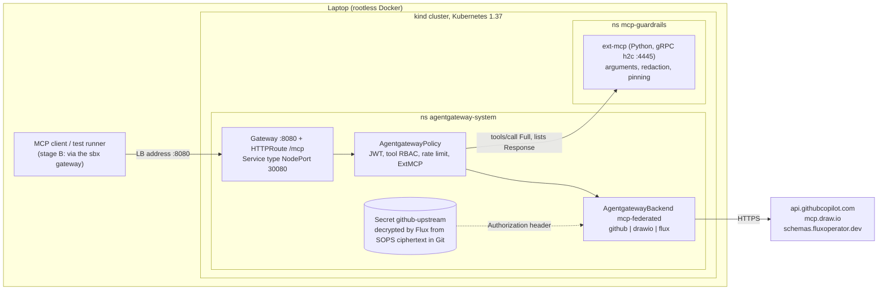
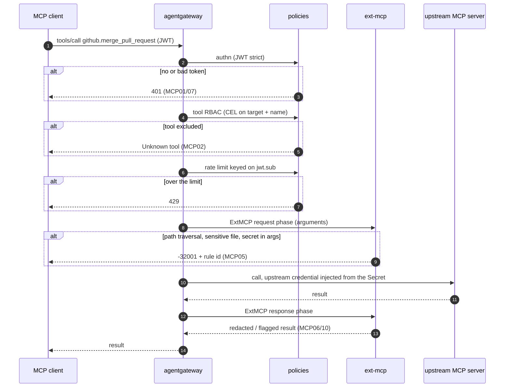
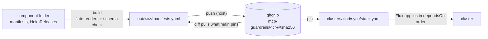
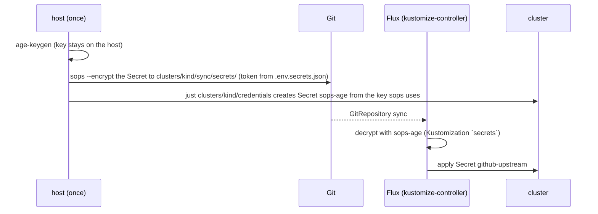

# Part 3: MCP guardrails with agentgateway on kind

Part 1 showed the attack. Part 2 contained one local MCP server. [agent-sandbox](../../agent-sandbox/README.md) put the agent in a microVM. This part puts a **policy point on the MCP path**: every call to a remote MCP server goes through [agentgateway](https://agentgateway.dev) in a local kind cluster, where tool, argument and response rules apply, mapped to the [OWASP MCP Top 10](https://owasp.org/www-project-mcp-top-10/).

> **Status (stage A).** Manifests, Flux stack, cluster folder and justfiles are written. `just <component>/build` renders and validates all ten components with the real v1.6.0 charts.
> **Not yet run on a cluster.** The `clusters/kind/*` recipes and `push` need the host (real ghcr.io token, your sops key) and refuse to run in the sandbox.
> Stage B (chaining the sbx gateway to this one, Keycloak) follows a spike.

## What this builds

- **A gateway in front of three remote MCP servers** (GitHub, draw.io, the Flux schema catalog) behind one `/mcp` endpoint with target-prefixed tool names.
- **Two runs to compare**: baseline (gateway in path, nothing enforced) and every policy on. A baseline stack is `stack.yaml` without the policy and `ext-mcp-isolation` entries.
- **One artifact per deployable unit**: each addon, route set, MCP server registration and policy is its own OCI artifact. A cluster's `stack.yaml` pins which one it runs, so rollout and rollback of one unit is a Git edit of its pin.
- **The artifact is the rendered manifest**: what you review is what Flux applies. Charts are rendered at build time, nothing is inflated in the cluster.

## Architecture



## One request, step by step



## How an artifact is made

Every component folder has a justfile that imports [`lib/lib.just`](lib/lib.just). Name the folder to run a recipe: `just platform/routes/build`. Run `just` for the list.



| Command | What it does |
|---|---|
| `just <c>/build` | flate renders the folder, charts included, checks it against the Kubernetes, Flux and ecosystem schemas, writes `out/<c>/manifests.yaml`: the artifact |
| `just <c>/diff` | prints the change against the artifact `origin/main` pins: the rendered objects, not the source files. `just --set base <rev> <c>/diff` for another revision. CRDs and Secrets are not shown (`FLATE_SKIP_CRDS=false` shows CRDs) |
| `just <c>/push` | builds, then pushes the artifact as `ghcr.io/raghav19/mcp-guardrails/<c>:<commit>` (host) |
| `just <c>/pin` | writes the pushed tag and digest into `stack.yaml`; commit it in a pull request |

`out/<c>/` is gitignored. Only `manifests.yaml` is pushed:

```text
out/routes/
├── manifests.yaml    the artifact
├── build/ks.yaml     the Flux Kustomization flate reads to render the folder (flate renders Flux objects, not folders)
├── diff/ks.yaml      the same, for baseline/
├── baseline/         the artifact main pins, pulled by diff
└── push.json         tag and digest of the last push, read by pin
```

Good to know:

- A HelmRelease and its chart source are replaced by the objects the chart renders. A chart hook becomes a plain object; the v1.6.0 charts have none. flate renders for Kubernetes 1.37.0 and has no `lookup`.
- CRDs and Secrets stay in the artifact. Every CRD carries `kustomize.toolkit.fluxcd.io/prune: disabled`, so Flux never deletes one (that would delete every custom resource of its kind). Remove them with `just clusters/kind/delete-crds`.
- flate 0.6.5 does not know some kinds are cluster-scoped and puts a namespace on them. `cluster_scoped` in `lib/lib.just` lists them and the build removes it.
- `kustomization.yaml` in a folder is only a build index. A Flux `Kustomization` in `stack.yaml` applies one artifact (order, health).

### How a value gets in

Not applied by the build yet. The component folders hold the fleet values. `values/` (with `values/wiring` and `clusters/<name>/values.env`) is not read by any recipe, and a per-cluster value or shape change has no mechanism yet (Flux `postBuild.substitute` or a per-cluster kustomize layer is the next design step).
A chart value is an edit of `spec.values` in the HelmRelease; `just <c>/diff` shows what it changes in the objects the chart creates.

### How a secret gets in



The agent never holds this value: the gateway reads the Secret and sets the upstream `Authorization` header. The Secret reaches the cluster from `clusters/<name>/sync/secrets` through Flux, never through a component folder. The sandbox VM has neither the token nor the age key.

## Directory structure

```text
part-3-mcp-guardrails/
├── justfile                     `just` prints the commands
├── lib/lib.just                 build, diff, push, pin: imported by every component justfile
├── platform/
│   ├── addons/                  gateway-api (CRDs); agentgateway (namespace, CRD chart, controller chart)
│   ├── mcp-servers/             the registered MCP servers behind /mcp (one AgentgatewayBackend)
│   └── routes/                  Gateway, AgentgatewayParameters, HTTPRoute
├── policies/                    one folder per control: authn-jwt, tool-rbac, rate-limit, ext-mcp-checks, ext-mcp-isolation
├── services/ext-mcp/            rules.py (+ tests), Dockerfile, deploy/ (the artifact)
├── values/                      fleet values.env + wiring (not applied yet)
├── clusters/kind/               one folder per cluster
│   ├── justfile                 up, credentials, down, delete-crds (host only)
│   ├── kind-config.yaml         read by `up`
│   └── sync/                    read by Flux: stack.yaml (pins, order, health), flux-instance.yaml, secrets/ (age ciphertext)
├── tests/                       justfile (run), attacks/ (one folder per OWASP id), servers/evil-mcp (fixture stub)
└── out/                         gitignored, see above
```

An **artifact** is one deployable unit. Its folder, justfile, Kustomization in `stack.yaml` and pin have the same name (`services/ext-mcp` is `ext-mcp`).
The ten artifacts: `gateway-api`, `agentgateway`, `mcp-servers`, `routes`, `ext-mcp`, `ext-mcp-isolation`, `authn-jwt`, `rate-limit`, `tool-rbac`, `ext-mcp-checks`. `secrets` is read from Git and is not an artifact.
A second cluster is a new `clusters/<name>/` folder with its own `stack.yaml`; one pushed artifact can be pinned by several clusters.

## Versions

| Item | Pin | Where |
|---|---|---|
| Kubernetes (kind node image) | v1.37.0 (kind 0.33.0 default) | `clusters/kind/kind-config.yaml` |
| Gateway API (standard channel) | v1.6.1 | `platform/addons/gateway-api/kustomization.yaml` |
| agentgateway (CRDs and controller) | v1.6.0, `just build` fails if the two tags differ | `platform/addons/agentgateway/` |
| Flux (via the Flux Operator) | 2.9.6; operator chart 0.61.0 | `clusters/kind/sync/flux-instance.yaml`, `clusters/kind/justfile` |
| just / flate / kind / helm | 1.58 / 0.6.5 / 0.33.0 / 4.3.0 | root `mise.toml` |
| What a cluster runs | one tag (the commit) and one digest per artifact | `clusters/kind/sync/stack.yaml` |

## Getting started

Prerequisites: rootless Docker ([`code/rootless-docker`](../../rootless-docker)), `mise install` at the repo root, your age key for `sops`. Steps marked **host** run on your machine.

1. **Look at what a cluster gets (anywhere).** `just platform/routes/build`, then `just platform/routes/diff`. The schema catalog needs the network; in the sandbox VM the chart registry needs a host approval first.
2. **Secret and keys (host, once).** Follow [`clusters/kind/sync/secrets/README.md`](clusters/kind/sync/secrets/README.md). Add `GHCR_USER`, `GHCR_PULL_TOKEN` and `GHCR_PUSH_TOKEN` (classic PAT, `read:packages` / `write:packages`) to `.env.secrets.json`.
3. **Push the artifacts (host).** `sops exec-env .env.secrets.json 'just platform/routes/push'`, then `just platform/routes/pin`; commit `stack.yaml` and open the pull request. Make the registry packages private.
4. **Create the cluster (host).** `just clusters/kind/up` (kind, Flux Operator, FluxInstance; needs no credential), then `just clusters/kind/credentials` (the `sops-age` and `ghcr-pull` Secrets). Watch: `kubectl -n flux-system get kustomizations`. Until the branch merges, set `spec.sync.ref` in `flux-instance.yaml` to your branch.
5. **Check the gateway.** `http://127.0.0.1:8080/mcp` (host port 8080 to NodePort 30080); `tools/list` should show `github_*`, `drawio_*`, `flux_*`.
6. **Run the attacks.** `just tests/run` (it refuses unless `kubectl`'s context is `kind-mcp-guardrails`). Results follow the stack: policy entries present means guarded, absent means baseline.
7. **Tear down.** `just clusters/kind/down`.

To change something: `just <c>/diff`, edit, `just <c>/build`, `just <c>/push`, `just <c>/pin`, open the pull request. Merging makes Flux apply the new pin.
To roll one artifact back: `git revert` the commit that pinned it. A change that needs two units moves both pins in one pull request; Flux applies them in `dependsOn` order.

## Policies and what they map to

Each policy is its own artifact, so one policy rolls out or back alone.

| Control | Folder | OWASP MCP | Test |
|---|---|---|---|
| JWT, strict | `policies/authn-jwt` | MCP01, MCP07 | `MCP07-no-token` |
| Upstream credential held by the gateway | SOPS Secret in `clusters/<name>/sync/secrets` + `platform/mcp-servers` `auth.secretRef` | MCP01 | (inspect: nothing client-side) |
| Tool deny list (CEL, target + name) | `policies/tool-rbac` | MCP02 | `MCP02-destructive-tool` |
| Rate limit per `jwt.sub` | `policies/rate-limit` | MCP02, MCP10 | to write |
| Argument and response checks, pinning | `policies/ext-mcp-checks` + `services/ext-mcp` | MCP03, 05, 06, 10 | `rules.py` unit tests; attack cases to write |
| Only the gateway may call ext-mcp | `policies/ext-mcp-isolation` | MCP04, MCP09 | to write |
| Access logs and traces | not wired | MCP08 | to write |

MCP04 (supply chain) and MCP06 (intent flow subversion) are reduced here, not solved.

## Known gaps and open risks

- **Gateway reachability is not verified.** cloud-provider-kind does not work on rootless Docker with pasta (no forwarding of 32768-60999), so `kind-config.yaml` maps host `127.0.0.1:8080` to NodePort 30080, pinned in `platform/routes/parameters.yaml`. No request has gone through yet. This is the first thing to prove.
- **Nothing has run on a cluster:** `push`, `pin`, `clusters/kind/*`, the Flux sync and the health gates need the host.
- **The first push of `agentgateway` changes its format.** The current pin holds two HelmReleases; the new one holds the rendered objects with the same names. On a cluster that already runs the old pin, helm-controller uninstalling the release could remove objects Flux just applied, so check that cut-over. A fresh cluster is fine.
- **Unchecked against a live controller:** the status conditions of `AgentgatewayPolicy` and `AgentgatewayBackend` (no CEL health check yet), the `Programmed` gate of `Gateway`, the secret key convention (`Authorization`, raw token), how two policies on one backend merge, and that an OCIRepository prefers `ref.digest` over `ref.tag` (`pin` writes both; `diff` pulls the digest).
- **Credentials are untested:** `GITHUB_TOKEN` against the GitHub MCP server. **JWKS is a placeholder** (`JWT_JWKS` in `values/values.env`) until Keycloak in stage B.
- **ext-mcp has rules but no server yet.** Argument-level CEL is unreliable in agentgateway ([#3092](https://github.com/agentgateway/agentgateway/issues/3092)), which is why argument checks live in ext-mcp.
- **Unplugging a USB device while the cluster runs could break new privileged pods** (runc fails on the vanished `/dev` entry). `kind-config.yaml` sets `privileged_without_host_devices = true`; its effect is not confirmed on a host. If it happens, recreate the cluster.
- **No CI and no signing yet.** `push` is a host recipe and the registry is the trust root. CI (`just <c>/diff` as a pull request comment), cosign and SBOM are next.
