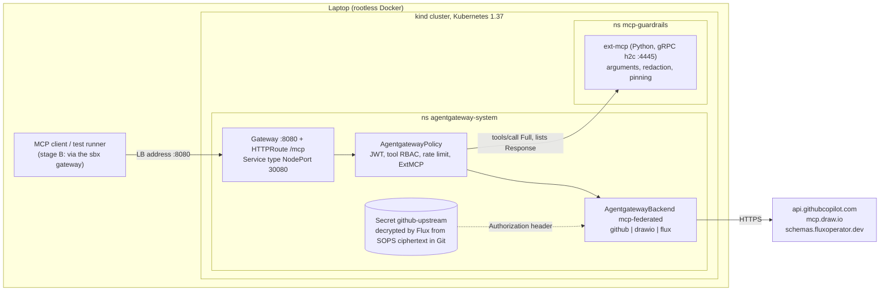
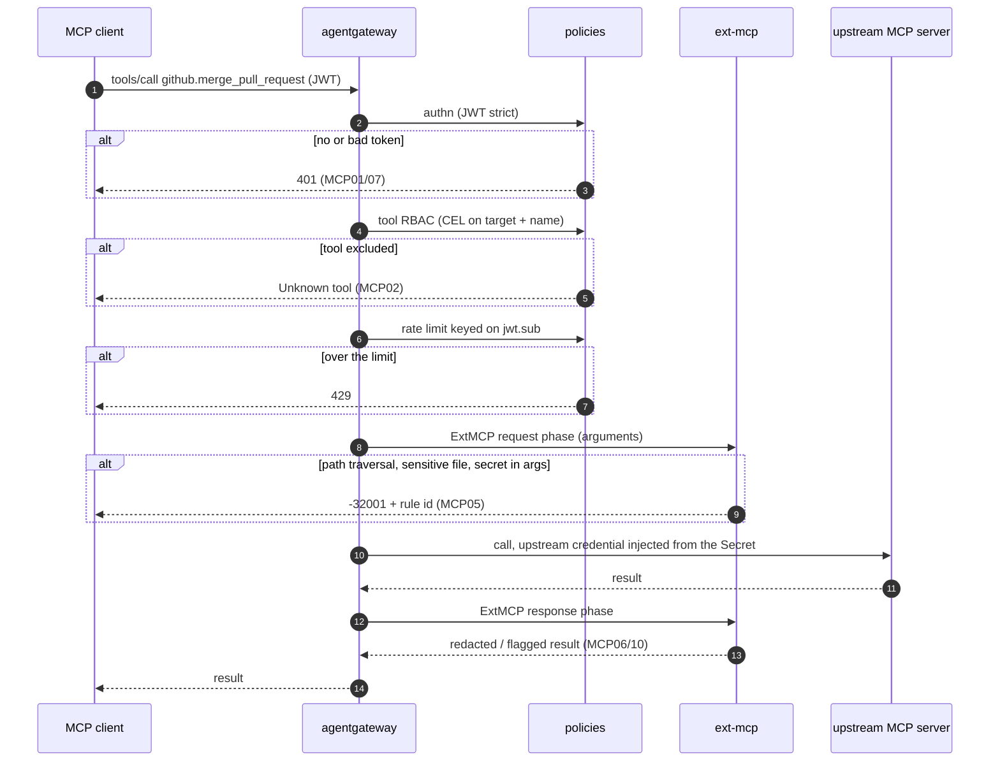
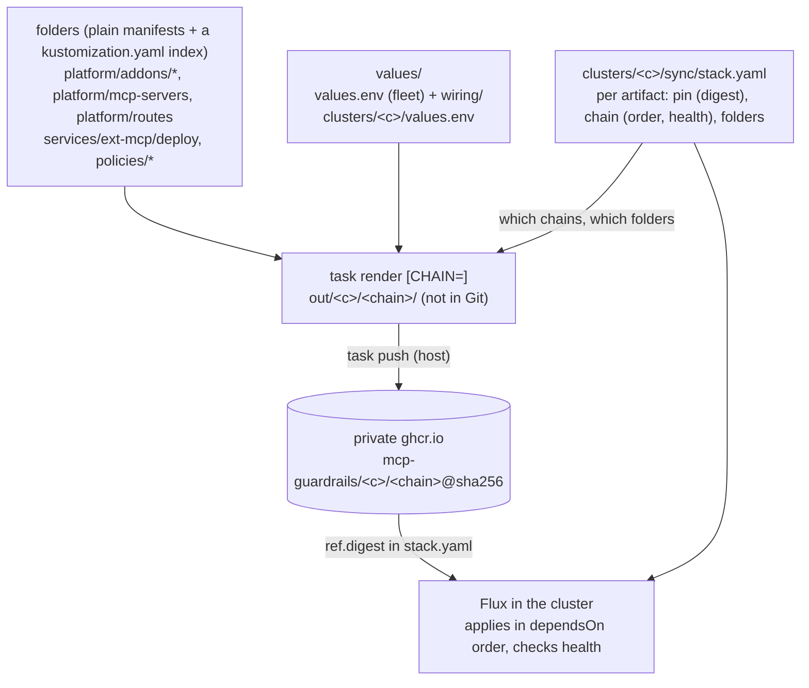

# Part 3: MCP guardrails with agentgateway on kind

Part 1 showed the attack. Part 2 contained one local MCP server. [agent-sandbox](../../agent-sandbox/README.md) put the agent in a microVM. This part puts a **policy point on the MCP path**: every call to a remote MCP server goes through [agentgateway](https://agentgateway.dev) running in a local kind cluster, where tool, argument and response rules apply, mapped to the [OWASP MCP Top 10](https://owasp.org/www-project-mcp-top-10/).

> **Status (stage A, Flux hand-over written).** Manifests, values layers, the render pipeline, the Flux stack and the cluster folder are written. `task render` runs end to end
> with the real v1.6.0 charts (as previews), and every custom resource validated against the CRDs of that render. **Not yet run against a cluster**: `task push`,
> `task cluster:up` and Flux itself need the host. The rootless-Docker gateway reachability question below is the first thing to prove.
> Stage B (chaining the sbx gateway to this one, sandbox-driven tests, Keycloak) follows a spike.

## What this builds

- **A gateway in front of three remote MCP servers**: GitHub, draw.io and the Flux schema catalog, federated behind one `/mcp` endpoint with target-prefixed tool names.
- **Two runs you can compare**: baseline (gateway in path, nothing enforced) and every policy on. A baseline cluster is a stack without the policy and `ext-mcp-isolation` entries. Same attacks, two results.
- **Values as data**: one flat `values.env` per layer (fleet, cluster, and a region when one exists), written into the manifests by declarative wiring rules. The same path carries Helm chart values. The rendered manifests show every value, never a secret.
- **One artifact per independently deployable unit**: each addon, route set, MCP server registration and policy is its own OCI artifact, per cluster, in a private registry. What must change together travels inside one artifact. What must only be ready first is a `dependsOn`. Rollout and rollback of one unit is an edit of its `ref.digest` in the cluster's `stack.yaml`.
- **Review before merge**: `task render` and `task diff` show the rendered diff and the values. `task push` publishes the changed artifacts, and a reviewer can `task review` the exact artifact. Nothing applies it until a pin in `main` names it.
- **One imperative task**: `task cluster:up` creates the cluster and hands it to Flux. Everything else is Git and the registry.

## Architecture



## One request, step by step



## How the manifests are composed



### One artifact, from folder to cluster

```text
 platform/addons/agentgateway/          task render                   stack.yaml                      cluster
 ├── kustomization.yaml (index)         stage 1: build folder         ┌ OCIRepository "agentgateway"  ┐
 ├── namespace.yaml                     stage 2: values + wiring      │   url ghcr.io/…/agentgateway  │
 ├── crds.yaml        (chart + release) ──► out/kind/agentgateway ──► │   digest sha256:…  (the pin)  │ ──► Flux applies the 5 objects
 └── controller.yaml  (chart + release)        task push              ├ Kustomization "agentgateway"  ┤         │
                                                                      │   dependsOn gateway-api, wait │         ▼
                                                                      └───────────────────────────────┘   helm-controller installs the charts
```

Two things carry the word "Kustomization": `kustomization.yaml` in a folder is only a build index (kustomize loads folders, not loose files), and a Flux `Kustomization`
in `stack.yaml` is a chain. Two things carry the word "OCIRepository": the pin of our artifact on `ghcr.io`, and, inside the artifact, the third-party chart source for a HelmRelease.

### How a value gets in

A source manifest keeps a concrete fleet value, and `values/values.env` repeats it as one flat `KEY=value`. A cluster overrides a key in `clusters/<name>/values.env`; `task render`
merges it over the fleet file with a ConfigMap generator (`behavior: merge`) inside each artifact's render. The wiring rules in `values/wiring` write the merged value into the fields,
selecting list elements by name, so the order of the MCP servers does not matter. `task render` fails on:

- a key that no wiring rule reads (a misspelled key: the wiring file is the list of valid keys),
- a field path that does not exist, and a value of the wrong type,
- an object field that its kind does not define (checked against the CRDs, with unknown fields closed).

A chart value is one more key. Example: `CONTROLLER_LOG_LEVEL=info` in `values/values.env`, a wiring rule that writes it into `spec.values.controller.logLevel` of the
HelmRelease (`options: {create: true}`), and `CONTROLLER_LOG_LEVEL=debug` in one cluster's `values.env`. The rendered HelmRelease shows `debug`; other clusters keep `info`.

A value change moves only the artifacts that use it: a rate-limit change moves `rate-limit`, a GitHub host change moves `mcp-servers`.

Flux does not override values. The render resolves every difference before the push, so Flux applies finished objects. The only value Flux handles itself is the
secret, because a secret cannot be rendered.

### How a secret gets in


The agent never holds this value. The gateway reads it from the Secret and sets the upstream `Authorization` header. No artifact and no rendered manifest holds a secret
or a ciphertext: `task render` fails if one does. The sandbox VM has neither the token nor the age key.

## Directory structure

```text
part-3-mcp-guardrails/
├── README.md
├── research.md                  background research (versions there predate the pins below)
├── Taskfile.yml                 orchestration only; CLUSTER= picks the cluster (default kind), CHAIN= one artifact
├── tasks/                       checks.yml, cluster.yml, artifacts.yml, tests.yml; render.sh and artifacts.sh hold the logic
├── platform/                    the gateway and what it needs
│   ├── addons/                  one folder per Kubernetes addon: gateway-api (CRDs); agentgateway (namespace, CRD chart, controller chart, both HelmRelease)
│   ├── mcp-servers/            the registered MCP servers behind /mcp (one AgentgatewayBackend)
│   └── routes/                  Gateway, AgentgatewayParameters, HTTPRoute
├── policies/                    one folder per control: authn-jwt, tool-rbac, rate-limit, ext-mcp-checks, ext-mcp-isolation
├── values/                      values.env (fleet layer) + kustomization.yaml (the ConfigMap) + wiring/ (key -> field paths, the list of valid keys)
├── services/ext-mcp/            rules.py (+ tests), Dockerfile, deploy/ (namespace, Deployment, Service)
├── clusters/
│   └── kind/                    one folder per cluster (the environment)
│       ├── values.env           this cluster's overrides
│       ├── kind-config.yaml     read by `task cluster:up`
│       └── sync/                read by Flux from Git: stack.yaml (pins, chains, order, health, folders), flux-instance.yaml, secrets/ (age ciphertext)
├── out/                         gitignored: the rendered manifests, one folder per artifact (.preview/ holds the helm template of each chart)
├── review/                      gitignored: artifacts pulled by `task review`
└── tests/
    ├── attacks/                 one folder per OWASP id: run.sh, driven by lib.sh
    └── servers/evil-mcp/        fixture server (stub)
```

An **artifact** is one independently deployable unit; the folder, the chain in `stack.yaml` and the pin have the same name. The stack names, per chain, the folders it renders
(annotation `render.engineersdaybook.dev/folders`), so `task render` needs no other list. The artifacts: `gateway-api`, `agentgateway`, `mcp-servers`, `routes`, `ext-mcp`,
`ext-mcp-isolation`, `authn-jwt`, `rate-limit`, `tool-rbac`, `ext-mcp-checks`, and `secrets` (from Git, not an artifact).

A second cluster is a new `clusters/<name>/` folder with its own `stack.yaml`. A region layer is not built yet: add a folder that merges its own `values.env`.

## Versions

Latest stable at 2026-10-10, checked against the GitHub release APIs, for Kubernetes **1.37**:

| Item | Pin | Where |
|---|---|---|
| Kubernetes (kind node image) | `v1.37.0@sha256:a1ed56cf…` (kind v0.33.0 default) | `clusters/kind/kind-config.yaml` |
| kind | 0.33.0 | root `mise.toml` |
| Gateway API (experimental channel) | v1.6.3 | `platform/addons/gateway-api/` |
| agentgateway (CRDs and controller) | v1.6.0 | `platform/addons/agentgateway/crds.yaml`, `controller.yaml` (`task render` fails if they differ) |
| kubectl / kustomize / helm | 1.37 / 5.8.3 / 4.3.0 | root `mise.toml` |
| Flux (distribution, via the Flux Operator) | 2.9.6 | `clusters/kind/sync/flux-instance.yaml` |
| Flux Operator chart | 0.61.0 (not checked against the registry) | `tasks/cluster.yml` |
| Which rendered version a cluster runs | one sha256 digest per artifact | `clusters/kind/sync/stack.yaml` (`ref.digest`) |

agentgateway v1.6.0 lists Kubernetes 1.32 to 1.37 and Gateway API 1.4 to 1.6 as supported ([research.md](research.md)). Chart, CRD and image versions live in the base folders and apply fleet-wide at the next render. The pin decides which render a cluster runs.

## Getting started

Prerequisites: rootless Docker as in [`code/rootless-docker`](../../rootless-docker), `mise install` at the repo root, and your age key for `sops`.
Steps marked **host** run on your machine. The sandbox VM has no age key, no cluster and no registry credential.

1. **Look at what a cluster gets (anywhere).** `task chains` lists the artifacts, what each waits for and its pin. `task render` renders `clusters/kind` to
   `out/kind/<chain>/`, checks it, and shows which layer each value comes from. `task render CHAIN=rate-limit` renders one artifact. Each chart is also rendered with
   `helm template` into `out/<cluster>/.preview/<chain>/` for review; in the sandbox VM the chart registry needs a host approval first.
2. **Secret and keys (host, once).** Follow [`clusters/kind/sync/secrets/README.md`](clusters/kind/sync/secrets/README.md): a cluster age key, a `.sops.yaml` rule, the encrypted
   `github-upstream` Secret. Add `GHCR_USER`, `GHCR_PULL_TOKEN` and `GHCR_PUSH_TOKEN` (classic PAT, `read:packages` / `write:packages`) to `.env.secrets.json`.
   Check on the host that the GitHub token can call the GitHub MCP server (`tools/list` returns the `github_*` tools). It was created for pulling the kit image;
   if it lacks the permissions you need, add a dedicated key.
3. **Push the artifacts (host).** Commit, then `sops exec-env .env.secrets.json 'task push'`. It pushes every artifact that has no pin or whose render differs from it,
   and prints one `digest:` line per artifact. Put each digest in `ref.digest` of its OCIRepository in `clusters/kind/sync/stack.yaml` (remove the `tag: unpinned` line),
   commit, and push to Git. (Make the registry packages private; the pull token is for them.)
4. **Create the cluster (host).** `sops exec-env .env.secrets.json 'task cluster:up'`. Flux syncs `clusters/kind/sync` and applies the artifacts in order. Watch:
   `kubectl -n flux-system get kustomizations`. Until the branch merges, set `spec.sync.ref` in `flux-instance.yaml` to your branch.
5. **Check the gateway.** It answers on `http://127.0.0.1:8080/mcp` (host port 8080 -> NodePort 30080); `tools/list` with the MCP Inspector should show `github_*`, `drawio_*`, `flux_*`.
6. **Run the attacks:** `task tests:run`. The expected results follow the stack: with the policy entries (`authn-jwt` and the others) the run is the guarded one, without them it is
   the baseline. To compare, remove those entries from `stack.yaml`, push, and let Flux apply.
7. **Tear down.** `task cluster:down`.

To change something:

```sh
task render CHAIN=rate-limit     # build one artifact, check it, read the values report
task diff   CHAIN=rate-limit     # the rendered diff against the pinned digest
task push   CHAIN=rate-limit     # host: push if changed, print the digest line
#   paste the digest into stack.yaml, commit, open the pull request
task review CHAIN=rate-limit     # a reviewer reads the exact artifact under review/
#   merge: Flux applies the new digest
```

To roll one artifact back: put its older `ref.digest` back in `stack.yaml` and merge. The other artifacts stay as they are.
A change that needs two units moves both digests in one pull request. Flux applies them in `dependsOn` order.

Every task that touches the cluster (`tests:run`) refuses to run unless `kubectl`'s current context is `kind-mcp-guardrails`.

## Policies and what they map to

Each policy is its own artifact, so one policy rolls out or back alone.

| Control | Folder | OWASP MCP | Test |
|---|---|---|---|
| JWT, strict | `policies/authn-jwt` | MCP01, MCP07 | `MCP07-no-token` |
| Upstream credential held by the gateway | SOPS Secret in `clusters/<name>/sync/secrets` + `platform/mcp-servers` `auth.secretRef` | MCP01 | (inspect: nothing client-side) |
| Tool deny list (CEL, target + name) | `policies/tool-rbac` | MCP02 | `MCP02-destructive-tool` |
| Rate limit per `jwt.sub` | `policies/rate-limit` | MCP02, MCP10 | to write |
| Argument and response checks, pinning | `policies/ext-mcp-checks` + `services/ext-mcp` | MCP03, 05, 06, 10 | `rules.py` unit tests; attack cases to write |
| Only the gateway may call ext-mcp | `policies/ext-mcp-isolation` | MCP04, MCP09 | to write |
| Access logs and traces | not wired | MCP08 | to write |

MCP04 (supply chain) and MCP06 (intent flow subversion) are reduced here, not solved.

## Known gaps and open risks

- **The gateway is reached through a NodePort, not a LoadBalancer, and that path is not yet verified end to end.** cloud-provider-kind does not work on rootless Docker with the pasta network: its proxy container gets an ephemeral host port, and pasta does not forward 32768-60999 (see `kind-config.yaml`). `kind-config.yaml` instead maps host `127.0.0.1:8080` to NodePort 30080, which `platform/gateway/parameters.yaml` pins. The manifests render and the mapping is created; a request through the gateway has not been made yet.
- **The two agentgateway charts are installed by Flux (helm-controller), not rendered into the artifact.** The artifact `agentgateway` holds an `OCIRepository` and a `HelmRelease` per chart. `task render` still renders both charts with `helm template` (same version, same values) as a preview for review. The preview is evidence, not the applied bytes: helm-controller renders and applies inside the cluster. `driftDetection` is on.
- **`GITHUB_TOKEN` as the MCP credential is untested**: it could not be decrypted where this was written, so its permissions against the GitHub MCP server are unknown.
- **Not verified against a live controller**: the CRD field names are checked against the v1.6.0 schemas, but `Gateway` Programmed status, the secret key convention (`Authorization`, raw token) and how two `AgentgatewayPolicy` objects on one backend merge need a cluster.
- **JWKS is a placeholder** (`JWT_JWKS` in `values/values.env`) until a key is minted; Keycloak replaces it in stage B.
- **ext-mcp has rules but no server yet**: the gRPC contract is to be vendored at the pinned tag.
- Argument-level CEL is unreliable in agentgateway ([#3092](https://github.com/agentgateway/agentgateway/issues/3092)), which is why argument checks live in ext-mcp.
- **Not run on a cluster.** `task push`, `task diff` and `task review` against the registry, `task cluster:up`, the Flux sync and the health gates need the host.
- **Unchecked names.** The status condition types of `AgentgatewayPolicy` and `AgentgatewayBackend` (the policy artifacts have no CEL health check until you read them on a live cluster), and the Flux Operator chart version `0.61.0`.
- **The health gate for `Gateway` in `clusters/kind/sync/stack.yaml`** uses the `Programmed` condition (Gateway API v1.6.3 schema); it is not exercised yet.
- **The gateway Service shape (NodePort 30080) still lives in base** (`platform/routes/parameters.yaml`). Move it out of the fleet files after the reachability spike; a cluster-only shape change has no mechanism yet.
- **Two behaviors of `flux diff artifact` are unchecked**: its exit code when nothing differs (`task push` reads 0 as equal), and whether a re-push of identical content gives a new digest. `task push` skips an unchanged artifact, so the pin stays stable either way.
- **Helm hooks**: the v1.6.0 charts have none (checked in the preview). Helm runs hooks of a later version as hooks, so check the preview of a chart bump.
- **No CI and no signing yet.** `task push` is a host task; the registry is the trust root. CI, cosign and SBOM are the next step.
- **Chart values per cluster** are keys of `values.env` wired into `spec.values` of the HelmRelease (tested with `controller.logLevel`; see "How a value gets in"). Both charts use their defaults today. A cluster-only shape change that a key cannot express has no mechanism yet; add a chain-scoped patch when the first one is needed.
