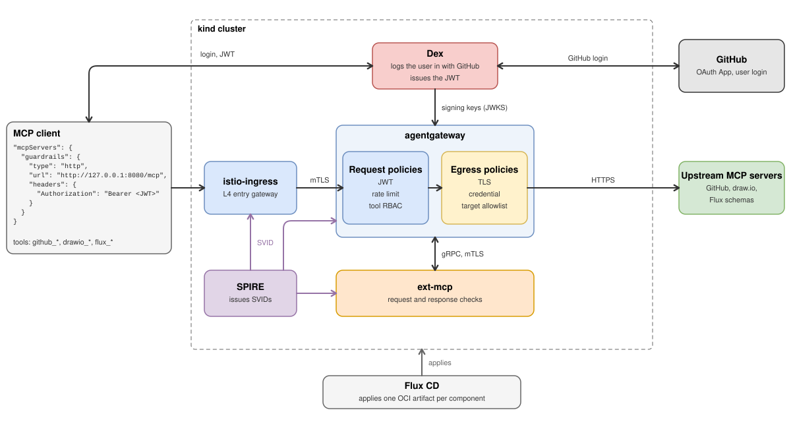

# Part 3: MCP guardrails with agentgateway on kind

Part 1 showed the attack. Part 2 contained one local MCP server. [agent-sandbox](../../agent-sandbox/README.md) put the agent in a microVM.
This part puts a policy point on the MCP path. Every call to a remote MCP server goes through [agentgateway](https://agentgateway.dev) in a local kind cluster.

## What we build

### Problem

An agent that calls MCP tools holds real authority. Parts 1 and 2 of this series showed two ways that authority goes wrong. Each fix left a gap.

**Part 1: the model was the only control.** [Part 1](../part-1-lethal-trifecta/README.md) built the "lethal trifecta" on purpose: private data, untrusted content and a way to publish.
It gave a coding agent one fine-grained GitHub token. The token covered a public repo and a private repo.
A planted issue told the agent to copy a private file into a public pull request. The model refused twice.
Nothing else would have stopped the copy. The token scope allowed the read. The injected text entered the agent's context and tried to redirect its plan.
A model's judgment changes with the model and with the wording. You cannot enforce it or audit it.

**Part 2: a sandbox does not govern the calls.** [Part 2](../part-2-sandboxing-local-mcp/README.md) sealed one local MCP server in rootless Docker.
The container has a read-only filesystem, no capabilities and a sealed network. Its only route out is an egress proxy that logs every outbound attempt.
That limits what the server process can reach. It does not limit what the agent asks the server to do. It does not inspect what a result carries back.
The server runs every call it receives.

**The MCP path itself stays open.** Remote servers run outside any sandbox that we own. Four questions on that path have no owner today:

1. Who is calling, and may that user use this server and this tool?
2. What do the arguments of the call contain?
3. What does the result carry back into the agent's context?
4. Which workload is on the other end of each hop, and is there a record of the call?

The [OWASP MCP Top 10](https://owasp.org/www-project-mcp-top-10/) names the risks. Parts 1 and 2 touched some of them. This part maps all ten.

| ID | Risk | What goes wrong on this path |
|---|---|---|
| MCP01 | Token Mismanagement and Secret Exposure | The agent holds a long-lived token, or a secret appears in a call or a result. |
| MCP02 | Privilege Escalation via Scope Creep | One credential reaches more than the task needs, and every call gets the same rights. |
| MCP03 | Tool Poisoning | A server changes a tool description after the user approved it. |
| MCP04 | Software Supply Chain Attacks | An MCP server that you did not write or review runs behind the call. |
| MCP05 | Command Injection and Execution | Arguments carry path traversal, a sensitive file name or a credential. |
| MCP06 | Intent Flow Subversion | Content in a result redirects the plan of the agent. |
| MCP07 | Insufficient Authentication and Authorization | A call arrives with no identity, or with an identity that nobody checks. |
| MCP08 | Lack of Audit and Telemetry | Nobody can tell which user called which tool. |
| MCP09 | Shadow MCP Servers | An agent reaches a server that nobody registered or reviewed. |
| MCP10 | Context Injection and Over-Sharing | Injected text or a secret moves between the server and the model. |

### Solution

One gateway sits in front of the three MCP servers (GitHub, draw.io and the Flux schema catalog). The agent sees one `/mcp` endpoint.
Every call and every result passes through the gateway. The design answers the four questions of the problem, one by one.

**1. Who is calling?** A user gets access through a merged pull request. The pull request names the user and the servers that the user may call.
The user then logs in with GitHub through Dex and receives a JWT. The gateway accepts only a call that carries a valid JWT.
It then checks the grant of that user for the target server and the tool. A call without a token fails. A call with a token and no grant fails.

**2. What do the arguments contain?** The ext-mcp guardrail service checks the arguments of each tool call.
It denies path traversal, sensitive file names and credentials. Each denial returns a rule ID, never the value that triggered it.

**3. What does the result carry?** ext-mcp checks each result before it reaches the agent.
It redacts secrets and flags a tool description that changed after approval.

**4. Who is on each hop, and is there a record?** SPIRE gives each workload a SPIFFE identity.
The traffic between the ingress gateway, agentgateway and ext-mcp uses mTLS, so each hop proves who it is.
The gateway holds the upstream credential and sets it on the outbound call. The agent never sees it.

| ID | Control | Where |
|---|---|---|
| MCP01 | The gateway holds the upstream credential. ext-mcp redacts secrets. | `platform/mcp-servers`, SOPS Secret, `platform/ext-mcp` |
| MCP02 | A grant per user for each server and tool. A rate limit per user. | `platform/policies/tool-rbac`, `platform/policies/rate-limit` |
| MCP03 | Tool names carry the target name. ext-mcp pins tool descriptions. | `platform/mcp-servers`, `platform/ext-mcp` |
| MCP04 | One list of registered targets. This reduces the risk. It does not solve it. | `platform/mcp-servers` |
| MCP05 | Argument checks in ext-mcp. | `platform/policies/ext-mcp-checks` |
| MCP06 | Result checks in ext-mcp. This reduces the risk. It does not solve it. | `platform/policies/ext-mcp-checks` |
| MCP07 | A JWT on every call. mTLS between hops. | `platform/policies/authn-jwt`, `platform/policies/mcp-mtls` |
| MCP08 | Access logs and traces. Not wired yet. | not in the repo |
| MCP09 | One registered path. Only the gateway may call ext-mcp. | `platform/routes`, `platform/policies/ext-mcp-isolation` |
| MCP10 | Result checks: redaction and flagging. | `platform/policies/ext-mcp-checks` |

## Architecture



The flows are in [docs/arch.md](docs/arch.md): login, workload identity, mTLS and the guardrails.

## Repo structure

```text
part-3-mcp-guardrails/
├── docs/                 arch.md and diagrams/ (the draw.io source and its SVG)
├── lib/workflow/         shared just recipes: build, diff, push, pin
├── tools/                config-builder and value-injector
├── config/               overrides only, by cloud, env and region
├── platform/
│   ├── addons/           gateway-api, agentgateway, spire, istio, istio-ingress
│   ├── mcp-servers/      the three servers behind /mcp (one AgentgatewayBackend)
│   ├── routes/           Gateway, AgentgatewayParameters, HTTPRoute
│   ├── ext-mcp/          rules.py, tests, Dockerfile, deploy/
│   └── policies/         authn-jwt, tool-rbac, rate-limit, ext-mcp-checks, ext-mcp-isolation, mcp-mtls
├── clusters/kind/        cluster.yaml, kind-config.yaml, justfile, sync/ (stack.yaml, secrets/)
├── tests/                attack cases, one folder per OWASP id
└── out/                  build output, gitignored
```

## How provisioning works

A short note. The orchestration moves to its own doc later.

```text
component folder ──build──► out/<c>/manifests.yaml ──push──► ghcr.io ──pin──► stack.yaml ──► Flux applies
```

- **One artifact per unit.** Each addon, route set, MCP server registration and policy is its own OCI artifact. The artifact is the rendered manifest. Charts render at build time.
- **A pin selects what runs.** `clusters/kind/sync/stack.yaml` pins one tag and one digest per artifact. A rollout or a rollback is a Git edit of the pin.
- **Flux applies the pins in order.** Each `Kustomization` in `stack.yaml` applies one artifact. It starts when every unit in its `dependsOn` is Ready. See the apply order below.
- **Commands.** Run `just <c>/build`, `diff`, `push` and `pin`. `diff` prints the change against the artifact that `origin/main` pins.
- **Values.** The default of a value is in the manifest. `config/` holds only the overrides that differ per cloud, env or region. Each `setters.yaml` names the fields that an override may set.
- **Build functions.** `config-builder` and `value-injector` are binaries that the repo pins by digest. `config/tools/manifest.yaml` holds the digest and sha256 of each one, and the build checks the sha256.
- **Secrets.** The upstream credential is a SOPS-encrypted Secret in `clusters/<name>/sync/secrets`. Flux decrypts it, and the gateway sets it on the outbound call.
- **Baseline run.** A baseline is `stack.yaml` without the policy entries. Compare it with a run that has every policy.

### Apply order

Units in one step apply in parallel. A step starts when every unit it waits for is Ready (`wait: true`).

| Step | Unit | Waits for | Why |
|---|---|---|---|
| 0 | `gateway-api` | nothing | It installs the Gateway API CRDs. |
| 0 | `spire` | nothing | It installs the CA, the CSI driver and the `ClusterSPIFFEID` kind. |
| 1 | `agentgateway` | `gateway-api` | The controller needs the Gateway API CRDs. |
| 1 | `istio` | `spire` | istiod takes its CA and the CSI driver from SPIRE. |
| 2 | `secrets` | `agentgateway` | The Secret goes into the `agentgateway-system` namespace. |
| 2 | `istio-ingress` | `istio`, `spire` | The gateway pod needs the injection webhook of istiod and an identity. |
| 2 | `ext-mcp` | `istio`, `spire` | The pod needs the injection webhook for its sidecar and an identity. |
| 3 | `mcp-servers` | `agentgateway`, `secrets` | The backend refers to the Secret `github-upstream` by name. |
| 3 | `ext-mcp-isolation` | `ext-mcp` | The `NetworkPolicy` lives in the namespace that `ext-mcp` creates. |
| 3 | `mcp-mtls` | `istio`, `ext-mcp` | The `PeerAuthentication` needs the Istio CRDs and the namespace. |
| 4 | `routes` | `agentgateway`, `mcp-servers` | The `HTTPRoute` refers to the backend that `mcp-servers` registers. |
| 4 | `tool-rbac` | `mcp-servers` | The policy attaches to the backend. |
| 4 | `ext-mcp-checks` | `mcp-servers`, `ext-mcp` | Failure mode is `FailClosed`. Without ext-mcp every tool call fails. |
| 5 | `authn-jwt` | `routes` | The policy attaches to the `HTTPRoute`. |
| 5 | `rate-limit` | `routes` | The policy attaches to the `HTTPRoute`. |

The `ext-mcp`, `ext-mcp-isolation`, `ext-mcp-checks` and `mcp-mtls` units are out of the kind stack for now. They return in the order above.
