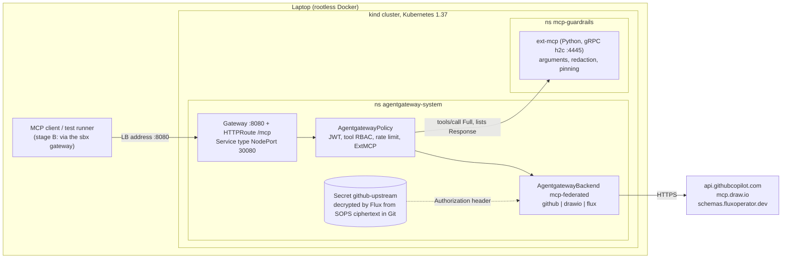
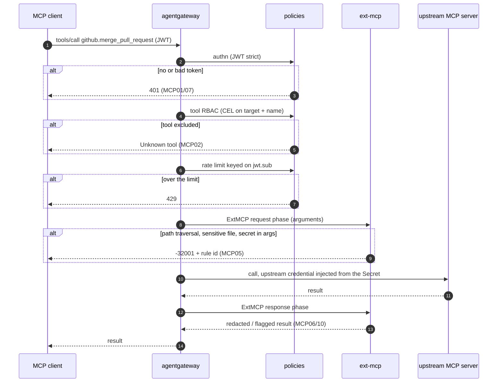
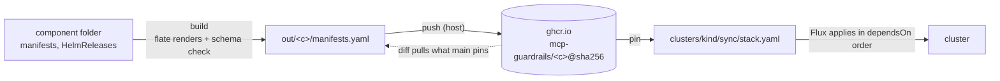
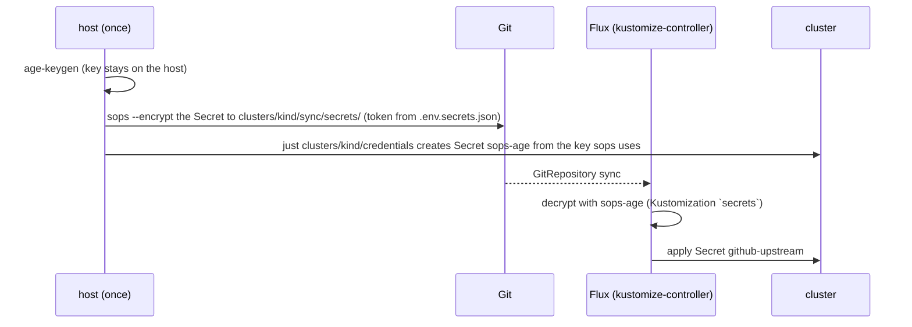

# Part 3: MCP guardrails with agentgateway on kind

Part 1 showed the attack. Part 2 contained one local MCP server. [agent-sandbox](../../agent-sandbox/README.md) put the agent in a microVM. This part puts a **policy point on the MCP path**: every call to a remote MCP server goes through [agentgateway](https://agentgateway.dev) in a local kind cluster, where tool, argument and response rules apply, mapped to the [OWASP MCP Top 10](https://owasp.org/www-project-mcp-top-10/).

> **Status (stage A).** Manifests, Flux stack, cluster folder and justfiles are written. `just <component>/build` renders and validates the components with the real charts (`istio` and `mcp-mtls` are new: see the Istio paragraph below).
> **Not yet run on a cluster.** The `clusters/kind/*` recipes and `push` need the host (real ghcr.io token, your sops key) and refuse to run in the sandbox.
> Stage B (chaining the sbx gateway to this one, Keycloak) follows a spike.

## What this builds

- **A gateway in front of three remote MCP servers** (GitHub, draw.io, the Flux schema catalog) behind one `/mcp` endpoint with target-prefixed tool names.
- **Two runs to compare**: baseline (gateway in path, nothing enforced) and every policy on. A baseline stack is `stack.yaml` without the policy and `ext-mcp-isolation` entries.
- **One artifact per deployable unit**: each addon, route set, MCP server registration and policy is its own OCI artifact. A cluster's `stack.yaml` pins which one it runs, so rollout and rollback of one unit is a Git edit of its pin.
- **The artifact is the rendered manifest**: what you review is what Flux applies. Charts are rendered at build time, nothing is inflated in the cluster.

## Architecture



## One request, step by step



## How an artifact is made

Every component folder has a justfile that imports [`lib/lib.just`](lib/lib.just). Name the folder to run a recipe: `just platform/routes/build`. Run `just` for the list.



| Command | What it does |
|---|---|
| `just <c>/build` | applies the config values to a copy of the folder (when it has a `setters.yaml`), flate renders it, charts included, checks it against the Kubernetes, Flux and ecosystem schemas, writes `out/<c>/manifests.yaml`: the artifact |
| `just <c>/diff` | prints the change against the artifact `origin/main` pins: the rendered objects, not the source files. `just --set base <rev> <c>/diff` for another revision. CRDs and Secrets are not shown (`FLATE_SKIP_CRDS=false` shows CRDs) |
| `just <c>/push` | builds, then pushes the artifact as `ghcr.io/raghav19/mcp-guardrails/<c>:<commit>` (host) |
| `just <c>/pin` | writes the pushed tag and digest into `stack.yaml`; commit it in a pull request |

`out/<c>/` is gitignored, and so is `out/values.yaml` (the converged config of the cluster, written by every build). Only `manifests.yaml` is pushed:

```text
out/routes/
├── manifests.yaml    the artifact
├── build/ks.yaml     the Flux Kustomization flate reads to render the folder (flate renders Flux objects, not folders)
├── build/src/        the folder with the config values applied (only for a folder with a setters.yaml)
├── diff/ks.yaml      the same, for baseline/
├── baseline/         the artifact main pins, pulled by diff
└── push.json         tag and digest of the last push, read by pin
```

Good to know:

- A HelmRelease and its chart source are replaced by the objects the chart renders. A chart hook becomes a plain object; the v1.6.0 charts have none. flate renders for Kubernetes 1.37.0 and has no `lookup`.
- CRDs and Secrets stay in the artifact. Every CRD carries `kustomize.toolkit.fluxcd.io/prune: disabled`, so Flux never deletes one (that would delete every custom resource of its kind). Remove them with `just clusters/kind/delete-crds`.
- flate 0.6.5 does not know some kinds are cluster-scoped and puts a namespace on them. `cluster_scoped` in `lib/lib.just` lists them and the build removes it.
- `kustomization.yaml` in a folder is only a build index. A Flux `Kustomization` in `stack.yaml` applies one artifact (order, health).

### How a value gets in

The default of a value is the manifest of its component, so the manifest stays complete and readable. `config/` holds only what differs per cloud, env or region. A component's `setters.yaml` lists the fields `config/` may override, and a function puts the override there. No manifest holds a placeholder.

```text
<component>/*.yaml                           the manifest: holds the default of every value
<component>/setters.yaml                     which config name overrides which field of this folder
config/*.yaml                                global: the same on every cloud (none yet)
config/cloud/*.yaml
config/cloud/<cloud>/*.yaml                  e.g. config/cloud/local/ (kind: trust_domain, cluster_name), config/cloud/aws/
config/cloud/<cloud>/<env>/*.yaml            e.g. config/cloud/aws/dev/
config/cloud/<cloud>/<env>/<region>/*.yaml   e.g. config/cloud/aws/dev/us-east-1/
clusters/<name>/cluster.yaml                 placement: cloud/local        (later cloud/aws/dev/us-east-1)
```

A level that does not exist is skipped: kind has a cloud and nothing below it. Put an override at the highest level where it is still true. A value that more than one component uses (the trust domain) is config, not the default of one component, and sits where it holds: `mcp.local` is true for the local cloud only, so it is under `config/cloud/local/`.

- **Converge.** Every build reads every `*.yaml` of `config/` and of each folder on the cluster's placement, and writes the flat result to `out/values.yaml` (each override with the file it came from). It holds overrides only; the effective value is in `out/<c>/manifests.yaml` and shown by `just <c>/diff`. A file lower on the path wins and is printed. A value that is a map or list fails, so does the same name in two files of one level, and so does a name that no `setters.yaml` lists (a misspelt override). The file names in `config/` mean nothing: name them by component or app.
- **Apply.** `<component>/setters.yaml` lists, per name, the fields it overrides: `object: Kind/name` and a dotted `path`, where a number is a position in a list. A chart value is a field of its HelmRelease, so its path starts at `spec.values`; for `kustomization.yaml` the object is `Kustomization` with no name. The build copies the folder to `out/<c>/build/src/`, sets those fields from `out/values.yaml` and lets flate render the copy; the source is never edited. A folder without a `setters.yaml` is built as before.
- **Default or required.** A name with a value overrides the field. A name without one leaves the field as the manifest has it: that is the default. If the manifest has no such field, the value is required and the build fails without it. `trust_domain` and `cluster_name` are required: they differ per cloud, and the chart's own default (`example.org`) would issue identities in the wrong domain.
- **What fails.** A setter whose object is not in the folder, a position that does not exist, a required name without a value, two names writing one field, and a config name nothing lists.
- **One name, many fields.** Several components can list the same name (the trust domain in spire and istio), so the value cannot disagree.

```yaml
# platform/routes/gateway.yaml            # platform/routes/setters.yaml                 # config/cloud/aws/dev/us-east-1/gateway.yaml
listeners:                                gateway_port:                                  gateway_port: 8443
  - name: http                              - object: Gateway/agentgateway-proxy
    port: 8080   # the default                path: spec.listeners.0.port
                                            - object: AgentgatewayParameters/agentgateway-proxy
                                              path: spec.service.spec.ports.0.port
```

The chart's own defaults stay in the chart; the `values:` of a HelmRelease holds what this stack sets differently, and `config/` overrides it per cluster. A list element is addressed by position: the targets of `platform/mcp-servers` are `0` github, `1` drawio, `2` flux, so reordering them in `backend.yaml` moves the overrides with it. Config names are one flat namespace: prefix them (`gateway_port`, not `port`).

Changing an override changes every artifact that sets it, so each is pushed and pinned again. Changing a default is an edit of the manifest and shows in `just <c>/diff`. The functions are `config-builder` and `value-injector` in `lib/tools/`, each its own pinned artifact ([below](#how-the-functions-are-pinned)).

Not covered by it: `clusters/kind/kind-config.yaml` (host port 8080 to NodePort 30080) and the default URL of `tests/justfile`. They are not components, so keep them equal to the gateway port by hand.

### How the functions are pinned

`config-builder` and `value-injector` are Python scripts, but a build never runs them from the working tree and never calls `uv`. Each is built by uv into one binary (PyInstaller, carrying the interpreter and PyYAML) and pushed as its own OCI artifact: one file in the registry, not a container image. Their digests are config, in `config/tools/manifest.yaml` (not in `lib/`, which every component imports); `_tools` pulls each once into `out/.tools/<name>/<digest>/` and links `out/.tools/<name>/<name>` to it. Nothing is installed and no network is used when a function runs.

```text
lib/tools/{pyproject.toml, uv.lock}  +  lib/tools/<name>/{<script>.py, justfile}
   │  just lib/tools/<name>/push      (host)  one push, prints:
   │                                    <name>:
   │                                      digest: 'sha256:<the artifact>'
   │                                      binary: 'sha256:<the executable inside it>'
   ▼
ghcr.io/raghav19/mcp-guardrails/tools/<name>:sha256-<sha of the binary>      the block goes into config/tools/manifest.yaml
```

- **Two recipes:** `build` first runs `ruff check` and `ruff format --check` on the script (ruff 0.17.0 from `uv.lock`, line length 140 in `pyproject.toml`), so a script that fails ruff is never built or pushed. It then runs `uv run --locked`, so exactly what `uv.lock` says (it fails when `pyproject.toml` and `uv.lock` disagree), and needs only `uv` and `objdump` (binutils) on the machine. `push` depends on `build`, pushes and prints the pin. The Python is uv's own 3.13.15 (`python-build-standalone`), so the binary needs glibc 2.14 or newer and runs on Debian 12.
- **Versions are pinned in one file,** `lib/tools/pyproject.toml` (PyYAML, and PyInstaller in the `build` group). Change one, run `uv lock` in `lib/tools`, commit `uv.lock`.
- **The identity of a function is the sha256 of its binary.** The build is deterministic (fixed Python 3.13.15, `PYTHONHASHSEED=1`, locked dependencies), so the same inputs give the same binary on any checkout path. The binary's sha256 is known before the push, so it is the tag (`sha256-<hex>`, the form cosign uses for digest tags) and one push makes one tag. The push is reproducible too (`--reproducible`, and a `--revision` taken from the binary, not from `HEAD`), so the same binary gives the same artifact digest. `push` on an unchanged function prints the same line. If a machine ever builds different bytes (another uv bringing another build of Python 3.13.15), the printed line differs: compare it with the one in `config/tools/manifest.yaml` before pasting. `manifest.yaml` holds both the artifact `digest` and the `binary` sha256; `_tools` checks the binary against it on every build, so a pin that names the wrong contents stops the build.
- **A script edit needs a push and a new block in `config/tools/manifest.yaml`**, even a comment-only edit (the line table is in the bundle, so the binary changes); until then builds keep running the pinned digest. To try an edit first, run `uv run --project lib/tools python lib/tools/<name>/<script>.py <args>`, or the binary of `just lib/tools/<name>/build` from `out/tools/<name>/`.
- **Why `config/tools/` and not `config/*.yaml`:** `config-builder` converges `config/*.yaml`, so it cannot read its own pin from that output, and it rejects any name no `setters.yaml` lists. `config/tools/` is not on a placement path, so it is skipped, and the pins are global (the same on every cloud).
- **Roll back** by `git revert` of the block in `config/tools/manifest.yaml`. The old digest is still in the registry.

### How a secret gets in



The agent never holds this value: the gateway reads the Secret and sets the upstream `Authorization` header. The Secret reaches the cluster from `clusters/<name>/sync/secrets` through Flux, never through a component folder. The sandbox VM has neither the token nor the age key.

## Directory structure

```text
part-3-mcp-guardrails/
├── justfile                     `just` prints the commands
├── lib/                         lib.just (build, diff, push, pin: imported by every component justfile)
│   └── tools/                   pyproject.toml, uv.lock, config-builder/, value-injector/ (script, justfile), tools.just (build, push)
├── config/                      overrides only: *.yaml global, then cloud/<cloud>/<env>/<region>/, flat name: value
│   └── tools/manifest.yaml          the digests of the build functions (lib/tools); outside the levels above, see "How the functions are pinned"
├── platform/
│   ├── addons/                  gateway-api (CRDs); agentgateway (namespace, CRD chart, controller chart); spire (namespace, CRD chart, spire chart); istio (namespaces, base, istiod, ingress gateway, gateway identity)
│   ├── mcp-servers/             the registered MCP servers behind /mcp (one AgentgatewayBackend)
│   └── routes/                  Gateway, AgentgatewayParameters, HTTPRoute
├── policies/                    one folder per control: authn-jwt, tool-rbac, rate-limit, ext-mcp-checks, ext-mcp-isolation, mcp-mtls
├── services/ext-mcp/            rules.py (+ tests), Dockerfile, deploy/ (the artifact)
├── clusters/kind/               one folder per cluster
│   ├── cluster.yaml             placement in config/ (cloud/local)
│   ├── justfile                 up, credentials, down, delete-crds (host only)
│   ├── kind-config.yaml         read by `up`
│   └── sync/                    read by Flux: stack.yaml (pins, order, health), flux-instance.yaml, secrets/ (age ciphertext)
├── tests/                       justfile (run), attacks/ (one folder per OWASP id), servers/evil-mcp (fixture stub)
└── out/                         gitignored, see above
```

An **artifact** is one deployable unit. Its folder, justfile, Kustomization in `stack.yaml` and pin have the same name (`services/ext-mcp` is `ext-mcp`).
The thirteen artifacts: `gateway-api`, `agentgateway`, `spire`, `istio`, `mcp-servers`, `routes`, `ext-mcp`, `ext-mcp-isolation`, `mcp-mtls`, `authn-jwt`, `rate-limit`, `tool-rbac`, `ext-mcp-checks`. `secrets` is read from Git and is not an artifact.
`spire` is the CA of trust domain `mcp.local`: the server in the cluster signs, the node agents attest to it (`k8s_psat`), and a join token (`join_token`) is enabled for the agent of a microVM later. Istio takes its CA from it (below). Identities are opt-in: the chart's `ClusterSPIFFEID`s are off, so a workload gets an SVID only when a `ClusterSPIFFEID` selects it.

`istio` is the mesh, in **sidecar mode only** (no ambient, no `istio-cni`, no `ztunnel`): `base` (CRDs), `istiod` and an ingress gateway in namespace `istio-ingress`. The three charts are one release, so one name, `istio_version` in `config/versions.yaml`, sets the three versions; the chart versions have no default in the manifests. SPIRE is the CA: a proxy gets its SVID from the SPIFFE Workload API socket that the CSI driver of `spire` mounts (the `spire` injection template in `istiod.yaml`), and `trust_domain` goes to both `spire` and `meshConfig.trustDomain`.
A namespace takes part by itself: the label `istio-injection: enabled`, the annotation `inject.istio.io/templates: sidecar,spire` on the pod, a `ClusterSPIFFEID` that selects it, and its own `PeerAuthentication`. Today only `mcp-guardrails` does (`ext-mcp`); `flux-system`, `spire-system` and the rest are untouched. There is no mesh-wide policy on purpose. A later MCP workload namespace repeats those steps.
The intended flow is host -> Istio gateway (L4) -> mTLS -> agentgateway (no sidecar; TLS with its own SPIRE identity, L7 checks) -> workloads. This pull request does not move the traffic: the gateway Service is ClusterIP, the host port 30080 still reaches agentgateway, and the `mcp-mtls` artifact (STRICT for `mcp-guardrails`) is `unpinned` until the client half exists (`AgentgatewayParameters.spec.spiffe` and a backend TLS policy with `certificateSource: SPIFFE`), because STRICT would otherwise reject the plain guardrail call.
A second cluster is a new `clusters/<name>/` folder with its own `stack.yaml`; one pushed artifact can be pinned by several clusters.

## Versions

| Item | Pin | Where |
|---|---|---|
| Kubernetes (kind node image) | v1.37.0 (kind 0.33.0 default) | `clusters/kind/kind-config.yaml` |
| Gateway API (standard channel) | v1.6.1 | `platform/addons/gateway-api/kustomization.yaml` |
| agentgateway (CRDs and controller) | v1.6.0, `just build` fails if the two tags differ | `platform/addons/agentgateway/` |
| SPIRE (CRD chart and spire chart) | spire-crds 0.6.1; spire 0.30.3 (SPIRE 1.15.3) | `platform/addons/spire/` |
| Istio (base, istiod, gateway: one release) | 1.31.1 (supports Kubernetes 1.32 to 1.37) | `config/versions.yaml` (`istio_version`), `platform/addons/istio/setters.yaml` |
| Flux (via the Flux Operator) | 2.9.6; operator chart 0.61.0 | `clusters/kind/sync/flux-instance.yaml`, `clusters/kind/justfile` |
| just / flate / kind / helm | 1.58 / 0.6.5 / 0.33.0 / 4.3.0 | root `mise.toml` |
| What a cluster runs | one tag (the commit) and one digest per artifact | `clusters/kind/sync/stack.yaml` |

## Getting started

Prerequisites: rootless Docker ([`code/rootless-docker`](../../rootless-docker)), `mise install` at the repo root, your age key for `sops`. Steps marked **host** run on your machine.

0. **Pin the build functions (host; already done for the current scripts).** After an edit of a function, or of `lib/tools/pyproject.toml`, run `just lib/tools/config-builder/push` and `just lib/tools/value-injector/push`, and put the block each prints into `config/tools/manifest.yaml`. A function that is not pinned there stops every build with that command.
1. **Look at what a cluster gets (anywhere).** `just platform/routes/build`, then `just platform/routes/diff`. The schema catalog needs the network; in the sandbox VM the chart registry needs a host approval first.
2. **Secret and keys (host, once).** Follow [`clusters/kind/sync/secrets/README.md`](clusters/kind/sync/secrets/README.md). Add `GHCR_USER`, `GHCR_PULL_TOKEN` and `GHCR_PUSH_TOKEN` (classic PAT, `read:packages` / `write:packages`) to `.env.secrets.json`.
3. **Push the artifacts (host).** `sops exec-env .env.secrets.json 'just platform/routes/push'`, then `just platform/routes/pin`; commit `stack.yaml` and open the pull request. Make the registry packages private.
4. **Create the cluster (host).** `just clusters/kind/up` (kind, Flux Operator, FluxInstance; needs no credential), then `just clusters/kind/credentials` (the `sops-age` and `ghcr-pull` Secrets). Watch: `kubectl -n flux-system get kustomizations`. Until the branch merges, set `spec.sync.ref` in `flux-instance.yaml` to your branch.
5. **Check the gateway.** `http://127.0.0.1:8080/mcp` (host port 8080 to NodePort 30080); `tools/list` should show `github_*`, `drawio_*`, `flux_*`.
6. **Run the attacks.** `just tests/run` (it refuses unless `kubectl`'s context is `kind-mcp-guardrails`). Results follow the stack: policy entries present means guarded, absent means baseline.
7. **Tear down.** `just clusters/kind/down`.

To change something: `just <c>/diff`, edit, `just <c>/build`, `just <c>/push`, `just <c>/pin`, open the pull request. Merging makes Flux apply the new pin.
To roll one artifact back: `git revert` the commit that pinned it. A change that needs two units moves both pins in one pull request; Flux applies them in `dependsOn` order.

## Policies and what they map to

Each policy is its own artifact, so one policy rolls out or back alone.

| Control | Folder | OWASP MCP | Test |
|---|---|---|---|
| JWT, strict | `policies/authn-jwt` | MCP01, MCP07 | `MCP07-no-token` |
| Upstream credential held by the gateway | SOPS Secret in `clusters/<name>/sync/secrets` + `platform/mcp-servers` `auth.secretRef` | MCP01 | (inspect: nothing client-side) |
| Tool deny list (CEL, target + name) | `policies/tool-rbac` | MCP02 | `MCP02-destructive-tool` |
| Rate limit per `jwt.sub` | `policies/rate-limit` | MCP02, MCP10 | to write |
| Argument and response checks, pinning | `policies/ext-mcp-checks` + `services/ext-mcp` | MCP03, 05, 06, 10 | `rules.py` unit tests; attack cases to write |
| Only the gateway may call ext-mcp | `policies/ext-mcp-isolation` | MCP04, MCP09 | to write |
| Access logs and traces | not wired | MCP08 | to write |

MCP04 (supply chain) and MCP06 (intent flow subversion) are reduced here, not solved.

## Known gaps and open risks

- **Gateway reachability is not verified.** cloud-provider-kind does not work on rootless Docker with pasta (no forwarding of 32768-60999), so `kind-config.yaml` maps host `127.0.0.1:8080` to NodePort 30080, pinned in `platform/routes/parameters.yaml`. No request has gone through yet. This is the first thing to prove.
- **Nothing has run on a cluster:** `push`, `pin`, `clusters/kind/*`, the Flux sync and the health gates need the host.
- **The first push of `agentgateway` changes its format.** The current pin holds two HelmReleases; the new one holds the rendered objects with the same names. On a cluster that already runs the old pin, helm-controller uninstalling the release could remove objects Flux just applied, so check that cut-over. A fresh cluster is fine.
- **Unchecked against a live controller:** the status conditions of `AgentgatewayPolicy` and `AgentgatewayBackend` (no CEL health check yet), the `Programmed` gate of `Gateway`, the secret key convention (`Authorization`, raw token), how two policies on one backend merge, and that an OCIRepository prefers `ref.digest` over `ref.tag` (`pin` writes both; `diff` pulls the digest).
- **Credentials are untested:** `GITHUB_TOKEN` against the GitHub MCP server. **JWKS is a placeholder** (the default in `policies/authn-jwt/policy.yaml`, override `jwt_jwks`) until Keycloak in stage B.
- **ext-mcp has rules but no server yet.** Argument-level CEL is unreliable in agentgateway ([#3092](https://github.com/agentgateway/agentgateway/issues/3092)), which is why argument checks live in ext-mcp.
- **Unplugging a USB device while the cluster runs could break new privileged pods** (runc fails on the vanished `/dev` entry). `kind-config.yaml` sets `privileged_without_host_devices = true`; its effect is not confirmed on a host. If it happens, recreate the cluster.
- **No CI and no signing yet.** `push` is a host recipe and the registry is the trust root. CI (`just <c>/diff` as a pull request comment), cosign and SBOM are next.
