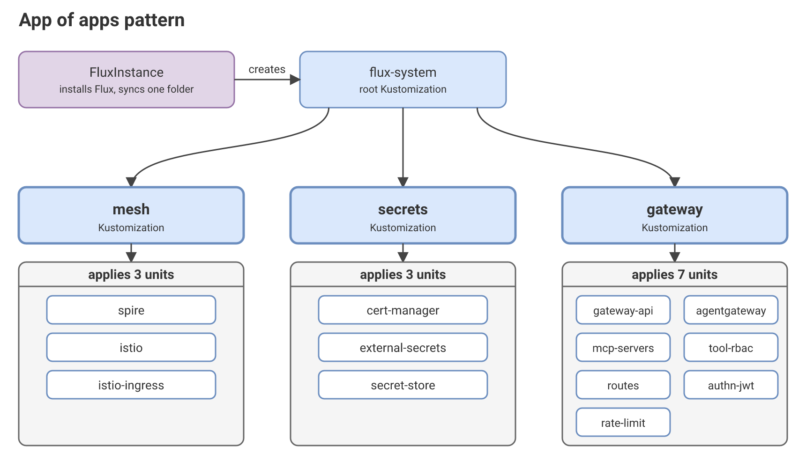
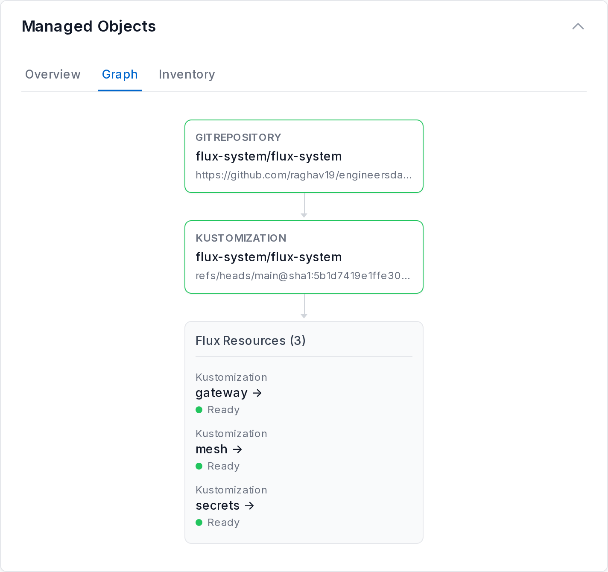
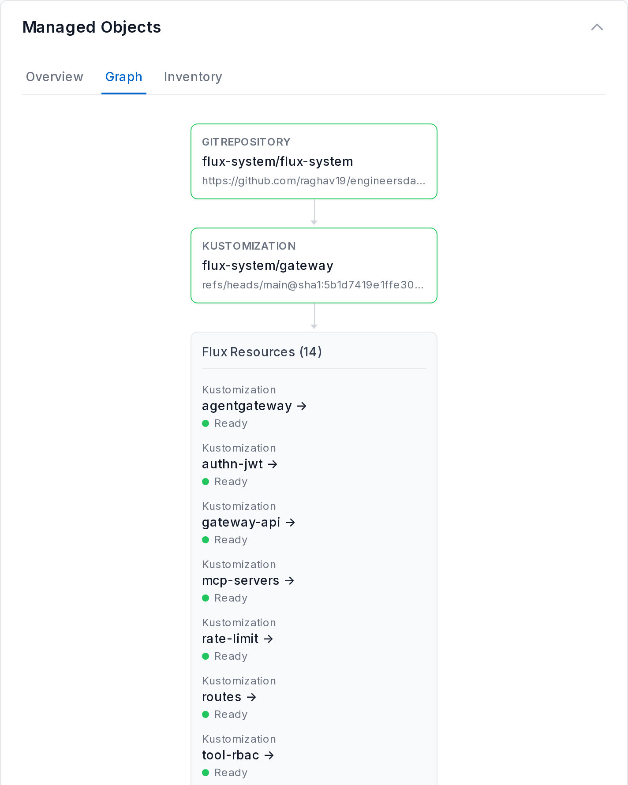

# the app of apps pattern

## 1. What the pattern is

An app of apps is a root object that applies group objects. Each group object applies the units of one dependency chain.

In Flux, the root is a `Kustomization` and each group is a `Kustomization`. A unit is an `OCIRepository` with its own `Kustomization`. Flux has no `Application` kind, so the pattern uses `Kustomization` objects at both levels.

Part 3 has one root, three groups and 13 units. The groups are `secrets` (3 units), `mesh` (3 units) and `gateway` (7 units).

## 2. The problem and the purpose

A platform stack has many units that depend on each other. For example, `cert-manager` comes first, then `external-secrets`, then `secret-store`.

If the root applies all units, the stack has three problems:
- A reader sees one long list of 13 objects. The list shows no chains.
- Each unit has its own `Ready` condition. No single object answers the question "is the gateway chain healthy?"
- A new workload joins the same list. The list has no place for it.

The purpose of the pattern is to give the stack one level in the middle. A group holds one chain, so one object shows the health of the chain. A new workload becomes a new group.

## 3. Diagram

The root `flux-system` applies three group `Kustomization` objects. Each group applies its own units.




## 4. Flat and grouped: comparison

| Criterion | Flat: the root applies every unit | Grouped: the root applies groups |
|---|---|---|
| Objects under the root | 13 units. | 3 groups. |
| Health of a chain | One `Ready` condition for each unit. | One `Ready` condition for each group. The group uses `wait: true`. |
| A new workload | A new unit in the one list. | A new group. Its units name what they need. |
| Ordering | `dependsOn` on the units. | The same. Units also name units in other groups. |
| Deleting a group | Not applicable. | Units stay, because the groups use `deletionPolicy: Orphan`. |
| Permissions for each chain | One set for all units. | A group can use its own `serviceAccountName`. Part 3 does not use it yet. |

## 5. App of apps and generators

An app of apps composes units that you wrote. Each unit has its own content and its own `dependsOn`.

A generator makes many units of the same shape from one template and a list of inputs. The Argo CD generator is `ApplicationSet`. The Flux Operator generator is `ResourceSet`.

The two work at different levels, and one setup can use both. A group of an app of apps can hold units that a `ResourceSet` makes.


## 6. Getting started

### The structure

Flux reconciles the folder `sync/local-kind`:

```text
sync/local-kind/
├── kustomization.yaml
├── apps.yaml   # the three groups: mesh, secrets and gateway
└── infra/
    ├── mesh/
    │   ├── kustomization.yaml
    │   └── stack.yaml        # the units of the group
    ├── secrets/
    │   ├── kustomization.yaml
    │   └── stack.yaml
    └── gateway/
        ├── kustomization.yaml
        └── stack.yaml
```

### See the tree

Run this command on the host:

```shell
flux tree kustomization flux-system -n flux-system --context kind-mcp-guardrails
```

### Screenshots





The UI shows one level in each view. It does not draw `dependsOn`. To see that `mcp-servers` waits for `secret-store`, open `mcp-servers` and read the tab Specification.

## 7. Limits

- A group sets `deletionPolicy: Orphan`. Deleting a group from `apps.yaml` then leaves its units running. This helps in two cases:
  - A mistaken edit or revert of `apps.yaml` does not take a chain down. The units keep running until you decide what to do.
  - You can take a chain down in order. Flux does not delete in `dependsOn` order, so the default policy deletes all units at once. With `Orphan`, you delete the units yourself. The units that nothing waits for go first.
- A group has no `dependsOn` on another group. The groups share one `GitRepository`. A test on 2026-10-21 showed that the second group then waits for each new revision of the first. Each retry took about 30 seconds.
- A suspended group does not suspend its units. The units are separate objects, so they should keep reconciling. To freeze a group, suspend each unit.
- The `timeout` of a group must be longer than the longest `dependsOn` chain that the group waits for. The chain can run through another group. `gateway` has 25 minutes.
- The only `dependsOn` between two groups is `mcp-servers` in `gateway` on `secret-store` in `secrets`.
