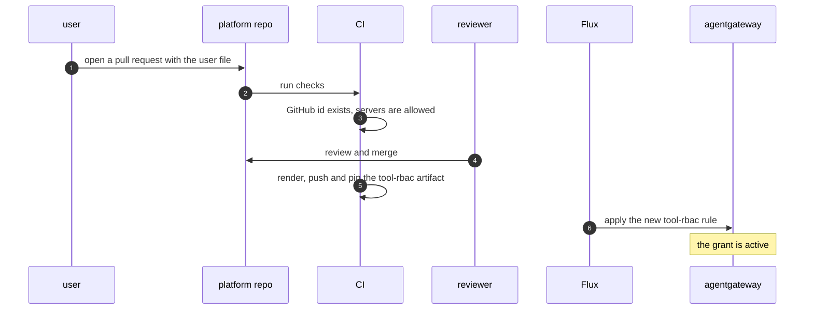
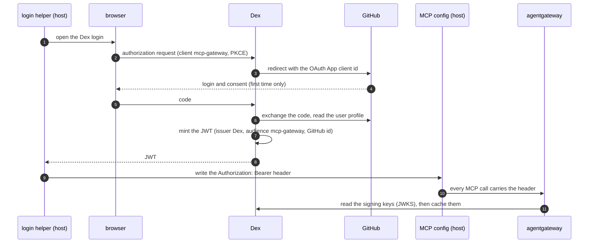
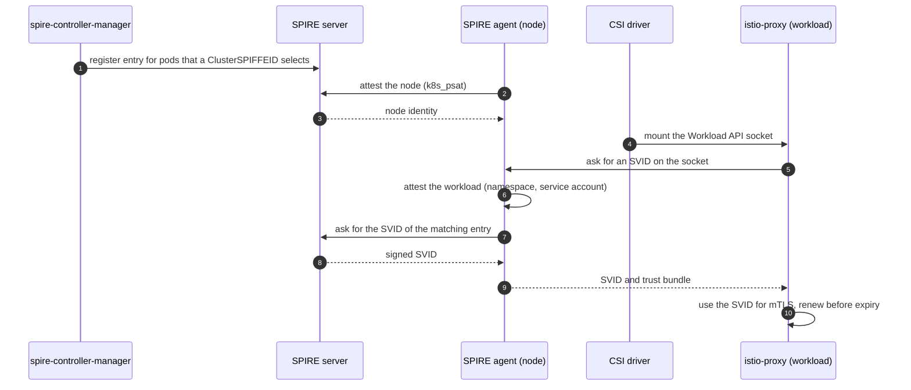
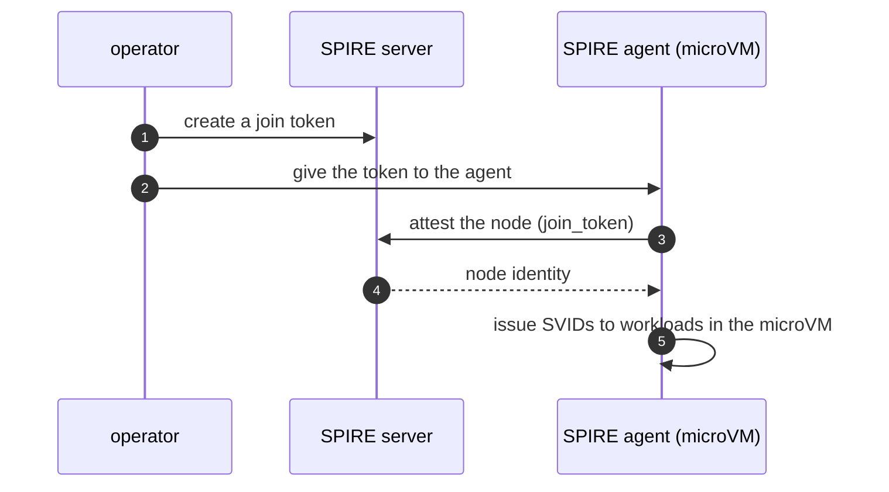
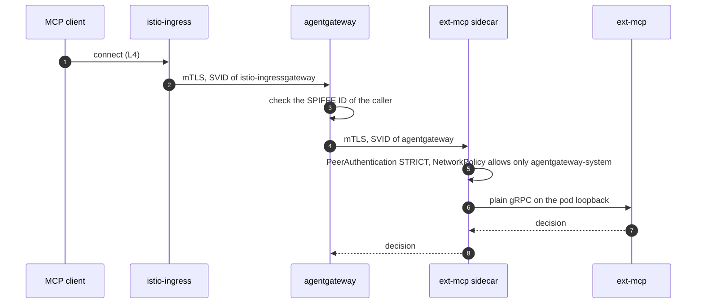
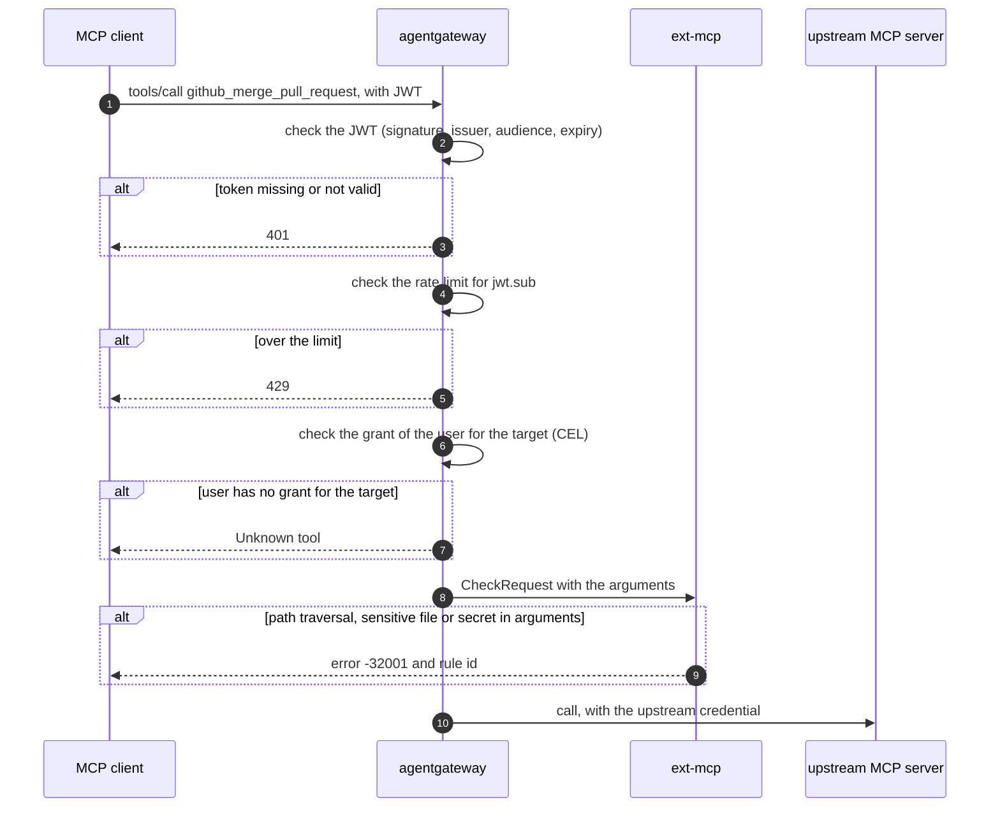
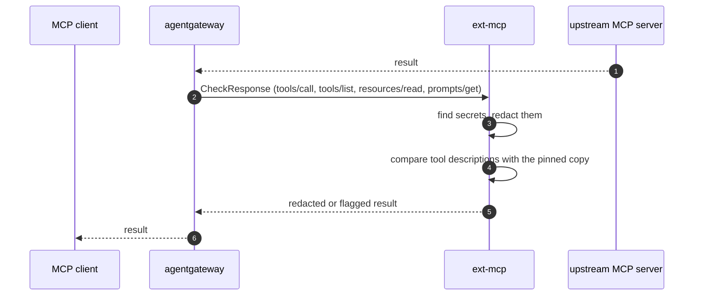

# Part 3: MCP guardrails architecture

## 1. Terms

The problem and the solution are in the [README](../README.md#what-we-build).

| Term | Meaning |
|---|---|
| MCP | Model Context Protocol. The agent uses it to call tools. |
| SPIFFE ID | The name of a workload, for example `spiffe://mcp.local/ns/mcp-guardrails/sa/ext-mcp`. |
| SVID | The short-lived certificate that proves a SPIFFE ID. |
| SPIRE | The system that attests workloads and issues SVIDs. |
| mTLS | TLS where both sides show a certificate. |
| ext-mcp | The guardrail service. The gateway calls it over gRPC. |
| GitHub OAuth App | The app that lets a user prove who they are on GitHub. The platform owner registers it once. |
| Dex | The OIDC provider. It lets a user log in with GitHub and mints the JWT for the gateway. |
| JWT | The signed token the client sends with each call. The audience is `mcp-gateway`. |
| Grant | The list of MCP servers one user may call. It comes from a file in the platform repo. |

## 2. High-level architecture


The source is `diagrams/architecture.drawio`. See [diagrams](diagrams/README.md) to open it in draw.io.

| Component | Job | Namespace |
|---|---|---|
| GitHub OAuth App | Proves who the user is, once, at login. | github.com, outside the cluster |
| `dex` | Logs the user in with GitHub. Mints the JWT. | `dex` |
| `istio-ingress` | Accepts the client connection at L4. Passes it to agentgateway as mTLS. | `istio-ingress` |
| `agentgateway` | Serves `/mcp`. Applies the policies. Calls ext-mcp. Calls the upstream servers. | `agentgateway-system` |
| `ext-mcp` | Checks tool arguments and results. Returns allow, deny or a redacted result. | `mcp-guardrails` |
| `spire` | Attests workloads. Issues SVIDs. | `spire-system` |
| `istio` | Runs the sidecars. Enforces mTLS with the SVID from SPIRE. | `istio-system` |
| `flux` | Applies each component from its OCI artifact. | `flux-system` |
| Secret `github-upstream` | Holds the GitHub credential. Flux decrypts it from SOPS. | `agentgateway-system` |

The pins of the OCI artifacts are in `clusters/kind/sync/stack.yaml`.

The four flows follow this diagram from left to right.
A is the login (GitHub, Dex). B is the identity (SPIRE). C is the connection (ingress, gateway, ext-mcp). D is the call (policies, egress, upstream).

### Egress policies of agentgateway

agentgateway applies the egress policies to every call to an upstream server. They are fields of each target in `AgentgatewayBackend mcp-federated`, not separate policy objects.

| Control | Setting | Effect |
|---|---|---|
| Target allowlist | `static.host`, `port`, `path` per target | The gateway reaches only the registered servers. |
| TLS to upstream | `policies.tls.sni` | The gateway opens HTTPS to the upstream. |
| Credential | `policies.auth.secretRef` | The gateway sets the `Authorization` header. The agent never holds it. |
| Tool names | `prefixMode: Always` | Tool names carry the target name, so two targets cannot share a name. |

## 3. Flow A: onboarding and login

A user gets access in two steps. A merged pull request gives the grant. Then the user logs in with GitHub through Dex and gets a JWT.
A call without a JWT fails. A call with a JWT and no grant fails.

### Onboarding (once per user)

The user adds one file to the platform repo.

```yaml
# onboarding/users/<github-login>.yaml
github_id: "1234567"
servers: [github, drawio, flux]
```



To revoke access, delete the file. The same steps delete the rule.

### Login (once per token lifetime)

The helper, the MCP config and the JWT stay on the host. The agent in the microVM does not hold the token.



The user config has one entry, for the gateway. The JWT is the same for all three servers.

```json
"mcpServers": {
  "guardrails": {
    "type": "http",
    "url": "http://127.0.0.1:8080/mcp",
    "headers": { "Authorization": "Bearer <JWT>" }
  }
}
```

### Tokens and where things live

| Token | Issued by | Held by | Used for |
|---|---|---|---|
| Gateway JWT | Dex | MCP config on the host | Every call to the gateway |
| GitHub user token | GitHub | Dex only | Read the user profile at login |
| Upstream credential | GitHub | Secret `github-upstream` in the gateway | Calls to the GitHub MCP server |

| Item | Location |
|---|---|
| Grant (user to servers) | `onboarding/users/*.yaml`, rendered into the `tool-rbac` artifact |
| GitHub OAuth App | One app, owned by the platform owner. Its callback URL is the Dex callback. |
| OAuth App secret and Dex config | `dex` artifact and a SOPS Secret |
| JWT of a user | MCP config on the host. Never in Git. |

The gateway checks each JWT on its own, with the Dex signing keys. It does not call Dex or GitHub per call.

## 4. Flow B: SPIFFE workload attestation

SPIRE checks the node, then the workload, then signs the SVID.



A microVM agent uses a different node proof. It joins the same server with a one-time token.



| Workload | SPIFFE ID | Selected by |
|---|---|---|
| `istio-ingressgateway` | `spiffe://mcp.local/ns/istio-ingress/sa/istio-ingressgateway` | `ClusterSPIFFEID istio-ingressgateway` |
| `agentgateway` | `spiffe://mcp.local/ns/agentgateway-system/sa/<service account>` | `ClusterSPIFFEID` of the gateway |
| `ext-mcp` | `spiffe://mcp.local/ns/mcp-guardrails/sa/ext-mcp` | `ClusterSPIFFEID mcp-guardrails-workloads` |
| SPIRE agent in the microVM | `spiffe://mcp.local/spire/agent/join_token/<token>` | join token |

## 5. Flow C: mTLS in the cluster

Each hop proves the identity of both sides. A hop without a valid SVID fails.



| Hop | Control | Object | Effect |
|---|---|---|---|
| ingress to gateway | Listener identity | `AgentgatewayParameters.spec.spiffe` and the listener option `agentgateway.dev/tls-certificate-source: SPIFFE` | The gateway shows its SVID and checks the client SVID. |
| ingress to gateway | Caller rule | CEL on `source.spiffeId` | Only the ingress gateway identity may call the gateway. |
| gateway to ext-mcp | Client identity | backend TLS with `certificateSource: SPIFFE` | The gateway shows its SVID to ext-mcp. |
| gateway to ext-mcp | Strict mTLS | `PeerAuthentication default` in `mcp-guardrails` | The sidecar rejects plain traffic. |
| gateway to ext-mcp | Network rule | `NetworkPolicy ext-mcp-from-gateway-only` | Only `agentgateway-system` reaches port 4445. |
| gateway to ext-mcp | Caller rule | Istio `AuthorizationPolicy` on the SPIFFE ID | Only the gateway identity may call ext-mcp. |

## 6. Flow D: MCP guardrails

The gateway checks every MCP call twice: on the request and on the response. The first failed check ends the call.

### Request



### Response



| Stage | Policy | Artifact | OWASP MCP |
|---|---|---|---|
| Authentication | JWT from Dex, Strict, for every method | `authn-jwt` | MCP01, MCP07 |
| Rate limit | per `jwt.sub` | `rate-limit` | MCP02, MCP10 |
| Tool RBAC | CEL allow list: the GitHub id of the user and the target | `tool-rbac` | MCP02 |
| Request check | path, sensitive file, secret in arguments | `ext-mcp-checks` | MCP05, MCP01 |
| Response check | secret redaction, description pinning | `ext-mcp-checks` | MCP03, MCP06, MCP10 |
| Credential | held by the gateway, set on the upstream call | `mcp-servers`, Secret | MCP01 |

If ext-mcp is not available, the call fails (`failureMode: FailClosed`).

### L7 policy chain

agentgateway applies its rules in two layers. The HTTP route holds the first two. The MCP backend holds the next two. Egress settings sit on each target.

| Layer | Object, attached to | Field | Setting | MCP methods |
|---|---|---|---|---|
| HTTP route | `AgentgatewayPolicy mcp-authn` on `HTTPRoute/mcp` | `traffic.jwtAuthentication` | `mode: Strict`, issuer, audience `mcp-gateway`, JWKS | all |
| HTTP route | `AgentgatewayPolicy mcp-rate-limit` on `HTTPRoute/mcp` | `traffic.rateLimit.local` | 60 requests per minute, burst 10, key `jwt.sub` | all |
| MCP backend | `AgentgatewayPolicy mcp-tool-rbac` on `AgentgatewayBackend/mcp-federated` | `backend.mcp.authorization` | `action: Require`, CEL on `mcp.tool.target` and `mcp.tool.name` | tool calls |
| MCP backend | `AgentgatewayPolicy mcp-extmcp` on `AgentgatewayBackend/mcp-federated` | `backend.mcp.guardrails.processors` | ext-mcp on port 4445, `failureMode: FailClosed` | `tools/call` request and response, others response only |
| Egress | `AgentgatewayBackend mcp-federated`, each target | `static.policies` | `tls.sni`, `auth.secretRef` (GitHub only) | per target |

- **Methods for ext-mcp.** `tools/call` is `Full`: ext-mcp sees the request and the response. `tools/list`, `resources/read` and `prompts/get` are `Response`.
- **JWT handling.** By default the gateway deletes the JWT after it checks the token. The upstream server does not receive it (`preserveToken` is off).
- **Rate limit unit.** The limit counts HTTP requests. One tool call is several requests: initialize, a notification, a list and the call.
- **Why `Require`.** A `Deny` rule that fails to evaluate fails to deny. A `Require` rule that fails to evaluate fails closed, so the policy uses `Require`.
- **Order between layers.** The route policies run before the MCP policies in the sequence above. Nobody checked this order on a live controller yet.
