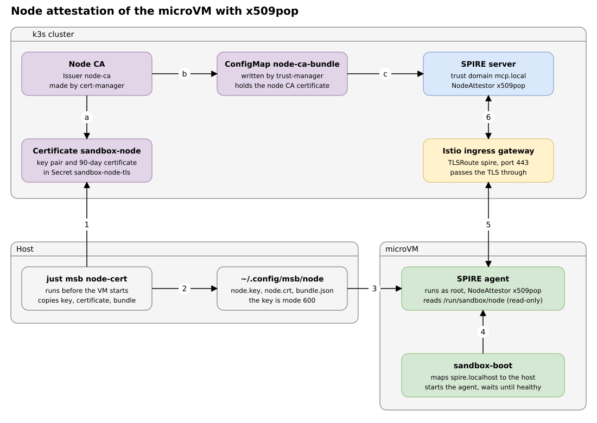
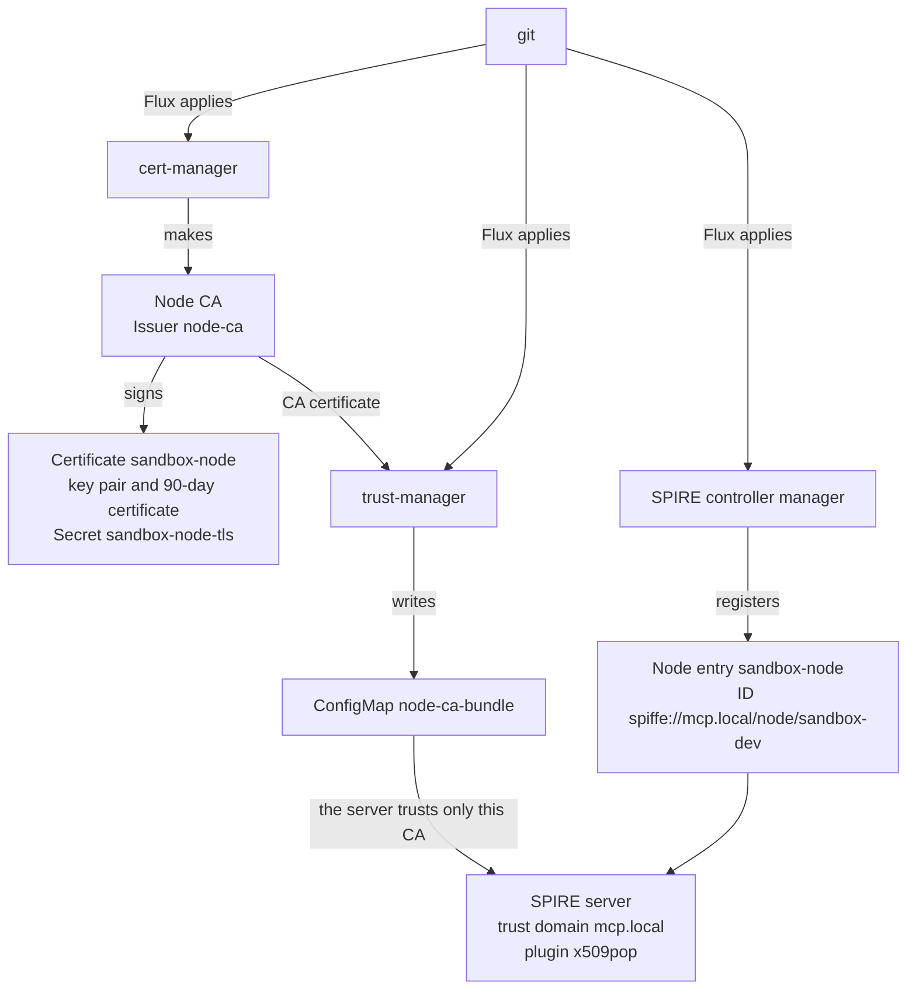
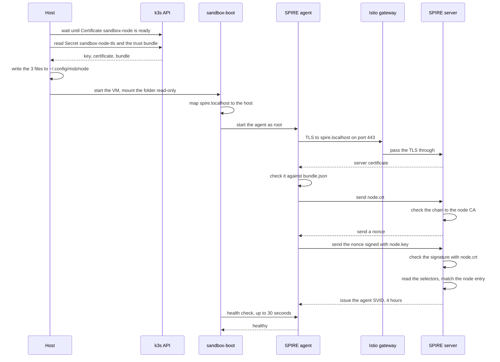
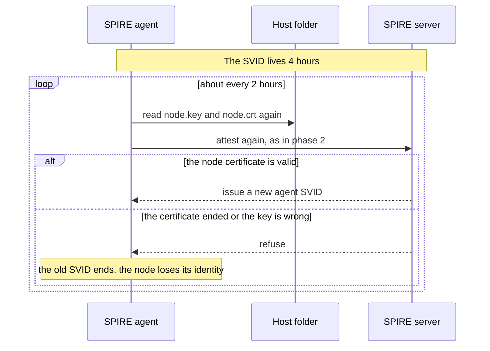

# Primer: node attestation of the microVM

This primer explains the model and the architecture behind the node attestation of the sandbox microVM. Read it first. Then read [Zero trust: node attestation](zero-trust-node-attestation.md) for the detail.

The lists and the diagrams are narrow on purpose. They read well in the GitHub mobile app.

## The idea

1. SPIRE gives an identity (an SVID) only to a machine that it trusts.
2. The microVM is a new machine at each start. No cloud gives it an identity document.
3. So the operator gives the microVM a certificate and a key before it starts. This is the out-of-band step.
4. The SPIRE server trusts one CA, the node CA. A certificate that the node CA signed is a valid node certificate.
5. The certificate alone is not enough. Anyone can copy a certificate. So the agent must also prove that it holds the key. It signs a random value (a nonce) that the server sends.

When the proof passes, the server attests the node. The agent in the microVM now has an identity of its own. This is node attestation.

## The picture



The letters a to d are the prerequisites. Flux applies them once, from git. The numbers 1 to 6 happen at each `just msb run`. The panel below the diagram repeats the steps in words.

## The cast

In the cluster (k3s, on the host):

- **Node CA.** cert-manager makes it. It signs the node certificate.
- **Certificate `sandbox-node`.** cert-manager makes the ECDSA key pair and the 90-day certificate. It keeps both in the Secret `sandbox-node-tls`.
- **ConfigMap `node-ca-bundle`.** trust-manager copies the CA certificate into it. The SPIRE server reads it.
- **SPIRE server.** Checks the certificate and the proof. Issues the agent SVID.
- **Node entry `sandbox-node`.** Gives an attested node the fixed ID `spiffe://mcp.local/node/sandbox-dev`. See below.
- **Istio ingress gateway.** Takes the TLS on port 443 and passes it through to the server.

On the host:

- **`just msb node-cert`.** Waits until the certificate is ready. Copies the key, the certificate and the trust bundle to `~/.config/msb/node`.
- **`~/.config/msb/node`.** The folder that the VM mounts. The key file has mode 600.

In the microVM:

- **`sandbox-boot`.** Maps `spire.localhost` to the host. Starts the agent as root. Waits up to 30 seconds until the agent is healthy.
- **SPIRE agent.** Reads the key and the certificate from the read-only mount `/run/sandbox/node`. Proves that it holds the key.

### The node entry

The node entry is an object in git: `ClusterStaticEntry` `sandbox-node`. Flux applies it. The controller manager of SPIRE copies it into the server.

The entry says: a node that attested with `x509pop` and has the CN `sandbox-dev` and the login `raghav19` in its URI SAN gets the ID `spiffe://mcp.local/node/sandbox-dev`. The server shows it like this:

```text
Entry ID   : mcp-guardrails.15029222-9bc5-4d88-ae6e-68d045a39ef9
SPIFFE ID  : spiffe://mcp.local/node/sandbox-dev
Parent ID  : spiffe://mcp.local/spire/server
Selector   : x509pop:san:github-id:raghav19
Selector   : x509pop:subject:cn:sandbox-dev
```

The agent has its own ID too: `spiffe://mcp.local/spire/agent/x509pop/<hash of the certificate>`. It changes with each new certificate. The node entry gives the node a second ID that stays the same. Workload entries use that ID as their parent.

## The flow in three phases

### Phase 1: the prerequisites, once

Flux applies these objects from git. After that, nobody does anything by hand.



### Phase 2: each VM start

`just msb run` copies the files, starts the VM and waits for the attestation.



If the agent is not healthy after 30 seconds, `sandbox-boot` stops. Then `just msb run` fails and prints the agent log.

### Phase 3: while the VM runs

The agent SVID lives 4 hours. About half-way, the agent rotates it. The `x509pop` plugin allows re-attestation, so the rotation runs the full attestation again. This happens about every 2 hours.



A running agent is not attested again by `just msb run`. The check happens at each start of the VM. The agent keeps itself attested while the VM runs.

## What lives how long

- **Node certificate:** 90 days. cert-manager renews it 30 days before the end and makes a new key.
- **Host folder:** changes only when `just msb node-cert` runs. That happens at each `just msb run`.
- **Agent SVID:** 4 hours on this server (`default_x509_svid_ttl`).
- **Nonce:** one attestation.

The agent reads the key and the certificate again at each attestation. So the certificate in the host folder must be valid at all times.

A leaked key needs a forced rotation. Delete the Secret `sandbox-node-tls`, then run `just msb node-cert`.

## Why the design looks like this

- **cert-manager makes the key pair.** One tool makes the key and the certificate, and renews both. The VM never makes a key.
- **The key lives on the host.** The VM mounts it read-only. The agent runs as root, so the user `agent` (Claude Code) cannot read the key.
- **The gateway passes the TLS through.** The agent checks the server certificate against the trust bundle. Later the agent uses its SVID as its own client certificate. If the gateway opened the TLS, both checks would break.
- **Port 443 and the name `spire.localhost`.** The agent uses the standard port. The gateway picks the route by the name. This is the same model as the other routes of the gateway.
- **A 90-day certificate and no certificate per run.** The agent attests again by itself. So the certificate only needs to stay valid.
- **A node entry with a fixed ID.** The ID of the agent changes with each new certificate. Workload entries need a parent that stays the same.

## The names

- **`mcp.local`** is the trust domain. It is the name of the identity space of this stack. Every ID starts with `spiffe://mcp.local`. The setting `trust_domain` in `config/cloud/k3s/identity.yaml` sets it.
- **SPIFFE ID** is the name of an identity. Example: `spiffe://mcp.local/node/sandbox-dev`.
- **SVID** is the short-lived certificate that SPIRE issues for a SPIFFE ID.
- **SPIRE server** keeps the registration entries and issues the SVIDs. It runs in the cluster.
- **SPIRE agent** runs on the node. It attests the node to the server. Later it serves SVIDs to the workloads of the node.
- **Node attestation** is the proof that the operator approved a node. Here the proof is a certificate and its key. The plugin is `x509pop` (proof of possession of an x509 key).
- **Node CA** signs the node certificate. It is not the CA of SPIRE.
- **Node CA bundle** holds the certificate of the node CA. The server uses it to check node certificates.
- **Trust bundle** (`bundle.json`) holds the certificates of the trust domain. The agent uses it to check the server. The two bundles are different files.
- **Nonce** is a random value. The server sends it. The agent signs it with the node key.
- **Selector** is a fact that the server learns about the node. Here: the CN of the certificate and the login in its URI SAN.
- **Node entry** is a registration entry. It gives an attested node a fixed ID, picked by the selectors.
- **`spire.localhost`** is the name that the agent calls. The gateway picks the route by this name. `sandbox-boot` maps it to the host.
- **TLS passthrough** means that the gateway does not open the TLS. The agent and the server do the handshake with each other.

## Where each part is in the repo

- Node CA: [`platform/addons/spire/node-ca.yaml`](../platform/addons/spire/node-ca.yaml)
- Node certificate: [`platform/addons/spire/node-certificate.yaml`](../platform/addons/spire/node-certificate.yaml)
- Node entry: [`platform/addons/spire/node-entry.yaml`](../platform/addons/spire/node-entry.yaml)
- Gateway route to the server: [`platform/addons/istio-ingress/spire-route.yaml`](../platform/addons/istio-ingress/spire-route.yaml)
- `just msb node-cert`: [`.msb/justfile`](../../../../.msb/justfile)
- Mount of the folder in the VM: [`.msb/vm/sandbox.yaml`](../../../../.msb/vm/sandbox.yaml)
- Configuration of the agent: [`.msb/image/configs/spire/spire-agent.conf`](../../../../.msb/image/configs/spire/spire-agent.conf)
- Start of the agent: [`.msb/image/sandbox-boot`](../../../../.msb/image/sandbox-boot)

## What comes next

After the node attestation, the agent can issue SVIDs to the workloads of the VM. This is the workload attestation. Read [Zero trust: workload attestation](zero-trust-workload-attestation.md).
