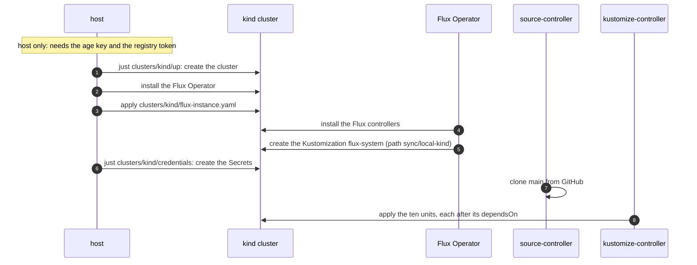
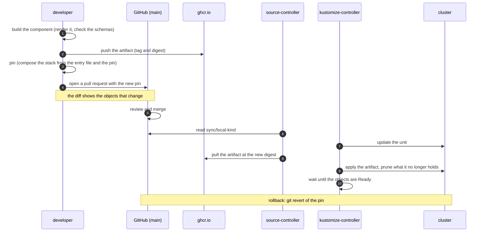
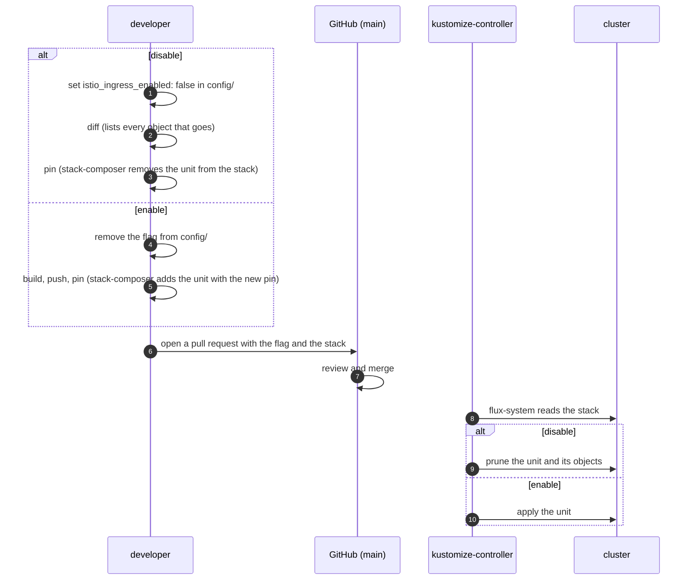

# Part 3: Flux orchestration

How Flux applies Part 3 to a cluster. The components and the traffic flows are in the [architecture](arch.md). The commands are in the [README](../README.md).

## 1. Terms

| Term | Meaning |
|---|---|
| Flux | The GitOps system. It makes the cluster match Git and the registry. |
| Flux Operator | Installs and upgrades the Flux controllers from one object, the `FluxInstance`. |
| `FluxInstance` | The object that holds the Flux version, the controllers and the first sync. One for each cluster. |
| source-controller | Reads Git and the OCI registry. Keeps the artifacts. |
| kustomize-controller | Applies an artifact to the cluster. Removes what is no longer in it. |
| Sync folder | `sync/<name>/`. The folder in Git that Flux reconciles for a cluster. `<name>` is `sync:` in `clusters/<cluster>/cluster.yaml`. |
| Stack | `infra-stack.yaml` in the sync folder. It holds every unit of the cluster. |
| Unit | One component as Flux sees it: an `OCIRepository` and a `Kustomization`. |
| Entry file | `<component>/flux/stack.yaml`. The unit of a component, with `tag: unpinned`. |
| Pin | The tag and the digest in the `OCIRepository` of a unit. They select the artifact that runs. |
| `dependsOn` | A rule of a `Kustomization`: it starts when the units it names are Ready. |
| Step | The depth of a unit in the `dependsOn` graph. It is not a stage. A unit starts as soon as the units it waits for are Ready. |
| Prune | Flux removes an object that is no longer in its source. |

## 2. High-level orchestration


The source is `diagrams/orchestration.drawio`. See [diagrams](diagrams/README.md) to open it in draw.io.

Flux itself is not in the sync folder:

```text
sync/local-kind/                   what Flux reconciles
├── kustomization.yaml
└── infra-stack.yaml               all 10 units
clusters/kind/flux-instance.yaml   Flux itself: applied only by the host
```

- A merge cannot remove the `FluxInstance`. Deleting it uninstalls Flux. The workloads stay.
- The `FluxInstance` has the annotation `kustomize.toolkit.fluxcd.io/prune: disabled`. A sync that once held it cannot prune it.
- A Flux upgrade is an edit of `distribution.version`. Then run `just clusters/kind/up` on the host.
- One stack holds every unit. Each `Kustomization` waits for the units it needs. A second stack returns when a second owner needs one.
- Another cluster has its own `sync/<name>/` folder and its own `flux-instance.yaml`. Run the recipes with `CLUSTER=<name>`.

## 3. Flow A: bring-up



## 4. Flow B: a change reaches the cluster



## 5. Flow C: enable or disable a component


