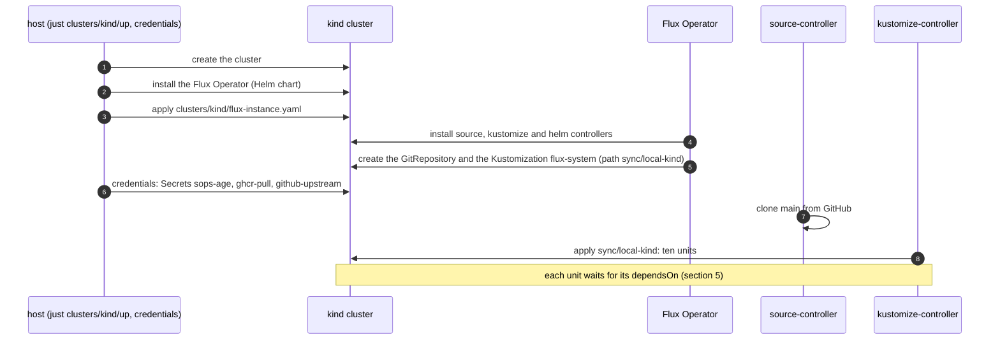
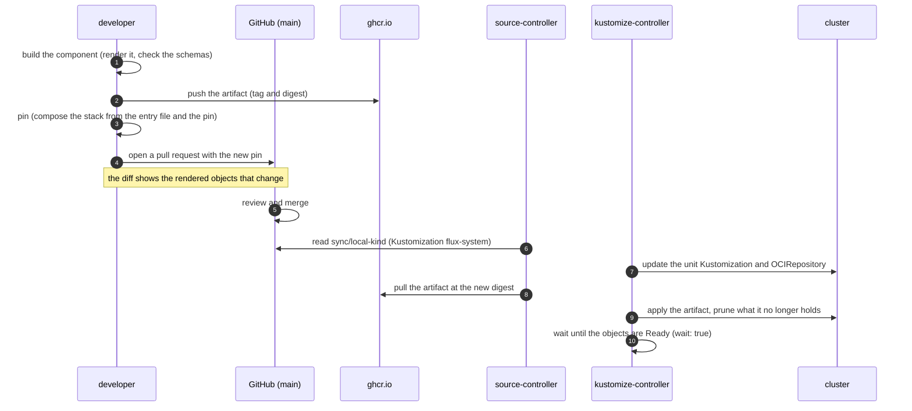
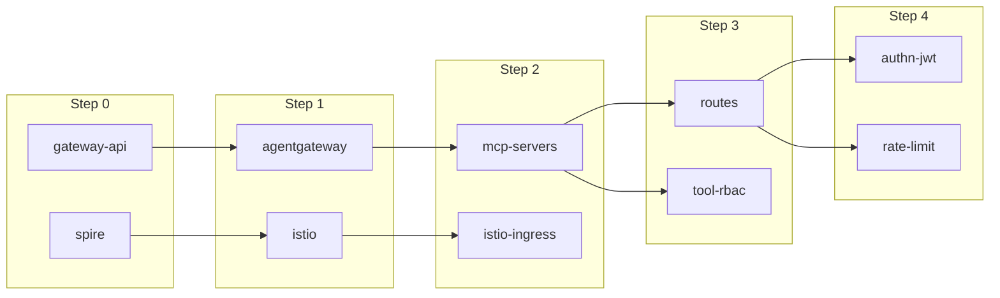
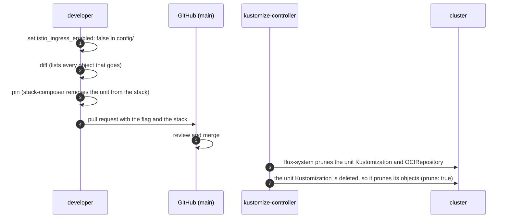

# Part 3: Flux orchestration

How Flux applies Part 3 to a cluster: what syncs, in which order, and how a change reaches the cluster.
The components and the traffic flows are in the [architecture](arch.md). The commands are in the [README](../README.md).

## 1. Terms

| Term | Meaning |
|---|---|
| Flux | The GitOps system. It makes the cluster match what Git and the registry say. |
| Flux Operator | Installs and upgrades the Flux controllers from one object, the `FluxInstance`. |
| `FluxInstance` | The object that holds the Flux version, the controllers, and the first sync. One for each cluster. |
| source-controller | Reads Git and the OCI registry. Keeps the artifacts. |
| kustomize-controller | Applies an artifact to the cluster. Removes what is no longer in it. |
| Sync folder | `sync/<name>/`. The one folder in Git that Flux reconciles for a cluster. `<name>` is `sync:` in `clusters/<cluster>/cluster.yaml`. |
| Stack | `infra-stack.yaml` in the sync folder. It holds every unit of the cluster. |
| Unit | One component as Flux sees it: an `OCIRepository` and a `Kustomization`. |
| Entry file | `<component>/flux/stack.yaml`. The unit of a component, with `tag: unpinned`. |
| Pin | The tag and the digest in the `OCIRepository` of a unit. They select the artifact that runs. |
| `dependsOn` | A rule of a `Kustomization`: it starts only when the named ones are Ready. |
| Step | The depth of a unit in the `dependsOn` graph. It is a way to read the picture, not a stage: a unit starts as soon as the units it waits for are Ready. |
| Prune | Flux removes an object that is no longer in its source. |

## 2. High-level orchestration


The source is `diagrams/orchestration.drawio`. See [diagrams](diagrams/README.md) to open it in draw.io.

| Part | Job | Where |
|---|---|---|
| Git repo (`main`) | Holds `sync/local-kind/infra-stack.yaml`: the units and their pins. | github.com |
| `FluxInstance flux` | Installs the Flux controllers. Creates the first sync. | `flux-system`, applied by the host |
| `Kustomization flux-system` | Reads the sync folder from Git. Creates the units. `prune: true`. | `flux-system` |
| Unit `OCIRepository` | Pulls one artifact by its tag and digest. | `flux-system` |
| Unit `Kustomization` | Applies the artifact. Waits for its `dependsOn`. | `flux-system` |
| ghcr.io | Holds one OCI artifact for each component. The artifact is the rendered manifest. | outside the cluster |

Flux itself is **not** in the sync folder:

```text
sync/local-kind/                   what Flux reconciles
├── kustomization.yaml
└── infra-stack.yaml               all 10 units (20 documents)
clusters/kind/flux-instance.yaml   Flux itself: applied only by the host
```

- A merge cannot remove the `FluxInstance`. Deleting it uninstalls Flux, and the workloads stay.
- The object has the annotation `kustomize.toolkit.fluxcd.io/prune: disabled`. A sync that once held it cannot prune it.
- The cost: a Flux upgrade is an edit of `distribution.version` and then `just clusters/kind/up` on the host. It is not a merge.

## 3. Flow A: bring-up

The host creates the cluster and hands it to Flux. After that, Git drives the cluster.
The sandbox cannot do these steps: they need the age key and the registry token on the host.



The Secrets are created by the host and are in no artifact. `ghcr-pull` lets each `OCIRepository` pull from ghcr.io.

## 4. Flow B: a change reaches the cluster

A change is a merged pull request. The merge changes the pin of a unit in the stack. Flux does the rest.



- **The pin decides what runs.** The `OCIRepository` has a tag and a digest. Flux pulls the digest. A change of the tag alone changes nothing.
- **Rollback** is `git revert` of the pin. Flux pulls the old digest and applies it.
- **`pin` writes the stack.** Do not edit it by hand. See "Disable a component" in the README for what `pin` does.
- **The intervals.** An `OCIRepository` checks every 5 minutes, and a `Kustomization` reconciles every 10 minutes. After a failure, a `Kustomization` retries after 1 minute.

## 5. Flow C: dependencies and apply order

Each unit has `dependsOn`. A unit starts as soon as every unit it names is Ready. It does not wait for the rest of the previous step: `istio` needs only `spire`, so it can start before `gateway-api` is Ready.



An arrow means "the target waits for the source". The pictures show the direct waits that the chain does not already give. `routes` also lists `agentgateway`, and `istio-ingress` also lists `spire`. `mcp-servers` and `istio` already wait for those, so the order is the same, and the pictures leave the two arrows out. The table lists every `dependsOn`. The same graph is in the diagram of section 2.

| Unit | Waits for | Why |
|---|---|---|
| `gateway-api` | none | Installs the Gateway API CRDs. |
| `spire` | none | Issues the identities (trust domain `mcp.local`). |
| `agentgateway` | `gateway-api` | Its gateway and routes use the Gateway API CRDs. |
| `istio` | `spire` | `istiod` takes its CA from SPIRE. |
| `istio-ingress` | `istio`, `spire` | Needs the injection webhook of `istiod` and an identity from SPIRE. |
| `mcp-servers` | `agentgateway` | The backend is an `agentgateway` object, in its namespace. |
| `routes` | `agentgateway`, `mcp-servers` | The route points at the gateway and at the backend. |
| `tool-rbac` | `mcp-servers` | The policy attaches to `AgentgatewayBackend mcp-federated`. |
| `authn-jwt`, `rate-limit` | `routes` | The policies attach to `HTTPRoute mcp`. |

- **Ready means healthy.** Every unit has `wait: true`: the `Kustomization` is Ready only when the objects it applied are healthy. `routes` also checks that the `Gateway` is `Programmed`.
- **Timeouts** are 2 to 5 minutes for each unit. A unit that does not become Ready in time fails, and the units that wait for it do not start.
- **The ext-mcp group** is not in the stack at present. It returns after `mcp-servers`, in the order the [README](../README.md#apply-order) shows.
- **One owner.** Every unit runs as `cluster-admin`, the service account of the Flux sync. The order comes from `dependsOn`. It is not a permission boundary.

## 6. Flow D: disable a component

A flag in `config/` removes a component. The pin of the unit leaves the stack, and Flux removes its objects.



- The checks of `pin` stop a disable that leaves a `dependsOn` open: the message names the units that still wait.
- CRDs stay. Flux does not prune them. Run `just clusters/kind/delete-crds`.
- Removing a namespace removes its volumes. Put `kustomize.toolkit.fluxcd.io/prune: disabled` on an object that must stay.
- The removal by Flux of the objects of a disabled unit is not yet tested on the cluster. The Flux documentation says that deleting a `Kustomization` with `prune: true` removes its objects.

## 7. Why this layout

| Decision | Reason | Source |
|---|---|---|
| One sync folder for each cluster | The Flux guide gives each cluster its own folder. | [Repository structure](https://fluxcd.io/flux/guides/repository-structure/) |
| One `Kustomization` for each component, ordered by `dependsOn` | The Flux example orders `infra-controllers`, `infra-configs` and `apps` the same way. The configs need the CRDs that the controllers install. | [flux2-kustomize-helm-example](https://github.com/fluxcd/flux2-kustomize-helm-example) |
| One stack, not two | One owner, and no restricted service account. A second stack comes back with a second owner. The tiers are ordered by `dependsOn`, not by folders. | [Multi-tenancy](https://fluxcd.io/flux/installation/configuration/multitenancy/) |
| One artifact for each component | The ControlPlane reference architecture does the same. | [d2-infra](https://github.com/controlplaneio-fluxcd/d2-infra) |
| `FluxInstance` apart from the synced folder | It has its own life cycle, its name cannot change, and deleting it uninstalls Flux. | [FluxInstance](https://fluxoperator.dev/docs/crd/fluxinstance/) |
| Pins in Git | A rollout and a rollback are a pull request. The cluster does not follow a moving tag. | [d2-fleet](https://github.com/controlplaneio-fluxcd/d2-fleet) |

Not found in the sources:

- A rule for the name of a region folder. `aws-dev-us-east-1` is a choice of this repo.
- Whether the `FluxInstance` belongs inside or outside the synced path. The Flux example and the ControlPlane reference keep it inside. Nothing forbids the other way.
- How the ControlPlane reference orders units of different repositories.
