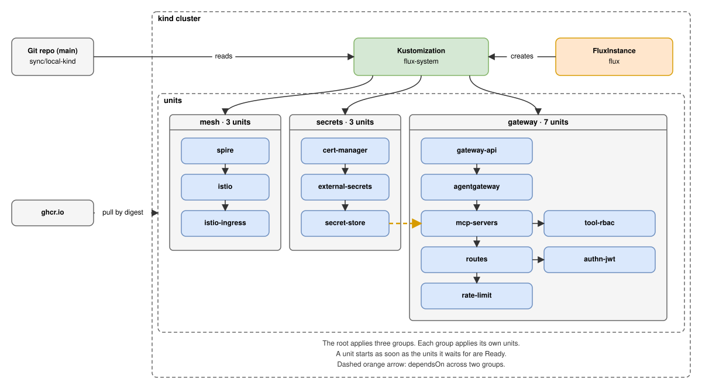
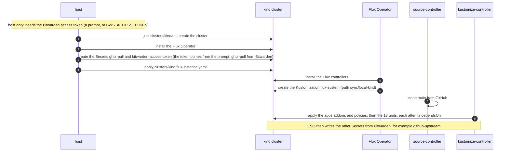
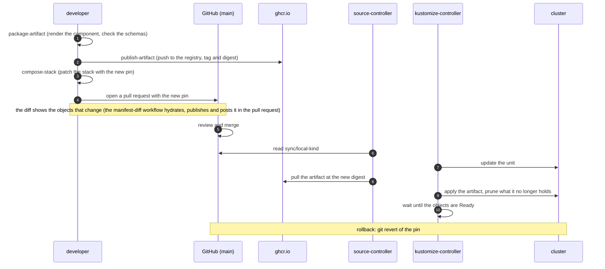
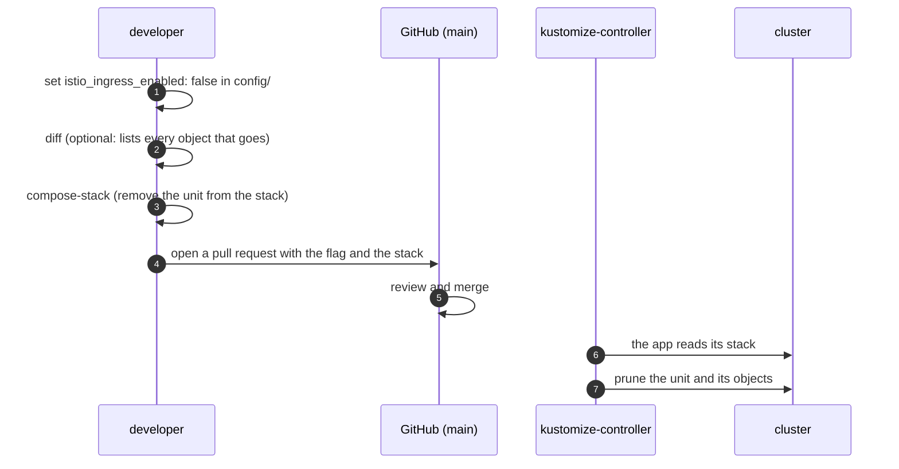
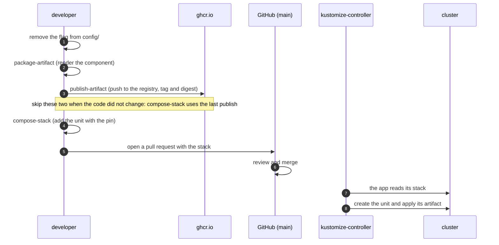

# Orchestration

## 1. Terms

| Term | Meaning |
|---|---|
| Flux | The GitOps system. It makes the cluster match Git and the registry. |
| Flux Operator | Installs and upgrades the Flux controllers from one object, the `FluxInstance`. |
| `FluxInstance` | The object that holds the Flux version, the controllers and the first sync. One for each cluster. |
| source-controller | Reads Git and the OCI registry. Keeps the artifacts. |
| kustomize-controller | Applies an artifact to the cluster. Removes what is no longer in it. |
| Sync folder | `sync/<name>/`. The folder in Git that Flux reconciles for a cluster. `<name>` is `sync:` in `clusters/<cluster>/cluster.yaml`. |
| Root | The `Kustomization flux-system`. The `FluxInstance` creates it. It applies the sync folder. |
| App | A group of units. A `Kustomization` in `apps.yaml` that applies the stack of its folder: `addons` or `policies`. |
| Stack | `infra/<app>/stack.yaml` in the sync folder. It holds the units of one app. |
| Unit | One component as Flux sees it: an `OCIRepository` and a `Kustomization`. |
| Entry file | `<component>/flux/stack.yaml`. The unit of a component, with `tag: unpinned`. |
| Pin | The tag and the digest in the `OCIRepository` of a unit. They select the artifact that runs. |
| `dependsOn` | A rule of a `Kustomization`: it starts when the units it names are Ready. |
| Step | The depth of a unit in the `dependsOn` graph. It is not a stage. A unit starts as soon as the units it waits for are Ready. |
| Prune | Flux removes an object that is no longer in its source. |

## 2. High-level orchestration



The source is `diagrams/orchestration.drawio`. See [diagrams](diagrams/README.md) to open it in draw.io.

Flux itself is not in the sync folder:

```text
sync/local-kind/                   what Flux reconciles
├── kustomization.yaml
├── apps.yaml                      the apps: addons, policies (dependsOn addons)
└── infra/
    ├── addons/stack.yaml          10 units
    └── policies/stack.yaml        3 units
clusters/kind/flux-instance.yaml   Flux itself: applied only by the host
```

- A merge cannot remove the `FluxInstance`. Deleting it uninstalls Flux. The workloads stay.
- The `FluxInstance` has the annotation `kustomize.toolkit.fluxcd.io/prune: disabled`. A sync that once held it cannot prune it.
- A Flux upgrade is an edit of `distribution.version`. Then run `just clusters/kind/up` on the host.
- The cluster has two apps. `addons` holds 10 units and `policies` holds 3. `policies` waits for `addons`. Each unit waits for the units it needs.
- A component in `platform/policies/` is in `policies`. Every other component is in `addons`. The first real workload becomes a third app: add it to `apps.yaml` with `dependsOn` on `addons` and `policies`, and add a folder next to `infra/`.
- The apps have `deletionPolicy: Orphan`. Removing an app from `apps.yaml` leaves its units running. Flux does not delete in `dependsOn` order, so a delete of an app would remove all its units at once. To remove an app, disable its units first, the ones nothing waits for first (`compose-stack` refuses the others), then remove the app.
- Another cluster has its own `sync/<name>/` folder and its own `flux-instance.yaml`. Run the recipes with `CLUSTER=<name>`.

## 3. Flow A: bring-up



## 4. Flow B: a change reaches the cluster



## 5. Flow C: enable or disable a component

### Disable



### Enable


