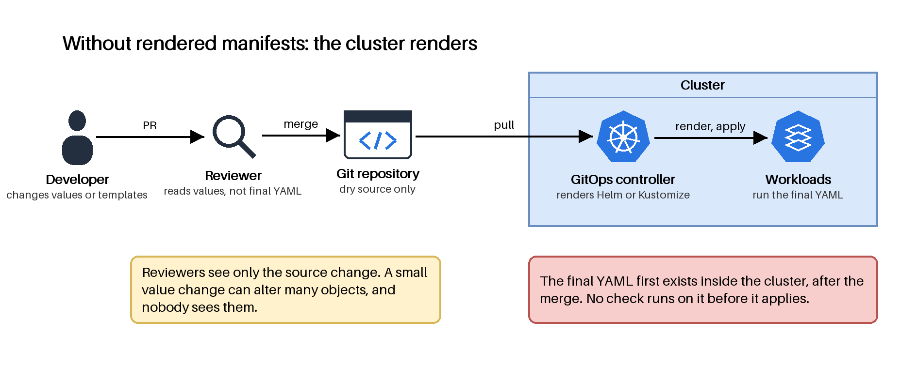
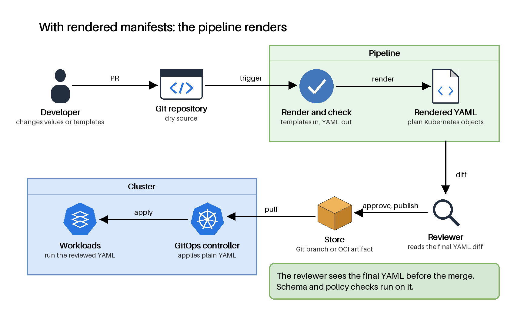
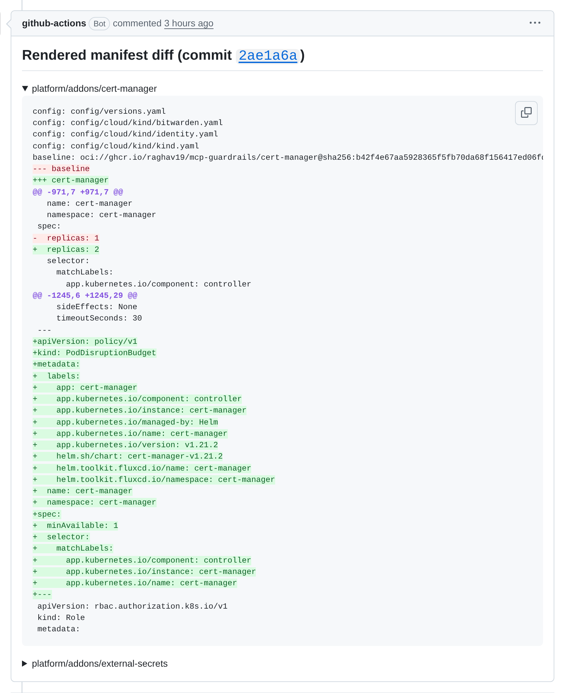
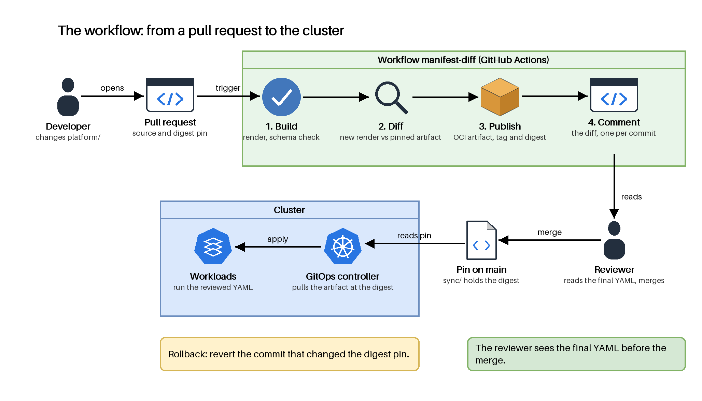

# Part 3: the rendered manifest pattern

## 1. What the pattern is

A rendered manifest is the final Kubernetes YAML. A tool such as Helm or Kustomize makes it from a template or an overlay.

The pattern renders the manifests before deployment, in a pipeline. The GitOps controller then applies plain YAML and renders nothing.


## 2. Diagrams

### Without rendered manifests

The cluster renders the templates after the merge. The reviewer sees only the source change.



### With rendered manifests

A pipeline renders and checks the YAML before the merge. The reviewer sees the final YAML. The controller applies it.



The sources are `diagrams/rendered-manifest-without.drawio` and `diagrams/rendered-manifest-with.drawio`. See [diagrams](diagrams/README.md).

## 3. With and without: comparison

| Criterion | Without rendered manifests | With rendered manifests |
|---|---|---|
| Where the render runs | In the cluster, at sync time. | In a pipeline, before the merge. |
| What the reviewer reads | Values and templates. A template with its parameters is "considerably less readable than the expanded result". | The diff of the final YAML. |
| Checks on the final objects | None before apply. The objects do not exist yet. | Schema and policy tools run before the merge. |
| Supply chain | Generation from Git "can't be provenance secured with Cosign". | A stored artifact can be signed. The controller can verify it. |
| Rollback | Revert the source. The cluster renders again | Revert the change that selects the rendered files |
| Cost | The cluster runs the render tools. | One more pipeline. No Helm hooks. No Secrets in rendered YAML. |

## 4. Getting started

Part 3 renders each component in a pipeline and shows the rendered diff in the pull request. Follow these steps to see it.

### See the rendered manifest in a pull request

1. Change a file under `platform/`. For example, change a Helm value in `platform/addons/cert-manager/cert-manager.yaml`.
2. Push the branch and open a pull request. The workflow `manifest-diff` starts. It starts only for changes under `platform/`.
3. Wait for the job to finish. It runs three steps: Build, Diff and Publish.
4. Open the pull request. The bot posts one comment for each commit. The comment has one block for each changed component. Each block is the diff of the final YAML.
5. Read the diff. A change of one Helm value shows the objects that the chart renders, for example a changed Deployment or a new PodDisruptionBudget.

A diff over 60,000 characters does not fit in a comment. The comment then holds a note and a link to the run. The job summary of the run has the full diff.

Example: [pull request 130](https://github.com/raghav19/engineersdaybook/pull/130) changes two Helm values. The screenshot shows its comment with the `cert-manager` block open. The diff has the changed Deployment (`replicas: 1` to `replicas: 2`) and the new PodDisruptionBudget. The `external-secrets` block is closed.



### See the rendered manifest on your machine

1. Install the tools: `mise trust && mise install`.
2. Run these commands in `code/mcp-sandbox/part-3-mcp-guardrails`:

   ```shell
   just platform/addons/cert-manager/package-artifact   # render, then check against the schemas
   just platform/addons/cert-manager/diff               # compare with the artifact that origin/main pins
   ```

3. Open `out/cert-manager/manifests.yaml`. This file is the rendered manifest. It holds the plain Kubernetes objects, with the chart inflated.

The `diff` recipe pulls the pinned artifact from `ghcr.io`. It needs the registry credentials that `lib/workflow/common.just` reads. `package-artifact` needs no credentials.

### The workflow as a flow

The workflow runs three steps and one comment. The reviewer reads the comment before the merge. After the merge, the GitOps controller applies the artifact that the digest pin names.



Git does not hold the rendered manifest. The pipeline publishes it as an OCI artifact, and Git holds only the digest pin in `sync/`.

Not in place yet:
- Artifact signing and signature verification.
- A policy engine on the rendered output. Only schema checks run.
- A workflow trigger for changes in `config/`. The workflow starts only for changes in `platform/`.
