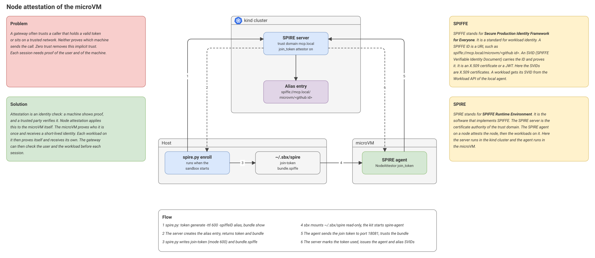
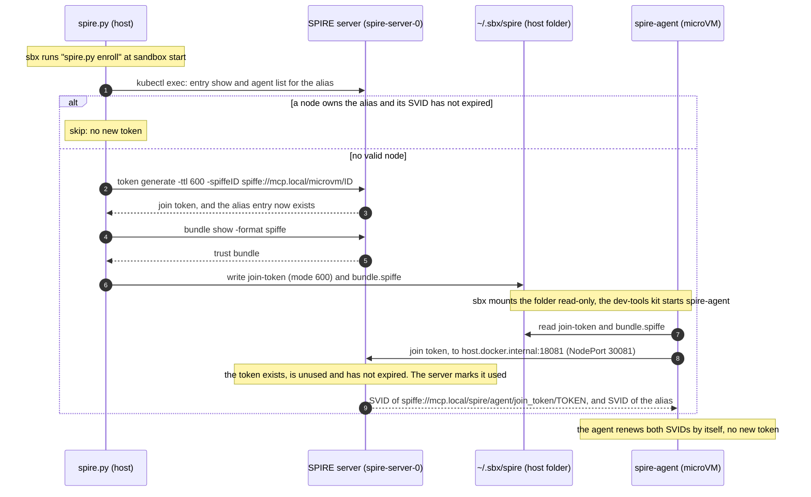
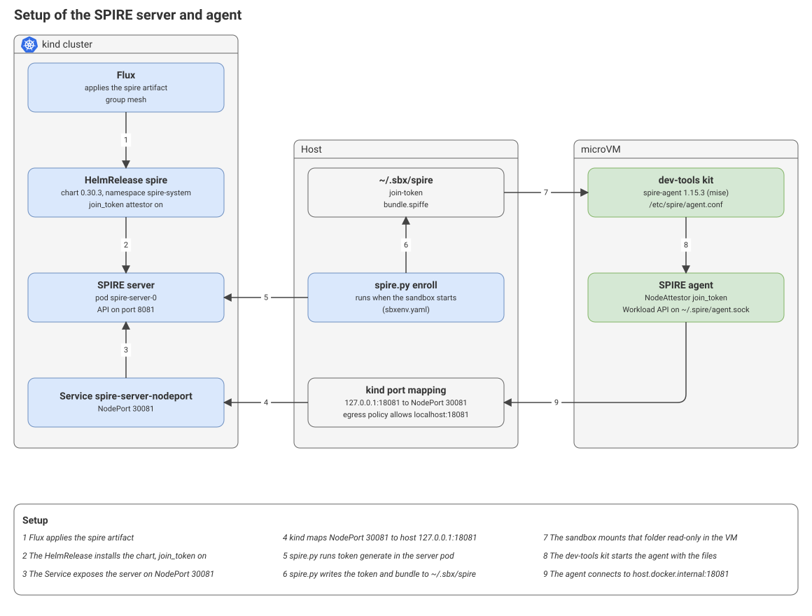

# Zero trust: node attestation

## 1. What node attestation is

Node attestation is the first proof in SPIRE. A node proves who it is to the SPIRE server. The server then issues an SVID to the SPIRE agent of that node.

In part 3, the node is the sandbox microVM. The agent that runs in the microVM joins the SPIRE server of the kind cluster with a one-time join token.

Workload attestation comes after it. A process on the node asks the agent for an SVID, and the agent checks the process. This page covers only the node step.

## 2. The problem and the purpose

The gateway must serve only trusted callers. A JWT proves the user. It does not prove the machine. A stolen JWT works from any machine.

Node attestation adds the machine. A call that comes from an unknown microVM has no SVID, so it can fail at the gateway. The node proof is the first guardrail of the chain.

Zero trust asks for the same thing. No network position gives trust. Each caller proves its identity, and a policy decides the access. This is the tenet of dynamic policy in NIST [CSWP 20](https://nvlpubs.nist.gov/nistpubs/CSWP/NIST.CSWP.20.pdf), which repeats SP 800-207.

Node attestation alone blocks no call. It makes the identity. A gateway policy must use it.

## 3. Architecture



### Flow



## 4. Setup



## 5. A better node attestor: x509pop

A join token proves that an operator allowed the node. It does not prove more, and it gives the node no selectors.

A better proof is `x509pop`. The node shows an X.509 certificate from a CA that you control. It also proves that it holds the private key.

How it is better here:

- **A copy is not enough.** A copied join token lets another machine join as the node. A copied certificate does not, because the agent must also sign a challenge with the private key.
- **No token for each start.** The certificate can attest again. A new VM does not need a new token from `spire.py`.
- **Selectors.** The certificate can carry facts about the microVM. SPIRE turns them into node selectors. One node entry can then match every node with the same selectors.

| Selector | What it can say about the microVM |
|---|---|
| `x509pop:subject:cn:<name>` | The sandbox name. |
| `x509pop:san:<key>:<value>` | The GitHub id of the user. |
| `x509pop:ext:oid:<OID>:<value>` | The pin of a kit or an image. You define the extension. |
| `x509pop:group:<value>` | A group that SPIRE derives from a template. `allowed_groups` limits the values. |
| `x509pop:ca:fingerprint:<sha1>` | The CA that issued the certificate. |
| `x509pop:serialnumber:<hex>` | The leaf certificate. |

The values are only as trustworthy as the issuing policy of the CA. The CA must decide when to issue a certificate to a microVM.

Source: the [x509pop server plugin](https://github.com/spiffe/spire/blob/main/doc/plugin_server_nodeattestor_x509pop.md) and the [agent plugin](https://github.com/spiffe/spire/blob/main/doc/plugin_agent_nodeattestor_x509pop.md).

## 6. See it on your machine

On the host, go to the root of the repo and make a token. Use the numeric GitHub id of your account.

```bash
export SANDBOX_GITHUB_ID=$(gh api user --jq .id)
.sbx/agent/spire.py enroll
```

In the microVM, check the agent:

```bash
spire-agent healthcheck -socketPath /home/agent/.spire/agent.sock
grep -E "SVID loaded|Creating X509-SVID" ~/.spire/agent.log
```

On the host, list the attested agents:

```bash
kubectl -n spire-system exec spire-server-0 -c spire-server -- /opt/spire/bin/spire-server agent list
```

To remove the node, evict it on the host. This also removes its alias entry:

```bash
kubectl -n spire-system exec spire-server-0 -c spire-server -- /opt/spire/bin/spire-server agent evict -spiffeID <agent SPIFFE ID>
```
