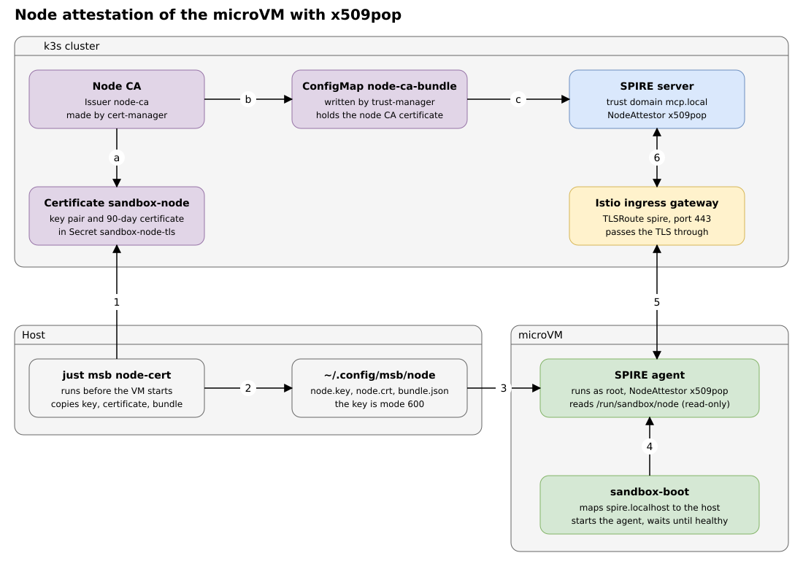
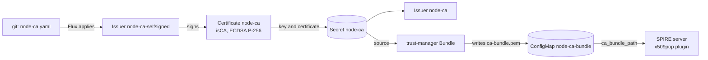
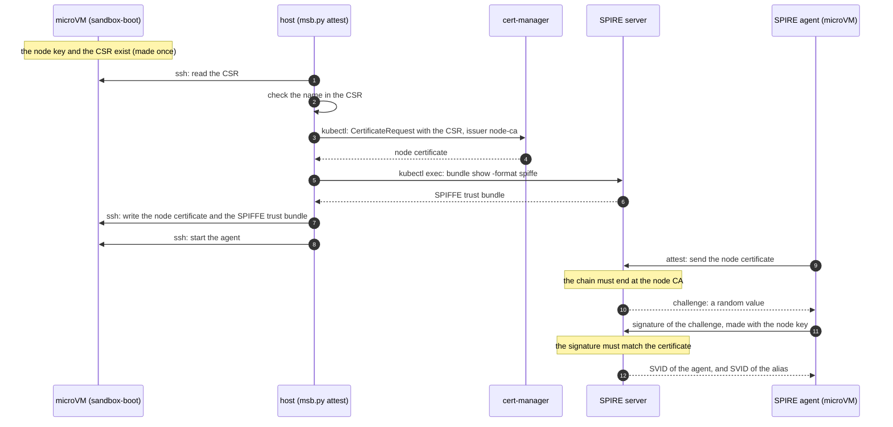
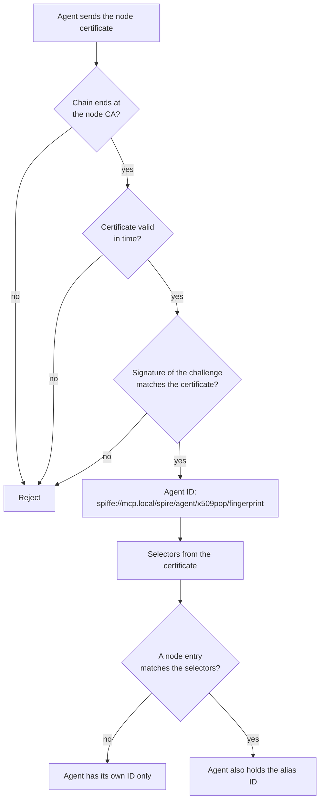
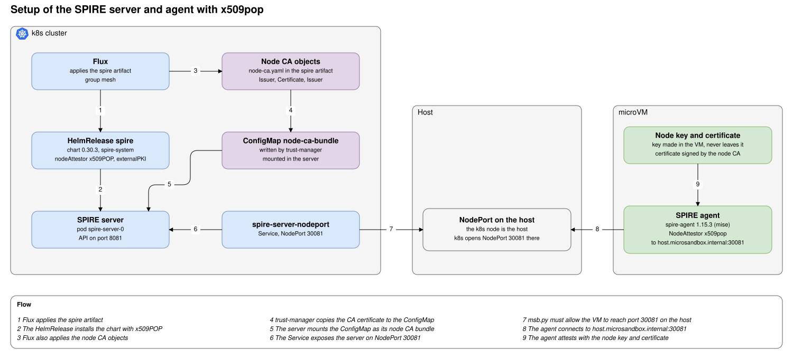

# Zero trust: node attestation

> **Status: design.** The microVM of the msb sandbox does not attest yet. This page describes the target flow with the SPIRE node attestor `x509pop`. Section 10 shows which parts exist. The join-token flow of the Docker sbx sandbox is in the git tag [`docker-sbx`](https://github.com/raghav19/engineersdaybook/tree/docker-sbx).

## 1. What node attestation is

Node attestation is the first proof in SPIRE. A node proves who it is to the SPIRE server. The server then issues an SVID to the SPIRE agent of that node.

In part 3, the node is the sandbox microVM. The agent that runs in the microVM joins the SPIRE server of the kind cluster. It shows a certificate that a CA of this cluster signed. It also proves that it holds the private key of that certificate.

Workload attestation comes after it. A process on the node asks the agent for an SVID, and the agent checks the process. This page covers only the node step.

## 2. The problem and the purpose

The gateway must serve only trusted callers. A JWT proves the user. It does not prove the machine. A stolen JWT works from any machine.

Node attestation adds the machine. A call that comes from an unknown microVM has no SVID, so it can fail at the gateway. The node proof is the first guardrail of the chain.

Zero trust asks for the same thing. No network position gives trust. Each caller proves its identity, and a policy decides the access. This is the tenet of dynamic policy in NIST [CSWP 20](https://nvlpubs.nist.gov/nistpubs/CSWP/NIST.CSWP.20.pdf), which repeats SP 800-207.

Node attestation alone blocks no call. It makes the identity. A gateway policy must use it.

## 3. Terms

| Term | Meaning here |
|---|---|
| SPIFFE ID | A URI that names an identity. Example: `spiffe://mcp.local/spire/agent/x509pop/<fingerprint>`. |
| SVID | A short-lived X.509 certificate that carries a SPIFFE ID. The SPIRE server signs it. |
| SPIRE server | The CA of the trust domain `mcp.local`. It runs in the kind cluster, in the namespace `spire-system`. |
| SPIRE agent | It runs on the node, here in the microVM. It attests the node, then the workloads on it. |
| Node CA | A CA that signs node certificates only. It is not the CA of the SPIRE server. cert-manager makes it. |
| CSR | A certificate signing request. The VM sends its public key and the name it asks for. The private key stays in the VM. |
| Node certificate | The certificate that the node CA signs for the VM. It shows who the VM is. |
| Proof of possession | The agent signs a random challenge with its private key. Only the holder of the key can do this. |
| Node CA bundle | The certificate of the node CA. The SPIRE server uses it to check node certificates. |
| SPIFFE trust bundle | The certificate of the SPIRE server. The agent uses it to trust the server. It is not the node CA bundle. |
| Selector | A fact that the server learns about an attested node. Example: `x509pop:subject:cn:microvm-123`. |
| Node entry (alias) | A registration entry that gives a node a fixed SPIFFE ID. The server picks the node by its selectors. Workload entries use it as parent. |

## 4. The flow



### The parts

| Part | Where | Job |
|---|---|---|
| cert-manager | `cert-manager` namespace | Makes the node CA, and signs a node certificate for each request. |
| Node CA objects | `spire-system`, from git | An `Issuer`, a CA `Certificate` and the `Issuer` `node-ca`. |
| trust-manager | `cert-manager` namespace | Copies the node CA certificate into a ConfigMap. |
| SPIRE server | `spire-system` | Checks the node certificate with the `x509pop` plugin. |
| `msb.py attest` | host | Signs the CSR of the VM and sends the files to the VM. |
| `sandbox-boot` | microVM | Makes the node key and the CSR. |
| SPIRE agent | microVM | Sends the certificate and signs the challenge. |

### Stage A: setup, once

Flux applies these steps from git. Nobody types a command.



1. Flux applies `node-ca.yaml`. A self-signed `Issuer` signs the CA `Certificate`. The result is the Secret `node-ca`.
2. The `Issuer` `node-ca` uses that Secret to sign other certificates.
3. A trust-manager `Bundle` copies the CA certificate (not the key) into the ConfigMap `node-ca-bundle`.
4. The SPIRE server mounts the ConfigMap. Its `x509pop` plugin reads it as `ca_bundle_path`.

### Stage B: each VM start



1. The VM makes its key and a CSR when no key exists. The key never leaves the VM.
2. The host reads the CSR over ssh. It checks that the name in the CSR is the one it expects.
3. The host applies a `CertificateRequest` with that CSR. cert-manager signs it and returns the node certificate.
4. The host reads the SPIFFE trust bundle from the SPIRE server.
5. The host writes the certificate and the bundle into the VM over ssh, then starts the agent.
6. The agent sends the certificate to the server. The server checks the chain, then sends a challenge.
7. The agent signs the challenge with its key. The server checks the signature.
8. The server issues the SVID of the agent. A node entry that matches the selectors also gives the alias SVID.

### Stage C: after the attestation

- The agent renews its SVIDs by itself. It needs no new certificate for this.
- The node certificate is short-lived. A restart of the agent after expiry needs a new certificate. The next `just msb run` signs one.
- The old agent IDs stay in the server until they expire or you evict them.

## 5. What the server checks



The agent ID has the SHA1 fingerprint of the certificate. It changes with each new certificate. This is why the workload entries use the alias as parent and not the agent ID.

The selectors that the plugin gives (SPIRE v1.15.3):

| Selector | What it says | Source in the certificate |
|---|---|---|
| `x509pop:subject:cn:<name>` | The name of the VM. | Common name |
| `x509pop:san:<key>:<value>` | A fact, such as the GitHub id. | A URI SAN of the form `x509pop://mcp.local/<key>/<value>` |
| `x509pop:ca:fingerprint:<sha1>` | The CA that signed it. | Each certificate of the chain after the leaf |
| `x509pop:serialnumber:<hex>` | The leaf certificate. | Serial number |

The values are only as trustworthy as the rule that issues the certificate. See section 8.

## 6. Who holds what

| Item | Made by | Where it lives | Who can read it |
|---|---|---|---|
| Node CA key | cert-manager | Secret `node-ca` in `spire-system` | cert-manager, and every user who can read Secrets in `spire-system` |
| Node CA certificate | cert-manager | The Secret, and the ConfigMap `node-ca-bundle` | Public |
| Node private key | The microVM | The microVM only | The user `agent` in the microVM |
| CSR | The microVM | The microVM, and a copy in the `CertificateRequest` | Public |
| Node certificate | cert-manager | The microVM, and the `CertificateRequest` | Public. It is useless without the key. |
| SPIFFE trust bundle | The SPIRE server | The microVM | Public |
| SVID of the agent, and its key | The SPIRE agent | The data folder of the agent in the microVM | The user `agent` in the microVM |

## 7. Why x509pop

| | Join token | `sshpop` | `x509pop` |
|---|---|---|---|
| What the node shows | A one-time secret | An SSH certificate | An X.509 certificate |
| A copy of the proof works on another machine | Yes, once, until it expires | No. The node must hold the key. | No. The node must hold the key. |
| New secret for each start | Yes | No | No |
| Selectors for a node entry | None | None listed in the plugin docs | CN, SAN, CA fingerprint, serial number |
| Switch in the SPIRE Helm chart | `nodeAttestor.joinToken` | None (checked in chart 0.30.3, 0.30.4 and `main`) | `nodeAttestor.x509POP`, mode `externalPKI` |

`sshpop` is a built-in plugin of SPIRE, but the chart cannot turn it on. The chart option `customPlugins` accepts only external plugin binaries. `x509pop` has a chart switch and it gives selectors, so it fits this repo.

The research behind the choice is in [docs/research/spire-node-attestation.md](../../../docs/research/spire-node-attestation.md).

## 8. Limits

- **The CA signs what the CSR asks for.** The host script checks the name in the CSR before it applies the `CertificateRequest`. A user who can create a `CertificateRequest` in `spire-system` skips this check. That user can ask for any name.
- **The CA key is a Secret in `spire-system`.** A user who can read Secrets there can sign any node certificate.
- **The GitHub id is a claim of the host.** The CA does not check it against GitHub. The host script reads it from the logged-in user.
- **Evict does not block a node.** The node can attest again with the same certificate until it expires. A short certificate life limits this. A new node CA ends it for all nodes.
- **The plugin docs list no revocation check.**
- **A removed node keeps its SVID until it expires.**
- **The values of the selectors are only as good as the issuing rule.** The plugin trusts the CA.

## 9. See it on your machine

Each check belongs to one part of the chain. A check works when its part exists (section 10).

**Part 1: the node CA.** On the host:

```bash
kubectl -n spire-system get issuer,certificate
kubectl -n spire-system get secret node-ca -o jsonpath='{.data.tls\.crt}' | base64 -d | openssl x509 -noout -subject -dates
```

Expect `node-ca-selfsigned` and `node-ca` as `Ready`. Expect the subject `mcp.local node CA`.

**Part 2: the bundle.**

```bash
kubectl -n spire-system get configmap node-ca-bundle -o jsonpath='{.data.ca-bundle\.pem}' | openssl x509 -noout -subject
```

Expect the same subject as the CA.

**Part 3: the server.**

```bash
kubectl -n spire-system get configmap spire-server -o jsonpath='{.data.server\.conf}' | grep -A3 x509pop
```

Expect `mode` `external_pki` and the path of the bundle.

**Parts 4 and 5: the agent.** In the microVM:

```bash
spire-agent healthcheck -socketPath /home/agent/.spire/agent.sock
grep -E "Node attestation was successful|SVID loaded" ~/.spire/agent.log
```

On the host, list the attested agents:

```bash
kubectl -n spire-system exec spire-server-0 -c spire-server -- /opt/spire/bin/spire-server agent list
```

Expect `spiffe://mcp.local/spire/agent/x509pop/<fingerprint>` and the selectors of section 5.

**Two tests that must fail:**

1. Remove the node certificate in the microVM and restart the agent. The attestation must fail.
2. Sign a certificate with another CA and use it in the microVM. The server must reject it.

To remove the node, evict it on the host. Then wait for the node certificate to expire:

```bash
kubectl -n spire-system exec spire-server-0 -c spire-server -- /opt/spire/bin/spire-server agent evict -spiffeID <agent SPIFFE ID>
```

## 10. Status of the chain

| # | Part | State |
|---|---|---|
| 0 | This page and the diagrams | done |
| 1 | The node CA (cert-manager) | planned |
| 2 | trust-manager and the node CA bundle | planned |
| 3 | `x509pop` on the SPIRE server, and the node entry | planned |
| 4 | The node key and the CSR in the microVM, and the agent config | planned |
| 5 | `msb.py attest` on the host | planned |
| 6 | Cleanup of the other pages | planned |

## 11. Setup of the SPIRE server and agent


